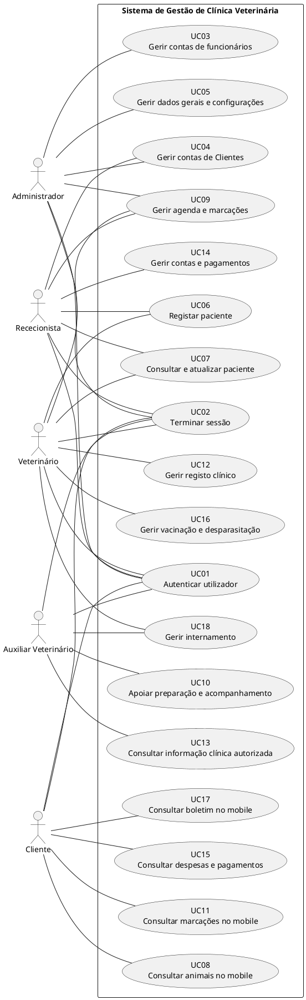

# Especificações dos Casos de Uso

**Projeto:** Gestão de Clínica Veterinária  
**Grupo:** G08  
**Milestone:** m2  
**Versão:** v01

---

## 0. Fronteira do sistema e diagrama geral de casos de uso

O sistema possui dois canais de utilização dentro da sua fronteira funcional:

- **Aplicação web**, utilizada pelos perfis internos Administrador, Rececionista, Veterinário e Auxiliar Veterinário, de acordo com as permissões definidas nos requisitos.
- **Aplicação móvel**, utilizada exclusivamente pelo Cliente (Proprietário do animal) para as funcionalidades de consulta previstas.

As integrações e funcionalidades declaradas fora do âmbito na Especificação de Requisitos não fazem parte da fronteira funcional representada neste documento.

### 0.1. Atores

- Administrador
- Rececionista
- Veterinário
- Auxiliar Veterinário
- Cliente (Proprietário do animal)

### 0.2. Diagrama geral de casos de uso

---

# 1. UC01 — Autenticar utilizador

**Objetivo:**  
Permitir que um utilizador registado inicie sessão no sistema e obtenha acesso às funcionalidades autorizadas para o respetivo perfil.

**Atores:**  
Administrador, Rececionista, Veterinário, Auxiliar Veterinário e Cliente.

**Requisitos relacionados:**  
RF001, RF002, RF004, RF005, RNF001, RNF003, RNF006.

## Precondições

- O utilizador possui uma conta registada.
- A conta possui acesso permitido.
- O sistema encontra-se acessível através da rede.

## Fluxo principal

1. O utilizador acede ao ecrã de autenticação.
2. O utilizador introduz as respetivas credenciais.
3. O sistema valida as credenciais.
4. O sistema verifica se a conta possui acesso permitido.
5. O sistema identifica o perfil associado à conta.
6. O sistema inicia a sessão.
7. O sistema disponibiliza as funcionalidades autorizadas para o perfil identificado.

## Fluxos alternativos

### A1 — Conta sem acesso permitido

1. O sistema identifica que a conta não possui acesso permitido.
2. O sistema recusa a autenticação.
3. O utilizador permanece não autenticado.

## Exceções

### E1 — Credenciais inválidas

1. O sistema não consegue validar as credenciais fornecidas.
2. O sistema rejeita a autenticação.
3. O utilizador permanece não autenticado.

## Pós-condições

**Sucesso:**  
O utilizador fica autenticado e pode aceder apenas às funcionalidades autorizadas para o respetivo perfil.

**Insucesso:**  
Não é criada uma sessão autenticada.

---

# 2. UC02 — Terminar sessão

**Objetivo:**  
Permitir que um utilizador autenticado termine a respetiva sessão.

**Atores:**  
Administrador, Rececionista, Veterinário, Auxiliar Veterinário e Cliente.

**Requisitos relacionados:**  
RF003.

## Precondições

- O utilizador encontra-se autenticado.

## Fluxo principal

1. O utilizador solicita o fim da sessão.
2. O sistema termina a sessão ativa.
3. O sistema deixa de permitir o acesso autenticado através dessa sessão.
4. O utilizador regressa ao estado não autenticado.

## Fluxos alternativos

Não aplicável.

## Exceções

Não são identificadas exceções específicas nos requisitos associados.

## Pós-condições

- A sessão anteriormente ativa deixa de permitir acesso autenticado.
- O utilizador deixa de estar autenticado.

---

# 3. UC03 — Gerir contas de funcionários

**Objetivo:**  
Permitir ao Administrador criar e administrar as contas dos funcionários da clínica.

**Ator principal:**  
Administrador.

**Requisitos relacionados:**  
RF006, RF007, RF008, RF009, RNF001, RNF004, RNF005.

## Precondições

- O Administrador encontra-se autenticado.
- O Administrador possui autorização para gerir contas de funcionários.

## Fluxo principal — Criar conta de funcionário

1. O Administrador acede à gestão de contas de funcionários.
2. O Administrador solicita a criação de uma nova conta.
3. O sistema apresenta os dados necessários ao registo.
4. O Administrador introduz os dados obrigatórios.
5. O sistema valida os dados introduzidos.
6. O Administrador confirma a operação.
7. O sistema cria a nova conta de funcionário.

## Fluxos alternativos

### A1 — Atualizar conta de funcionário

1. O Administrador seleciona uma conta existente.
2. O sistema apresenta os dados editáveis.
3. O Administrador altera os dados pretendidos, incluindo, para um Auxiliar Veterinário, a autorização de registo de informação não clínica de apoio quando necessário.
4. O sistema valida os novos valores.
5. O Administrador confirma a operação.
6. O sistema atualiza a conta.

### A2 — Atribuir perfil

1. O Administrador seleciona uma conta de funcionário.
2. O Administrador seleciona um dos perfis internos previstos.
3. O sistema associa o perfil à conta.
4. A conta passa a estar sujeita às permissões do perfil atribuído.

### A3 — Bloquear conta

1. O Administrador seleciona uma conta de funcionário.
2. O Administrador solicita o bloqueio.
3. O sistema bloqueia a conta.
4. A conta deixa de permitir autenticação enquanto permanecer bloqueada.

## Exceções

### E1 — Dados inválidos ou obrigatórios em falta

1. O sistema identifica dados inválidos ou em falta.
2. O sistema não conclui a operação.
3. O Administrador deve corrigir os dados antes de voltar a confirmar.

## Pós-condições

- A conta criada ou alterada permanece registada.
- O perfil atribuído determina as permissões aplicáveis.
- Uma conta bloqueada não permite autenticação.

---

# 4. UC04 — Gerir contas de Clientes

**Objetivo:**  
Permitir ao Administrador e ao Rececionista criar e atualizar contas de Clientes.

**Atores:**  
Administrador e Rececionista.

**Requisitos relacionados:**  
RF010, RF011, RNF001, RNF004, RNF005.

## Precondições

- O utilizador encontra-se autenticado como Administrador ou Rececionista.

## Fluxo principal — Criar conta de Cliente

1. O ator acede à gestão de Clientes.
2. O ator solicita a criação de uma nova conta.
3. O sistema apresenta os dados necessários.
4. O ator introduz os dados obrigatórios.
5. O sistema valida os dados.
6. O ator confirma a operação.
7. O sistema cria a conta do Cliente.

## Fluxos alternativos

### A1 — Atualizar conta de Cliente

1. O ator seleciona uma conta de Cliente existente.
2. O sistema apresenta os dados editáveis.
3. O ator altera os dados pretendidos.
4. O sistema valida os novos valores.
5. O ator confirma a operação.
6. O sistema guarda os novos valores.

## Exceções

### E1 — Dados inválidos ou incompletos

1. O sistema rejeita os dados inválidos.
2. A operação não é concluída.
3. O ator deve corrigir os dados.

## Pós-condições

- A conta de Cliente criada ou atualizada permanece registada no sistema.

---

# 5. UC05 — Gerir dados gerais e configurações da clínica

**Objetivo:**  
Permitir ao Administrador consultar e atualizar os dados gerais da clínica e as configurações abrangidas pelo sistema.

**Ator principal:**  
Administrador.

**Requisitos relacionados:**  
RF012, RF013, RNF001, RNF004, RNF005.

## Precondições

- O Administrador encontra-se autenticado.

## Fluxo principal — Consultar dados gerais e configurações

1. O Administrador acede à área de configuração da clínica.
2. O sistema apresenta os dados gerais e as configurações atualmente registadas.
3. O Administrador consulta a informação apresentada.

## Fluxos alternativos

### A1 — Atualizar dados gerais e configurações

1. O Administrador solicita a alteração dos dados gerais ou das configurações.
2. O sistema apresenta os campos editáveis.
3. O Administrador altera os valores pretendidos.
4. O sistema valida os novos valores.
5. O Administrador confirma a alteração.
6. O sistema guarda os dados atualizados.

### A2 — Cancelar alteração

1. O Administrador cancela a operação antes da confirmação.
2. O sistema mantém os valores anteriormente registados.

## Exceções

### E1 — Dados inválidos

1. O sistema identifica valores inválidos.
2. O sistema não guarda as alterações.
3. O Administrador deve corrigir os dados.

## Pós-condições

- A consulta não altera os dados gerais nem as configurações.
- Quando existe uma atualização válida e confirmada, os novos valores ficam registados no sistema.

---

# 6. UC06 — Registar paciente

**Objetivo:**  
Permitir ao Rececionista ou ao Veterinário criar a ficha administrativa de um paciente e associá-la ao respetivo Cliente.

**Atores:**  
Rececionista e Veterinário.

**Requisitos relacionados:**  
RF014, RNF001, RNF004, RNF005.

## Precondições

- O ator encontra-se autenticado.
- O Cliente proprietário do paciente encontra-se registado no sistema.

## Fluxo principal

1. O ator acede à gestão de pacientes.
2. O ator solicita o registo de um novo paciente.
3. O sistema apresenta os dados necessários.
4. O ator introduz os dados administrativos do paciente.
5. O ator seleciona o Cliente proprietário.
6. O sistema valida os dados introduzidos.
7. O ator confirma a operação.
8. O sistema cria a ficha do paciente.
9. O sistema associa o paciente ao Cliente selecionado.

## Fluxos alternativos

### A1 — Proprietário ainda não selecionado

1. O sistema não permite concluir o registo enquanto não existir associação a um Cliente.
2. O ator seleciona um Cliente existente.
3. O fluxo regressa à validação dos dados.

## Exceções

### E1 — Dados obrigatórios inválidos ou em falta

1. O sistema rejeita o registo.
2. O ator deve corrigir os dados.

## Pós-condições

- Existe uma nova ficha de paciente.
- O paciente fica associado ao respetivo Cliente.

---

# 7. UC07 — Consultar e atualizar paciente

**Objetivo:**  
Permitir ao Rececionista e ao Veterinário localizar pacientes, consultar as respetivas fichas administrativas e atualizar os dados permitidos.

**Atores:**  
Rececionista e Veterinário.

**Requisitos relacionados:**  
RF015, RF016, RF017, RNF001, RNF004, RNF005.

## Precondições

- O ator encontra-se autenticado.
- O paciente encontra-se registado no sistema.

## Fluxo principal — Consultar ficha

1. O ator acede à gestão de pacientes.
2. O ator seleciona um paciente.
3. O sistema apresenta os dados administrativos da ficha do paciente.

## Fluxos alternativos

### A1 — Pesquisar pacientes por proprietário

1. O ator pesquisa ou seleciona um Cliente.
2. O sistema identifica os pacientes associados ao Cliente.
3. O sistema apresenta os pacientes encontrados.
4. O ator seleciona o paciente pretendido.
5. O sistema apresenta a ficha administrativa.

### A2 — Atualizar dados administrativos

1. O ator consulta a ficha de um paciente.
2. O ator solicita a alteração dos dados administrativos.
3. O sistema apresenta os campos editáveis.
4. O ator introduz os novos valores.
5. O sistema valida os dados.
6. O ator confirma a alteração.
7. O sistema guarda os novos valores.

## Exceções

### E1 — Paciente não encontrado

1. A pesquisa não devolve pacientes correspondentes.
2. O sistema informa que não existem resultados.

### E2 — Dados inválidos

1. O sistema rejeita a alteração.
2. Os dados anteriores permanecem inalterados.

## Pós-condições

- A consulta não altera os dados.
- Quando é efetuada uma atualização válida, os novos dados ficam registados.

---

# 8. UC08 — Consultar animais na aplicação móvel

**Objetivo:**  
Permitir ao Cliente consultar os dados básicos dos animais associados à sua própria conta.

**Ator principal:**  
Cliente.

**Requisitos relacionados:**  
RF018, RNF001, RNF002, RNF003.

## Precondições

- O Cliente encontra-se autenticado na aplicação móvel.
- Existem animais associados à respetiva conta.

## Fluxo principal

1. O Cliente acede à área dos seus animais.
2. O sistema identifica os animais associados à conta autenticada.
3. O sistema apresenta apenas esses animais.
4. O Cliente seleciona um animal.
5. O sistema apresenta os dados básicos disponibilizados para consulta.

## Fluxos alternativos

### A1 — Cliente sem animais associados

1. O sistema não encontra animais associados à conta.
2. O sistema apresenta a lista vazia ou indicação equivalente.

## Exceções

### E1 — Tentativa de acesso a animal de outro Cliente

1. O sistema identifica que o animal não pertence à conta autenticada.
2. O sistema recusa o acesso à informação.

## Pós-condições

- Nenhum dado do paciente é alterado.
- O Cliente visualiza apenas informação dos seus próprios animais.

---

# 9. UC09 — Gerir agenda e marcações

**Objetivo:**  
Permitir gerir as marcações da clínica e consultar a agenda de acordo com as permissões de cada perfil.

**Ator principal:**  
Rececionista.

**Atores secundários:**  
Veterinário e Administrador.

**Requisitos relacionados:**  
RF019, RF020, RF021, RF022, RF023, RF024, RF025, RNF001, RNF004, RNF005.

## Precondições

- O utilizador encontra-se autenticado.
- Para criar uma marcação, o paciente e o Veterinário encontram-se registados.

## Fluxo principal — Criar marcação

1. O Rececionista acede à agenda.
2. O Rececionista seleciona o Veterinário e o período pretendido.
3. O sistema apresenta a disponibilidade registada.
4. O Rececionista seleciona uma data e hora disponíveis.
5. O Rececionista seleciona o paciente.
6. O sistema valida os dados e a disponibilidade.
7. O Rececionista confirma a operação.
8. O sistema cria a marcação.
9. O sistema associa a marcação ao paciente e ao Veterinário selecionados.

## Fluxos alternativos

### A1 — Alterar marcação

1. O Rececionista seleciona uma marcação existente.
2. O Rececionista altera os dados pretendidos.
3. O sistema valida a alteração e a disponibilidade aplicável.
4. O Rececionista confirma.
5. O sistema guarda os novos valores.

### A2 — Atualizar estado da marcação

1. O Rececionista seleciona uma marcação.
2. O sistema apresenta apenas as transições permitidas para o estado atual: `Pendente` → `Confirmada` ou `Cancelada`; `Confirmada` → `Realizada` ou `Cancelada`.
3. O Rececionista escolhe o novo estado e confirma a alteração.
4. O sistema regista o novo estado.

### A3 — Consultar agenda

1. O Rececionista seleciona um período.
2. O sistema apresenta as marcações correspondentes.

### A4 — Consultar consultas atribuídas ao Veterinário

1. O Veterinário acede à agenda.
2. O sistema identifica o Veterinário autenticado.
3. O sistema apresenta as consultas que lhe estão atribuídas.

### A5 — Registar chegada

1. O Rececionista seleciona uma consulta marcada.
2. O Rececionista regista a chegada do Cliente e do respetivo animal.
3. O sistema guarda a informação de chegada.

### A6 — Gerir horários de funcionamento

1. O Administrador acede à configuração dos horários de funcionamento.
2. O sistema apresenta os horários atualmente registados.
3. O Administrador define os períodos de funcionamento pretendidos; um mesmo dia pode ter mais do que um período.
4. O sistema valida que cada período tem hora de início anterior à hora de fim e que não existem períodos sobrepostos no mesmo dia.
5. O Administrador confirma a operação.
6. O sistema guarda a configuração e passa a considerá-la na determinação das disponibilidades para marcação.

## Exceções

### E1 — Horário indisponível

1. O sistema identifica que a data ou hora selecionada não está disponível.
2. O sistema não cria ou altera a marcação.
3. O Rececionista deve escolher outra disponibilidade.

### E2 — Dados obrigatórios inválidos

1. O sistema recusa a operação.
2. O Rececionista deve corrigir os dados.

## Pós-condições

- Uma nova marcação pode ficar registada.
- Uma marcação existente pode ficar atualizada.
- A informação de estado ou chegada pode ficar registada.
- Os horários de funcionamento confirmados pelo Administrador ficam registados e passam a ser considerados na determinação das disponibilidades.
- A consulta da agenda não altera as marcações.

---

# 10. UC10 — Apoiar preparação e acompanhamento da consulta

**Objetivo:**  
Permitir ao Auxiliar Veterinário consultar informação necessária à preparação ou acompanhamento de uma consulta e registar informação não clínica quando autorizado.

**Ator principal:**  
Auxiliar Veterinário.

**Requisitos relacionados:**  
RF026, RF027, RNF001, RNF004, RNF005.

## Precondições

- O Auxiliar Veterinário encontra-se autenticado.
- Existe uma consulta abrangida pelas respetivas permissões.

## Fluxo principal

1. O Auxiliar Veterinário acede às consultas disponíveis.
2. O Auxiliar seleciona uma consulta.
3. O sistema verifica as respetivas permissões.
4. O sistema apresenta a informação necessária à preparação ou acompanhamento da consulta.
5. O Auxiliar consulta a informação apresentada.

## Fluxos alternativos

### A1 — Registar informação não clínica de apoio

1. O Auxiliar seleciona uma consulta.
2. O sistema confirma que a autorização de registo de apoio está ativa na conta do Auxiliar.
3. O Auxiliar introduz a informação não clínica.
4. O sistema valida os dados.
5. O Auxiliar confirma.
6. O sistema guarda a informação.

## Exceções

### E1 — Operação não autorizada

1. O Auxiliar tenta realizar uma operação fora das suas permissões.
2. O sistema recusa a operação.

## Pós-condições

- A consulta de informação não altera os registos clínicos.
- A informação não clínica autorizada pode ficar registada.
- Nenhum registo clínico é criado ou alterado pelo Auxiliar.

---

# 11. UC11 — Consultar marcações na aplicação móvel

**Objetivo:**  
Permitir ao Cliente consultar as próximas marcações e o histórico administrativo associado aos seus animais.

**Ator principal:**  
Cliente.

**Requisitos relacionados:**  
RF028, RF029, RNF001, RNF002, RNF003.

## Precondições

- O Cliente encontra-se autenticado na aplicação móvel.

## Fluxo principal — Consultar marcações futuras

1. O Cliente acede à área de consultas.
2. O sistema identifica os animais associados à conta.
3. O sistema obtém as marcações futuras correspondentes.
4. O sistema apresenta as marcações ao Cliente.

## Fluxos alternativos

### A1 — Consultar histórico

1. O Cliente seleciona a opção de histórico.
2. O sistema apresenta as marcações passadas e consultas realizadas dos seus animais.
3. O sistema apresenta apenas informação administrativa, como data, animal e Veterinário.

## Exceções

### E1 — Tentativa de acesso a dados de outro Cliente

1. O sistema recusa o acesso.
2. Nenhuma informação pertencente a outro Cliente é apresentada.

## Pós-condições

- Nenhuma marcação é criada, alterada ou cancelada.
- O Cliente apenas consulta informação associada aos seus próprios animais.

---

# 12. UC12 — Gerir registo clínico

**Objetivo:**  
Permitir exclusivamente ao Veterinário criar, consultar e atualizar os registos clínicos de um paciente.

**Ator principal:**  
Veterinário.

**Requisitos relacionados:**  
RF030, RF031, RF032, RF033, RF034, RF035, RNF001, RNF004, RNF005.

## Precondições

- O Veterinário encontra-se autenticado.
- O paciente encontra-se registado.
- Quando aplicável, existe uma consulta associada.

## Fluxo principal — Registar notas clínicas

1. O Veterinário seleciona o paciente e a consulta.
2. O sistema apresenta a área de registo clínico.
3. O Veterinário introduz as notas clínicas.
4. O sistema valida a informação.
5. O Veterinário confirma.
6. O sistema guarda as notas associadas à consulta e ao paciente.

## Fluxos alternativos

### A1 — Registar diagnóstico

1. O Veterinário seleciona o paciente e a consulta.
2. O Veterinário introduz o diagnóstico.
3. O Veterinário confirma.
4. O sistema associa o diagnóstico à consulta e ao paciente.

### A2 — Registar tratamento

1. O Veterinário introduz o tratamento aplicado.
2. O sistema valida os dados.
3. O Veterinário confirma.
4. O sistema associa o tratamento à consulta e ao paciente.

### A3 — Registar prescrição

1. O Veterinário introduz os dados da prescrição de medicamentos.
2. O sistema valida os dados.
3. O Veterinário confirma.
4. O sistema associa a prescrição à consulta e ao paciente.

### A4 — Atualizar registo clínico

1. O Veterinário seleciona notas clínicas, um diagnóstico, um tratamento ou uma prescrição anteriormente registados.
2. O Veterinário altera os dados pretendidos.
3. O sistema valida a alteração.
4. O Veterinário confirma.
5. O sistema guarda os novos valores.

### A5 — Consultar histórico clínico

1. O Veterinário seleciona um paciente.
2. O sistema apresenta os registos clínicos anteriormente armazenados.

## Exceções

### E1 — Dados inválidos

1. O sistema rejeita o registo ou alteração.
2. O Veterinário deve corrigir os dados.

### E2 — Operação efetuada por perfil não autorizado

1. O sistema identifica que o utilizador não é Veterinário.
2. O sistema impede a criação ou alteração do registo clínico.

## Pós-condições

- Os dados clínicos confirmados ficam associados ao paciente e, quando aplicável, à consulta.
- Apenas o Veterinário pode criar ou alterar estes registos.

---

# 13. UC13 — Consultar informação clínica autorizada

**Objetivo:**  
Permitir ao Auxiliar Veterinário consultar a informação clínica necessária às respetivas funções sem poder alterá-la.

**Ator principal:**  
Auxiliar Veterinário.

**Requisitos relacionados:**  
RF036, RNF001.

## Precondições

- O Auxiliar Veterinário encontra-se autenticado.
- Existe informação clínica disponibilizada às suas funções.

## Fluxo principal

1. O Auxiliar Veterinário seleciona o paciente ou consulta relevante.
2. O sistema verifica as permissões aplicáveis.
3. O sistema apresenta apenas a informação clínica autorizada.
4. O Auxiliar consulta a informação.

## Fluxos alternativos

Não aplicável.

## Exceções

### E1 — Informação sem autorização de consulta

1. O Auxiliar tenta aceder a informação que não está incluída nas suas permissões.
2. O sistema recusa o acesso.

### E2 — Tentativa de alteração

1. O Auxiliar tenta criar ou alterar informação clínica.
2. O sistema impede a operação.

## Pós-condições

- Nenhum registo clínico é alterado.

---

# 14. UC14 — Gerir contas e pagamentos

**Objetivo:**  
Permitir ao Rececionista gerir os custos e estados administrativos dos pagamentos associados aos serviços prestados.

**Ator principal:**  
Rececionista.

**Requisitos relacionados:**  
RF037, RF038, RF039, RF040, RF041, RNF001, RNF004, RNF005.

## Precondições

- O Rececionista encontra-se autenticado.
- O Cliente encontra-se registado.

## Fluxo principal — Registar custo

1. O Rececionista acede à situação administrativa do Cliente.
2. O Rececionista seleciona o serviço correspondente.
3. O Rececionista introduz o custo.
4. O sistema valida os dados.
5. O Rececionista confirma.
6. O sistema associa o custo ao Cliente e ao serviço.

## Fluxos alternativos

### A1 — Consultar valores em dívida

1. O Rececionista seleciona um Cliente.
2. O sistema apresenta os valores registados como pendentes.

### A2 — Registar pagamento ao balcão

1. O Rececionista seleciona a conta ou custo correspondente.
2. O Rececionista regista o pagamento.
3. O sistema valida a informação.
4. O Rececionista confirma.
5. O sistema associa o pagamento à conta correspondente e atualiza os montantes apresentados.

### A3 — Atualizar estado de pagamento

1. O Rececionista seleciona uma conta registada.
2. O Rececionista seleciona `Pago` ou `Pendente` e introduz a justificação da correção.
3. O sistema valida a coerência entre o estado escolhido e o montante em dívida.
4. O sistema regista o novo estado e a respetiva justificação.

### A4 — Fechar conta administrativa

1. O Rececionista seleciona uma conta administrativa em aberto com estado `Pago` e sem valor em dívida.
2. O Rececionista solicita o fecho.
3. O Rececionista confirma a operação.
4. O sistema identifica a conta como encerrada e deixa de a apresentar como conta administrativa em aberto.

## Exceções

### E1 — Dados de pagamento ou custo inválidos

1. O sistema rejeita a operação.
2. O Rececionista deve corrigir os dados.

## Pós-condições

- Os custos, pagamentos e respetivos estados confirmados ficam registados.
- Uma conta fechada deixa de ser apresentada como conta administrativa em aberto.

---

# 15. UC15 — Consultar despesas e estados de pagamento

**Objetivo:**  
Permitir ao Cliente consultar, na aplicação móvel, as despesas associadas aos seus animais e os respetivos estados de pagamento.

**Ator principal:**  
Cliente.

**Requisitos relacionados:**  
RF042, RNF001, RNF002, RNF003.

## Precondições

- O Cliente encontra-se autenticado na aplicação móvel.

## Fluxo principal

1. O Cliente acede à área de despesas.
2. O sistema identifica os animais associados à conta autenticada.
3. O sistema obtém as despesas associadas aos serviços prestados a esses animais.
4. O sistema apresenta os valores e respetivos estados de pagamento.
5. O Cliente consulta a informação.

## Fluxos alternativos

### A1 — Não existem despesas registadas

1. O sistema não encontra despesas associadas.
2. O sistema apresenta a lista vazia ou indicação equivalente.

## Exceções

### E1 — Tentativa de alteração ou pagamento

1. O Cliente tenta alterar valores, registar ou efetuar um pagamento.
2. O sistema não disponibiliza ou recusa essa operação.

### E2 — Tentativa de consultar despesas de outro Cliente

1. O sistema recusa o acesso.
2. Nenhum dado de outro Cliente é apresentado.

## Pós-condições

- Nenhuma informação financeira é alterada.
- O Cliente apenas consulta os seus próprios dados.

---

# 16. UC16 — Gerir vacinação e desparasitação

**Objetivo:**  
Permitir ao Veterinário registar e consultar o histórico de vacinação e desparasitação dos pacientes e calcular as próximas administrações previstas.

**Ator principal:**  
Veterinário.

**Requisitos relacionados:**  
RF043, RF044, RF045, RF046, RNF001, RNF004, RNF005.

## Precondições

- O Veterinário encontra-se autenticado.
- O paciente encontra-se registado no sistema.

## Fluxo principal — Registar vacinação

1. O Veterinário seleciona o paciente.
2. O Veterinário solicita o registo de uma vacinação.
3. O sistema apresenta os campos aplicáveis.
4. O Veterinário introduz a data de administração, tipo de vacina ou produto, lote e, quando aplicável, intervalo até à próxima administração.
5. O sistema valida os dados.
6. O Veterinário confirma o registo.
7. O sistema associa a vacinação ao paciente.
8. Quando existe um intervalo definido, o sistema calcula a data prevista para a próxima administração.

## Fluxos alternativos

### A1 — Registar desparasitação

1. O Veterinário seleciona o paciente.
2. O Veterinário introduz a data de administração, produto utilizado, lote e intervalo aplicável.
3. O sistema valida os dados.
4. O Veterinário confirma.
5. O sistema associa o registo ao paciente.
6. Quando existe um intervalo definido, o sistema calcula a próxima administração prevista.

### A2 — Consultar boletim no sistema web

1. O Veterinário seleciona um paciente.
2. O sistema apresenta o histórico de vacinação e desparasitação.
3. O sistema apresenta as próximas administrações previstas quando existam.

## Exceções

### E1 — Dados inválidos

1. O sistema rejeita o registo.
2. O Veterinário deve corrigir os dados.

### E2 — Impossibilidade de calcular próxima administração

1. Não existe uma data de administração válida ou intervalo definido.
2. O sistema não calcula uma próxima data.
3. O registo mantém apenas os dados aplicáveis.

## Pós-condições

- A vacinação ou desparasitação confirmada fica associada ao paciente.
- Quando aplicável, fica registada ou disponibilizada a data prevista para a próxima administração.

---

# 17. UC17 — Consultar boletim de vacinação e desparasitação

**Objetivo:**  
Permitir ao Cliente consultar, na aplicação móvel, o boletim de vacinação e desparasitação dos seus animais.

**Ator principal:**  
Cliente.

**Requisitos relacionados:**  
RF047, RNF001, RNF002, RNF003.

## Precondições

- O Cliente encontra-se autenticado na aplicação móvel.
- O animal encontra-se associado à conta do Cliente.

## Fluxo principal

1. O Cliente acede à área dos seus animais.
2. O Cliente seleciona um animal.
3. O Cliente acede ao boletim de vacinação e desparasitação.
4. O sistema verifica que o animal pertence ao Cliente autenticado.
5. O sistema apresenta o histórico disponível.
6. O sistema apresenta as próximas administrações previstas quando existam.

## Fluxos alternativos

### A1 — Não existem registos

1. O animal não possui registos de vacinação ou desparasitação.
2. O sistema apresenta a ausência de registos.

## Exceções

### E1 — Animal não pertencente ao Cliente

1. O sistema identifica que o animal não está associado à conta.
2. O sistema recusa o acesso ao boletim.

## Pós-condições

- Nenhum registo de vacinação ou desparasitação é alterado.

---

# 18. UC18 — Gerir internamento

**Objetivo:**  
Permitir registar, consultar e acompanhar os internamentos dos pacientes, respeitando as permissões do Veterinário e do Auxiliar Veterinário.

**Ator principal:**  
Veterinário.

**Ator secundário:**  
Auxiliar Veterinário.

**Requisitos relacionados:**  
RF048, RF049, RF050, RF051, RF052, RNF001, RNF004, RNF005.

## Precondições

- O utilizador encontra-se autenticado.
- O paciente encontra-se registado no sistema.

## Fluxo principal — Registar internamento

1. O Veterinário seleciona um paciente.
2. O Veterinário solicita o registo de um internamento.
3. O sistema apresenta os dados necessários.
4. O Veterinário introduz os dados obrigatórios.
5. O sistema valida os dados.
6. O Veterinário confirma.
7. O sistema cria o internamento associado ao paciente.

## Fluxos alternativos

### A1 — Associar alojamento

1. O Veterinário seleciona um internamento.
2. O Veterinário seleciona um alojamento disponível.
3. O sistema confirma que o alojamento não está associado a outro internamento ativo.
4. O sistema regista o alojamento associado ao internamento.

### A2 — Consultar painel de internamentos

1. O Veterinário ou Auxiliar Veterinário acede ao painel de internamentos.
2. O sistema apresenta os internamentos sem alta médica registada.
3. O sistema identifica os pacientes e respetivos alojamentos quando associados.

### A3 — Atualizar estado clínico

1. O Veterinário seleciona um internamento ativo.
2. O Veterinário seleciona `EmObservacao` ou `Recobro`, de acordo com a evolução do paciente.
3. O sistema confirma que o internamento ainda não tem alta médica.
4. O Veterinário confirma.
5. O sistema regista o novo estado clínico e a respetiva alteração no histórico.

### A4 — Registar alta médica

1. O Veterinário seleciona um internamento ativo.
2. O Veterinário solicita o registo da alta médica.
3. O sistema confirma a operação.
4. O internamento deixa de ser apresentado como ativo.

## Exceções

### E1 — Dados obrigatórios inválidos

1. O sistema rejeita o registo ou alteração.
2. O Veterinário deve corrigir os dados.

### E2 — Auxiliar tenta atualizar estado clínico

1. O Auxiliar Veterinário tenta alterar o estado clínico.
2. O sistema recusa a operação.

### E3 — Auxiliar tenta registar alta médica

1. O Auxiliar Veterinário tenta registar a alta.
2. O sistema recusa a operação.

## Pós-condições

- Um novo internamento pode ficar associado ao paciente.
- O alojamento pode ficar registado.
- O estado clínico pode ser atualizado exclusivamente pelo Veterinário.
- Uma alta médica encerra o internamento ativo.
- O Auxiliar Veterinário mantém apenas as permissões de consulta previstas.