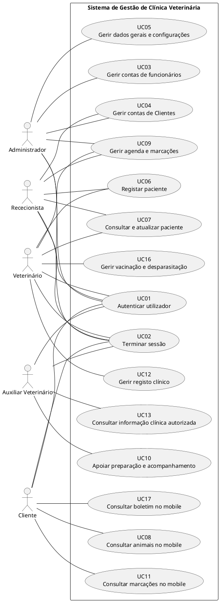
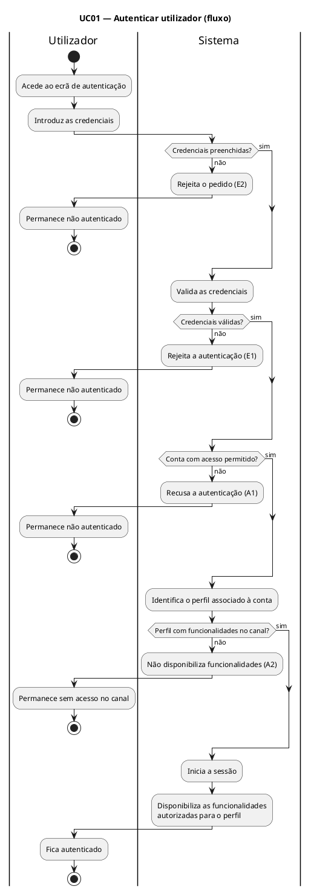
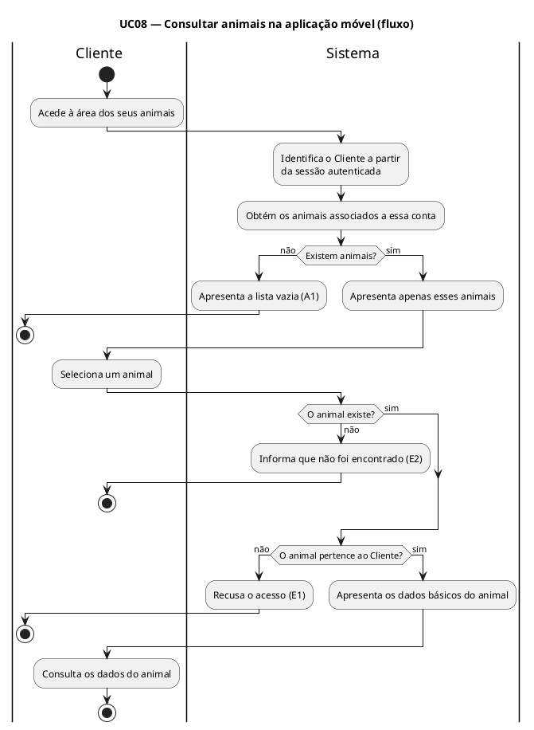
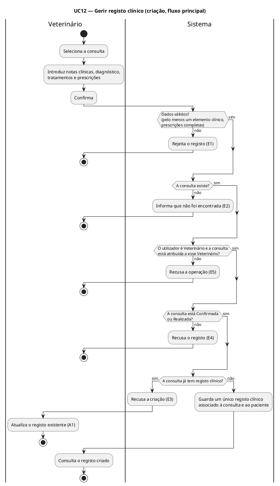
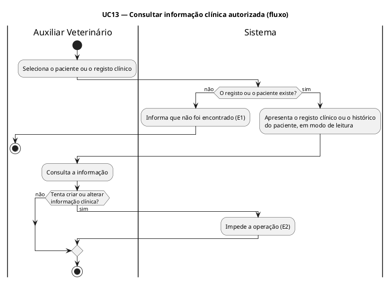

# Especificações dos Casos de Uso

**Projeto:** Gestão de Clínica Veterinária
**Grupo:** G08
**Milestone:** m3
**Versão:** v02
**Issue e papéis:** por atribuir. Esta versão ainda não tem Issue própria; será planeada no Backlog Refinement e no Sprint Planning, onde se atribuem Executor, Revisor e Auditor. A Issue I015 (v01, m2) está concluída e não é reaberta.
**Estado:** Rascunho para revisão e auditoria

---

## Histórico de versões

| Versão | Data | Descrição das alterações |
|---|---|---|
| v01 | m2 | Especificação dos casos de uso UC01 a UC18. Mantém-se inalterada como histórico (`m2-especificacoes-casos-uso-v01.md`). |
| v02 | 22/10/2026 | Reflete a Declaração de Âmbito v05: UC14, UC15 e UC18 passam para o não-âmbito e saem do diagrama geral. Os casos de uso **UC01, UC08, UC12 e UC13** são reescritos com os fluxos completos, o diagrama do fluxo, a correspondência com a API v02 e as exceções e códigos de resposta previstos. As precondições do UC01 e do UC08 são corrigidas e no UC09 fica explícito o papel do Administrador. Os restantes casos de uso mantêm o texto da v01. |

### Alterações da v02 em relação à v01

| Caso de uso | Alteração |
|---|---|
| UC01 | Acrescentados o diagrama do fluxo, a correspondência com a API (EP-001 e EP-003), a alternativa A2 (perfil sem funcionalidades no canal utilizado), a alternativa A3 (autenticação que deixa de ser válida) e a exceção E2 (dados em falta). Os fluxos A1, E1 e o fluxo principal mantêm o sentido da v01. |
| UC01 (precondição) | Retirada a precondição «A conta possui acesso permitido», que contradizia a alternativa A1 (conta bloqueada): o acesso é verificado no passo 4 do fluxo principal, não antes dele. |
| UC08 | A precondição «Existem animais associados à respetiva conta» foi retirada, porque contradizia a alternativa A1 (Cliente sem animais). Acrescentados o diagrama do fluxo, a correspondência com a API (EP-019 e EP-020), a lista dos dados básicos apresentados e a exceção E2 (animal inexistente). |
| UC09 | Acrescentado o parágrafo «Papel do Administrador»: o Administrador só define o horário de funcionamento (RF019, EP-009 e EP-010) e não consulta nem altera marcações. O resto do texto mantém-se. |
| UC12 | Reescrito para coincidir com a API v02: um único registo clínico por consulta (notas, diagnóstico, tratamentos e prescrições), criado uma vez (EP-031) e atualizado depois (EP-032), em vez de quatro registos separados. A precondição passa a exigir sempre uma consulta, atribuída ao Veterinário e Confirmada ou Realizada. Novas exceções: dados inválidos (400), consulta inexistente (404), consulta com registo (409), consulta Pendente ou Cancelada (422) e sem permissão ou consulta de outro Veterinário (403). Os fluxos alternativos passam a atualizar, consultar um registo e consultar o histórico. Acrescentados o diagrama do fluxo e a correspondência com a API. |
| UC13 | Retirada a exceção «informação sem autorização de consulta», que não tem correspondência na API v02 (o Auxiliar lê o registo clínico completo); passa a exceção «registo ou paciente inexistente» (404). Retirada a precondição «Existe informação clínica disponibilizada às suas funções». Acrescentados o diagrama do fluxo e a correspondência com a API (EP-033 e EP-034). A decisão fica por confirmar na revisão. |
| UC14, UC15, UC18 | Passam a **fora do âmbito** (F005 e F007, Declaração de Âmbito v05). Saem do diagrama geral. A numeração mantém-se reservada. |
| Restantes | Sem alterações de conteúdo. |

---

## 0. Fronteira do sistema e diagrama geral de casos de uso

O sistema possui dois canais de utilização dentro da sua fronteira funcional:

- **Aplicação web**, utilizada pelos perfis internos Administrador, Rececionista, Veterinário e Auxiliar Veterinário, de acordo com as permissões definidas nos requisitos.
- **Aplicação móvel**, utilizada exclusivamente pelo Cliente (Proprietário do animal) para as funcionalidades de consulta previstas.

As integrações e funcionalidades declaradas fora do âmbito na Especificação de Requisitos e na Declaração de Âmbito v05 não fazem parte da fronteira funcional representada neste documento. Em particular, a gestão de contas e pagamentos (F005) e a gestão de internamento (F007) estão fora do âmbito.

### 0.1. Atores

- Administrador
- Rececionista
- Veterinário
- Auxiliar Veterinário
- Cliente (Proprietário do animal)

### 0.2. Diagrama geral de casos de uso

### 0.3. Casos de uso fora do âmbito

| Caso de uso | Funcionalidade | Motivo |
|---|---|---|
| UC14 — Gerir contas e pagamentos | F005 — Gestão de contas e pagamentos | Fora do âmbito (Declaração de Âmbito v05) |
| UC15 — Consultar despesas e estados de pagamento | F005 — Gestão de contas e pagamentos | Fora do âmbito (Declaração de Âmbito v05) |
| UC18 — Gerir internamento | F007 — Gestão de internamento | Fora do âmbito (Declaração de Âmbito v05) |

A numeração de UC14, UC15 e UC18 mantém-se reservada, para que as referências a UC16 e UC17 (e a documentos anteriores) continuem corretas. A especificação destes três casos de uso encontra-se, apenas como histórico, em `m2-especificacoes-casos-uso-v01.md`.

---

# 1. UC01 — Autenticar utilizador

**Objetivo:**
Permitir que um utilizador registado inicie sessão no sistema e obtenha acesso às funcionalidades autorizadas para o respetivo perfil.

**Atores:**
Administrador, Rececionista, Veterinário, Auxiliar Veterinário e Cliente.

**Canal:**
Aplicação web (perfis internos) e aplicação móvel (Cliente).

**Requisitos relacionados:**
RF001, RF002, RF004, RF005, RNF001, RNF003, RNF006.

**Endpoints da API v02:**
EP-001 (iniciar sessão) e EP-003 (consultar utilizador autenticado).

## Precondições

- O utilizador possui uma conta registada.
- O sistema encontra-se acessível através da rede.

## Fluxo principal

1. O utilizador acede ao ecrã de autenticação.
2. O utilizador introduz as respetivas credenciais.
3. O sistema valida as credenciais.
4. O sistema verifica se a conta possui acesso permitido.
5. O sistema identifica o perfil associado à conta.
6. O sistema inicia a sessão.
7. O sistema disponibiliza as funcionalidades autorizadas para o perfil identificado.

## Fluxos alternativos

### A1 — Conta sem acesso permitido

1. O sistema identifica que a conta não possui acesso permitido (conta bloqueada).
2. O sistema recusa a autenticação.
3. O utilizador permanece não autenticado.

### A2 — Perfil sem funcionalidades no canal utilizado

1. O sistema identifica o perfil associado à conta (passo 5 do fluxo principal).
2. O perfil não dispõe de funcionalidades no canal utilizado: os perfis internos utilizam a aplicação web e o Cliente utiliza apenas a aplicação móvel (RNF003).
3. O sistema não disponibiliza as funcionalidades desse perfil nesse canal.
4. O utilizador permanece sem acesso a funcionalidades no canal utilizado.

### A3 — Autenticação que deixa de ser válida

1. Durante a utilização, a autenticação do utilizador deixa de ser válida (por exemplo, por ter expirado ou por ter sido terminada a sessão — UC02).
2. O sistema deixa de permitir as operações autenticadas (RF004).
3. O utilizador é encaminhado para o ecrã de autenticação, regressando ao passo 1 do fluxo principal.

## Exceções

### E1 — Credenciais inválidas

1. O sistema não consegue validar as credenciais fornecidas.
2. O sistema rejeita a autenticação.
3. O utilizador permanece não autenticado.

### E2 — Credenciais em falta

1. O utilizador solicita a autenticação sem preencher o e-mail ou a palavra-passe.
2. O sistema rejeita o pedido e indica que as credenciais são obrigatórias.
3. O utilizador permanece não autenticado.

## Pós-condições

**Sucesso:**
O utilizador fica autenticado e pode aceder apenas às funcionalidades autorizadas para o respetivo perfil.

**Insucesso:**
Não é criada uma sessão autenticada.

## Diagrama do fluxo

O diagrama mostra o fluxo principal e as alternativas e exceções. As «pistas» (*swimlanes*) separam o que faz o utilizador do que faz o sistema.

A alternativa A3 (autenticação que deixa de ser válida) acontece depois de o utilizador já estar autenticado e por isso não consta do diagrama: o utilizador volta ao início do fluxo.

## Correspondência com a API v02

| Passo do fluxo principal | Endpoint | Resultado |
|---|---|---|
| 2 e 3 — introduzir e validar as credenciais | EP-001 `POST /auth/login` | 200 com o token; 400 se faltarem credenciais (E2); 401 se forem inválidas (E1) |
| 4 — verificar o acesso da conta | EP-001 | 403 se a conta estiver bloqueada (A1) |
| 5 — identificar o perfil | EP-001 e EP-003 `GET /auth/me` | O perfil vem na resposta de EP-001; EP-003 devolve o perfil do token |
| 6 e 7 — iniciar a sessão e disponibilizar as funcionalidades | EP-001 | O token tem validade de 8 horas; as funcionalidades são as do perfil (RF005) |
| A3 — autenticação deixa de ser válida | Qualquer endpoint protegido | 401 (token expirado, revogado ou inválido) |

O diagrama de sequência do UC01 está em `04.09-modelos-de-interacao/m3-diagrama-sequencia-autenticar-utilizador-v02.md`.

---

# 2. UC02 — Terminar sessão

**Objetivo:**  
Permitir que um utilizador autenticado termine a respetiva sessão.

**Atores:**  
Administrador, Rececionista, Veterinário, Auxiliar Veterinário e Cliente.

**Requisitos relacionados:**  
RF003.

## Precondições

- O utilizador encontra-se autenticado.

## Fluxo principal

1. O utilizador solicita o fim da sessão.
2. O sistema termina a sessão ativa.
3. O sistema deixa de permitir o acesso autenticado através dessa sessão.
4. O utilizador regressa ao estado não autenticado.

## Fluxos alternativos

Não aplicável.

## Exceções

Não são identificadas exceções específicas nos requisitos associados.

## Pós-condições

- A sessão anteriormente ativa deixa de permitir acesso autenticado.
- O utilizador deixa de estar autenticado.

---

# 3. UC03 — Gerir contas de funcionários

**Objetivo:**  
Permitir ao Administrador criar e administrar as contas dos funcionários da clínica.

**Ator principal:**  
Administrador.

**Requisitos relacionados:**  
RF006, RF007, RF008, RF009, RNF001, RNF004, RNF005.

## Precondições

- O Administrador encontra-se autenticado.
- O Administrador possui autorização para gerir contas de funcionários.

## Fluxo principal — Criar conta de funcionário

1. O Administrador acede à gestão de contas de funcionários.
2. O Administrador solicita a criação de uma nova conta.
3. O sistema apresenta os dados necessários ao registo.
4. O Administrador introduz os dados obrigatórios.
5. O sistema valida os dados introduzidos.
6. O Administrador confirma a operação.
7. O sistema cria a nova conta de funcionário.

## Fluxos alternativos

### A1 — Atualizar conta de funcionário

1. O Administrador seleciona uma conta existente.
2. O sistema apresenta os dados editáveis.
3. O Administrador altera os dados pretendidos, incluindo, para um Auxiliar Veterinário, a autorização de registo de informação não clínica de apoio quando necessário.
4. O sistema valida os novos valores.
5. O Administrador confirma a operação.
6. O sistema atualiza a conta.

### A2 — Atribuir perfil

1. O Administrador seleciona uma conta de funcionário.
2. O Administrador seleciona um dos perfis internos previstos.
3. O sistema associa o perfil à conta.
4. A conta passa a estar sujeita às permissões do perfil atribuído.

### A3 — Bloquear conta

1. O Administrador seleciona uma conta de funcionário.
2. O Administrador solicita o bloqueio.
3. O sistema bloqueia a conta.
4. A conta deixa de permitir autenticação enquanto permanecer bloqueada.

## Exceções

### E1 — Dados inválidos ou obrigatórios em falta

1. O sistema identifica dados inválidos ou em falta.
2. O sistema não conclui a operação.
3. O Administrador deve corrigir os dados antes de voltar a confirmar.

## Pós-condições

- A conta criada ou alterada permanece registada.
- O perfil atribuído determina as permissões aplicáveis.
- Uma conta bloqueada não permite autenticação.

---

# 4. UC04 — Gerir contas de Clientes

**Objetivo:**  
Permitir ao Administrador e ao Rececionista criar e atualizar contas de Clientes.

**Atores:**  
Administrador e Rececionista.

**Requisitos relacionados:**  
RF010, RF011, RNF001, RNF004, RNF005.

## Precondições

- O utilizador encontra-se autenticado como Administrador ou Rececionista.

## Fluxo principal — Criar conta de Cliente

1. O ator acede à gestão de Clientes.
2. O ator solicita a criação de uma nova conta.
3. O sistema apresenta os dados necessários.
4. O ator introduz os dados obrigatórios.
5. O sistema valida os dados.
6. O ator confirma a operação.
7. O sistema cria a conta do Cliente.

## Fluxos alternativos

### A1 — Atualizar conta de Cliente

1. O ator seleciona uma conta de Cliente existente.
2. O sistema apresenta os dados editáveis.
3. O ator altera os dados pretendidos.
4. O sistema valida os novos valores.
5. O ator confirma a operação.
6. O sistema guarda os novos valores.

## Exceções

### E1 — Dados inválidos ou incompletos

1. O sistema rejeita os dados inválidos.
2. A operação não é concluída.
3. O ator deve corrigir os dados.

## Pós-condições

- A conta de Cliente criada ou atualizada permanece registada no sistema.

---

# 5. UC05 — Gerir dados gerais e configurações da clínica

**Objetivo:**  
Permitir ao Administrador consultar e atualizar os dados gerais da clínica e as configurações abrangidas pelo sistema.

**Ator principal:**  
Administrador.

**Requisitos relacionados:**  
RF012, RF013, RNF001, RNF004, RNF005.

## Precondições

- O Administrador encontra-se autenticado.

## Fluxo principal — Consultar dados gerais e configurações

1. O Administrador acede à área de configuração da clínica.
2. O sistema apresenta os dados gerais e as configurações atualmente registadas.
3. O Administrador consulta a informação apresentada.

## Fluxos alternativos

### A1 — Atualizar dados gerais e configurações

1. O Administrador solicita a alteração dos dados gerais ou das configurações.
2. O sistema apresenta os campos editáveis.
3. O Administrador altera os valores pretendidos.
4. O sistema valida os novos valores.
5. O Administrador confirma a alteração.
6. O sistema guarda os dados atualizados.

### A2 — Cancelar alteração

1. O Administrador cancela a operação antes da confirmação.
2. O sistema mantém os valores anteriormente registados.

## Exceções

### E1 — Dados inválidos

1. O sistema identifica valores inválidos.
2. O sistema não guarda as alterações.
3. O Administrador deve corrigir os dados.

## Pós-condições

- A consulta não altera os dados gerais nem as configurações.
- Quando existe uma atualização válida e confirmada, os novos valores ficam registados no sistema.

---

# 6. UC06 — Registar paciente

**Objetivo:**  
Permitir ao Rececionista ou ao Veterinário criar a ficha administrativa de um paciente e associá-la ao respetivo Cliente.

**Atores:**  
Rececionista e Veterinário.

**Requisitos relacionados:**  
RF014, RNF001, RNF004, RNF005.

## Precondições

- O ator encontra-se autenticado.
- O Cliente proprietário do paciente encontra-se registado no sistema.

## Fluxo principal

1. O ator acede à gestão de pacientes.
2. O ator solicita o registo de um novo paciente.
3. O sistema apresenta os dados necessários.
4. O ator introduz os dados administrativos do paciente.
5. O ator seleciona o Cliente proprietário.
6. O sistema valida os dados introduzidos.
7. O ator confirma a operação.
8. O sistema cria a ficha do paciente.
9. O sistema associa o paciente ao Cliente selecionado.

## Fluxos alternativos

### A1 — Proprietário ainda não selecionado

1. O sistema não permite concluir o registo enquanto não existir associação a um Cliente.
2. O ator seleciona um Cliente existente.
3. O fluxo regressa à validação dos dados.

## Exceções

### E1 — Dados obrigatórios inválidos ou em falta

1. O sistema rejeita o registo.
2. O ator deve corrigir os dados.

## Pós-condições

- Existe uma nova ficha de paciente.
- O paciente fica associado ao respetivo Cliente.

---

# 7. UC07 — Consultar e atualizar paciente

**Objetivo:**  
Permitir ao Rececionista e ao Veterinário localizar pacientes, consultar as respetivas fichas administrativas e atualizar os dados permitidos.

**Atores:**  
Rececionista e Veterinário.

**Requisitos relacionados:**  
RF015, RF016, RF017, RNF001, RNF004, RNF005.

## Precondições

- O ator encontra-se autenticado.
- O paciente encontra-se registado no sistema.

## Fluxo principal — Consultar ficha

1. O ator acede à gestão de pacientes.
2. O ator seleciona um paciente.
3. O sistema apresenta os dados administrativos da ficha do paciente.

## Fluxos alternativos

### A1 — Pesquisar pacientes por proprietário

1. O ator pesquisa ou seleciona um Cliente.
2. O sistema identifica os pacientes associados ao Cliente.
3. O sistema apresenta os pacientes encontrados.
4. O ator seleciona o paciente pretendido.
5. O sistema apresenta a ficha administrativa.

### A2 — Atualizar dados administrativos

1. O ator consulta a ficha de um paciente.
2. O ator solicita a alteração dos dados administrativos.
3. O sistema apresenta os campos editáveis.
4. O ator introduz os novos valores.
5. O sistema valida os dados.
6. O ator confirma a alteração.
7. O sistema guarda os novos valores.

## Exceções

### E1 — Paciente não encontrado

1. A pesquisa não devolve pacientes correspondentes.
2. O sistema informa que não existem resultados.

### E2 — Dados inválidos

1. O sistema rejeita a alteração.
2. Os dados anteriores permanecem inalterados.

## Pós-condições

- A consulta não altera os dados.
- Quando é efetuada uma atualização válida, os novos dados ficam registados.

---

# 8. UC08 — Consultar animais na aplicação móvel

**Objetivo:**
Permitir ao Cliente consultar os dados básicos dos animais associados à sua própria conta.

**Ator principal:**
Cliente.

**Canal:**
Aplicação móvel.

**Requisitos relacionados:**
RF018, RNF001, RNF002, RNF003.

**Endpoints da API v02:**
EP-019 (listar os meus animais) e EP-020 (consultar o meu animal).

## Precondições

- O Cliente encontra-se autenticado na aplicação móvel (UC01).

## Fluxo principal

1. O Cliente acede à área dos seus animais.
2. O sistema identifica os animais associados à conta autenticada.
3. O sistema apresenta apenas esses animais.
4. O Cliente seleciona um animal.
5. O sistema apresenta os dados básicos disponibilizados para consulta: nome, espécie, raça, sexo, data de nascimento, idade e peso.

## Fluxos alternativos

### A1 — Cliente sem animais associados

1. O sistema não encontra animais associados à conta.
2. O sistema apresenta a lista vazia ou indicação equivalente.
3. O caso de uso termina sem que o Cliente possa selecionar um animal.

## Exceções

### E1 — Tentativa de acesso a animal de outro Cliente

1. O sistema identifica que o animal não pertence à conta autenticada.
2. O sistema recusa o acesso à informação.

### E2 — Animal inexistente

1. O Cliente solicita um animal que não existe.
2. O sistema informa que o animal não foi encontrado.

## Pós-condições

- Nenhum dado do paciente é alterado.
- O Cliente visualiza apenas informação dos seus próprios animais.

## Diagrama do fluxo

## Correspondência com a API v02

| Passo | Endpoint | Resultado |
|---|---|---|
| 1 a 3 — listar os animais do Cliente | EP-019 `GET /me/animais` | 200 com a lista dos animais do Cliente (lista vazia se não tiver animais, A1) |
| 4 e 5 — consultar um animal | EP-020 `GET /me/animais/{id}` | 200 com os dados básicos; 403 se o animal for de outro Cliente (E1); 404 se não existir (E2) |

O Cliente é identificado exclusivamente pelo token (RNF002): o pedido nunca indica de que Cliente se trata.

---

# 9. UC09 — Gerir agenda e marcações

**Objetivo:**  
Permitir gerir as marcações da clínica e consultar a agenda de acordo com as permissões de cada perfil.

**Ator principal:**  
Rececionista.

**Atores secundários:**  
Veterinário e Administrador.

**Papel do Administrador:** o Administrador intervém neste caso de uso apenas na definição do horário de funcionamento (RF019; API v02: EP-009 e EP-010). Não consulta nem altera marcações: a matriz de permissões da API v02 não lhe dá acesso a EP-023 a EP-029, e o Veterinário só consulta as consultas que lhe estão atribuídas (RF024).

**Requisitos relacionados:**  
RF019, RF020, RF021, RF022, RF023, RF024, RF025, RNF001, RNF004, RNF005.

## Precondições

- O utilizador encontra-se autenticado.
- Para criar uma marcação, o paciente e o Veterinário encontram-se registados.

## Fluxo principal — Criar marcação

1. O Rececionista acede à agenda.
2. O Rececionista seleciona o Veterinário e o período pretendido.
3. O sistema apresenta a disponibilidade registada.
4. O Rececionista seleciona uma data e hora disponíveis.
5. O Rececionista seleciona o paciente.
6. O sistema valida os dados e a disponibilidade.
7. O Rececionista confirma a operação.
8. O sistema cria a marcação.
9. O sistema associa a marcação ao paciente e ao Veterinário selecionados.

## Fluxos alternativos

### A1 — Alterar marcação

1. O Rececionista seleciona uma marcação existente.
2. O Rececionista altera os dados pretendidos.
3. O sistema valida a alteração e a disponibilidade aplicável.
4. O Rececionista confirma.
5. O sistema guarda os novos valores.

### A2 — Atualizar estado da marcação

1. O Rececionista seleciona uma marcação.
2. O sistema apresenta apenas as transições permitidas para o estado atual: `Pendente` → `Confirmada` ou `Cancelada`; `Confirmada` → `Realizada` ou `Cancelada`.
3. O Rececionista escolhe o novo estado e confirma a alteração.
4. O sistema regista o novo estado.

### A3 — Consultar agenda

1. O Rececionista seleciona um período.
2. O sistema apresenta as marcações correspondentes.

### A4 — Consultar consultas atribuídas ao Veterinário

1. O Veterinário acede à agenda.
2. O sistema identifica o Veterinário autenticado.
3. O sistema apresenta as consultas que lhe estão atribuídas.

### A5 — Registar chegada

1. O Rececionista seleciona uma consulta marcada.
2. O Rececionista regista a chegada do Cliente e do respetivo animal.
3. O sistema guarda a informação de chegada.

### A6 — Gerir horários de funcionamento

1. O Administrador acede à configuração dos horários de funcionamento.
2. O sistema apresenta os horários atualmente registados.
3. O Administrador define os períodos de funcionamento pretendidos; um mesmo dia pode ter mais do que um período.
4. O sistema valida que cada período tem hora de início anterior à hora de fim e que não existem períodos sobrepostos no mesmo dia.
5. O Administrador confirma a operação.
6. O sistema guarda a configuração e passa a considerá-la na determinação das disponibilidades para marcação.

## Exceções

### E1 — Horário indisponível

1. O sistema identifica que a data ou hora selecionada não está disponível.
2. O sistema não cria ou altera a marcação.
3. O Rececionista deve escolher outra disponibilidade.

### E2 — Dados obrigatórios inválidos

1. O sistema recusa a operação.
2. O Rececionista deve corrigir os dados.

## Pós-condições

- Uma nova marcação pode ficar registada.
- Uma marcação existente pode ficar atualizada.
- A informação de estado ou chegada pode ficar registada.
- Os horários de funcionamento confirmados pelo Administrador ficam registados e passam a ser considerados na determinação das disponibilidades.
- A consulta da agenda não altera as marcações.

---

# 10. UC10 — Apoiar preparação e acompanhamento da consulta

**Objetivo:**  
Permitir ao Auxiliar Veterinário consultar informação necessária à preparação ou acompanhamento de uma consulta e registar informação não clínica quando autorizado.

**Ator principal:**  
Auxiliar Veterinário.

**Requisitos relacionados:**  
RF026, RF027, RNF001, RNF004, RNF005.

## Precondições

- O Auxiliar Veterinário encontra-se autenticado.
- Existe uma consulta abrangida pelas respetivas permissões.

## Fluxo principal

1. O Auxiliar Veterinário acede às consultas disponíveis.
2. O Auxiliar seleciona uma consulta.
3. O sistema verifica as respetivas permissões.
4. O sistema apresenta a informação necessária à preparação ou acompanhamento da consulta.
5. O Auxiliar consulta a informação apresentada.

## Fluxos alternativos

### A1 — Registar informação não clínica de apoio

1. O Auxiliar seleciona uma consulta.
2. O sistema confirma que a autorização de registo de apoio está ativa na conta do Auxiliar.
3. O Auxiliar introduz a informação não clínica.
4. O sistema valida os dados.
5. O Auxiliar confirma.
6. O sistema guarda a informação.

## Exceções

### E1 — Operação não autorizada

1. O Auxiliar tenta realizar uma operação fora das suas permissões.
2. O sistema recusa a operação.

## Pós-condições

- A consulta de informação não altera os registos clínicos.
- A informação não clínica autorizada pode ficar registada.
- Nenhum registo clínico é criado ou alterado pelo Auxiliar.

---

# 11. UC11 — Consultar marcações na aplicação móvel

**Objetivo:**  
Permitir ao Cliente consultar as próximas marcações e o histórico administrativo associado aos seus animais.

**Ator principal:**  
Cliente.

**Requisitos relacionados:**  
RF028, RF029, RNF001, RNF002, RNF003.

## Precondições

- O Cliente encontra-se autenticado na aplicação móvel.

## Fluxo principal — Consultar marcações futuras

1. O Cliente acede à área de consultas.
2. O sistema identifica os animais associados à conta.
3. O sistema obtém as marcações futuras correspondentes.
4. O sistema apresenta as marcações ao Cliente.

## Fluxos alternativos

### A1 — Consultar histórico

1. O Cliente seleciona a opção de histórico.
2. O sistema apresenta as marcações passadas e consultas realizadas dos seus animais.
3. O sistema apresenta apenas informação administrativa, como data, animal e Veterinário.

## Exceções

### E1 — Tentativa de acesso a dados de outro Cliente

1. O sistema recusa o acesso.
2. Nenhuma informação pertencente a outro Cliente é apresentada.

## Pós-condições

- Nenhuma marcação é criada, alterada ou cancelada.
- O Cliente apenas consulta informação associada aos seus próprios animais.

---

# 12. UC12 — Gerir registo clínico

**Objetivo:**
Permitir exclusivamente ao Veterinário criar, atualizar e consultar o registo clínico de uma consulta e o histórico clínico de um paciente.

**Ator principal:**
Veterinário.

**Canal:**
Aplicação web.

**Requisitos relacionados:**
RF030, RF031, RF032, RF033, RF034, RF035, RNF001, RNF004, RNF005.

**Endpoints da API v02:**
EP-031 (criar registo clínico), EP-032 (atualizar registo clínico), EP-033 (consultar registo clínico) e EP-034 (consultar histórico clínico do paciente).

**Registo único por consulta:**
Cada consulta tem no máximo um registo clínico, que reúne as notas clínicas, o diagnóstico, os tratamentos e as prescrições (RF030 a RF033). O registo é criado uma só vez; tudo o que se acrescenta ou corrige depois faz-se atualizando esse mesmo registo (A1).

## Precondições

- O Veterinário encontra-se autenticado.
- A consulta existe, está associada a um paciente registado, está atribuída ao Veterinário e encontra-se Confirmada ou Realizada.

## Fluxo principal — Criar o registo clínico da consulta

1. O Veterinário seleciona a consulta (e, através dela, o paciente).
2. O sistema apresenta a área de registo clínico da consulta.
3. O Veterinário introduz as notas clínicas, o diagnóstico, os tratamentos e as prescrições. Basta preencher um destes elementos.
4. O Veterinário confirma.
5. O sistema valida a informação e a consulta.
6. O sistema guarda um único registo clínico, associado à consulta e ao paciente, e apresenta-o ao Veterinário.

## Fluxos alternativos

### A1 — Atualizar o registo clínico

Aplica-se quando a consulta já tem registo clínico, incluindo o caso em que a criação foi recusada por E3.

1. O Veterinário abre o registo clínico da consulta.
2. O Veterinário altera as notas clínicas ou o diagnóstico e acrescenta ou altera tratamentos e prescrições.
3. O Veterinário confirma.
4. O sistema valida a alteração.
5. O sistema guarda os novos valores e regista o autor e a data da atualização.

### A2 — Consultar um registo clínico

1. O Veterinário seleciona a consulta ou um registo do histórico.
2. O sistema apresenta o registo clínico completo: notas, diagnóstico, tratamentos e prescrições.

### A3 — Consultar o histórico clínico de um paciente

1. O Veterinário seleciona um paciente e, se pretender, um intervalo de datas.
2. O sistema apresenta os registos clínicos do paciente, do mais recente para o mais antigo, com a data, o Veterinário, o diagnóstico e o número de tratamentos e de prescrições.

## Exceções

### E1 — Dados inválidos

1. O sistema rejeita a operação por dados inválidos: nenhum elemento clínico preenchido, prescrição incompleta ou, no histórico (A3), intervalo de datas inválido.
2. O Veterinário corrige os dados e repete a operação.

### E2 — Consulta, registo ou paciente inexistente

1. O Veterinário seleciona uma consulta, um registo ou um paciente que não existe.
2. O sistema informa que não foi encontrado.

### E3 — A consulta já tem registo clínico

1. O Veterinário tenta criar um registo clínico para uma consulta que já tem um.
2. O sistema recusa a criação.
3. O Veterinário prossegue pelo A1 para atualizar o registo existente.

### E4 — Consulta pendente ou cancelada

1. O Veterinário tenta criar o registo de uma consulta Pendente ou Cancelada.
2. O sistema recusa a criação.

### E5 — Perfil sem permissão ou consulta de outro Veterinário

1. O sistema identifica que o utilizador não é Veterinário ou que a consulta está atribuída a outro Veterinário.
2. O sistema impede a criação ou a alteração do registo clínico.

## Pós-condições

- Existe um único registo clínico para a consulta, associado à consulta e ao paciente.
- Na atualização, ficam registados o autor e a data da alteração (`atualizadoPor`, `atualizadoEm`).
- A criação do registo não altera o estado da marcação.
- Apenas o Veterinário pode criar ou alterar estes registos.

**A confirmar na revisão:** a regra 3.3 da API só diz que o Veterinário acede às consultas que lhe estão atribuídas, e o histórico (EP-034) lista registos com o nome do Veterinário que os fez. Este caso de uso aplica o E5 (consulta de outro Veterinário) à criação e à atualização; se um Veterinário pode ler registos de consultas de colegas (A2 e A3) fica por decidir.

## Diagrama do fluxo

A ordem das verificações no diagrama é ilustrativa; a API v02 define os códigos de resposta, não a ordem em que são avaliados.

## Correspondência com a API v02

| Passo | Endpoint | Resultado |
|---|---|---|
| Fluxo principal — criar o registo clínico | EP-031 `POST /registos-clinicos` | 201 com o registo clínico; 400 dados inválidos (E1); 403 sem permissão ou consulta de outro Veterinário (E5); 404 consulta inexistente (E2); 409 a consulta já tem registo (E3); 422 consulta Pendente ou Cancelada (E4) |
| A1 — atualizar o registo clínico | EP-032 `PUT /registos-clinicos/{id}` | 200 com o registo atualizado, incluindo `atualizadoEm` e `atualizadoPor`; 400 (E1); 403 (E5); 404 (E2). As listas de tratamentos e de prescrições enviadas substituem as anteriores |
| A2 — consultar um registo clínico | EP-033 `GET /registos-clinicos/{id}` | 200 com o registo clínico; 403 (E5); 404 (E2) |
| A3 — consultar o histórico do paciente | EP-034 `GET /animais/{id}/historico-clinico` | 200 com os registos do paciente, do mais recente para o mais antigo; 400 intervalo de datas inválido (E1); 403 (E5); 404 (E2) |

---

# 13. UC13 — Consultar informação clínica autorizada

**Objetivo:**
Permitir ao Auxiliar Veterinário consultar a informação clínica necessária às respetivas funções sem poder alterá-la.

**Ator principal:**
Auxiliar Veterinário.

**Canal:**
Aplicação web.

**Requisitos relacionados:**
RF036, RNF001.

**Endpoints da API v02:**
EP-033 (consultar registo clínico) e EP-034 (consultar histórico clínico do paciente).

**Informação disponibilizada ao Auxiliar:**
Na API v02, o Auxiliar Veterinário lê o registo clínico completo (notas, diagnóstico, tratamentos e prescrições) e o histórico do paciente, apenas em modo de leitura. A API não esconde campos clínicos ao Auxiliar.

## Precondições

- O Auxiliar Veterinário encontra-se autenticado.

## Fluxo principal

1. O Auxiliar Veterinário seleciona o paciente ou o registo clínico que pretende consultar.
2. O sistema verifica que o perfil pode consultar informação clínica, em modo de leitura.
3. O sistema apresenta o registo clínico ou o histórico clínico do paciente.
4. O Auxiliar consulta a informação.

## Fluxos alternativos

Não aplicável.

## Exceções

### E1 — Registo ou paciente inexistente

1. O Auxiliar seleciona um registo ou um paciente que não existe.
2. O sistema informa que não foi encontrado.

### E2 — Tentativa de alteração

1. O Auxiliar tenta criar ou alterar informação clínica.
2. O sistema impede a operação.

## Pós-condições

- Nenhum registo clínico é alterado.

**A confirmar na revisão:** a v01 previa uma exceção «informação sem autorização de consulta», que não tem correspondência na API v02. Nesta versão foi retirada, porque o Auxiliar lê o registo clínico completo. Se o grupo quiser que o Auxiliar veja apenas parte da informação clínica, a API terá de definir quais os campos escondidos (por exemplo, um DTO de resposta próprio para este perfil) e o E1 original volta a fazer sentido.

## Diagrama do fluxo

## Correspondência com a API v02

| Passo | Endpoint | Resultado |
|---|---|---|
| 1 a 4 — consultar um registo clínico | EP-033 `GET /registos-clinicos/{id}` | 200 com o registo clínico completo, só de leitura; 404 se não existir (E1) |
| 1 a 4 — consultar o histórico do paciente | EP-034 `GET /animais/{id}/historico-clinico` | 200 com os registos do paciente; 404 se o paciente não existir (E1) |
| E2 — tentativa de criar ou alterar | EP-031 `POST /registos-clinicos` e EP-032 `PUT /registos-clinicos/{id}` | 403: estes endpoints são só do perfil Veterinário |

---

# 14. UC14 — Gerir contas e pagamentos

**Estado:** fora do âmbito.

Este caso de uso pertencia à funcionalidade F005 (Gestão de contas e pagamentos), cuja transição para o não-âmbito consta da Declaração de Âmbito v05 (autorizada a 20/10/2026 e homologada por e-mail a 21/10/2026). Os requisitos associados (RF037 a RF041) estão descontinuados na Especificação de Requisitos v02 (a v01, da m2, ainda os trata como ativos) e não são implementados. A especificação original consta, como histórico, de `m2-especificacoes-casos-uso-v01.md`.

---

# 15. UC15 — Consultar despesas e estados de pagamento

**Estado:** fora do âmbito.

Este caso de uso pertencia à funcionalidade F005 (Gestão de contas e pagamentos), cuja transição para o não-âmbito consta da Declaração de Âmbito v05 (autorizada a 20/10/2026 e homologada por e-mail a 21/10/2026). Os requisitos associados (RF042) estão descontinuados na Especificação de Requisitos v02 (a v01, da m2, ainda os trata como ativos) e não são implementados. A especificação original consta, como histórico, de `m2-especificacoes-casos-uso-v01.md`.

---

# 16. UC16 — Gerir vacinação e desparasitação

**Objetivo:**  
Permitir ao Veterinário registar e consultar o histórico de vacinação e desparasitação dos pacientes e calcular as próximas administrações previstas.

**Ator principal:**  
Veterinário.

**Requisitos relacionados:**  
RF043, RF044, RF045, RF046, RNF001, RNF004, RNF005.

## Precondições

- O Veterinário encontra-se autenticado.
- O paciente encontra-se registado no sistema.

## Fluxo principal — Registar vacinação

1. O Veterinário seleciona o paciente.
2. O Veterinário solicita o registo de uma vacinação.
3. O sistema apresenta os campos aplicáveis.
4. O Veterinário introduz a data de administração, tipo de vacina ou produto, lote e, quando aplicável, intervalo até à próxima administração.
5. O sistema valida os dados.
6. O Veterinário confirma o registo.
7. O sistema associa a vacinação ao paciente.
8. Quando existe um intervalo definido, o sistema calcula a data prevista para a próxima administração.

## Fluxos alternativos

### A1 — Registar desparasitação

1. O Veterinário seleciona o paciente.
2. O Veterinário introduz a data de administração, produto utilizado, lote e intervalo aplicável.
3. O sistema valida os dados.
4. O Veterinário confirma.
5. O sistema associa o registo ao paciente.
6. Quando existe um intervalo definido, o sistema calcula a próxima administração prevista.

### A2 — Consultar boletim no sistema web

1. O Veterinário seleciona um paciente.
2. O sistema apresenta o histórico de vacinação e desparasitação.
3. O sistema apresenta as próximas administrações previstas quando existam.

## Exceções

### E1 — Dados inválidos

1. O sistema rejeita o registo.
2. O Veterinário deve corrigir os dados.

### E2 — Impossibilidade de calcular próxima administração

1. Não existe uma data de administração válida ou intervalo definido.
2. O sistema não calcula uma próxima data.
3. O registo mantém apenas os dados aplicáveis.

## Pós-condições

- A vacinação ou desparasitação confirmada fica associada ao paciente.
- Quando aplicável, fica registada ou disponibilizada a data prevista para a próxima administração.

---

# 17. UC17 — Consultar boletim de vacinação e desparasitação

**Objetivo:**  
Permitir ao Cliente consultar, na aplicação móvel, o boletim de vacinação e desparasitação dos seus animais.

**Ator principal:**  
Cliente.

**Requisitos relacionados:**  
RF047, RNF001, RNF002, RNF003.

## Precondições

- O Cliente encontra-se autenticado na aplicação móvel.
- O animal encontra-se associado à conta do Cliente.

## Fluxo principal

1. O Cliente acede à área dos seus animais.
2. O Cliente seleciona um animal.
3. O Cliente acede ao boletim de vacinação e desparasitação.
4. O sistema verifica que o animal pertence ao Cliente autenticado.
5. O sistema apresenta o histórico disponível.
6. O sistema apresenta as próximas administrações previstas quando existam.

## Fluxos alternativos

### A1 — Não existem registos

1. O animal não possui registos de vacinação ou desparasitação.
2. O sistema apresenta a ausência de registos.

## Exceções

### E1 — Animal não pertencente ao Cliente

1. O sistema identifica que o animal não está associado à conta.
2. O sistema recusa o acesso ao boletim.

## Pós-condições

- Nenhum registo de vacinação ou desparasitação é alterado.

---

# 18. UC18 — Gerir internamento

**Estado:** fora do âmbito.

Este caso de uso pertencia à funcionalidade F007 (Gestão de internamento), cuja transição para o não-âmbito consta da Declaração de Âmbito v05 (autorizada a 20/10/2026 e homologada por e-mail a 21/10/2026). Os requisitos associados (RF048 a RF052) estão descontinuados na Especificação de Requisitos v02 (a v01, da m2, ainda os trata como ativos) e não são implementados. A especificação original consta, como histórico, de `m2-especificacoes-casos-uso-v01.md`.

---

# 19. Ligação dos casos de uso aos endpoints da API v02

A tabela deriva da matriz de rastreabilidade da Documentação da API v02 (secção 12.3) e confirma que todos os casos de uso em âmbito têm endpoints e que os casos de uso fora do âmbito não têm.

| Caso de uso | Endpoints | N.º de endpoints |
|---|---|---|
| UC01 | EP-001, EP-003 | 2 |
| UC02 | EP-002 | 1 |
| UC03 | EP-004 a EP-008 | 5 |
| UC04 | EP-011 a EP-014 | 4 |
| UC05 | EP-009, EP-010 | 2 |
| UC06 | EP-017 | 1 |
| UC07 | EP-011, EP-012, EP-015, EP-016, EP-018 | 5 |
| UC08 | EP-019, EP-020 | 2 |
| UC09 | EP-009, EP-010, EP-021 a EP-028 | 10 |
| UC10 | EP-016, EP-023, EP-024, EP-029 | 4 |
| UC11 | EP-030 | 1 |
| UC12 | EP-031 a EP-034 | 4 |
| UC13 | EP-033, EP-034 | 2 |
| UC14 | Fora do âmbito (F005/F007) | — |
| UC15 | Fora do âmbito (F005/F007) | — |
| UC16 | EP-042, EP-043 | 2 |
| UC17 | EP-044 | 1 |
| UC18 | Fora do âmbito (F005/F007) | — |
