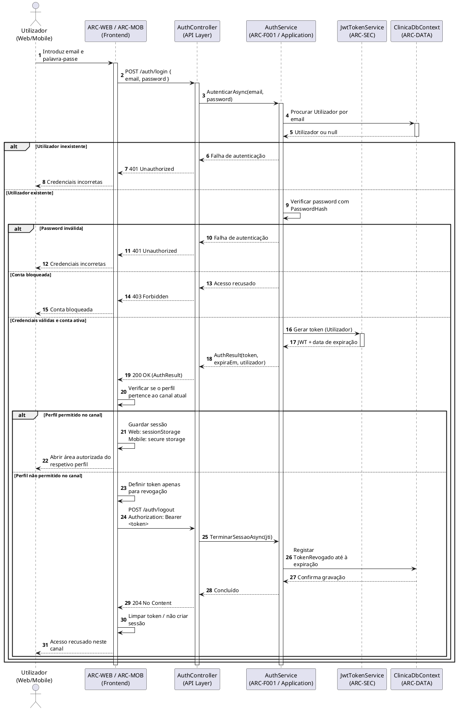

# Diagrama de Sequência — Autenticar Utilizador

**Projeto:** Gestão de Clínica Veterinária  
**Grupo:** G08  
**Milestone:** m2  
**Versão:** v01  
**Issue:** I023 — Diagrama de sequência — autenticar utilizador  
**Ficheiro:** `m2-diagrama-sequencia-autenticar-utilizador-v01.md`

---

## 1. Objetivo

Este documento apresenta o diagrama de sequência do caso de uso **UC01 — Autenticar utilizador**.
O diagrama representa a interação prevista entre o utilizador, o frontend do canal utilizado, a API, os serviços de autenticação e a persistência durante a validação das credenciais e a emissão do token JWT.

O fluxo segue a arquitetura definida para o projeto: Frontend Web ou Mobile → ARC-API → ARC-F001/ARC-SEC → ARC-DATA, utilizando ASP.NET Core 8, Entity Framework Core e JWT.

## 2. Diagrama de Sequência

O diagrama inclui o fluxo de sucesso e as alternativas relevantes previstas nos requisitos e na Documentação da API.

## 3. Regras representadas

- `401 Unauthorized` é utilizado quando o utilizador não existe ou a palavra-passe está incorreta (RF002).
- `403 Forbidden` é utilizado quando a conta está bloqueada (RF002, RF009).
- O JWT é emitido apenas depois da validação das credenciais e do estado da conta; a validade prevista é de 8 horas e não existe *refresh token* (RF004; DA-ARQ-06).
- O Frontend Web aceita apenas Administrador, Rececionista, Veterinário e Auxiliar Veterinário; o Frontend Mobile aceita apenas Cliente (RNF003).
- Se EP-001 devolver um perfil que não pertence ao canal atual, o token é revogado por EP-002 e não é mantida uma sessão nesse frontend.
- O armazenamento local do token depende do canal: `sessionStorage` no Frontend Web e armazenamento seguro no Frontend Mobile, conforme os respetivos modelos de classes.
