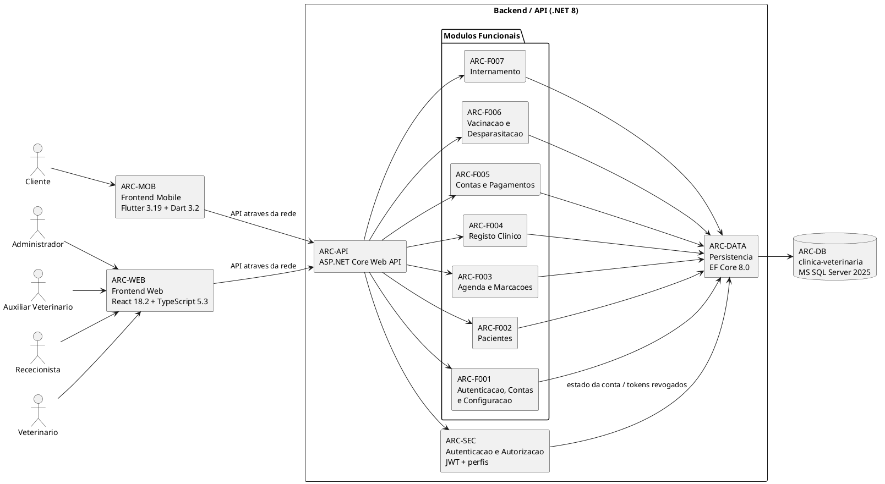
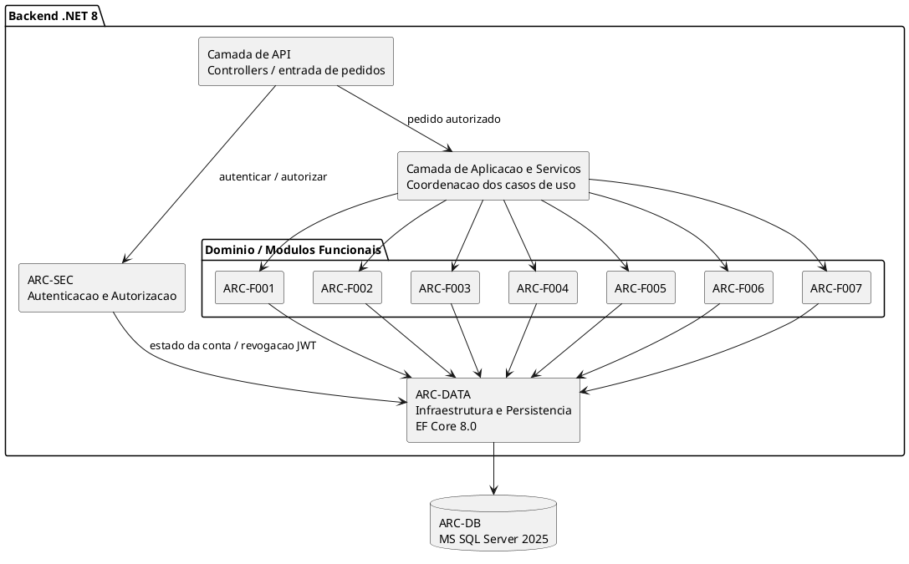

# Documentação da Arquitetura

**Projeto:** Gestão de Clínica Veterinária  
**Grupo:** G08  
**Milestone:** m2  
**Versão:** v01  
**Issue:** I019 — Documentação da Arquitetura  


---

## 1. Objetivo

O presente documento descreve a arquitetura prevista para o sistema de Gestão de Clínica Veterinária.

A documentação identifica os principais componentes do sistema, as respetivas responsabilidades, as relações entre componentes, as tecnologias previstas, as interfaces de comunicação, as restrições e as decisões arquiteturais relevantes.

A arquitetura é definida de forma coerente com a Proposta de Sistema e a Declaração de Âmbito homologadas, com a Especificação de Requisitos e com as Especificações dos Casos de Uso da milestone m2.

Este documento constitui ainda uma referência para os modelos de classes, documentação da API, protótipos, implementação e Requirements Traceability Matrix (RTM).

---

## 2. Documentos de referência

A arquitetura descrita neste documento tem como referências:

- `m1-proposta-sistema-v03.pdf`;
- `m1-declaracao-ambito-v03.pdf`;
- `m1-regulamento-grupo-v01.pdf`;
- `m1-plano-qualidade-processo-v01.pdf`;
- `m1-definition-of-ready-v01.pdf`;
- `m1-definition-of-done-v01.pdf`;
- `m2-especificacao-requisitos-v01.md`;
- `m2-especificacoes-casos-uso-v01.md`;
- `m2-20261007-backlog-projeto-v01.pdf`.

Quando existir conflito entre este documento e os documentos homologados ou normativos aplicáveis, prevalecem os documentos de nível superior.

---

## 3. Âmbito arquitetural

A arquitetura cobre os quatro componentes técnicos principais previstos para o sistema:

1. **Frontend Web**, destinado aos utilizadores internos da clínica;
2. **Frontend Mobile**, destinado exclusivamente ao Cliente;
3. **Backend / API**, responsável pela lógica de negócio, autenticação, autorização, validação e acesso aos dados;
4. **Base de Dados**, responsável pela persistência da informação do sistema.

A arquitetura documenta ainda a organização lógica do backend em módulos correspondentes às funcionalidades F001 a F007.

Não são detalhados neste documento:

- os endpoints concretos, métodos, parâmetros e formatos de pedido/resposta, que pertencem à Documentação de API;
- as entidades, atributos, relações e cardinalidades detalhadas da base de dados, que pertencem ao Modelo de Dados;
- as classes, atributos, operações e relações detalhadas de backend, frontend web e frontend mobile, que pertencem aos respetivos Modelos de Classes;
- o desenho visual detalhado dos ecrãs, que pertence ao Protótipo de Baixa Fidelidade.

---

## 4. Condicionantes arquiteturais

A arquitetura deve respeitar as seguintes condicionantes do âmbito aprovado:

- os perfis **Administrador**, **Rececionista**, **Veterinário** e **Auxiliar Veterinário** utilizam a aplicação web;
- o **Administrador** é responsável pela gestão dos horários de funcionamento da clínica no âmbito de F003;
- o perfil **Cliente (Proprietário do animal)** utiliza exclusivamente a aplicação móvel;
- as permissões devem respeitar a separação definida entre dados administrativos e dados clínicos;
- o Administrador não pode consultar, criar ou alterar registos clínicos;
- o Rececionista não pode criar ou alterar registos clínicos, diagnósticos, tratamentos ou prescrições;
- o Auxiliar Veterinário apenas pode consultar a informação clínica necessária às suas funções e não pode criar ou alterar registos clínicos;
- a atualização do estado clínico dos internamentos e o registo de alta médica são exclusivos do Veterinário;
- o Cliente apenas pode consultar informação pertencente aos seus próprios animais;
- o Cliente não pode criar, alterar ou cancelar marcações através da aplicação móvel;
- o Cliente não pode criar ou editar fichas de animais;
- o Cliente não pode efetuar pagamentos através da aplicação móvel;
- o acompanhamento de internamentos não é disponibilizado na aplicação móvel;
- o sistema depende de ligação à rede e não garante funcionamento offline;
- o sistema é desenvolvido e demonstrado em ambiente académico controlado com dados fictícios;
- não é prevista a migração de dados provenientes de sistemas veterinários anteriores;
- ficam excluídas integrações externas não previstas no âmbito homologado.

---

## 5. Visão geral da arquitetura

O sistema adota uma arquitetura cliente-servidor, com separação entre as interfaces de utilizador, o backend e a persistência de dados.

O **Frontend Web** e o **Frontend Mobile** comunicam com o **Backend / API**. As aplicações cliente não acedem diretamente à base de dados.

O Backend concentra a aplicação das regras de negócio e das regras de autorização. A persistência é realizada através da camada de acesso a dados, utilizando Entity Framework Core sobre uma base de dados Microsoft SQL Server.

A organização interna do backend é lógica e modular. Os módulos correspondem às áreas funcionais homologadas F001 a F007, não representando serviços independentes nem microserviços. O objetivo desta separação é manter responsabilidades claras e permitir rastreabilidade direta entre requisitos, casos de uso, arquitetura e implementação futura.

---

## 6. Tecnologias previstas

| Componente | Tecnologia principal | Versão / ambiente |
|---|---|---|
| Backend | C# / ASP.NET Core Web API | C# 12 / ASP.NET Core Web API 8.0 / .NET 8.0 SDK |
| Persistência no backend | Entity Framework Core | EF Core 8.0, abordagem code-first |
| Autenticação | JWT | Integrada no backend |
| Frontend Web | React / TypeScript | React 18.2 / TypeScript 5.3 / Node.js 20 LTS |
| Construção Frontend Web | Vite / npm | npm 10 |
| Frontend Mobile | Flutter / Dart | Flutter 3.19 / Dart 3.2 / Android SDK 34 |
| Base de Dados | Microsoft SQL Server / T-SQL | MS SQL Server 2025 |
| Migrações de dados | EF Core Migrations | `dotnet-ef` |
| Diagramas técnicos | PlantUML | Fonte textual incluída nos documentos Markdown |
| Controlo de versões | Git / GitHub | Repositório único do projeto |

As tecnologias identificadas nesta secção correspondem aos compromissos técnicos já definidos pelo Grupo G08.

---

## 7. Catálogo de componentes arquiteturais

Para efeitos de rastreabilidade, cada componente recebe um identificador estável que pode ser utilizado na RTM.

### 7.1. ARC-WEB — Frontend Web

**Tecnologia:** React 18.2 + TypeScript 5.3.

**Responsabilidades:**

- disponibilizar a interface utilizada pelos perfis Administrador, Rececionista, Veterinário e Auxiliar Veterinário;
- apresentar apenas as funcionalidades permitidas ao perfil autenticado;
- recolher dados introduzidos pelo utilizador;
- efetuar validações de interface que não substituem a validação obrigatória do backend;
- enviar pedidos ao Backend / API;
- apresentar os resultados e erros devolvidos pelo backend;
- suportar os fluxos web definidos nos casos de uso.

O Frontend Web não acede diretamente à base de dados e não é responsável pela decisão final de autorização de uma operação.

---

### 7.2. ARC-MOB — Frontend Mobile

**Tecnologia:** Flutter 3.19 + Dart 3.2.

**Responsabilidades:**

- disponibilizar a aplicação destinada exclusivamente ao Cliente;
- permitir autenticação e fim de sessão do Cliente;
- apresentar os dados básicos dos animais associados à conta autenticada;
- apresentar marcações futuras e histórico administrativo;
- apresentar despesas e estados de pagamento;
- apresentar boletim de vacinação e desparasitação;
- impedir, ao nível da interface, operações que não pertencem ao âmbito mobile;
- comunicar exclusivamente com o Backend / API para obter os dados autorizados.

O Frontend Mobile não permite administração de contas, alteração das fichas dos animais, atos clínicos, gestão de marcações, pagamentos ou acompanhamento de internamentos.

---

### 7.3. ARC-API — Backend / API

**Tecnologia:** ASP.NET Core Web API 8.0 em C# 12 / .NET 8.

**Responsabilidades:**

- disponibilizar as operações necessárias ao Frontend Web e ao Frontend Mobile;
- receber e validar pedidos;
- coordenar a execução dos módulos funcionais;
- aplicar as regras de negócio;
- aplicar autenticação e autorização;
- impedir operações não permitidas ao perfil autenticado;
- garantir o isolamento dos dados dos Clientes;
- coordenar a persistência e consulta de dados;
- devolver resultados e erros às aplicações cliente.

O Backend / API constitui o ponto central de aplicação das regras funcionais e de segurança.

---

### 7.4. ARC-SEC — Autenticação e Autorização

**Tecnologia:** JWT e mecanismos de autorização do ASP.NET Core.

**Responsabilidades:**

- autenticar utilizadores através das credenciais associadas às contas;
- rejeitar autenticações inválidas ou contas sem acesso permitido;
- emitir e validar mecanismos de acesso baseados em JWT;
- identificar o perfil associado ao utilizador autenticado;
- aplicar controlo de acesso baseado nos cinco perfis do sistema;
- impedir operações não autorizadas;
- suportar o isolamento entre dados pertencentes a Clientes diferentes;
- consultar, através da camada de persistência, o estado das contas e a informação necessária à validação de tokens revogados.

As regras de autorização devem ser aplicadas no backend mesmo quando a interface já oculta uma funcionalidade não permitida.

---

### 7.5. ARC-F001 — Módulo de Autenticação, Contas e Configuração

**Origem funcional:** F001 — Autenticação e Controlos de Acesso.  
**Requisitos principais:** RF001–RF013.  
**Casos de uso principais:** UC01–UC05.

**Responsabilidades:**

- autenticação e fim de sessão;
- gestão de contas de funcionários;
- atribuição de perfis;
- bloqueio de contas;
- criação e atualização de contas de Clientes;
- consulta dos dados gerais e configurações da clínica;
- atualização dos dados gerais e configurações da clínica;
- aplicação das regras de acesso associadas a estas operações.

A operação **RF019 — Gerir horários de funcionamento** pertence funcionalmente ao módulo ARC-F003 — Agenda e Marcações e é executada pelo Administrador. O ARC-F001 assegura apenas a gestão da conta, do perfil e das permissões necessárias ao acesso a essa operação.

A coordenação dos casos de uso de autenticação e gestão de contas pertence ao ARC-F001; os mecanismos técnicos de emissão, validação e revogação de JWT são responsabilidade do ARC-SEC.

---

### 7.6. ARC-F002 — Módulo de Pacientes

**Origem funcional:** F002 — Gestão de pacientes.  
**Requisitos principais:** RF014–RF018.  
**Casos de uso principais:** UC06–UC08.

**Responsabilidades:**

- registar pacientes;
- consultar fichas administrativas;
- atualizar dados administrativos;
- pesquisar pacientes por proprietário;
- manter a associação entre paciente e Cliente;
- disponibilizar ao Cliente apenas os dados dos seus próprios animais.

Os registos clínicos não são responsabilidade deste módulo, sendo tratados pelo módulo ARC-F004.

---

### 7.7. ARC-F003 — Módulo de Agenda e Marcações

**Origem funcional:** F003 — Agendamento de consultas.  
**Requisitos principais:** RF019–RF029.  
**Casos de uso principais:** UC09–UC11.

**Responsabilidades:**

- considerar os horários de funcionamento na gestão da agenda;
- consultar disponibilidade dos Veterinários;
- criar e alterar marcações;
- atualizar o estado das marcações;
- disponibilizar a agenda da clínica;
- registar a chegada de Clientes e animais;
- disponibilizar informação necessária à preparação das consultas;
- guardar informação não clínica de apoio quando autorizada;
- disponibilizar ao Cliente marcações futuras e histórico administrativo.

**Regra de autorização:** a gestão dos horários de funcionamento é executada pelo Administrador. Apesar de o Administrador ser o ator responsável pela operação, esta responsabilidade permanece arquiteturalmente no módulo ARC-F003 por pertencer à funcionalidade F003 — Agendamento de consultas.

---

### 7.8. ARC-F004 — Módulo de Registo Clínico

**Origem funcional:** F004 — Registo clínico e tratamentos.  
**Requisitos principais:** RF030–RF036.  
**Casos de uso principais:** UC12–UC13.

**Responsabilidades:**

- registar notas clínicas;
- registar diagnósticos;
- registar tratamentos;
- registar prescrições;
- atualizar registos clínicos;
- disponibilizar histórico clínico ao Veterinário;
- disponibilizar ao Auxiliar Veterinário apenas a informação clínica autorizada.

A criação e alteração de informação clínica são reservadas ao Veterinário.

---

### 7.9. ARC-F005 — Módulo de Contas e Pagamentos

**Origem funcional:** F005 — Gestão de contas e pagamentos.  
**Requisitos principais:** RF037–RF042.  
**Casos de uso principais:** UC14–UC15.

**Responsabilidades:**

- registar custos associados aos serviços prestados;
- consultar valores em dívida;
- registar manualmente pagamentos efetuados ao balcão;
- atualizar estados de pagamento;
- fechar contas administrativas;
- disponibilizar ao Cliente as despesas e estados de pagamento em modo de consulta.

O módulo não efetua pagamentos eletrónicos e não realiza emissão fiscal certificada nem comunicação com a Autoridade Tributária.

---

### 7.10. ARC-F006 — Módulo de Vacinação e Desparasitação

**Origem funcional:** F006 — Boletim de Vacinas e Desparasitações.  
**Requisitos principais:** RF043–RF047.  
**Casos de uso principais:** UC16–UC17.

**Responsabilidades:**

- registar vacinação;
- registar desparasitação;
- calcular a data prevista para a próxima administração a partir da data e intervalo definidos;
- disponibilizar o boletim no sistema web;
- disponibilizar ao Cliente o boletim e próximas administrações previstas.

O módulo não integra bases de dados nacionais de saúde animal nem leitura automática de códigos de barras ou QR.

---

### 7.11. ARC-F007 — Módulo de Internamento

**Origem funcional:** F007 — Gestão de internamento.  
**Requisitos principais:** RF048–RF052.  
**Caso de uso principal:** UC18.

**Responsabilidades:**

- registar internamentos;
- associar localização, jaula ou outro alojamento;
- apresentar o painel de internamentos ativos;
- permitir ao Veterinário atualizar o estado clínico;
- permitir exclusivamente ao Veterinário registar a alta médica;
- permitir ao Auxiliar Veterinário consultar a informação necessária ao acompanhamento.

O internamento não é disponibilizado na aplicação móvel.

---

### 7.12. ARC-DATA — Camada de Persistência

**Tecnologia:** Entity Framework Core 8.0, abordagem code-first.

**Responsabilidades:**

- disponibilizar ao backend acesso persistente aos dados;
- traduzir as operações da aplicação para operações sobre a base de dados;
- suportar consultas e alterações requeridas pelos módulos funcionais;
- gerir a evolução do esquema através de EF Core Migrations;
- assegurar que dados confirmados permanecem disponíveis para consulta posterior.

A camada de persistência é utilizada pelo backend e não é acedida diretamente pelos frontends.

---

### 7.13. ARC-DB — Base de Dados `clinica-veterinaria`

**Tecnologia:** Microsoft SQL Server 2025 / T-SQL.

**Responsabilidades:**

- armazenar os dados persistentes necessários às funcionalidades F001–F007;
- armazenar relações necessárias entre Clientes, pacientes e informação funcional associada;
- fornecer persistência ao backend através da camada ARC-DATA.

A definição das entidades, atributos, relações e cardinalidades pertence ao artefacto I016 — Modelo de Dados.

---

## 8. Organização lógica do Backend

A arquitetura interna prevista para o backend separa responsabilidades em quatro níveis lógicos.

### 8.1. Camada de API

Responsável por:

- receber pedidos das aplicações cliente;
- expor as operações documentadas na API;
- iniciar o processamento de cada pedido;
- devolver respostas e erros.

Esta camada não deve concentrar regras de negócio que pertençam aos serviços ou módulos funcionais.

### 8.2. Camada de Aplicação e Serviços

Responsável por:

- coordenar os casos de uso;
- aplicar regras de negócio;
- coordenar validações;
- utilizar os módulos F001–F007;
- solicitar operações de persistência;
- garantir que as operações respeitam as permissões aplicáveis.

### 8.3. Camada de Domínio / Módulos Funcionais

Agrupa as responsabilidades correspondentes às sete áreas funcionais:

- ARC-F001 — Autenticação, Contas e Configuração;
- ARC-F002 — Pacientes;
- ARC-F003 — Agenda e Marcações;
- ARC-F004 — Registo Clínico;
- ARC-F005 — Contas e Pagamentos;
- ARC-F006 — Vacinação e Desparasitação;
- ARC-F007 — Internamento.

Esta divisão é lógica e destina-se a manter separação de responsabilidades e rastreabilidade. Não implica a criação de serviços independentes.

### 8.4. Camada de Infraestrutura e Persistência

Responsável por:

- implementação do acesso a dados;
- integração com Entity Framework Core;
- configuração de persistência;
- migrações;
- comunicação com Microsoft SQL Server.

---

## 9. Interfaces e comunicação entre componentes

| Origem | Destino | Interface | Finalidade |
|---|---|---|---|
| ARC-WEB | ARC-API | API Web através da rede | Executar as operações permitidas aos perfis internos |
| ARC-MOB | ARC-API | API Web através da rede | Autenticação e consultas permitidas ao Cliente |
| ARC-API | ARC-SEC | Serviços internos do backend | Autenticação, identificação de perfil e autorização |
| ARC-API | ARC-F001…ARC-F007 | Chamadas internas | Executar regras e casos de uso |
| ARC-F001…ARC-F007 | ARC-DATA | Serviços de persistência | Consultar e alterar dados persistentes |
| ARC-DATA | ARC-DB | EF Core / SQL Server | Persistir e recuperar dados |

A definição concreta de métodos, rotas, parâmetros, pedidos, respostas e códigos de erro é realizada no artefacto I018 — Documentação de API.

Não existem interfaces diretas entre os frontends e ARC-DB.

---

## 10. Autenticação, autorização e separação de perfis

O backend utiliza autenticação baseada em JWT, de acordo com as tecnologias assumidas pelo grupo.

Após autenticação, o perfil associado à conta é utilizado para determinar as operações autorizadas.

A autorização deve ser aplicada no backend e não pode depender exclusivamente da ocultação de opções nas interfaces.

### 10.1. Perfis e canais

| Perfil | Canal |
|---|---|
| Administrador | Frontend Web |
| Rececionista | Frontend Web |
| Veterinário | Frontend Web |
| Auxiliar Veterinário | Frontend Web |
| Cliente | Frontend Mobile |

### 10.2. Regras arquiteturais de autorização

- o Administrador gere funcionários, perfis, contas de Clientes, configurações e horários de funcionamento da clínica, mas não acede a registos clínicos;
- o Rececionista gere informação administrativa, agenda e pagamentos, mas não cria nem altera registos clínicos;
- o Veterinário consulta apenas as consultas que lhe estão atribuídas e gere informação clínica, vacinação e operações clínicas de internamento;
- o Auxiliar Veterinário possui apenas as permissões de consulta previstas e só pode registar informação não clínica de apoio quando essa autorização está ativa na respetiva conta;
- o Cliente apenas acede às funcionalidades mobile e aos dados associados à sua própria conta;
- pedidos não autorizados devem ser rejeitados pelo backend mesmo que tenham sido enviados fora das interfaces previstas.

---

## 11. Validação de dados

As aplicações cliente podem realizar validações de interface para melhorar a interação com o utilizador.

Contudo, o Backend / API é responsável pela validação autoritativa antes de aceitar operações de criação ou alteração.

A validação deve considerar:

- presença dos dados obrigatórios;
- formato e restrições aplicáveis;
- existência das entidades relacionadas quando necessária;
- permissões do utilizador;
- regras de negócio associadas ao módulo funcional.

Dados inválidos não devem produzir alterações persistentes.

---

## 12. Persistência e consistência dos dados

Toda a persistência da aplicação é coordenada pelo Backend / API através de ARC-DATA.

Os frontends não mantêm uma fonte de dados autónoma que substitua a base de dados do sistema.

Depois de uma operação válida ser confirmada e persistida com sucesso, os dados devem permanecer disponíveis para consulta posterior.

A definição física das estruturas de armazenamento é responsabilidade do Modelo de Dados e das migrações associadas ao backend.

---

## 13. Rastreabilidade funcional da arquitetura

| Funcionalidade | Requisitos | Casos de uso | Componentes principais |
|---|---|---|---|
| F001 — Autenticação e Controlos de Acesso | RF001–RF013 | UC01–UC05 | ARC-WEB, ARC-MOB, ARC-API, ARC-SEC, ARC-F001, ARC-DATA, ARC-DB |
| F002 — Gestão de pacientes | RF014–RF018 | UC06–UC08 | ARC-WEB, ARC-MOB, ARC-API, ARC-F002, ARC-DATA, ARC-DB |
| F003 — Agendamento de consultas | RF019–RF029 | UC09–UC11 | ARC-WEB, ARC-MOB, ARC-API, ARC-F003, ARC-DATA, ARC-DB |
| F004 — Registo clínico e tratamentos | RF030–RF036 | UC12–UC13 | ARC-WEB, ARC-API, ARC-F004, ARC-DATA, ARC-DB |
| F005 — Gestão de contas e pagamentos | RF037–RF042 | UC14–UC15 | ARC-WEB, ARC-MOB, ARC-API, ARC-F005, ARC-DATA, ARC-DB |
| F006 — Boletim de Vacinas e Desparasitações | RF043–RF047 | UC16–UC17 | ARC-WEB, ARC-MOB, ARC-API, ARC-F006, ARC-DATA, ARC-DB |
| F007 — Gestão de internamento | RF048–RF052 | UC18 | ARC-WEB, ARC-API, ARC-F007, ARC-DATA, ARC-DB |

A tabela representa rastreabilidade de alto nível. Na RTM, cada requisito pode referenciar apenas os componentes efetivamente envolvidos na respetiva operação.

---

## 14. Rastreabilidade dos requisitos não funcionais

| Requisito | Componentes arquiteturais relacionados | Tratamento arquitetural |
|---|---|---|
| RNF001 — Controlo de acesso às operações | ARC-API, ARC-SEC, ARC-F001…ARC-F007 | Autorização centralizada no backend de acordo com o perfil |
| RNF002 — Isolamento dos dados de Clientes | ARC-MOB, ARC-API, ARC-SEC, ARC-DATA, ARC-DB | O backend restringe o acesso aos dados associados ao Cliente autenticado |
| RNF003 — Separação dos canais de utilização | ARC-WEB, ARC-MOB, ARC-API, ARC-SEC | Perfis internos utilizam Web; Cliente utiliza Mobile |
| RNF004 — Validação dos dados de entrada | ARC-WEB, ARC-MOB, ARC-API, ARC-F001…ARC-F007 | A interface pode validar, mas o backend efetua a validação autoritativa |
| RNF005 — Persistência dos dados confirmados | ARC-API, ARC-DATA, ARC-DB | Operações confirmadas são persistidas através de EF Core / SQL Server |
| RNF006 — Dependência de ligação à rede | ARC-WEB, ARC-MOB, ARC-API | A utilização das aplicações depende de comunicação com o backend; não existe modo offline garantido |

---

## 15. Restrições e elementos fora do âmbito

A arquitetura não prevê os seguintes elementos:

- fornecedores externos de identidade, como Google ou Facebook;
- autenticação multifator;
- integração com SIAC ou outras bases de dados nacionais de microchips;
- sincronização com calendários externos;
- envio automático de SMS ou e-mail para lembretes;
- geração ou envio automático de prescrições em PDF;
- integrações para execução de pagamentos eletrónicos, MB Way, referências Multibanco ou TPA; o sistema apenas regista manualmente pagamentos efetuados por métodos admitidos;
- certificação fiscal e comunicação direta com a Autoridade Tributária;
- leitura automática de códigos de barras ou QR de vacinas;
- bases de dados nacionais de saúde animal;
- acompanhamento de internamentos pelo Cliente na aplicação móvel;
- integração com monitores de sinais vitais, câmaras, balanças, leitores de microchips ou equipamentos de diagnóstico por imagem;
- operação offline garantida;
- colocação efetiva do sistema em produção numa clínica real nesta fase;
- migração de dados históricos ou clínicos provenientes de aplicações anteriores.

Estas exclusões não devem ser introduzidas por decisões de arquitetura, modelos, protótipos ou implementação.

---

## 16. Decisões arquiteturais

### DA-ARQ-01 — Separação entre Web e Mobile

Os utilizadores internos utilizam o Frontend Web e o Cliente utiliza exclusivamente o Frontend Mobile.

**Justificação:** corresponde diretamente ao âmbito homologado e ao requisito de separação dos canais de utilização.

### DA-ARQ-02 — Backend como ponto central das regras de negócio

As regras de negócio, validações autoritativas e verificações de permissões são executadas no Backend / API.

**Justificação:** evita depender das interfaces para garantir segurança e mantém comportamento consistente entre os dois canais.

### DA-ARQ-03 — Sem acesso direto dos frontends à base de dados

Frontend Web e Frontend Mobile comunicam apenas com o Backend / API.

**Justificação:** centraliza segurança, regras de negócio e persistência.

### DA-ARQ-04 — Organização lógica por funcionalidades F001–F007

O backend é organizado logicamente em módulos correspondentes às sete funcionalidades homologadas.

**Justificação:** melhora separação de responsabilidades e permite rastreabilidade direta com requisitos e casos de uso.

### DA-ARQ-05 — Persistência relacional com EF Core e SQL Server

O backend utiliza Entity Framework Core 8.0 em abordagem code-first sobre Microsoft SQL Server 2025.

**Justificação:** corresponde às tecnologias formalmente adotadas pelo grupo.

### DA-ARQ-06 — Autenticação JWT e autorização por perfil

A autenticação é suportada por JWT assinado com HMAC-SHA256, com validade de 8 horas e sem mecanismo de refresh token. O fim de sessão invalida o token atual através do respetivo identificador `jti`, mantido como revogado até à expiração. A autorização respeita os cinco perfis previstos e, quando aplicável, regras de propriedade sobre os dados.

**Justificação:** centraliza autenticação e autorização no backend, mantém o controlo de acesso independente das interfaces e assegura coerência com os requisitos e com a Documentação de API.

### DA-ARQ-07 — Dependência de rede

A arquitetura não implementa sincronização ou funcionamento offline.

**Justificação:** o âmbito homologado exige ligação constante à rede e não garante funcionamento offline.

### DA-ARQ-08 — Diagramas versionáveis em PlantUML

Os diagramas arquiteturais são mantidos em código PlantUML no próprio documento Markdown.

**Justificação:** preserva uma representação textual, editável e versionável.

### DA-ARQ-09 — Gestão dos horários de funcionamento pelo Administrador

A operação RF019 — Gerir horários de funcionamento é atribuída ao perfil Administrador e permanece integrada no módulo ARC-F003. A configuração pode conter vários períodos no mesmo dia, desde que não se sobreponham.

**Justificação:** o grupo decidiu atribuir ao Administrador a responsabilidade pela configuração dos horários de funcionamento, mantendo a operação dentro de F003 por afetar diretamente a determinação das disponibilidades da agenda.

---

## 17. Diagrama geral de componentes



---

## 18. Diagrama lógico do Backend



---

## 19. Organização prevista no repositório

De acordo com a estratégia de repositório adotada pelo grupo, os principais componentes são mantidos no mesmo repositório, com separação por diretório:

```text
/src/backend
/src/frontend
/src/frontend-mobile
/docs
/projeto
```

A documentação técnica e os diagramas versionáveis são preservados no repositório juntamente com os restantes artefactos do projeto.

---
