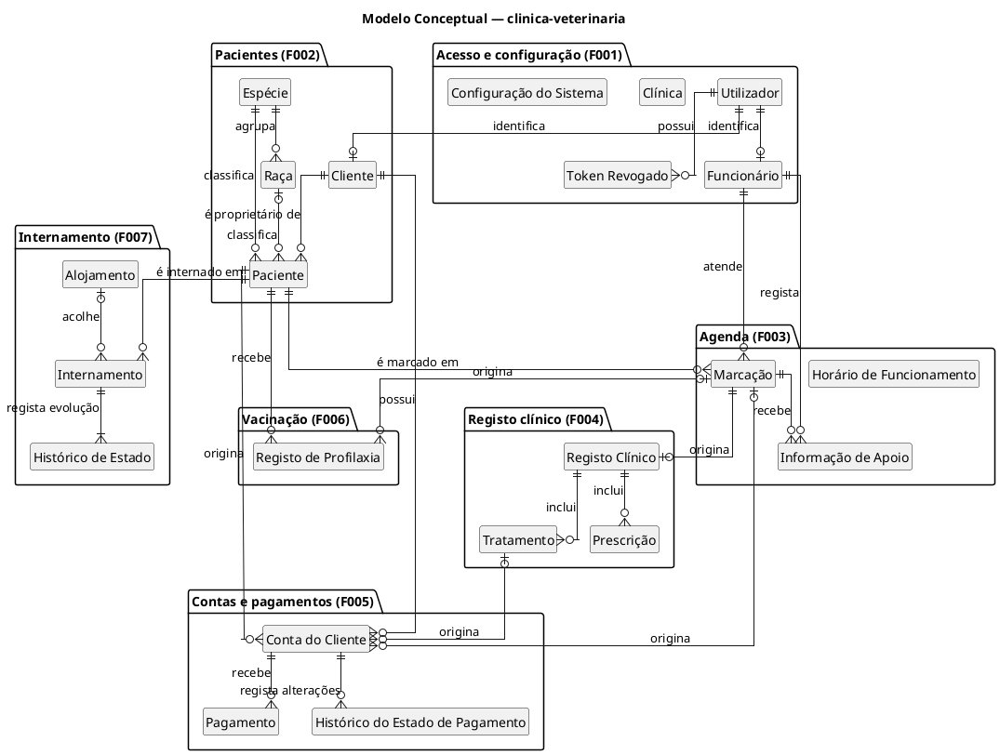
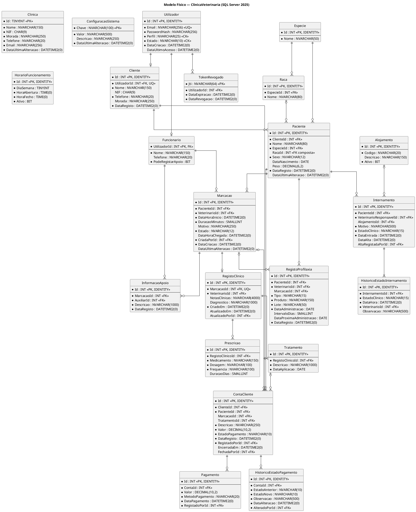

# Modelo de Dados — Base de Dados clinica-veterinaria

**Projeto:** Gestão de Clínica Veterinária  
**Grupo:** G08  
**Milestone:** m2  
**Issue:** I016 — Modelo de Dados (Base de dados clinica-veterinaria)  
**Versão:** v01  
**SGBD:** Microsoft SQL Server 2025  
**Abordagem de persistência:** Entity Framework Core 8.0 (code-first)

---

## 1. Objetivo

O presente documento define o modelo de dados da base de dados `clinica-veterinaria`, que assegura a persistência, a integridade e a consulta da informação do sistema de Gestão de Clínica Veterinária.

O documento apresenta:

- o **modelo conceptual**, com as entidades do domínio e as respetivas relações e cardinalidades;
- o **modelo lógico**, com o esquema relacional normalizado, chaves primárias e chaves estrangeiras;
- o **modelo físico**, com os tipos de dados do SQL Server, restrições, índices e regras de implementação através do Entity Framework Core;
- o **dicionário de dados** de todas as tabelas;
- a **rastreabilidade** entre as tabelas, os requisitos e os casos de uso.

Todos os diagramas são produzidos em PlantUML, conforme o Regulamento Interno do Grupo G08 (secção 12.1), e o respetivo código-fonte está incluído neste ficheiro, conforme a secção 17 do Regulamento de Funcionamento da UC.

---

## 2. Fontes e referências

| Referência | Utilização neste documento |
|---|---|
| `m1-proposta-sistema-v03.pdf` | Atores, funcionalidades F001–F007 e dados relevantes do domínio. |
| `m1-declaracao-ambito-v03.pdf` | Âmbito por componente, exclusões e limites transversais. |
| `m2-especificacao-requisitos-v01.md` | Requisitos RF001–RF052 e RNF001–RNF006. |
| `m2-especificacoes-casos-uso-v01.md` | Casos de uso UC01–UC18, fluxos, exceções e pós-condições. |
| `m2-documentacao-arquitetura-v01.md` | Componentes, responsabilidades, tecnologias e regras de autorização. |
| `m2-documentacao-api-v01.md` | Contrato previsto da API, autenticação, endpoints, permissões e formatos de dados. |
| `m1-regulamento-grupo-v01.pdf` | Tecnologias adotadas (SQL Server, EF Core code-first, PlantUML). |
| Regulamento de Funcionamento da UC | Componentes obrigatórios, regras de diagramas e nomenclatura. |

---

## 3. Decisões e pressupostos de modelação

| N.º | Decisão | Justificação |
|---|---|---|
| D01 | As credenciais de acesso são guardadas numa única tabela `Utilizador`, com o atributo `Perfil`. Os dados próprios dos funcionários e dos Clientes ficam em `Funcionario` e `Cliente`. | Uma única tabela de autenticação simplifica RF001–RF005 e o controlo por perfil (RNF001), mantendo separados os dados de negócio. |
| D02 | Cada `Cliente` possui obrigatoriamente um `Utilizador` associado com perfil `Cliente`. | A API prevista cria o proprietário e a respetiva conta de acesso mobile na mesma operação de RF010 (`POST /clientes`). |
| D03 | A autenticação usa JWT com validade de 8 horas e não utiliza refresh token. O `jti` de um token terminado por logout é persistido em `TokenRevogado` até à expiração. | Alinha com RF003–RF004 e com a Documentação da API. O bloqueio de conta é verificado pelo backend através de `Utilizador.Estado`. |
| D04 | A idade do paciente não é armazenada; é derivada de `DataNascimento`. | Evita um valor temporal redundante e desatualizado. |
| D05 | `Especie` e `Raca` são tabelas de referência e uma raça tem de pertencer à espécie do paciente. | Evita valores livres inconsistentes e permite pesquisas fiáveis. |
| D06 | A consulta corresponde à entidade `Marcacao`, que acompanha o ciclo pendente, confirmada, realizada ou cancelada. | RF021–RF025 e RF030–RF033 referem-se ao mesmo episódio. |
| D07 | Cada consulta tem no máximo um `RegistoClinico`, que contém as notas clínicas e o diagnóstico; os tratamentos e as prescrições são linhas dependentes do registo. Nenhuma destas tabelas guarda `PacienteId`: o paciente obtém-se através de `Marcacao`. | Corresponde a EP-031/EP-032 da API (um registo por consulta, erro 409 em duplicado) e a RF030–RF034. A unicidade de `MarcacaoId` é garantida pelo SGBD. Guardar `PacienteId` criaria uma dependência transitiva e permitiria registos contraditórios (3FN). |
| D08 | Vacinações e desparasitações usam uma única tabela `RegistoProfilaxia`, distinguida por `Tipo`. | RF043 e RF044 possuem a mesma estrutura; RF045 determina a próxima administração. |
| D09 | Cada `ContaCliente` representa um custo administrativo individual associado a um Cliente e a um paciente, podendo referenciar uma marcação ou tratamento. | A API define que `POST /contas` regista diretamente um custo; não é necessária uma tabela intermédia `ItemCusto`. |
| D10 | `Pagamento` associa-se diretamente a `ContaCliente`; uma conta pode receber vários pagamentos parciais. | Corresponde a RF039–RF040 e a `POST /contas/{id}/pagamentos`. |
| D11 | Alterações administrativas explícitas ao estado de pagamento são guardadas em `HistoricoEstadoPagamento`, com justificação e autor. Constituem correções excecionais: alteram apenas `EstadoPagamento` e nunca criam, alteram ou eliminam registos de `Pagamento`. | Corresponde a EP-039 (`observacao` obrigatória e histórico). A correção só é aceite quando o estado permanece coerente com o valor em dívida: `Pago` quando a dívida é zero e `Pendente` quando existe dívida. |
| D12 | O estado clínico atual fica em `Internamento` e cada alteração é registada em `HistoricoEstadoInternamento`. | Permite apresentar o estado atual e conservar a evolução de RF051. |
| D13 | Não existem eliminações em cascata nos dados de negócio. | Preserva histórico clínico, administrativo e financeiro (RNF005). |
| D14 | Restrições dependentes do perfil são aplicadas pelo backend e verificadas por testes de autorização. | Não são adequadamente expressáveis por `CHECK` simples no SQL Server. |
| D15 | Datas e horas com instante são guardadas em `DATETIME2(0)` UTC e convertidas na apresentação. | Alinha com as convenções da API e evita ambiguidades horárias. |
| D16 | Valores enumerados são guardados como texto com restrição `CHECK`. | Facilita leitura, validação e alinhamento com as enumerações da API/backend. |
| D17 | A disponibilidade de RF020 não é persistida: é calculada a partir de `HorarioFuncionamento`, das marcações não canceladas do Veterinário e da duração da consulta (`ConfiguracaoSistema`). | Corresponde a EP-022 da Documentação da API, que devolve horários livres calculados e não prevê operação para registar disponibilidade. **Limitação assumida:** todos os Veterinários partilham o horário de funcionamento da clínica; folgas, ausências ou horários individuais não são representados nesta versão. |
| D18 | `Especie`, `Raca` e `Alojamento` são dados de referência carregados por seed. | Não existe requisito nem endpoint de escrita para gerir estes catálogos. |
| D19 | `Paciente.Peso` representa apenas o valor atual. | Não existe requisito de histórico de peso. |

### 3.1. Elementos fora do âmbito com impacto no modelo

Não são modelados dados de integração com SIAC ou bases nacionais, fornecedores de identidade externos, autenticação multifator, calendários externos, notificações SMS/e-mail, pagamentos eletrónicos, faturação certificada, leitura de códigos de barras/QR, equipamentos especializados ou migração de dados, conforme a secção 7 da Especificação de Requisitos e a Declaração de Âmbito.

---

## 4. Modelo conceptual

### 4.1. Diagrama entidade-relacionamento



### 4.2. Entidades

| Entidade | Descrição | Funcionalidade |
|---|---|---|
| Utilizador | Conta de acesso ao sistema, com credenciais, perfil e estado. | F001 |
| Token Revogado | `jti` de um JWT terminado por logout, conservado até à sua expiração. | F001 |
| Funcionário | Dados de um elemento da equipa da clínica com perfil interno. | F001 |
| Clínica | Dados gerais da clínica. | F001 |
| Configuração do Sistema | Parâmetros configuráveis geridos pelo Administrador. | F001 |
| Cliente | Proprietário associado obrigatoriamente a uma conta de acesso mobile. | F001, F002 |
| Paciente | Animal acompanhado pela clínica, com dados administrativos. | F002 |
| Espécie / Raça | Dados de referência para classificar pacientes. | F002 |
| Horário de Funcionamento | Períodos de abertura da clínica, geridos pelo Administrador. | F003 |
| Marcação | Consulta marcada para um paciente e Veterinário, incluindo estado e chegada. | F003 |
| Informação de Apoio | Informação não clínica registada pelo Auxiliar para uma consulta. | F003 |
| Registo Clínico | Ficha clínica única de uma consulta, com notas clínicas e diagnóstico. | F004 |
| Tratamento | Tratamento aplicado no âmbito de um registo clínico. | F004 |
| Prescrição | Medicamento prescrito, com dosagem, frequência e duração. | F004 |
| Conta do Cliente | Custo administrativo individual de um serviço prestado a um paciente. | F005 |
| Pagamento | Pagamento manual total ou parcial registado ao balcão. | F005 |
| Histórico do Estado de Pagamento | Alterações administrativas ao estado de pagamento. | F005 |
| Registo de Profilaxia | Administração de vacina ou desparasitante. | F006 |
| Alojamento | Jaula, box ou outro local de internamento. | F007 |
| Internamento | Período de hospitalização de um paciente. | F007 |
| Histórico de Estado | Evolução do estado clínico de um internamento. | F007 |

### 4.3. Relacionamentos e cardinalidades

| Relacionamento | Cardinalidade | Regra de negócio |
|---|---|---|
| Utilizador — Token Revogado | 1 : 0..N | Cada token revogado pertence a um único utilizador. |
| Utilizador — Funcionário | 1 : 0..1 | Cada funcionário tem exatamente uma conta de acesso interna. |
| Utilizador — Cliente | 1 : 0..1 | Cada Cliente tem exatamente uma conta com perfil `Cliente`. |
| Cliente — Paciente | 1 : 0..N | Cada paciente tem um único proprietário. |
| Espécie — Raça | 1 : 0..N | Cada raça pertence a uma única espécie. |
| Espécie — Paciente | 1 : 0..N | Cada paciente tem uma espécie. |
| Raça — Paciente | 0..1 : 0..N | A raça é opcional e coerente com a espécie. |
| Paciente — Marcação | 1 : 0..N | Cada marcação é de um único paciente. |
| Funcionário (Veterinário) — Marcação | 1 : 0..N | Cada marcação é atribuída a um Veterinário. |
| Marcação — Informação de Apoio | 1 : 0..N | Informação não clínica da consulta. |
| Marcação — Registo Clínico | 1 : 0..1 | Cada consulta tem no máximo um registo clínico; o paciente obtém-se através da consulta. |
| Registo Clínico — Tratamento | 1 : 0..N | Os tratamentos pertencem ao registo clínico da consulta. |
| Registo Clínico — Prescrição | 1 : 0..N | Cada prescrição corresponde a um medicamento. |
| Paciente — Registo de Profilaxia | 1 : 0..N | Histórico de vacinação/desparasitação. |
| Marcação — Registo de Profilaxia | 0..1 : 0..N | Uma administração pode ocorrer numa consulta. |
| Cliente — Conta | 1 : 0..N | Cada conta pertence a um Cliente. |
| Paciente — Conta | 1 : 0..N | Cada custo identifica o paciente do serviço. |
| Marcação — Conta | 0..1 : 0..N | A conta pode resultar de uma consulta. |
| Tratamento — Conta | 0..1 : 0..N | A conta pode resultar de um tratamento. |
| Conta — Pagamento | 1 : 0..N | Uma conta pode receber vários pagamentos parciais. |
| Conta — Histórico do Estado de Pagamento | 1 : 0..N | Alterações administrativas ao estado ficam auditadas. |
| Paciente — Internamento | 1 : 0..N | Só pode existir um internamento ativo por paciente. |
| Alojamento — Internamento | 0..1 : 0..N | Só pode existir um internamento ativo por alojamento. |
| Internamento — Histórico de Estado | 1 : 1..N | O estado inicial e alterações ficam registados. |

---

## 5. Modelo lógico

### 5.1. Esquema relacional

Notação: **sublinhado** = chave primária (PK); `#` = chave estrangeira (FK); `?` = atributo opcional.

**Acesso e configuração**
- Utilizador(<u>Id</u>, Email, PasswordHash, Perfil, Estado, DataCriacao, DataUltimoAcesso?)
- TokenRevogado(<u>Jti</u>, #UtilizadorId, DataExpiracao, DataRevogacao)
- Funcionario(<u>#UtilizadorId</u>, Nome, Telefone?, PodeRegistarApoio)
- Clinica(<u>Id</u>, Nome, NIF, Morada, Telefone, Email, DataUltimaAlteracao)
- ConfiguracaoSistema(<u>Chave</u>, Valor, Descricao?, DataUltimaAlteracao)

**Clientes e pacientes**
- Cliente(<u>Id</u>, #UtilizadorId, Nome, NIF?, Telefone, Morada?, DataRegisto)
- Especie(<u>Id</u>, Nome)
- Raca(<u>Id</u>, #EspecieId, Nome)
- Paciente(<u>Id</u>, #ClienteId, Nome, #EspecieId, #RacaId?, Sexo, DataNascimento?, Peso?, DataRegisto, DataUltimaAlteracao?)

**Agenda**
- HorarioFuncionamento(<u>Id</u>, DiaSemana, HoraAbertura, HoraFecho, Ativo)
- Marcacao(<u>Id</u>, #PacienteId, #VeterinarioId, DataHoraInicio, DuracaoMinutos, Motivo?, Estado, DataHoraChegada?, #CriadaPorId, DataCriacao, DataUltimaAlteracao?)
- InformacaoApoio(<u>Id</u>, #MarcacaoId, #AuxiliarId, Descricao, DataRegisto)

**Registo clínico**
- RegistoClinico(<u>Id</u>, #MarcacaoId, #VeterinarioId, NotasClinicas?, Diagnostico?, CriadoEm, AtualizadoEm?, #AtualizadoPorId?)
- Tratamento(<u>Id</u>, #RegistoClinicoId, Descricao, DataAplicacao)
- Prescricao(<u>Id</u>, #RegistoClinicoId, Medicamento, Dosagem, Frequencia, DuracaoDias?)

**Vacinação e desparasitação**
- RegistoProfilaxia(<u>Id</u>, #PacienteId, #VeterinarioId, #MarcacaoId?, Tipo, Produto, Lote, DataAdministracao, IntervaloDias?, DataProximaAdministracao?, DataRegisto)

**Contas e pagamentos**
- ContaCliente(<u>Id</u>, #ClienteId, #PacienteId, #MarcacaoId?, #TratamentoId?, Descricao, Valor, EstadoPagamento, DataRegisto, #RegistadoPorId, EncerradaEm?, #FechadaPorId?)
- Pagamento(<u>Id</u>, #ContaId, Valor, MetodoPagamento, DataPagamento, #RegistadoPorId)
- HistoricoEstadoPagamento(<u>Id</u>, #ContaId, EstadoAnterior, EstadoNovo, Observacao, DataAlteracao, #AlteradoPorId)

**Internamento**
- Alojamento(<u>Id</u>, Codigo, Descricao?, Ativo)
- Internamento(<u>Id</u>, #PacienteId, #VeterinarioResponsavelId, #AlojamentoId?, Motivo, EstadoClinico, DataEntrada, DataAlta?, #AltaRegistadaPorId?)
- HistoricoEstadoInternamento(<u>Id</u>, #InternamentoId, EstadoClinico, DataHora, #VeterinarioId, Observacao?)

### 5.2. Chaves estrangeiras

| Tabela | Coluna | Referencia | Papel |
|---|---|---|---|
| TokenRevogado | UtilizadorId | Utilizador.Id | Titular do token revogado |
| Funcionario | UtilizadorId | Utilizador.Id | Conta do funcionário |
| Cliente | UtilizadorId | Utilizador.Id | Conta mobile do Cliente |
| Raca | EspecieId | Especie.Id | Espécie da raça |
| Paciente | ClienteId | Cliente.Id | Proprietário |
| Paciente | EspecieId | Especie.Id | Espécie |
| Paciente | (EspecieId, RacaId) | Raca(EspecieId, Id) | Raça coerente com a espécie |
| Marcacao | PacienteId | Paciente.Id | Paciente |
| Marcacao | VeterinarioId | Funcionario.UtilizadorId | Veterinário |
| Marcacao | CriadaPorId | Funcionario.UtilizadorId | Rececionista |
| InformacaoApoio | MarcacaoId | Marcacao.Id | Consulta |
| InformacaoApoio | AuxiliarId | Funcionario.UtilizadorId | Auxiliar |
| RegistoClinico | MarcacaoId | Marcacao.Id | Consulta (única) |
| RegistoClinico | VeterinarioId | Funcionario.UtilizadorId | Veterinário que criou o registo |
| RegistoClinico | AtualizadoPorId | Funcionario.UtilizadorId | Veterinário da última alteração |
| Tratamento | RegistoClinicoId | RegistoClinico.Id | Registo clínico |
| Prescricao | RegistoClinicoId | RegistoClinico.Id | Registo clínico |
| RegistoProfilaxia | PacienteId | Paciente.Id | Paciente |
| RegistoProfilaxia | VeterinarioId | Funcionario.UtilizadorId | Veterinário |
| RegistoProfilaxia | MarcacaoId | Marcacao.Id | Consulta opcional |
| ContaCliente | ClienteId | Cliente.Id | Titular |
| ContaCliente | PacienteId | Paciente.Id | Animal do serviço |
| ContaCliente | MarcacaoId | Marcacao.Id | Consulta opcional |
| ContaCliente | TratamentoId | Tratamento.Id | Tratamento opcional |
| ContaCliente | RegistadoPorId | Funcionario.UtilizadorId | Rececionista que registou |
| ContaCliente | FechadaPorId | Funcionario.UtilizadorId | Rececionista que fechou |
| Pagamento | ContaId | ContaCliente.Id | Conta liquidada |
| Pagamento | RegistadoPorId | Funcionario.UtilizadorId | Rececionista |
| HistoricoEstadoPagamento | ContaId | ContaCliente.Id | Conta alterada |
| HistoricoEstadoPagamento | AlteradoPorId | Funcionario.UtilizadorId | Rececionista |
| Internamento | PacienteId | Paciente.Id | Paciente |
| Internamento | VeterinarioResponsavelId | Funcionario.UtilizadorId | Veterinário responsável |
| Internamento | AlojamentoId | Alojamento.Id | Alojamento |
| Internamento | AltaRegistadaPorId | Funcionario.UtilizadorId | Veterinário da alta |
| HistoricoEstadoInternamento | InternamentoId | Internamento.Id | Internamento |
| HistoricoEstadoInternamento | VeterinarioId | Funcionario.UtilizadorId | Veterinário da alteração |

### 5.3. Normalização

O esquema encontra-se na **Terceira Forma Normal (3FN)**:

- **1FN** — todos os atributos são atómicos. Os tratamentos e as prescrições de uma consulta, que formariam grupos repetitivos, estão em tabelas próprias ligadas a `RegistoClinico`.
- **2FN** — todas as tabelas usam chave primária simples (`Id`), pelo que não existem dependências parciais.
- **3FN** — não existem dependências transitivas entre atributos não chave. Por exemplo, o nome da espécie está em `Especie` e não em `Paciente`; o Cliente de um registo clínico é obtido através de `Marcacao → Paciente → Cliente`.

Redundâncias controladas e justificadas:

| Atributo | Justificação | Garantia de coerência |
|---|---|---|
| `ContaCliente.PacienteId` | Permite associar sempre o custo ao animal e filtrar despesas no mobile. | O backend valida que o paciente pertence ao Cliente titular. |
| `ContaCliente.EstadoPagamento` | Permite consultar diretamente o estado. | É atualizado ao registar pagamentos; correções explícitas ficam em `HistoricoEstadoPagamento` e só são aceites quando coerentes com o valor em dívida. |
| `Internamento.EstadoClinico` | Evita percorrer o histórico para obter o estado atual no painel (RF050). | O backend atualiza o internamento e cria a linha de histórico na mesma transação. |
| `RegistoProfilaxia.DataProximaAdministracao` | Coluna calculada e persistida pelo próprio SGBD (RF045). | Calculada pelo SQL Server; não pode ser alterada manualmente. |

---

## 6. Modelo físico

### 6.1. Ambiente e convenções

| Aspeto | Decisão |
|---|---|
| SGBD | Microsoft SQL Server 2025 |
| Componente arquitetural | ARC-DB (base de dados) e ARC-DATA (persistência EF Core), conforme `m2-documentacao-arquitetura-v01.md` |
| Base de dados | `ClinicaVeterinaria` (identificador físico da base de dados `clinica-veterinaria`, sem hífen para evitar delimitadores em T-SQL) |
| Esquema | `dbo` |
| Criação do esquema | Migrações do Entity Framework Core 8.0 (code-first), a entregar em m3 em `04.13-scripts-de-base-de-dados` |
| Nomes de tabelas e colunas | PascalCase, singular, sem acentos |
| Chaves primárias | `INT IDENTITY(1,1)`, exceto `Funcionario` (PK = FK para `Utilizador`), `ConfiguracaoSistema` (chave natural) e `Clinica` (linha única) |
| Nomes de restrições | `PK_<Tabela>`, `FK_<Tabela>_<Referência>_<Coluna>`, `UQ_<Tabela>_<Coluna>`, `CK_<Tabela>_<Regra>`, `IX_<Tabela>_<Colunas>` |
| Datas e horas | `DATETIME2(0)` em UTC; `DATE` para datas sem hora; `TIME(0)` para horários |
| Valores monetários | `DECIMAL(10,2)` em euros |
| Texto | `NVARCHAR(n)` (Unicode) |
| Comportamento de eliminação | `NO ACTION` em todas as chaves estrangeiras |
| Dados de teste | Exclusivamente fictícios, criados por scripts de seed (Regulamento Interno G08, secção 14.3) |

### 6.2. Diagrama físico



> Nota: para manter o diagrama legível, algumas ligações de auditoria a `Funcionario` não são desenhadas; estão identificadas na tabela 5.2 e no dicionário de dados.

### 6.3. Restrições de domínio (CHECK)

| Restrição | Tabela | Regra |
|---|---|---|
| CK_Utilizador_Perfil | Utilizador | `Perfil IN ('Administrador','Rececionista','Veterinario','AuxiliarVeterinario','Cliente')` |
| CK_Utilizador_Estado | Utilizador | `Estado IN ('Ativo','Bloqueado')` |
| CK_Clinica_LinhaUnica | Clinica | `Id = 1` |
| CK_Paciente_Sexo | Paciente | `Sexo IN ('Macho','Femea','Desconhecido')` |
| CK_Paciente_Peso | Paciente | `Peso IS NULL OR Peso > 0` |
| CK_Horario_DiaSemana | HorarioFuncionamento | `DiaSemana BETWEEN 1 AND 7` |
| CK_Horario_Intervalo | HorarioFuncionamento | `HoraFecho > HoraAbertura` |
| CK_Marcacao_Estado | Marcacao | `Estado IN ('Pendente','Confirmada','Realizada','Cancelada')` |
| CK_Marcacao_Duracao | Marcacao | `DuracaoMinutos > 0` |
| CK_Prescricao_Duracao | Prescricao | `DuracaoDias IS NULL OR DuracaoDias > 0` |
| CK_RegistoClinico_Atualizacao | RegistoClinico | `(AtualizadoEm IS NULL AND AtualizadoPorId IS NULL) OR (AtualizadoEm IS NOT NULL AND AtualizadoPorId IS NOT NULL)` |
| CK_Profilaxia_Tipo | RegistoProfilaxia | `Tipo IN ('Vacina','Desparasitacao')` |
| CK_Profilaxia_Intervalo | RegistoProfilaxia | `IntervaloDias IS NULL OR IntervaloDias > 0` |
| CK_Conta_Valor | ContaCliente | `Valor > 0` |
| CK_Conta_EstadoPagamento | ContaCliente | `EstadoPagamento IN ('Pendente','Pago')` |
| CK_Conta_Fecho | ContaCliente | `(EncerradaEm IS NULL AND FechadaPorId IS NULL) OR (EncerradaEm IS NOT NULL AND FechadaPorId IS NOT NULL AND EstadoPagamento = 'Pago')` |
| CK_Pagamento_Valor | Pagamento | `Valor > 0` |
| CK_Pagamento_Metodo | Pagamento | `MetodoPagamento IN ('Numerario','Multibanco','Transferencia')` |
| CK_HistoricoPagamento_Estados | HistoricoEstadoPagamento | `EstadoAnterior IN ('Pendente','Pago') AND EstadoNovo IN ('Pendente','Pago') AND EstadoAnterior <> EstadoNovo` |
| CK_Internamento_Estado | Internamento, HistoricoEstadoInternamento | `EstadoClinico IN ('EmObservacao','Recobro','AltaMedica')` |
| CK_Internamento_Alta | Internamento | `(EstadoClinico = 'AltaMedica' AND DataAlta IS NOT NULL) OR (EstadoClinico <> 'AltaMedica' AND DataAlta IS NULL)` |
| CK_Internamento_Datas | Internamento | `DataAlta IS NULL OR DataAlta >= DataEntrada` |

### 6.4. Unicidade e chaves compostas

| Restrição | Tabela | Colunas | Observação |
|---|---|---|---|
| UQ_Utilizador_Email | Utilizador | Email | Identificador de autenticação. |
| PK_TokenRevogado_Jti | TokenRevogado | Jti | Identificador único do token revogado. |
| UQ_Cliente_UtilizadorId | Cliente | UtilizadorId | Relação 1:1 obrigatória entre Cliente e conta. |
| UQ_Cliente_NIF | Cliente | NIF | Índice único filtrado `WHERE NIF IS NOT NULL`. |
| UQ_Especie_Nome | Especie | Nome | — |
| UQ_RegistoClinico_Marcacao | RegistoClinico | MarcacaoId | Uma consulta tem no máximo um registo clínico (EP-031, erro 409). |
| UQ_Raca_Especie_Nome | Raca | EspecieId, Nome | A mesma raça não se repete na mesma espécie. |
| UQ_Raca_Especie_Id | Raca | EspecieId, Id | Chave alternativa para a FK composta de `Paciente`. |
| FK_Paciente_Raca | Paciente | (EspecieId, RacaId) → Raca(EspecieId, Id) | Garante coerência entre espécie e raça. |
| UQ_Alojamento_Codigo | Alojamento | Codigo | — |
| UQ_Internamento_PacienteAtivo | Internamento | PacienteId | Índice único filtrado `WHERE DataAlta IS NULL`. |
| UQ_Internamento_AlojamentoAtivo | Internamento | AlojamentoId | Índice único filtrado `WHERE DataAlta IS NULL AND AlojamentoId IS NOT NULL`. |

### 6.5. Índices de desempenho

| Índice | Tabela | Colunas | Consulta suportada |
|---|---|---|---|
| IX_TokenRevogado_Utilizador | TokenRevogado | UtilizadorId, DataExpiracao | Verificação/limpeza de tokens revogados. |
| IX_Paciente_ClienteId | Paciente | ClienteId | Pesquisa por proprietário e mobile. |
| IX_Marcacao_Veterinario_Data | Marcacao | VeterinarioId, DataHoraInicio | Agenda e cálculo de disponibilidade. |
| IX_Marcacao_Paciente_Data | Marcacao | PacienteId, DataHoraInicio | Marcações futuras e histórico. |
| IX_Marcacao_Data | Marcacao | DataHoraInicio | Agenda por período. |
| IX_Tratamento_Registo | Tratamento | RegistoClinicoId | Leitura do registo clínico. |
| IX_Prescricao_Registo | Prescricao | RegistoClinicoId | Leitura do registo clínico. |
| IX_Profilaxia_Paciente_Data | RegistoProfilaxia | PacienteId, DataAdministracao | Boletim web/mobile. |
| IX_Conta_Cliente_Estado | ContaCliente | ClienteId, EstadoPagamento | Valores em dívida. |
| IX_Conta_Paciente | ContaCliente | PacienteId, DataRegisto | Despesas por animal. |
| IX_Pagamento_Conta | Pagamento | ContaId, DataPagamento | Total pago e movimentos. |
| IX_HistoricoPagamento_Conta | HistoricoEstadoPagamento | ContaId, DataAlteracao | Histórico de correções. |
| IX_Historico_Internamento | HistoricoEstadoInternamento | InternamentoId, DataHora | Evolução do internamento. |

As chaves estrangeiras sem índice próprio nesta tabela são indexadas automaticamente pelo Entity Framework Core.

### 6.6. Coluna calculada

A data da próxima administração (RF045) é calculada pelo SQL Server e persistida:

```sql
DataProximaAdministracao AS (
    CASE
        WHEN IntervaloDias IS NULL THEN NULL
        ELSE DATEADD(DAY, IntervaloDias, DataAdministracao)
    END
) PERSISTED
```

No Entity Framework Core é configurada com:

```csharp
builder.Property(r => r.DataProximaAdministracao)
       .HasComputedColumnSql(
           "CASE WHEN [IntervaloDias] IS NULL THEN NULL " +
           "ELSE DATEADD(DAY, [IntervaloDias], [DataAdministracao]) END",
           stored: true);
```

### 6.7. Correspondência com o Entity Framework Core

| Elemento do modelo | Implementação code-first |
|---|---|
| Tabelas | Uma classe de entidade por tabela, configurada com `IEntityTypeConfiguration<T>`. |
| Valores enumerados | `Perfil`, `EstadoUtilizador`, `EstadoConsulta`, `TipoAdministracao`, `EstadoPagamento`, `MetodoPagamento`, `EstadoInternamento` e `Sexo`, convertidos com `HasConversion<string>()`. |
| Restrições `CHECK` | `ToTable(t => t.HasCheckConstraint(...))`. |
| Índices filtrados | `HasIndex(...).IsUnique().HasFilter(...)`. |
| FK composta Paciente → Raca | `HasAlternateKey` em `Raca` e `HasForeignKey` composta em `Paciente`. |
| Eliminação | `DeleteBehavior.Restrict` em todas as relações. |
| Valores por omissão | `Alojamento.Ativo = 1`, `Utilizador.Estado = 'Ativo'`, `Marcacao.Estado = 'Pendente'`, `ContaCliente.EstadoPagamento = 'Pendente'`, `Funcionario.PodeRegistarApoio = 0`; datas de registo usam `SYSUTCDATETIME()`. |
| Dados de referência | `HasData` para `Clinica`, `Especie`, `Raca`, `Alojamento` e `ConfiguracaoSistema`, com valores fictícios. |

### 6.8. Regras de integridade garantidas pelo backend

| Regra | Requisitos |
|---|---|
| `Funcionario` só existe para perfil interno e `Cliente.UtilizadorId` referencia obrigatoriamente perfil `Cliente`. | RF005, RF006, RF010 |
| Contas bloqueadas não autenticam e tokens emitidos são rejeitados enquanto a conta estiver bloqueada. | RF002, RF009 |
| Um `jti` presente em `TokenRevogado` não autentica pedidos antes da expiração original. | RF003, RF004 |
| Só o Administrador cria ou altera `HorarioFuncionamento`; um mesmo dia pode ter vários períodos, desde que não se sobreponham. | RF019, RNF001 |
| A disponibilidade é calculada a partir do horário, marcações não canceladas e duração, sem tabela autónoma. | RF019, RF020, RF021 |
| `Marcacao.VeterinarioId` e autores de atos clínicos, profilaxia e alterações de internamento têm perfil `Veterinario`. | RF021, RF030–RF034, RF043, RF044, RF051, RF052 |
| Só existe `RegistoClinico` para marcações `Confirmada` ou `Realizada`, e cada registo tem pelo menos um elemento clínico preenchido (notas, diagnóstico, tratamento ou prescrição). | RF030–RF033 (EP-031) |
| Cada alteração a um registo clínico preenche `AtualizadoEm` e `AtualizadoPorId`. Um tratamento referenciado por `ContaCliente.TratamentoId` não pode ser removido do registo. | RF034, RF037 (EP-032) |
| `InformacaoApoio.AuxiliarId` tem perfil `AuxiliarVeterinario` e `PodeRegistarApoio = 1`. | RF027 |
| Não existem marcações não canceladas sobrepostas para o mesmo Veterinário. | RF020, RF021 |
| O paciente da `ContaCliente` pertence ao Cliente titular; marcação/tratamento opcionais têm de referir o mesmo paciente. | RF037, RF042 |
| O total pago nunca ultrapassa `ContaCliente.Valor`; o valor pago e o valor em dívida são calculados a partir de `Pagamento` e não são armazenados. | RF038, RF039 |
| Ao registar um pagamento que liquida o total, `EstadoPagamento` passa automaticamente a `Pago` (EP-038). Não são aceites pagamentos numa conta `Pago` ou encerrada. | RF039, RF040 |
| A alteração manual de `EstadoPagamento` (EP-039) é uma correção excecional: exige observação, cria uma linha em `HistoricoEstadoPagamento`, só é aceite se o novo estado for diferente do atual e continuar coerente com o valor em dívida (`Pago` com dívida zero; `Pendente` com dívida superior a zero). Não cria nem elimina pagamentos. | RF040 |
| Só se fecha uma conta `Pago` e sem valor em dívida; uma conta encerrada não admite novos pagamentos nem alterações. | RF041 |
| Cada alteração de `Internamento.EstadoClinico` cria uma linha no respetivo histórico. | RF051, RF052 |
| O Administrador não acede a F004, F006 nem internamento. | F001 (DA), RNF001 |
| O Cliente só acede a dados associados à sua conta. | RNF002 |

---

## 7. Dicionário de dados

Legenda: **N** = admite nulo (S/N). PK = chave primária; FK = chave estrangeira; UQ = único; CK = restrição de domínio; DF = valor por omissão.

### 7.1. Utilizador

| Coluna | Tipo | N | Restrições | Descrição |
|---|---|---|---|---|
| Id | INT | N | PK, IDENTITY | Identificador do utilizador. |
| Email | NVARCHAR(256) | N | UQ | Email usado como credencial de autenticação. |
| PasswordHash | NVARCHAR(256) | N | — | Hash da palavra-passe (ASP.NET Core Identity `PasswordHasher`). A palavra-passe nunca é guardada em claro. |
| Perfil | NVARCHAR(25) | N | CK | Administrador, Rececionista, Veterinario, AuxiliarVeterinario ou Cliente. |
| Estado | NVARCHAR(10) | N | CK, DF 'Ativo' | Ativo ou Bloqueado. |
| DataCriacao | DATETIME2(0) | N | DF SYSUTCDATETIME() | Data de criação da conta. |
| DataUltimoAcesso | DATETIME2(0) | S | — | Data da última autenticação válida. |

### 7.2. TokenRevogado

| Coluna | Tipo | N | Restrições | Descrição |
|---|---|---|---|---|
| Jti | NVARCHAR(64) | N | PK | Identificador único do JWT revogado. |
| UtilizadorId | INT | N | FK → Utilizador | Titular do token. |
| DataExpiracao | DATETIME2(0) | N | — | Expiração original do JWT. |
| DataRevogacao | DATETIME2(0) | N | DF SYSUTCDATETIME() | Momento do logout (RF003). |

### 7.3. Funcionario

| Coluna | Tipo | N | Restrições | Descrição |
|---|---|---|---|---|
| UtilizadorId | INT | N | PK, FK → Utilizador | Conta de acesso do funcionário. |
| Nome | NVARCHAR(150) | N | — | Nome completo. |
| Telefone | NVARCHAR(20) | S | — | Contacto telefónico. |
| PodeRegistarApoio | BIT | N | DF 0 | Autorização do Auxiliar Veterinário para registar informação de apoio (RF027). |

### 7.4. Clinica

| Coluna | Tipo | N | Restrições | Descrição |
|---|---|---|---|---|
| Id | TINYINT | N | PK, CK = 1 | Linha única com os dados da clínica. |
| Nome | NVARCHAR(150) | N | — | Designação da clínica. |
| NIF | CHAR(9) | N | — | Número de identificação fiscal. |
| Morada | NVARCHAR(250) | N | — | Morada. |
| Telefone | NVARCHAR(20) | N | — | Contacto telefónico. |
| Email | NVARCHAR(256) | N | — | Contacto eletrónico. |
| DataUltimaAlteracao | DATETIME2(0) | N | — | Última atualização (RF013). |

### 7.5. ConfiguracaoSistema

| Coluna | Tipo | N | Restrições | Descrição |
|---|---|---|---|---|
| Chave | NVARCHAR(100) | N | PK | Nome do parâmetro, por exemplo `DuracaoPadraoConsultaMinutos`. |
| Valor | NVARCHAR(500) | N | — | Valor do parâmetro. |
| Descricao | NVARCHAR(250) | S | — | Explicação do parâmetro. |
| DataUltimaAlteracao | DATETIME2(0) | N | — | Última atualização (RF013). |

### 7.6. Cliente

| Coluna | Tipo | N | Restrições | Descrição |
|---|---|---|---|---|
| Id | INT | N | PK, IDENTITY | Identificador do Cliente. |
| UtilizadorId | INT | N | FK → Utilizador, UQ | Conta de acesso obrigatória à aplicação móvel, criada com o Cliente (RF010). |
| Nome | NVARCHAR(150) | N | — | Nome completo do proprietário. |
| NIF | CHAR(9) | S | UQ filtrado | Número de identificação fiscal. |
| Telefone | NVARCHAR(20) | N | — | Contacto telefónico. |
| Morada | NVARCHAR(250) | S | — | Morada. |
| DataRegisto | DATETIME2(0) | N | DF SYSUTCDATETIME() | Data de registo. |

O endereço de e-mail usado pela conta do Cliente é armazenado em `Utilizador.Email`. As operações de criação e atualização do Cliente atualizam esse valor na mesma operação, evitando manter duas cópias do mesmo dado.

### 7.7. Especie

| Coluna | Tipo | N | Restrições | Descrição |
|---|---|---|---|---|
| Id | INT | N | PK, IDENTITY | Identificador. |
| Nome | NVARCHAR(50) | N | UQ | Designação da espécie (por exemplo, Cão, Gato). |

### 7.8. Raca

| Coluna | Tipo | N | Restrições | Descrição |
|---|---|---|---|---|
| Id | INT | N | PK, IDENTITY | Identificador. |
| EspecieId | INT | N | FK → Especie | Espécie a que a raça pertence. |
| Nome | NVARCHAR(80) | N | UQ (EspecieId, Nome) | Designação da raça. |

### 7.9. Paciente

| Coluna | Tipo | N | Restrições | Descrição |
|---|---|---|---|---|
| Id | INT | N | PK, IDENTITY | Identificador do paciente. |
| ClienteId | INT | N | FK → Cliente | Proprietário (RF014). |
| Nome | NVARCHAR(80) | N | — | Nome do animal. |
| EspecieId | INT | N | FK → Especie | Espécie. |
| RacaId | INT | S | FK composta → Raca | Raça, coerente com a espécie. |
| Sexo | NVARCHAR(12) | N | CK, DF 'Desconhecido' | Macho, Femea ou Desconhecido. |
| DataNascimento | DATE | S | — | Data de nascimento real ou estimada; a idade é derivada (D04). |
| Peso | DECIMAL(6,2) | S | CK > 0 | Peso atual em kg. |
| DataRegisto | DATETIME2(0) | N | DF SYSUTCDATETIME() | Data de criação da ficha. |
| DataUltimaAlteracao | DATETIME2(0) | S | — | Última atualização (RF016). |

### 7.10. HorarioFuncionamento

| Coluna | Tipo | N | Restrições | Descrição |
|---|---|---|---|---|
| Id | INT | N | PK, IDENTITY | Identificador. |
| DiaSemana | TINYINT | N | CK 1..7 | Dia da semana (1 = segunda-feira). |
| HoraAbertura | TIME(0) | N | — | Hora de início do período. |
| HoraFecho | TIME(0) | N | CK > HoraAbertura | Hora de fim do período. |
| Ativo | BIT | N | DF 1 | Período em vigor. |

Um dia pode ter vários períodos (por exemplo, manhã e tarde).

### 7.11. Marcacao

| Coluna | Tipo | N | Restrições | Descrição |
|---|---|---|---|---|
| Id | INT | N | PK, IDENTITY | Identificador da consulta. |
| PacienteId | INT | N | FK → Paciente | Paciente. |
| VeterinarioId | INT | N | FK → Funcionario | Veterinário atribuído. |
| DataHoraInicio | DATETIME2(0) | N | — | Data e hora marcadas. |
| DuracaoMinutos | SMALLINT | N | CK > 0 | Duração prevista. |
| Motivo | NVARCHAR(250) | S | — | Motivo administrativo da marcação. |
| Estado | NVARCHAR(12) | N | CK, DF 'Pendente' | Pendente, Confirmada, Realizada ou Cancelada (RF023). |
| DataHoraChegada | DATETIME2(0) | S | — | Registo de chegada (RF025). |
| CriadaPorId | INT | N | FK → Funcionario | Rececionista que criou a marcação. |
| DataCriacao | DATETIME2(0) | N | DF SYSUTCDATETIME() | Data de criação. |
| DataUltimaAlteracao | DATETIME2(0) | S | — | Última alteração (RF022). |

### 7.12. InformacaoApoio

| Coluna | Tipo | N | Restrições | Descrição |
|---|---|---|---|---|
| Id | INT | N | PK, IDENTITY | Identificador. |
| MarcacaoId | INT | N | FK → Marcacao | Consulta. |
| AuxiliarId | INT | N | FK → Funcionario | Auxiliar Veterinário autor. |
| Descricao | NVARCHAR(1000) | N | — | Informação não clínica de apoio. |
| DataRegisto | DATETIME2(0) | N | DF SYSUTCDATETIME() | Data de registo. |

### 7.13. RegistoClinico

| Coluna | Tipo | N | Restrições | Descrição |
|---|---|---|---|---|
| Id | INT | N | PK, IDENTITY | Identificador do registo clínico. |
| MarcacaoId | INT | N | FK → Marcacao, UQ | Consulta a que pertence; o paciente obtém-se através dela (D07). |
| VeterinarioId | INT | N | FK → Funcionario | Veterinário que criou o registo. |
| NotasClinicas | NVARCHAR(4000) | S | — | Notas clínicas da consulta (RF030). |
| Diagnostico | NVARCHAR(1000) | S | — | Diagnóstico (RF031). |
| CriadoEm | DATETIME2(0) | N | DF SYSUTCDATETIME() | Data de criação. |
| AtualizadoEm | DATETIME2(0) | S | CK coerente com AtualizadoPorId | Última alteração (RF034). |
| AtualizadoPorId | INT | S | FK → Funcionario | Veterinário da última alteração (RF034). |

### 7.14. Tratamento

| Coluna | Tipo | N | Restrições | Descrição |
|---|---|---|---|---|
| Id | INT | N | PK, IDENTITY | Identificador. |
| RegistoClinicoId | INT | N | FK → RegistoClinico | Registo clínico a que pertence. |
| Descricao | NVARCHAR(1000) | N | — | Tratamento aplicado (RF032). |
| DataAplicacao | DATE | N | — | Data da aplicação. |

### 7.15. Prescricao

| Coluna | Tipo | N | Restrições | Descrição |
|---|---|---|---|---|
| Id | INT | N | PK, IDENTITY | Identificador. |
| RegistoClinicoId | INT | N | FK → RegistoClinico | Registo clínico a que pertence. |
| Medicamento | NVARCHAR(150) | N | — | Medicamento prescrito (RF033). |
| Dosagem | NVARCHAR(100) | N | — | Dose (por exemplo, 3 gotas). |
| Frequencia | NVARCHAR(100) | N | — | Frequência (por exemplo, 2 vezes por dia). |
| DuracaoDias | SMALLINT | S | CK > 0 | Duração do tratamento. |

### 7.16. RegistoProfilaxia

| Coluna | Tipo | N | Restrições | Descrição |
|---|---|---|---|---|
| Id | INT | N | PK, IDENTITY | Identificador. |
| PacienteId | INT | N | FK → Paciente | Paciente. |
| VeterinarioId | INT | N | FK → Funcionario | Veterinário responsável. |
| MarcacaoId | INT | S | FK → Marcacao | Consulta em que ocorreu, quando aplicável. |
| Tipo | NVARCHAR(15) | N | CK | Vacina ou Desparasitacao (RF043, RF044). |
| Produto | NVARCHAR(150) | N | — | Tipo de vacina ou produto utilizado. |
| Lote | NVARCHAR(50) | N | — | Lote do produto. |
| DataAdministracao | DATE | N | — | Data de administração. |
| IntervaloDias | SMALLINT | S | CK > 0 | Intervalo até à próxima toma, definido pelo Veterinário. |
| DataProximaAdministracao | DATE | S | Calculada, PERSISTED | `DataAdministracao + IntervaloDias` (RF045). |
| DataRegisto | DATETIME2(0) | N | DF SYSUTCDATETIME() | Data de registo. |

### 7.17. ContaCliente

| Coluna | Tipo | N | Restrições | Descrição |
|---|---|---|---|---|
| Id | INT | N | PK, IDENTITY | Identificador da conta/custo. |
| ClienteId | INT | N | FK → Cliente | Titular. |
| PacienteId | INT | N | FK → Paciente | Animal do serviço. |
| MarcacaoId | INT | S | FK → Marcacao | Consulta associada, quando aplicável. |
| TratamentoId | INT | S | FK → Tratamento | Tratamento associado, quando aplicável. |
| Descricao | NVARCHAR(250) | N | — | Descrição do serviço/custo. |
| Valor | DECIMAL(10,2) | N | CK > 0 | Valor total (RF037). |
| EstadoPagamento | NVARCHAR(10) | N | CK, DF 'Pendente' | Pendente ou Pago. |
| DataRegisto | DATETIME2(0) | N | DF SYSUTCDATETIME() | Registo do custo. |
| RegistadoPorId | INT | N | FK → Funcionario | Rececionista. |
| EncerradaEm | DATETIME2(0) | S | — | `NULL` enquanto a conta estiver aberta. |
| FechadaPorId | INT | S | FK → Funcionario | Rececionista que fechou a conta. |

### 7.18. Pagamento

| Coluna | Tipo | N | Restrições | Descrição |
|---|---|---|---|---|
| Id | INT | N | PK, IDENTITY | Identificador. |
| ContaId | INT | N | FK → ContaCliente | Conta liquidada. |
| Valor | DECIMAL(10,2) | N | CK > 0 | Montante pago. |
| MetodoPagamento | NVARCHAR(20) | N | CK | Numerario, Multibanco ou Transferencia; registo manual, sem integração TPA. |
| DataPagamento | DATETIME2(0) | N | DF SYSUTCDATETIME() | Momento do pagamento. |
| RegistadoPorId | INT | N | FK → Funcionario | Rececionista. |

### 7.19. HistoricoEstadoPagamento

| Coluna | Tipo | N | Restrições | Descrição |
|---|---|---|---|---|
| Id | INT | N | PK, IDENTITY | Identificador. |
| ContaId | INT | N | FK → ContaCliente | Conta alterada. |
| EstadoAnterior | NVARCHAR(10) | N | CK | Estado anterior. |
| EstadoNovo | NVARCHAR(10) | N | CK | Novo estado. |
| Observacao | NVARCHAR(500) | N | — | Justificação obrigatória da correção. |
| DataAlteracao | DATETIME2(0) | N | DF SYSUTCDATETIME() | Momento da alteração. |
| AlteradoPorId | INT | N | FK → Funcionario | Rececionista responsável. |

### 7.20. Alojamento

| Coluna | Tipo | N | Restrições | Descrição |
|---|---|---|---|---|
| Id | INT | N | PK, IDENTITY | Identificador. |
| Codigo | NVARCHAR(20) | N | UQ | Código visível (por exemplo, `JAULA-03`). |
| Descricao | NVARCHAR(150) | S | — | Descrição do alojamento. |
| Ativo | BIT | N | DF 1 | Alojamento disponível para utilização. |

### 7.21. Internamento

| Coluna | Tipo | N | Restrições | Descrição |
|---|---|---|---|---|
| Id | INT | N | PK, IDENTITY | Identificador. |
| PacienteId | INT | N | FK → Paciente, UQ filtrado (ativo) | Paciente internado (RF048). |
| VeterinarioResponsavelId | INT | N | FK → Funcionario | Veterinário que registou o internamento. |
| AlojamentoId | INT | S | FK → Alojamento, UQ filtrado (ativo) | Alojamento atribuído (RF049). |
| Motivo | NVARCHAR(500) | N | — | Motivo do internamento. |
| EstadoClinico | NVARCHAR(15) | N | CK, DF 'EmObservacao' | EmObservacao, Recobro ou AltaMedica (RF051). |
| DataEntrada | DATETIME2(0) | N | DF SYSUTCDATETIME() | Início do internamento. |
| DataAlta | DATETIME2(0) | S | CK coerente com EstadoClinico | Alta médica (RF052); `NULL` = internamento ativo. |
| AltaRegistadaPorId | INT | S | FK → Funcionario | Veterinário que registou a alta. |

### 7.22. HistoricoEstadoInternamento

| Coluna | Tipo | N | Restrições | Descrição |
|---|---|---|---|---|
| Id | INT | N | PK, IDENTITY | Identificador. |
| InternamentoId | INT | N | FK → Internamento | Internamento. |
| EstadoClinico | NVARCHAR(15) | N | CK | Estado registado. |
| DataHora | DATETIME2(0) | N | DF SYSUTCDATETIME() | Momento da alteração. |
| VeterinarioId | INT | N | FK → Funcionario | Veterinário que alterou o estado. |
| Observacao | NVARCHAR(500) | S | — | Observação sobre a evolução. |

---

## 8. Rastreabilidade

### 8.1. Requisitos e casos de uso por tabela

| Tabela | Requisitos | Casos de uso |
|---|---|---|
| Utilizador | RF001–RF011, RNF001 | UC01–UC04 |
| TokenRevogado | RF003, RF004, RF009 | UC01, UC02 |
| Funcionario | RF006–RF009, RF020, RF021, RF027 | UC03, UC09, UC10 |
| Clinica | RF012, RF013 | UC05 |
| ConfiguracaoSistema | RF012, RF013 | UC05 |
| Cliente | RF010, RF011, RF014, RF017, RNF002 | UC04, UC06, UC07 |
| Especie, Raca | RF014–RF016, RF018 | UC06–UC08 |
| Paciente | RF014–RF018, RNF002 | UC06–UC08 |
| HorarioFuncionamento | RF019, RF020, RF021 | UC09 |
| Marcacao | RF020–RF025, RF028, RF029 | UC09, UC11 |
| InformacaoApoio | RF026, RF027 | UC10 |
| RegistoClinico | RF030, RF031, RF034–RF036 | UC12, UC13 |
| Tratamento | RF032, RF034–RF037 | UC12–UC14 |
| Prescricao | RF033–RF036 | UC12, UC13 |
| RegistoProfilaxia | RF043–RF047 | UC16, UC17 |
| ContaCliente | RF037–RF042 | UC14, UC15 |
| Pagamento | RF039, RF040 | UC14 |
| HistoricoEstadoPagamento | RF040 | UC14 |
| Alojamento | RF049, RF050 | UC18 |
| Internamento | RF048–RF052 | UC18 |
| HistoricoEstadoInternamento | RF051, RF052 | UC18 |

### 8.2. Tabelas por módulo da arquitetura

Correspondência entre as tabelas e os módulos lógicos do backend definidos na Documentação da Arquitetura, para utilização na coluna de componentes da RTM (I014).

| Módulo | Tabelas |
|---|---|
| ARC-F001 — Autenticação, Contas e Configuração | Utilizador, TokenRevogado, Funcionario, Cliente, Clinica, ConfiguracaoSistema |
| ARC-F002 — Pacientes | Paciente, Especie, Raca |
| ARC-F003 — Agenda e Marcações | HorarioFuncionamento, Marcacao, InformacaoApoio |
| ARC-F004 — Registo Clínico | RegistoClinico, Tratamento, Prescricao |
| ARC-F005 — Contas e Pagamentos | ContaCliente, Pagamento, HistoricoEstadoPagamento |
| ARC-F006 — Vacinação e Desparasitação | RegistoProfilaxia |
| ARC-F007 — Internamento | Alojamento, Internamento, HistoricoEstadoInternamento |

Todas as tabelas pertencem a ARC-DB e são acedidas exclusivamente através de ARC-DATA (DA-ARQ-03).

### 8.3. Requisitos não funcionais

| Requisito | Contributo do modelo de dados |
|---|---|
| RNF001 — Controlo de acesso | Perfil/estado do utilizador, autorias e regras da secção 6.8 suportam a autorização do backend. |
| RNF002 — Isolamento dos dados de Clientes | A informação mobile é rastreável ao `Cliente.Id` por chaves estrangeiras. |
| RNF003 — Separação dos canais | `Utilizador.Perfil` distingue perfis internos e Cliente; o canal é imposto pela API/frontend. |
| RNF004 — Validação dos dados | `NOT NULL`, `CHECK`, `UNIQUE` e FKs complementam a validação do backend. |
| RNF005 — Persistência | Dados confirmados e históricos relevantes são persistidos sem eliminações em cascata de negócio. |
| RNF006 — Ligação à rede | A base de dados é centralizada e acedida pela API; não há persistência offline nos clientes. |

---

## 9. Histórico de versões

| Versão | Autor  |
|---|---|
| v01 | Gonçalo Magalhães Ribeiro  | 
