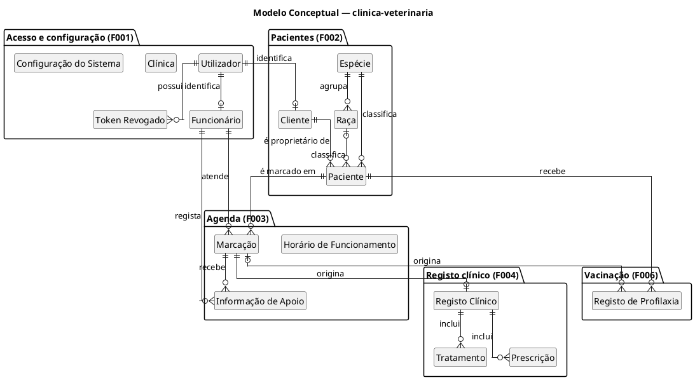
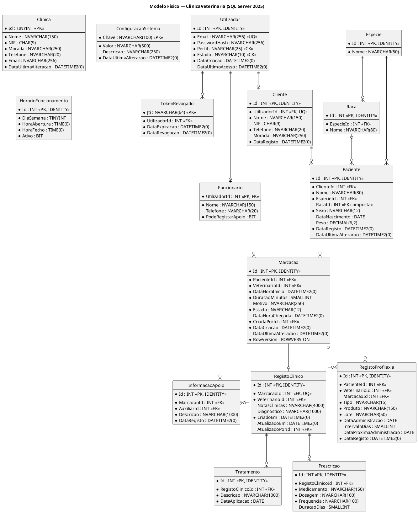

# Modelo de Dados — Base de Dados clinica-veterinaria

**Projeto:** Gestão de Clínica Veterinária
**Grupo:** G08
**Milestone:** m3
**Versão:** v02
**Issue e papéis:** por atribuir. Esta versão ainda não tem Issue própria; será planeada no Backlog Refinement e no Sprint Planning, onde se atribuem Executor, Revisor e Auditor. A Issue I016 corresponde à v01 (m2) e não é reaberta.
**Estado:** Rascunho para revisão e auditoria
**Ficheiro:** `m3-modelo-de-dados-clinica-veterinaria-v02.md`
**Pasta:** `/projeto/04-artefactos-tecnicos/04.06-modelos-de-dados`
**SGBD:** Microsoft SQL Server 2025
**Abordagem de persistência:** Entity Framework Core 10.0 (code-first)

---

## Alterações da v02 em relação à v01

A v01 (`m2-modelo-de-dados-clinica-veterinaria-v01.md`) mantém-se inalterada como histórico. Esta versão não repete o texto das tabelas retiradas: quando é útil, remete para a v01.

| Ponto | v01 | v02 | Motivo |
|---|---|---|---|
| Âmbito (secções 1 a 8) | 22 tabelas, para as funcionalidades F001 a F007 | **16 tabelas**, para as funcionalidades em âmbito F001 a F004 e F006. Saem `ContaCliente`, `Pagamento`, `HistoricoEstadoPagamento` (F005) e `Alojamento`, `Internamento`, `HistoricoEstadoInternamento` (F007) | Declaração de Âmbito v05 (transição de F005 e F007 para o não-âmbito, autorizada a 20/10/2026 e homologada por e-mail a 21/10/2026) |
| Decisões (secção 3) | D01 a D19 | D09 a D12 ficam reservadas (texto na v01); D13 e D18 sem referências às tabelas retiradas; D06 e D16 com notas sobre os termos da API e sobre `DiaSemana`; novo ponto 3.2 com as tabelas retiradas | Pontos anteriores e Documentação da API v02 |
| Diagramas (secções 4.1 e 6.2) | Pacotes e entidades de F005 e F007 | Retirados, com as respetivas relações | Declaração de Âmbito v05 |
| Quadros das secções 4.2, 4.3, 5.1, 5.2, 5.3, 6.3, 6.4, 6.5, 6.8 | Linhas de F005 e F007 | Linhas retiradas: 6 entidades, 9 relacionamentos, 16 chaves estrangeiras, 3 redundâncias, 9 `CHECK`, 3 unicidades, 5 índices e 6 regras de integridade | Declaração de Âmbito v05 |
| Convenções (secção 6.1) | EF Core 8.0; esquema criado por migrações; nomes de restrições sem valores por omissão | EF Core 10.0; esquema criado pelos scripts T-SQL da I060, com migrações coerentes na I062; valores por omissão nomeados `DF_<Tabela>_<Coluna>` | Regulamento do Grupo v02 (secção 11.2, aprovado e assinado a 24/10/2026); README da I060 (DI-03, DI-07) |
| Chave primária de `TokenRevogado` (secção 6.4) | `PK_TokenRevogado_Jti` | `PK_TokenRevogado`, igual à convenção `PK_<Tabela>` | README da I060 (DI-01) |
| Índices (secção 6.5) | 13 índices de desempenho; nota a dizer que o EF Core indexa as restantes chaves estrangeiras | 8 índices de desempenho em âmbito, mais `IX_Cliente_Nome` e `IX_Paciente_Nome` (a confirmar) e 8 índices de chaves estrangeiras criados explicitamente pelos scripts | README da I060 (DI-04, DI-05) |
| Enumerações e valores por omissão (secção 6.7) | Incluíam `EstadoPagamento`, `MetodoPagamento`, `EstadoInternamento`, `Alojamento.Ativo` e `ContaCliente.EstadoPagamento` | Retirados. `DiaSemana` passa a constar (`byte` com 1 a 7 na entidade, nome na API). Lista completa dos 13 valores por omissão | Documentação da API v02; Modelo de Classes do Backend v02 |
| Rastreabilidade (secção 8) | Tabelas ligadas a UC14, UC15 e UC18 e aos RF037 a RF042 e RF048 a RF052 | Só requisitos e casos de uso em âmbito (UC01 a UC13, UC16 e UC17); ARC-F005 e ARC-F007 reservados; novos intervalos de endpoints por módulo | Especificação de Requisitos v02; Casos de Uso v02; Arquitetura v02; Documentação da API v02 |
| `Marcacao` (secções 5.1, 6.2, 6.7 e 7.11) | 11 colunas, sem controlo de concorrência | **12 colunas**: acrescenta `RowVersion` (`ROWVERSION NOT NULL`), token de concorrência otimista | Decisão do Líder do grupo a 24/10/2026 (ponto 9.2, opção B2); critério 3 da Issue I059 |
| Pontos em aberto (secção 9) | — | Novo. Decididos pelo Líder do grupo a 24/10/2026: retirar as seis tabelas dos scripts numa versão nova, `m3-v02` (9.1, opção B), e acrescentar `Marcacao.RowVersion` (9.2, opção B2). Com proposta adotada em rascunho e por confirmar pelo Revisor: dados de referência e de demonstração (9.3) e DI-04, DI-05 e DI-08 do README da I060, incluindo a collation `Latin1_General_100_CI_AS` (9.4) | Coerência com a Issue I059 e com os scripts da I060 |
| Histórico de versões (secção 10) | Versão e autor | Versão, data, autor e descrição | Controlo de versões |

---

## 1. Objetivo

O presente documento define o modelo de dados da base de dados `clinica-veterinaria`, que assegura a persistência, a integridade e a consulta da informação do sistema de Gestão de Clínica Veterinária.

Na v02 o modelo tem **16 tabelas**, que correspondem às funcionalidades em âmbito após a Declaração de Âmbito v05 (F001 a F004 e F006). As tabelas de contas e pagamentos (F005) e de internamento (F007) deixam de fazer parte do modelo; ver a secção 3.2.

O documento apresenta:

- o **modelo conceptual**, com as entidades do domínio e as respetivas relações e cardinalidades;
- o **modelo lógico**, com o esquema relacional normalizado, chaves primárias e chaves estrangeiras;
- o **modelo físico**, com os tipos de dados do SQL Server, restrições, índices e regras de implementação através do Entity Framework Core;
- o **dicionário de dados** de todas as tabelas;
- a **rastreabilidade** entre as tabelas, os requisitos e os casos de uso.

Todos os diagramas são produzidos em PlantUML, conforme o Regulamento Interno do Grupo G08 v02 (secção 12.1), e o respetivo código-fonte está incluído neste ficheiro, conforme a secção 17 do Regulamento de Funcionamento da UC.

---

## 2. Fontes e referências

| Referência | Utilização neste documento |
|---|---|
| `m3-proposta-sistema-v05.pdf` | Atores, funcionalidades em âmbito (F001 a F004 e F006) e dados relevantes do domínio. |
| `m3-declaracao-ambito-v05.pdf` | Âmbito por componente, exclusões (incluindo F005 e F007) e limites transversais. |
| `m3-especificacao-requisitos-v02.md` (rascunho) | Requisitos em âmbito RF001–RF036 e RF043–RF047, requisitos descontinuados RF037–RF042 e RF048–RF052, e RNF001–RNF006. |
| `m3-especificacoes-casos-uso-v02.md` (rascunho) | Casos de uso em âmbito UC01–UC13, UC16 e UC17, fluxos, exceções e pós-condições. |
| `m3-documentacao-arquitetura-v02.md` (rascunho) | Componentes, módulos ARC-F001 a ARC-F004 e ARC-F006, responsabilidades e regras de autorização. |
| `m3-documentacao-api-v02.md` (rascunho) | Contrato da API com 37 endpoints, autenticação, permissões, formatos de dados e enumerações. |
| `m3-modelo-classes-backend-v02.md` (rascunho) | Entidades de domínio e enumerações do backend, para garantir a coerência com as tabelas. |
| `m3-regulamento-grupo-v02.pdf` | Tecnologias adotadas (SQL Server 2025, EF Core 10.0 code-first, PlantUML), aprovado e assinado a 24/10/2026. |
| `04.13-scripts-de-base-de-dados/m3-v01/README.md` | Scripts T-SQL da Issue I060 e decisões DI-01 a DI-10 sobre a conformidade com o Modelo de Dados v01. |
| `04.13-scripts-de-base-de-dados/m3-v02/README.md` (rascunho) | Scripts T-SQL sem as tabelas de F005 e F007 e com `Marcacao.RowVersion`; decisões DI-11 e DI-12. |
| `m2-modelo-de-dados-clinica-veterinaria-v01.md` | Versão anterior, inalterada. Contém o texto das tabelas retiradas. |
| Regulamento de Funcionamento da UC | Componentes obrigatórios, regras de diagramas e nomenclatura. |

---

## 3. Decisões e pressupostos de modelação

| N.º | Decisão | Justificação |
|---|---|---|
| D01 | As credenciais de acesso são guardadas numa única tabela `Utilizador`, com o atributo `Perfil`. Os dados próprios dos funcionários e dos Clientes ficam em `Funcionario` e `Cliente`. | Uma única tabela de autenticação simplifica RF001–RF005 e o controlo por perfil (RNF001), mantendo separados os dados de negócio. |
| D02 | Cada `Cliente` possui obrigatoriamente um `Utilizador` associado com perfil `Cliente`. | A API prevista cria o proprietário e a respetiva conta de acesso mobile na mesma operação de RF010 (`POST /clientes`). |
| D03 | A autenticação usa JWT com validade de 8 horas e não utiliza refresh token. O `jti` de um token terminado por logout é persistido em `TokenRevogado` até à expiração. | Alinha com RF003–RF004 e com a Documentação da API. O bloqueio de conta é verificado pelo backend através de `Utilizador.Estado`. |
| D04 | A idade do paciente não é armazenada; é derivada de `DataNascimento`. | Evita um valor temporal redundante e desatualizado. |
| D05 | `Especie` e `Raca` são tabelas de referência e uma raça tem de pertencer à espécie do paciente. | Evita valores livres inconsistentes e permite pesquisas fiáveis. |
| D06 | A consulta corresponde à entidade `Marcacao`, que acompanha o ciclo pendente, confirmada, realizada ou cancelada. | RF021–RF025 e RF030–RF033 referem-se ao mesmo episódio. A Documentação da API v02 usa os termos «consulta» (`/consultas`) e «animal» (`/animais`) para o que este modelo designa `Marcacao` e `Paciente`; os nomes das tabelas mantêm-se. A `Marcacao` tem uma coluna `RowVersion` para controlo de concorrência (ponto 9.2). |
| D07 | Cada consulta tem no máximo um `RegistoClinico`, que contém as notas clínicas e o diagnóstico; os tratamentos e as prescrições são linhas dependentes do registo. Nenhuma destas tabelas guarda `PacienteId`: o paciente obtém-se através de `Marcacao`. | Corresponde a EP-031/EP-032 da API (um registo por consulta, erro 409 em duplicado) e a RF030–RF034. A unicidade de `MarcacaoId` é garantida pelo SGBD. Guardar `PacienteId` criaria uma dependência transitiva e permitiria registos contraditórios (3FN). |
| D08 | Vacinações e desparasitações usam uma única tabela `RegistoProfilaxia`, distinguida por `Tipo`. | RF043 e RF044 possuem a mesma estrutura; RF045 determina a próxima administração. |
| D09 | *(Reservada.)* Decisão sobre `ContaCliente` (F005, fora do âmbito). | Texto na v01. |
| D10 | *(Reservada.)* Decisão sobre `Pagamento` (F005, fora do âmbito). | Texto na v01. |
| D11 | *(Reservada.)* Decisão sobre `HistoricoEstadoPagamento` (F005, fora do âmbito). | Texto na v01. |
| D12 | *(Reservada.)* Decisão sobre `Internamento` e `HistoricoEstadoInternamento` (F007, fora do âmbito). | Texto na v01. |
| D13 | Não existem eliminações em cascata nos dados de negócio. | Preserva histórico clínico e administrativo (RNF005). |
| D14 | Restrições dependentes do perfil são aplicadas pelo backend e verificadas por testes de autorização. | Não são adequadamente expressáveis por `CHECK` simples no SQL Server. |
| D15 | Datas e horas com instante são guardadas em `DATETIME2(0)` UTC e convertidas na apresentação. | Alinha com as convenções da API e evita ambiguidades horárias. |
| D16 | Valores enumerados são guardados como texto com restrição `CHECK`. Exceção: `HorarioFuncionamento.DiaSemana` é `TINYINT` com valores 1 a 7 (1 = segunda-feira); o backend trata-o como `byte` e a API converte-o nos nomes `Segunda` a `Domingo` da enumeração `DiaSemana`. | Facilita leitura, validação e alinhamento com as enumerações da API/backend. |
| D17 | A disponibilidade de RF020 não é persistida: é calculada a partir de `HorarioFuncionamento`, das marcações não canceladas do Veterinário e da duração da consulta (`ConfiguracaoSistema`). | Corresponde a EP-022 da Documentação da API, que devolve horários livres calculados e não prevê operação para registar disponibilidade. **Limitação assumida:** todos os Veterinários partilham o horário de funcionamento da clínica; folgas, ausências ou horários individuais não são representados nesta versão. |
| D18 | `Especie` e `Raca` são dados de referência carregados por seed. | Não existe requisito nem endpoint de escrita para gerir estes catálogos. |
| D19 | `Paciente.Peso` representa apenas o valor atual. | Não existe requisito de histórico de peso. |

### 3.1. Elementos fora do âmbito com impacto no modelo

Não são modelados dados de integração com SIAC ou bases nacionais, fornecedores de identidade externos, autenticação multifator, calendários externos, notificações SMS/e-mail, pagamentos eletrónicos, faturação certificada, leitura de códigos de barras/QR, equipamentos especializados ou migração de dados, conforme a secção 7 da Especificação de Requisitos v02 e a Declaração de Âmbito v05. Também não são modelados os dados das funcionalidades F005 (contas e pagamentos) e F007 (internamento), que passaram para o não-âmbito (secção 3.2).

### 3.2. Tabelas retiradas em relação à v01

| Tabela da v01 | Funcionalidade | Requisitos (descontinuados) | Casos de uso (fora do âmbito) | Dicionário na v01 |
|---|---|---|---|---|
| `ContaCliente` | F005 | RF037–RF042 | UC14, UC15 | 7.17 |
| `Pagamento` | F005 | RF039, RF040 | UC14 | 7.18 |
| `HistoricoEstadoPagamento` | F005 | RF040 | UC14 | 7.19 |
| `Alojamento` | F007 | RF049, RF050 | UC18 | 7.20 |
| `Internamento` | F007 | RF048–RF052 | UC18 | 7.21 |
| `HistoricoEstadoInternamento` | F007 | RF051, RF052 | UC18 | 7.22 |

Os números D09 a D12, UC14, UC15 e UC18 e os módulos ARC-F005 e ARC-F007 ficam reservados. Os scripts SQL da Issue I060 (`m3-v01`) ainda criam estas seis tabelas; a nova versão dos scripts (`m3-v02`, rascunho) retira-as (ponto 9.1).

---

## 4. Modelo conceptual

### 4.1. Diagrama entidade-relacionamento



### 4.2. Entidades

| Entidade | Descrição | Funcionalidade |
|---|---|---|
| Utilizador | Conta de acesso ao sistema, com credenciais, perfil e estado. | F001 |
| Token Revogado | `jti` de um JWT terminado por logout, conservado até à sua expiração. | F001 |
| Funcionário | Dados de um elemento da equipa da clínica com perfil interno. | F001 |
| Clínica | Dados gerais da clínica. | F001 |
| Configuração do Sistema | Parâmetros configuráveis geridos pelo Administrador. | F001 |
| Cliente | Proprietário associado obrigatoriamente a uma conta de acesso mobile. | F001, F002 |
| Paciente | Animal acompanhado pela clínica, com dados administrativos. | F002 |
| Espécie / Raça | Dados de referência para classificar pacientes. | F002 |
| Horário de Funcionamento | Períodos de abertura da clínica, geridos pelo Administrador. | F003 |
| Marcação | Consulta marcada para um paciente e Veterinário, incluindo estado e chegada. | F003 |
| Informação de Apoio | Informação não clínica registada pelo Auxiliar para uma consulta. | F003 |
| Registo Clínico | Ficha clínica única de uma consulta, com notas clínicas e diagnóstico. | F004 |
| Tratamento | Tratamento aplicado no âmbito de um registo clínico. | F004 |
| Prescrição | Medicamento prescrito, com dosagem, frequência e duração. | F004 |
| Registo de Profilaxia | Administração de vacina ou desparasitante. | F006 |

### 4.3. Relacionamentos e cardinalidades

| Relacionamento | Cardinalidade | Regra de negócio |
|---|---|---|
| Utilizador — Token Revogado | 1 : 0..N | Cada token revogado pertence a um único utilizador. |
| Utilizador — Funcionário | 1 : 0..1 | Cada funcionário tem exatamente uma conta de acesso interna. |
| Utilizador — Cliente | 1 : 0..1 | Cada Cliente tem exatamente uma conta com perfil `Cliente`. |
| Cliente — Paciente | 1 : 0..N | Cada paciente tem um único proprietário. |
| Espécie — Raça | 1 : 0..N | Cada raça pertence a uma única espécie. |
| Espécie — Paciente | 1 : 0..N | Cada paciente tem uma espécie. |
| Raça — Paciente | 0..1 : 0..N | A raça é opcional e coerente com a espécie. |
| Paciente — Marcação | 1 : 0..N | Cada marcação é de um único paciente. |
| Funcionário (Veterinário) — Marcação | 1 : 0..N | Cada marcação é atribuída a um Veterinário. |
| Marcação — Informação de Apoio | 1 : 0..N | Informação não clínica da consulta. |
| Marcação — Registo Clínico | 1 : 0..1 | Cada consulta tem no máximo um registo clínico; o paciente obtém-se através da consulta. |
| Registo Clínico — Tratamento | 1 : 0..N | Os tratamentos pertencem ao registo clínico da consulta. |
| Registo Clínico — Prescrição | 1 : 0..N | Cada prescrição corresponde a um medicamento. |
| Paciente — Registo de Profilaxia | 1 : 0..N | Histórico de vacinação/desparasitação. |
| Marcação — Registo de Profilaxia | 0..1 : 0..N | Uma administração pode ocorrer numa consulta. |

---

## 5. Modelo lógico

### 5.1. Esquema relacional

Notação: **sublinhado** = chave primária (PK); `#` = chave estrangeira (FK); `?` = atributo opcional.

**Acesso e configuração**
- Utilizador(<u>Id</u>, Email, PasswordHash, Perfil, Estado, DataCriacao, DataUltimoAcesso?)
- TokenRevogado(<u>Jti</u>, #UtilizadorId, DataExpiracao, DataRevogacao)
- Funcionario(<u>#UtilizadorId</u>, Nome, Telefone?, PodeRegistarApoio)
- Clinica(<u>Id</u>, Nome, NIF, Morada, Telefone, Email, DataUltimaAlteracao)
- ConfiguracaoSistema(<u>Chave</u>, Valor, Descricao?, DataUltimaAlteracao)

**Clientes e pacientes**
- Cliente(<u>Id</u>, #UtilizadorId, Nome, NIF?, Telefone, Morada?, DataRegisto)
- Especie(<u>Id</u>, Nome)
- Raca(<u>Id</u>, #EspecieId, Nome)
- Paciente(<u>Id</u>, #ClienteId, Nome, #EspecieId, #RacaId?, Sexo, DataNascimento?, Peso?, DataRegisto, DataUltimaAlteracao?)

**Agenda**
- HorarioFuncionamento(<u>Id</u>, DiaSemana, HoraAbertura, HoraFecho, Ativo)
- Marcacao(<u>Id</u>, #PacienteId, #VeterinarioId, DataHoraInicio, DuracaoMinutos, Motivo?, Estado, DataHoraChegada?, #CriadaPorId, DataCriacao, DataUltimaAlteracao?, RowVersion)
- InformacaoApoio(<u>Id</u>, #MarcacaoId, #AuxiliarId, Descricao, DataRegisto)

**Registo clínico**
- RegistoClinico(<u>Id</u>, #MarcacaoId, #VeterinarioId, NotasClinicas?, Diagnostico?, CriadoEm, AtualizadoEm?, #AtualizadoPorId?)
- Tratamento(<u>Id</u>, #RegistoClinicoId, Descricao, DataAplicacao)
- Prescricao(<u>Id</u>, #RegistoClinicoId, Medicamento, Dosagem, Frequencia, DuracaoDias?)

**Vacinação e desparasitação**
- RegistoProfilaxia(<u>Id</u>, #PacienteId, #VeterinarioId, #MarcacaoId?, Tipo, Produto, Lote, DataAdministracao, IntervaloDias?, DataProximaAdministracao?, DataRegisto)

### 5.2. Chaves estrangeiras

| Tabela | Coluna | Referencia | Papel |
|---|---|---|---|
| TokenRevogado | UtilizadorId | Utilizador.Id | Titular do token revogado |
| Funcionario | UtilizadorId | Utilizador.Id | Conta do funcionário |
| Cliente | UtilizadorId | Utilizador.Id | Conta mobile do Cliente |
| Raca | EspecieId | Especie.Id | Espécie da raça |
| Paciente | ClienteId | Cliente.Id | Proprietário |
| Paciente | EspecieId | Especie.Id | Espécie |
| Paciente | (EspecieId, RacaId) | Raca(EspecieId, Id) | Raça coerente com a espécie |
| Marcacao | PacienteId | Paciente.Id | Paciente |
| Marcacao | VeterinarioId | Funcionario.UtilizadorId | Veterinário |
| Marcacao | CriadaPorId | Funcionario.UtilizadorId | Rececionista |
| InformacaoApoio | MarcacaoId | Marcacao.Id | Consulta |
| InformacaoApoio | AuxiliarId | Funcionario.UtilizadorId | Auxiliar |
| RegistoClinico | MarcacaoId | Marcacao.Id | Consulta (única) |
| RegistoClinico | VeterinarioId | Funcionario.UtilizadorId | Veterinário que criou o registo |
| RegistoClinico | AtualizadoPorId | Funcionario.UtilizadorId | Veterinário da última alteração |
| Tratamento | RegistoClinicoId | RegistoClinico.Id | Registo clínico |
| Prescricao | RegistoClinicoId | RegistoClinico.Id | Registo clínico |
| RegistoProfilaxia | PacienteId | Paciente.Id | Paciente |
| RegistoProfilaxia | VeterinarioId | Funcionario.UtilizadorId | Veterinário |
| RegistoProfilaxia | MarcacaoId | Marcacao.Id | Consulta opcional |

### 5.3. Normalização

O esquema encontra-se na **Terceira Forma Normal (3FN)**:

- **1FN** — todos os atributos são atómicos. Os tratamentos e as prescrições de uma consulta, que formariam grupos repetitivos, estão em tabelas próprias ligadas a `RegistoClinico`.
- **2FN** — todas as tabelas usam chave primária simples (`Id`), pelo que não existem dependências parciais.
- **3FN** — não existem dependências transitivas entre atributos não chave. Por exemplo, o nome da espécie está em `Especie` e não em `Paciente`; o Cliente de um registo clínico é obtido através de `Marcacao → Paciente → Cliente`.

Redundâncias controladas e justificadas:

| Atributo | Justificação | Garantia de coerência |
|---|---|---|
| `RegistoProfilaxia.DataProximaAdministracao` | Coluna calculada e persistida pelo próprio SGBD (RF045). | Calculada pelo SQL Server; não pode ser alterada manualmente. |

---

## 6. Modelo físico

### 6.1. Ambiente e convenções

| Aspeto | Decisão |
|---|---|
| SGBD | Microsoft SQL Server 2025 |
| Componente arquitetural | ARC-DB (base de dados) e ARC-DATA (persistência EF Core), conforme `m3-documentacao-arquitetura-v02.md` |
| Base de dados | `ClinicaVeterinaria` (identificador físico da base de dados `clinica-veterinaria`, sem hífen para evitar delimitadores em T-SQL) |
| Esquema | `dbo` |
| Criação do esquema | Scripts T-SQL em `04.13-scripts-de-base-de-dados`: `m3-v01` (Issue I060, concluída, 22 tabelas) e `m3-v02` (rascunho, 16 tabelas e `RowVersion`), que é a que corresponde a este modelo. As migrações do Entity Framework Core 10.0 (code-first) coerentes com os scripts são entregues na Issue I062 (DI-07) |
| Nomes de tabelas e colunas | PascalCase, singular, sem acentos |
| Chaves primárias | `INT IDENTITY(1,1)`, exceto `Funcionario` (PK = FK para `Utilizador`), `TokenRevogado` (PK = `Jti`), `ConfiguracaoSistema` (chave natural) e `Clinica` (linha única) |
| Nomes de restrições | `PK_<Tabela>`, `FK_<Tabela>_<Referência>_<Coluna>`, `UQ_<Tabela>_<Coluna>`, `CK_<Tabela>_<Regra>`, `DF_<Tabela>_<Coluna>`, `IX_<Tabela>_<Colunas>` |
| Datas e horas | `DATETIME2(0)` em UTC; `DATE` para datas sem hora; `TIME(0)` para horários |
| Valores monetários | `DECIMAL(10,2)` em euros |
| Texto | `NVARCHAR(n)` (Unicode) |
| Collation | `Latin1_General_100_CI_AS` (insensível a maiúsculas, sensível a acentos), fixada em `00-criar-base-de-dados.sql` da `m3-v02`. Proposta a confirmar pelo Revisor (ver 9.4) |
| Comportamento de eliminação | `NO ACTION` em todas as chaves estrangeiras |
| Dados de teste | Exclusivamente fictícios, criados por scripts de seed (Regulamento Interno G08, secção 14.3) |

Os valores por omissão têm nome explícito (`DF_<Tabela>_<Coluna>`) porque, sem nome, o SQL Server gera identificadores diferentes em cada ambiente (por exemplo, `DF__Utiliza__Estad__3B75D760`), o que dificulta a comparação com as migrações (DI-03).

### 6.2. Diagrama físico



> Nota: para manter o diagrama legível, algumas ligações de auditoria a `Funcionario` não são desenhadas; estão identificadas na tabela 5.2 e no dicionário de dados.

### 6.3. Restrições de domínio (CHECK)

| Restrição | Tabela | Regra |
|---|---|---|
| CK_Utilizador_Perfil | Utilizador | `Perfil IN ('Administrador','Rececionista','Veterinario','AuxiliarVeterinario','Cliente')` |
| CK_Utilizador_Estado | Utilizador | `Estado IN ('Ativo','Bloqueado')` |
| CK_Clinica_LinhaUnica | Clinica | `Id = 1` |
| CK_Paciente_Sexo | Paciente | `Sexo IN ('Macho','Femea','Desconhecido')` |
| CK_Paciente_Peso | Paciente | `Peso IS NULL OR Peso > 0` |
| CK_Horario_DiaSemana | HorarioFuncionamento | `DiaSemana BETWEEN 1 AND 7` |
| CK_Horario_Intervalo | HorarioFuncionamento | `HoraFecho > HoraAbertura` |
| CK_Marcacao_Estado | Marcacao | `Estado IN ('Pendente','Confirmada','Realizada','Cancelada')` |
| CK_Marcacao_Duracao | Marcacao | `DuracaoMinutos > 0` |
| CK_Prescricao_Duracao | Prescricao | `DuracaoDias IS NULL OR DuracaoDias > 0` |
| CK_RegistoClinico_Atualizacao | RegistoClinico | `(AtualizadoEm IS NULL AND AtualizadoPorId IS NULL) OR (AtualizadoEm IS NOT NULL AND AtualizadoPorId IS NOT NULL)` |
| CK_Profilaxia_Tipo | RegistoProfilaxia | `Tipo IN ('Vacina','Desparasitacao')` |
| CK_Profilaxia_Intervalo | RegistoProfilaxia | `IntervaloDias IS NULL OR IntervaloDias > 0` |

### 6.4. Unicidade e chaves compostas

| Restrição | Tabela | Colunas | Observação |
|---|---|---|---|
| UQ_Utilizador_Email | Utilizador | Email | Identificador de autenticação. A comparação segue a collation da base de dados (`Latin1_General_100_CI_AS`, insensível a maiúsculas; ver 9.4). |
| PK_TokenRevogado | TokenRevogado | Jti | Chave primária, com o nome da convenção `PK_<Tabela>` (DI-01). Identificador único do token revogado. |
| UQ_Cliente_UtilizadorId | Cliente | UtilizadorId | Relação 1:1 obrigatória entre Cliente e conta. |
| UQ_Cliente_NIF | Cliente | NIF | Índice único filtrado `WHERE NIF IS NOT NULL`. |
| UQ_Especie_Nome | Especie | Nome | — |
| UQ_RegistoClinico_Marcacao | RegistoClinico | MarcacaoId | Uma consulta tem no máximo um registo clínico (EP-031, erro 409). |
| UQ_Raca_Especie_Nome | Raca | EspecieId, Nome | A mesma raça não se repete na mesma espécie. |
| UQ_Raca_Especie_Id | Raca | EspecieId, Id | Chave alternativa para a FK composta de `Paciente`. |
| FK_Paciente_Raca | Paciente | (EspecieId, RacaId) → Raca(EspecieId, Id) | Garante coerência entre espécie e raça. |

### 6.5. Índices de desempenho

| Índice | Tabela | Colunas | Consulta suportada |
|---|---|---|---|
| IX_TokenRevogado_Utilizador | TokenRevogado | UtilizadorId, DataExpiracao | Verificação/limpeza de tokens revogados. |
| IX_Paciente_ClienteId | Paciente | ClienteId | Pesquisa por proprietário e mobile. |
| IX_Marcacao_Veterinario_Data | Marcacao | VeterinarioId, DataHoraInicio | Agenda e cálculo de disponibilidade. |
| IX_Marcacao_Paciente_Data | Marcacao | PacienteId, DataHoraInicio | Marcações futuras e histórico. |
| IX_Marcacao_Data | Marcacao | DataHoraInicio | Agenda por período. |
| IX_Tratamento_Registo | Tratamento | RegistoClinicoId | Leitura do registo clínico. |
| IX_Prescricao_Registo | Prescricao | RegistoClinicoId | Leitura do registo clínico. |
| IX_Profilaxia_Paciente_Data | RegistoProfilaxia | PacienteId, DataAdministracao | Boletim web/mobile. |
| IX_Cliente_Nome | Cliente | Nome | Pesquisa de Clientes por nome (EP-011). **A confirmar pelo Revisor (DI-05).** |
| IX_Paciente_Nome | Paciente | Nome | Pesquisa de pacientes por nome (EP-015). **A confirmar pelo Revisor (DI-05).** |

As restantes chaves estrangeiras, que nenhum dos índices acima cobre, são indexadas explicitamente pelos scripts da Issue I060, com o nome que o Entity Framework Core usa por omissão (`IX_<Tabela>_<Coluna>`), para que o esquema criado pelos scripts fique completo sem depender das migrações (DI-04):

| Índice | Tabela | Colunas |
|---|---|---|
| IX_Paciente_EspecieId_RacaId | Paciente | EspecieId, RacaId (cobre as duas chaves estrangeiras) |
| IX_Marcacao_CriadaPorId | Marcacao | CriadaPorId |
| IX_InformacaoApoio_MarcacaoId | InformacaoApoio | MarcacaoId |
| IX_InformacaoApoio_AuxiliarId | InformacaoApoio | AuxiliarId |
| IX_RegistoClinico_VeterinarioId | RegistoClinico | VeterinarioId |
| IX_RegistoClinico_AtualizadoPorId | RegistoClinico | AtualizadoPorId |
| IX_RegistoProfilaxia_VeterinarioId | RegistoProfilaxia | VeterinarioId |
| IX_RegistoProfilaxia_MarcacaoId | RegistoProfilaxia | MarcacaoId |

A Issue I062 deve confirmar que as migrações geram os mesmos índices (DI-04).

### 6.6. Coluna calculada

A data da próxima administração (RF045) é calculada pelo SQL Server e persistida:

```sql
DataProximaAdministracao AS (
    CASE
        WHEN IntervaloDias IS NULL THEN NULL
        ELSE DATEADD(DAY, IntervaloDias, DataAdministracao)
    END
) PERSISTED
```

No Entity Framework Core é configurada com:

```csharp
builder.Property(r => r.DataProximaAdministracao)
       .HasComputedColumnSql(
           "CASE WHEN [IntervaloDias] IS NULL THEN NULL " +
           "ELSE DATEADD(DAY, [IntervaloDias], [DataAdministracao]) END",
           stored: true);
```

### 6.7. Correspondência com o Entity Framework Core

| Elemento do modelo | Implementação code-first |
|---|---|
| Tabelas | Uma classe de entidade por tabela, configurada com `IEntityTypeConfiguration<T>`. |
| Valores enumerados | `Perfil`, `EstadoUtilizador`, `EstadoConsulta`, `TipoAdministracao` e `Sexo`, convertidos com `HasConversion<string>()`. `DiaSemana` fica `byte` (1 a 7) na entidade e só é convertido no nome da API (`Segunda` a `Domingo`) nos DTO. |
| Restrições `CHECK` | `ToTable(t => t.HasCheckConstraint(...))`. |
| Índices filtrados | `HasIndex(...).IsUnique().HasFilter(...)`. |
| FK composta Paciente → Raca | `HasAlternateKey` em `Raca` e `HasForeignKey` composta em `Paciente`. |
| Eliminação | `DeleteBehavior.Restrict` em todas as relações. |
| Concorrência otimista | `Marcacao.RowVersion` é `byte[]`, configurada com `IsRowVersion()` (ou `[Timestamp]`). O backend nunca a escreve. Um conflito de gravação (`DbUpdateConcurrencyException`) é devolvido como 409 em EP-026, EP-027 e EP-028; se o cliente enviar `If-Match` e este já não corresponder à versão atual, a resposta é 412 (ponto 9.2 e Documentação da API v02, secção 5.1). |
| Valores por omissão | Os 13 valores por omissão têm o nome `DF_<Tabela>_<Coluna>`: `Utilizador.Estado = 'Ativo'`, `Marcacao.Estado = 'Pendente'`, `Paciente.Sexo = 'Desconhecido'`, `Funcionario.PodeRegistarApoio = 0` e `HorarioFuncionamento.Ativo = 1`; as datas de registo (`Utilizador.DataCriacao`, `TokenRevogado.DataRevogacao`, `Cliente.DataRegisto`, `Paciente.DataRegisto`, `Marcacao.DataCriacao`, `InformacaoApoio.DataRegisto`, `RegistoClinico.CriadoEm` e `RegistoProfilaxia.DataRegisto`) usam `SYSUTCDATETIME()`. `Clinica.DataUltimaAlteracao` e `ConfiguracaoSistema.DataUltimaAlteracao` não têm valor por omissão (DI-10). |
| Dados de referência | `HasData` para `Clinica`, `Especie`, `Raca` e `ConfiguracaoSistema`, com chaves explícitas, datas fixas em UTC e valores fictícios (proposta; ver 9.3). |

### 6.8. Regras de integridade garantidas pelo backend

| Regra | Requisitos |
|---|---|
| `Funcionario` só existe para perfil interno e `Cliente.UtilizadorId` referencia obrigatoriamente perfil `Cliente`. | RF005, RF006, RF010 |
| Contas bloqueadas não autenticam e tokens emitidos são rejeitados enquanto a conta estiver bloqueada. | RF002, RF009 |
| Um `jti` presente em `TokenRevogado` não autentica pedidos antes da expiração original. | RF003, RF004 |
| Só o Administrador cria ou altera `HorarioFuncionamento`; um mesmo dia pode ter vários períodos, desde que não se sobreponham. | RF019, RNF001 |
| A disponibilidade é calculada a partir do horário, marcações não canceladas e duração, sem tabela autónoma. | RF019, RF020, RF021 |
| `Marcacao.VeterinarioId` e autores de atos clínicos e de profilaxia têm perfil `Veterinario`. | RF021, RF030–RF034, RF043, RF044 |
| Só existe `RegistoClinico` para marcações `Confirmada` ou `Realizada`, e cada registo tem pelo menos um elemento clínico preenchido (notas, diagnóstico, tratamento ou prescrição). | RF030–RF033 (EP-031) |
| Cada alteração a um registo clínico preenche `AtualizadoEm` e `AtualizadoPorId`. | RF034 (EP-032) |
| `InformacaoApoio.AuxiliarId` tem perfil `AuxiliarVeterinario` e `PodeRegistarApoio = 1`. | RF027 |
| Não existem marcações não canceladas sobrepostas para o mesmo Veterinário. | RF020, RF021 |
| O Administrador não acede a F004 nem a F006. | F001 (DA), RNF001 |
| O Cliente só acede a dados associados à sua conta. | RNF002 |

---

## 7. Dicionário de dados

Legenda: **N** = admite nulo (S/N). PK = chave primária; FK = chave estrangeira; UQ = único; CK = restrição de domínio; DF = valor por omissão (com o nome `DF_<Tabela>_<Coluna>`).

### 7.1. Utilizador

| Coluna | Tipo | N | Restrições | Descrição |
|---|---|---|---|---|
| Id | INT | N | PK, IDENTITY | Identificador do utilizador. |
| Email | NVARCHAR(256) | N | UQ | Email usado como credencial de autenticação. |
| PasswordHash | NVARCHAR(256) | N | — | Hash da palavra-passe (ASP.NET Core Identity `PasswordHasher`). A palavra-passe nunca é guardada em claro. |
| Perfil | NVARCHAR(25) | N | CK | Administrador, Rececionista, Veterinario, AuxiliarVeterinario ou Cliente. |
| Estado | NVARCHAR(10) | N | CK, DF 'Ativo' | Ativo ou Bloqueado. |
| DataCriacao | DATETIME2(0) | N | DF SYSUTCDATETIME() | Data de criação da conta. |
| DataUltimoAcesso | DATETIME2(0) | S | — | Data da última autenticação válida. |

### 7.2. TokenRevogado

| Coluna | Tipo | N | Restrições | Descrição |
|---|---|---|---|---|
| Jti | NVARCHAR(64) | N | PK | Identificador único do JWT revogado. |
| UtilizadorId | INT | N | FK → Utilizador | Titular do token. |
| DataExpiracao | DATETIME2(0) | N | — | Expiração original do JWT. |
| DataRevogacao | DATETIME2(0) | N | DF SYSUTCDATETIME() | Momento do logout (RF003). |

### 7.3. Funcionario

| Coluna | Tipo | N | Restrições | Descrição |
|---|---|---|---|---|
| UtilizadorId | INT | N | PK, FK → Utilizador | Conta de acesso do funcionário. |
| Nome | NVARCHAR(150) | N | — | Nome completo. |
| Telefone | NVARCHAR(20) | S | — | Contacto telefónico. |
| PodeRegistarApoio | BIT | N | DF 0 | Autorização do Auxiliar Veterinário para registar informação de apoio (RF027). |

### 7.4. Clinica

| Coluna | Tipo | N | Restrições | Descrição |
|---|---|---|---|---|
| Id | TINYINT | N | PK, CK = 1 | Linha única com os dados da clínica. |
| Nome | NVARCHAR(150) | N | — | Designação da clínica. |
| NIF | CHAR(9) | N | — | Número de identificação fiscal. |
| Morada | NVARCHAR(250) | N | — | Morada. |
| Telefone | NVARCHAR(20) | N | — | Contacto telefónico. |
| Email | NVARCHAR(256) | N | — | Contacto eletrónico. |
| DataUltimaAlteracao | DATETIME2(0) | N | — | Última atualização (RF013). Sem valor por omissão: o seed indica-o (DI-10). |

### 7.5. ConfiguracaoSistema

| Coluna | Tipo | N | Restrições | Descrição |
|---|---|---|---|---|
| Chave | NVARCHAR(100) | N | PK | Nome do parâmetro, por exemplo `DuracaoPadraoConsultaMinutos`. |
| Valor | NVARCHAR(500) | N | — | Valor do parâmetro. |
| Descricao | NVARCHAR(250) | S | — | Explicação do parâmetro. |
| DataUltimaAlteracao | DATETIME2(0) | N | — | Última atualização (RF013). Sem valor por omissão: o seed indica-o (DI-10). |

### 7.6. Cliente

| Coluna | Tipo | N | Restrições | Descrição |
|---|---|---|---|---|
| Id | INT | N | PK, IDENTITY | Identificador do Cliente. |
| UtilizadorId | INT | N | FK → Utilizador, UQ | Conta de acesso obrigatória à aplicação móvel, criada com o Cliente (RF010). |
| Nome | NVARCHAR(150) | N | — | Nome completo do proprietário. |
| NIF | CHAR(9) | S | UQ filtrado | Número de identificação fiscal. |
| Telefone | NVARCHAR(20) | N | — | Contacto telefónico. |
| Morada | NVARCHAR(250) | S | — | Morada. |
| DataRegisto | DATETIME2(0) | N | DF SYSUTCDATETIME() | Data de registo. |

O endereço de e-mail usado pela conta do Cliente é armazenado em `Utilizador.Email`. As operações de criação e atualização do Cliente atualizam esse valor na mesma operação, evitando manter duas cópias do mesmo dado.

### 7.7. Especie

| Coluna | Tipo | N | Restrições | Descrição |
|---|---|---|---|---|
| Id | INT | N | PK, IDENTITY | Identificador. |
| Nome | NVARCHAR(50) | N | UQ | Designação da espécie (por exemplo, Cão, Gato). |

### 7.8. Raca

| Coluna | Tipo | N | Restrições | Descrição |
|---|---|---|---|---|
| Id | INT | N | PK, IDENTITY | Identificador. |
| EspecieId | INT | N | FK → Especie | Espécie a que a raça pertence. |
| Nome | NVARCHAR(80) | N | UQ (EspecieId, Nome) | Designação da raça. |

### 7.9. Paciente

| Coluna | Tipo | N | Restrições | Descrição |
|---|---|---|---|---|
| Id | INT | N | PK, IDENTITY | Identificador do paciente. |
| ClienteId | INT | N | FK → Cliente | Proprietário (RF014). |
| Nome | NVARCHAR(80) | N | — | Nome do animal. |
| EspecieId | INT | N | FK → Especie | Espécie. |
| RacaId | INT | S | FK composta → Raca | Raça, coerente com a espécie. |
| Sexo | NVARCHAR(12) | N | CK, DF 'Desconhecido' | Macho, Femea ou Desconhecido. |
| DataNascimento | DATE | S | — | Data de nascimento real ou estimada; a idade é derivada (D04). |
| Peso | DECIMAL(6,2) | S | CK > 0 | Peso atual em kg. |
| DataRegisto | DATETIME2(0) | N | DF SYSUTCDATETIME() | Data de criação da ficha. |
| DataUltimaAlteracao | DATETIME2(0) | S | — | Última atualização (RF016). |

### 7.10. HorarioFuncionamento

| Coluna | Tipo | N | Restrições | Descrição |
|---|---|---|---|---|
| Id | INT | N | PK, IDENTITY | Identificador. |
| DiaSemana | TINYINT | N | CK 1..7 | Dia da semana (1 = segunda-feira). |
| HoraAbertura | TIME(0) | N | — | Hora de início do período. |
| HoraFecho | TIME(0) | N | CK > HoraAbertura | Hora de fim do período. |
| Ativo | BIT | N | DF 1 | Período em vigor. |

Um dia pode ter vários períodos (por exemplo, manhã e tarde).

### 7.11. Marcacao

| Coluna | Tipo | N | Restrições | Descrição |
|---|---|---|---|---|
| Id | INT | N | PK, IDENTITY | Identificador da consulta. |
| PacienteId | INT | N | FK → Paciente | Paciente. |
| VeterinarioId | INT | N | FK → Funcionario | Veterinário atribuído. |
| DataHoraInicio | DATETIME2(0) | N | — | Data e hora marcadas. |
| DuracaoMinutos | SMALLINT | N | CK > 0 | Duração prevista. |
| Motivo | NVARCHAR(250) | S | — | Motivo administrativo da marcação. |
| Estado | NVARCHAR(12) | N | CK, DF 'Pendente' | Pendente, Confirmada, Realizada ou Cancelada (RF023). |
| DataHoraChegada | DATETIME2(0) | S | — | Registo de chegada (RF025). |
| CriadaPorId | INT | N | FK → Funcionario | Rececionista que criou a marcação. |
| DataCriacao | DATETIME2(0) | N | DF SYSUTCDATETIME() | Data de criação. |
| DataUltimaAlteracao | DATETIME2(0) | S | — | Última alteração (RF022). |
| RowVersion | ROWVERSION | N | — | Versão da linha, mudada pelo SQL Server em cada alteração. Token de concorrência otimista (ponto 9.2); o backend nunca a escreve. |

### 7.12. InformacaoApoio

| Coluna | Tipo | N | Restrições | Descrição |
|---|---|---|---|---|
| Id | INT | N | PK, IDENTITY | Identificador. |
| MarcacaoId | INT | N | FK → Marcacao | Consulta. |
| AuxiliarId | INT | N | FK → Funcionario | Auxiliar Veterinário autor. |
| Descricao | NVARCHAR(1000) | N | — | Informação não clínica de apoio. |
| DataRegisto | DATETIME2(0) | N | DF SYSUTCDATETIME() | Data de registo. |

### 7.13. RegistoClinico

| Coluna | Tipo | N | Restrições | Descrição |
|---|---|---|---|---|
| Id | INT | N | PK, IDENTITY | Identificador do registo clínico. |
| MarcacaoId | INT | N | FK → Marcacao, UQ | Consulta a que pertence; o paciente obtém-se através dela (D07). |
| VeterinarioId | INT | N | FK → Funcionario | Veterinário que criou o registo. |
| NotasClinicas | NVARCHAR(4000) | S | — | Notas clínicas da consulta (RF030). |
| Diagnostico | NVARCHAR(1000) | S | — | Diagnóstico (RF031). |
| CriadoEm | DATETIME2(0) | N | DF SYSUTCDATETIME() | Data de criação. |
| AtualizadoEm | DATETIME2(0) | S | CK coerente com AtualizadoPorId | Última alteração (RF034). |
| AtualizadoPorId | INT | S | FK → Funcionario | Veterinário da última alteração (RF034). |

### 7.14. Tratamento

| Coluna | Tipo | N | Restrições | Descrição |
|---|---|---|---|---|
| Id | INT | N | PK, IDENTITY | Identificador. |
| RegistoClinicoId | INT | N | FK → RegistoClinico | Registo clínico a que pertence. |
| Descricao | NVARCHAR(1000) | N | — | Tratamento aplicado (RF032). |
| DataAplicacao | DATE | N | — | Data da aplicação. |

### 7.15. Prescricao

| Coluna | Tipo | N | Restrições | Descrição |
|---|---|---|---|---|
| Id | INT | N | PK, IDENTITY | Identificador. |
| RegistoClinicoId | INT | N | FK → RegistoClinico | Registo clínico a que pertence. |
| Medicamento | NVARCHAR(150) | N | — | Medicamento prescrito (RF033). |
| Dosagem | NVARCHAR(100) | N | — | Dose (por exemplo, 3 gotas). |
| Frequencia | NVARCHAR(100) | N | — | Frequência (por exemplo, 2 vezes por dia). |
| DuracaoDias | SMALLINT | S | CK > 0 | Duração do tratamento. |

### 7.16. RegistoProfilaxia

| Coluna | Tipo | N | Restrições | Descrição |
|---|---|---|---|---|
| Id | INT | N | PK, IDENTITY | Identificador. |
| PacienteId | INT | N | FK → Paciente | Paciente. |
| VeterinarioId | INT | N | FK → Funcionario | Veterinário responsável. |
| MarcacaoId | INT | S | FK → Marcacao | Consulta em que ocorreu, quando aplicável. |
| Tipo | NVARCHAR(15) | N | CK | Vacina ou Desparasitacao (RF043, RF044). |
| Produto | NVARCHAR(150) | N | — | Tipo de vacina ou produto utilizado. |
| Lote | NVARCHAR(50) | N | — | Lote do produto. |
| DataAdministracao | DATE | N | — | Data de administração. |
| IntervaloDias | SMALLINT | S | CK > 0 | Intervalo até à próxima toma, definido pelo Veterinário. |
| DataProximaAdministracao | DATE | S | Calculada, PERSISTED | `DataAdministracao + IntervaloDias` (RF045). |
| DataRegisto | DATETIME2(0) | N | DF SYSUTCDATETIME() | Data de registo. |

### 7.17. Tabelas retiradas

As tabelas `ContaCliente`, `Pagamento`, `HistoricoEstadoPagamento`, `Alojamento`, `Internamento` e `HistoricoEstadoInternamento` já não fazem parte do modelo de dados (secção 3.2). O dicionário destas tabelas está nas secções 7.17 a 7.22 da v01 (`m2-modelo-de-dados-clinica-veterinaria-v01.md`) e não é repetido nesta versão.

---

## 8. Rastreabilidade

### 8.1. Requisitos e casos de uso por tabela

| Tabela | Requisitos | Casos de uso |
|---|---|---|
| Utilizador | RF001–RF011, RNF001 | UC01–UC04 |
| TokenRevogado | RF003, RF004, RF009 | UC01, UC02 |
| Funcionario | RF006–RF009, RF020, RF021, RF027 | UC03, UC09, UC10 |
| Clinica | RF012, RF013 | UC05 |
| ConfiguracaoSistema | RF012, RF013 | UC05 |
| Cliente | RF010, RF011, RF014, RF017, RNF002 | UC04, UC06, UC07 |
| Especie, Raca | RF014–RF016, RF018 | UC06–UC08 |
| Paciente | RF014–RF018, RNF002 | UC06–UC08 |
| HorarioFuncionamento | RF019, RF020, RF021 | UC09 |
| Marcacao | RF020–RF025, RF028, RF029 | UC09, UC11 |
| InformacaoApoio | RF026, RF027 | UC10 |
| RegistoClinico | RF030, RF031, RF034–RF036 | UC12, UC13 |
| Tratamento | RF032, RF034–RF036 | UC12, UC13 |
| Prescricao | RF033–RF036 | UC12, UC13 |
| RegistoProfilaxia | RF043–RF047 | UC16, UC17 |

Os requisitos RF037–RF042 e RF048–RF052 estão descontinuados e os casos de uso UC14, UC15 e UC18 estão fora do âmbito (números reservados), pelo que já não aparecem nesta matriz.

### 8.2. Tabelas por módulo da arquitetura

Correspondência entre as tabelas e os módulos lógicos do backend definidos na Documentação da Arquitetura v02, para utilização na coluna de componentes da RTM, e os endpoints da Documentação da API v02 numerados por funcionalidade.

| Módulo | Tabelas | Endpoints da API v02 |
|---|---|---|
| ARC-F001 — Autenticação, Contas e Configuração | Utilizador, TokenRevogado, Funcionario, Cliente, Clinica, ConfiguracaoSistema | EP-001 a EP-014 |
| ARC-F002 — Pacientes | Paciente, Especie, Raca | EP-015 a EP-020 |
| ARC-F003 — Agenda e Marcações | HorarioFuncionamento, Marcacao, InformacaoApoio | EP-021 a EP-030 |
| ARC-F004 — Registo Clínico | RegistoClinico, Tratamento, Prescricao | EP-031 a EP-034 |
| ARC-F005 — Contas e Pagamentos | *Reservado (fora do âmbito)* | — |
| ARC-F006 — Vacinação e Desparasitação | RegistoProfilaxia | EP-042 a EP-044 |
| ARC-F007 — Internamento | *Reservado (fora do âmbito)* | — |

EP-009 e EP-010 (dados gerais, configurações e horário da clínica) escrevem também em `HorarioFuncionamento`, que pertence a ARC-F003.

Todas as tabelas pertencem a ARC-DB e são acedidas exclusivamente através de ARC-DATA (DA-ARQ-03).

### 8.3. Requisitos não funcionais

| Requisito | Contributo do modelo de dados |
|---|---|
| RNF001 — Controlo de acesso | Perfil/estado do utilizador, autorias e regras da secção 6.8 suportam a autorização do backend. |
| RNF002 — Isolamento dos dados de Clientes | A informação mobile é rastreável ao `Cliente.Id` por chaves estrangeiras. |
| RNF003 — Separação dos canais | `Utilizador.Perfil` distingue perfis internos e Cliente; o canal é imposto pela API/frontend. |
| RNF004 — Validação dos dados | `NOT NULL`, `CHECK`, `UNIQUE` e FKs complementam a validação do backend. |
| RNF005 — Persistência | Dados confirmados e históricos relevantes são persistidos sem eliminações em cascata de negócio. |
| RNF006 — Ligação à rede | A base de dados é centralizada e acedida pela API; não há persistência offline nos clientes. |

---

## 9. Pontos em aberto

Os pontos 9.1 e 9.2 foram decididos pelo Líder do grupo a 24/10/2026. Nos pontos 9.3 e 9.4 este rascunho adota uma proposta, que o Revisor ainda tem de confirmar. Este rascunho **não altera os scripts `m3-v01`** nem nenhuma Issue; a Issue I059 continua por atualizar (secção 9.1).

### 9.1. Tabelas de F005 e F007 nos scripts — decidido (opção B)

Este modelo tem 16 tabelas. Os scripts da Issue I060 (`04.13-scripts-de-base-de-dados/m3-v01`, concluída) criam as 22 da v01.

**Decisão do Líder do grupo, 24/10/2026:** retirar as seis tabelas numa versão nova dos scripts, sem mexer na `m3-v01`. A pasta `04.13-scripts-de-base-de-dados/m3-v02` tem o rascunho dessa versão: 16 tabelas, 99 colunas, 68 restrições e 19 índices, sem `06-contas-e-pagamentos.sql` nem `07-internamento.sql`, com `08-indices.sql` convertido em `06-indices.sql` e com os testes renumerados (README, DI-11).

Falta:

1. O Executor e o Revisor executarem a `m3-v02` num SQL Server vazio (`executar-scripts` com `-Verificar` e `-Testar`) e anexarem o registo. Os scripts foram verificados por leitura e por programa, **não executados**.
2. Registar na Issue I059 que os critérios de aceitação 1 (todas as tabelas) e 4 (modelo EF sem diferenças face ao esquema) se medem contra as 16 tabelas da `m3-v02`.
3. Rever os dados da Issue I061 que preencham `Alojamento` (ponto 9.3).

### 9.2. Controlo de concorrência (`rowversion`) — decidido (opção B2)

O critério de aceitação 3 da Issue I059 pede `rowversion` para a «Consulta», que é a tabela `Marcacao` (decisão D06). Nem o Modelo de Dados v01 nem os scripts `m3-v01` tinham uma coluna de versão, e `Marcacao.DataUltimaAlteracao` é `DATETIME2(0)`, com a precisão de 1 segundo e dependente de o backend a atualizar sempre.

**Decisão do Líder do grupo, 24/10/2026:** acrescentar a coluna `RowVersion` (`ROWVERSION NOT NULL`) a `Marcacao`, como 12.ª e última coluna. O SQL Server muda-a em cada alteração da linha, pelo que duas alterações da mesma marcação nunca ficam com a mesma versão. Nenhuma outra tabela a tem. O critério 3 fica cumprido à letra.

O que mudou por causa desta decisão:

- Scripts `m3-v02`: `Marcacao.RowVersion`, `verificar-esquema.sql` (espera `TIMESTAMP NOT NULL`, o nome que o SQL Server dá ao tipo) e dois testes novos (README, DI-12).
- Este modelo: secções 5.1, 6.2, 6.7 e 7.11.
- Modelo de Classes do Backend v02: `Marcacao.RowVersion` (`byte[]`) e conflito tratado em `ConsultasService`.
- Documentação da API v02: resposta 412 em EP-026, EP-027 e EP-028 quando o `If-Match` está desatualizado e 409 quando duas gravações da mesma marcação chegam em simultâneo. O mecanismo proposto é `ETag` e `If-Match` (secção 5.1 da API, com a nota sobre CORS); a alternativa de um campo `versao` nos DTOs fica como ponto em aberto 5 da API.

### 9.3. Dados de referência e dados de demonstração — proposta em rascunho

A secção 6.7 prevê `HasData` do Entity Framework Core para `Clinica`, `Especie`, `Raca` e `ConfiguracaoSistema`, enquanto a Issue I061 (dados iniciais e de demonstração) fala em scripts SQL, incluindo dados de `Alojamento` e contas com pagamentos. Usar os dois mecanismos para as mesmas linhas duplicaria dados ou causaria conflitos de chave.

**Proposta adotada neste rascunho (a confirmar pelo Revisor):** separar pelo tipo de dado.

- **Dados de referência** (a aplicação não funciona sem eles): `Clinica` (linha única, `Id = 1`), `Especie`, `Raca` e `ConfiguracaoSistema`. Ficam em `HasData`, com chaves explícitas, valores fictícios e datas **fixas** em UTC (nunca `DateTime.Now`, que faria cada migração gerar uma alteração nova). `Clinica.DataUltimaAlteracao` e `ConfiguracaoSistema.DataUltimaAlteracao` são `NOT NULL` e não têm valor por omissão, pelo que o seed tem de as preencher (DI-10).
- **Dados de demonstração** (clientes, pacientes, marcações, registos clínicos e contas de teste): só scripts SQL da I061. Não inserem linhas de referência nem repetem chaves.
- **Sem tabela na `m3-v02`:** `Alojamento`, contas e pagamentos. Os critérios da I061 que falam deles (contas com pagamento parcial, internamento com e sem alojamento, alojamentos suficientes) não se aplicam; a Issue não foi alterada.

**Condição a confirmar.** `HasData` só chega à base de dados quando as migrações da I062 são aplicadas. Uma base criada apenas pelos scripts `m3-v02` (que são a referência do esquema, DI-07) fica sem as linhas de referência, e os scripts de demonstração da I061 precisam delas (por exemplo, `Paciente` precisa de `Especie`). O Revisor tem de dizer qual é o caminho oficial para criar uma base de desenvolvimento: (a) migrações da I062, com os scripts da I061 a correr depois delas; ou (b) dados de referência também em script SQL idempotente na I061 e sem `HasData`. Se escolher (b), a secção 6.7 deixa de falar em `HasData`.

### 9.4. Confirmações do README da I060

| Ponto | Situação neste rascunho | Quem confirma |
|---|---|---|
| DI-04 — índices das chaves estrangeiras | Incluídos na secção 6.5, como criados pelos scripts com o nome do EF Core. | Issue I062: confirmar que as migrações geram os mesmos índices. |
| DI-05 — `IX_Cliente_Nome` e `IX_Paciente_Nome` | **Proposta: manter** (secção 6.5). Ajudam a ordenação e a paginação por nome e a pesquisa pelo início do nome. Uma pesquisa por parte do nome (`LIKE '%costa%'`, como no exemplo de EP-011) não consegue usar o índice para localizar linhas. O custo é de dois índices pequenos. | Revisor: confirmar. |
| DI-08 — collation | **Proposta: fixar `Latin1_General_100_CI_AS`** em `00-criar-base-de-dados.sql` da `m3-v02`, que `verificar-esquema.sql` passa a confirmar. Sem isto, a base usa a collation da instância, que muda conforme a instalação. Com `_CI_AS`, `UQ_Utilizador_Email` não distingue `A@x.pt` de `a@x.pt` em nenhum ambiente; o backend continua a normalizar os e-mails em minúsculas. Uma collation sem acentos (`_CI_AI`) faria «Joao» encontrar «João», mas também mudaria a unicidade de e-mails e de nomes de espécie e raça, pelo que não foi adotada. | Revisor: confirmar o nome da collation. Issue I062: usar a mesma no modelo EF (`UseCollation`). |

DI-01, DI-03 e DI-07 já estão refletidos neste documento. DI-02 e a parte de `Internamento` de DI-10 deixam de se aplicar com a retirada das tabelas. DI-06 não exige alteração ao esquema. DI-09 foi corrigida nos Casos de Uso v02.

### 9.5. Documentos alinhados e documentos por alinhar

Alinhados em rascunho a 24/10/2026: Documentação da Arquitetura v02 (secção 7.13 e ponto em aberto da secção 20), Modelo de Classes do Backend v02 (`Marcacao.RowVersion`, pontos em aberto 5 e 6), Documentação da API v02 (412, 409, CORS e secção 5.1), Plano de Testes do Backend v02 (CT-F003-09) e Modelo de Classes do Frontend Web v02 (fonte do modelo de dados).

Por alinhar quando o grupo aprovar:

- Registo das decisões 9.1 e 9.2 na Issue I059 (texto preparado em separado; as Issues não foram alteradas).
- Execução da `m3-v02` num SQL Server e anexação do registo.
- Frontend web: guardar o `ETag` lido em EP-024 e enviá-lo em `If-Match` (depende do ponto em aberto 5 da API).
- CCA: linha para os scripts `m3-v02`, se a entrega do marco passar a ser esta versão.

---

## 10. Histórico de versões

| Versão | Data | Autor | Descrição das alterações |
|---|---|---|---|
| v01 | m2 | Gonçalo Magalhães Ribeiro | Versão inicial do Modelo de Dados (Issue I016). Mantém-se inalterada como histórico (`m2-modelo-de-dados-clinica-veterinaria-v01.md`). |
| v02 | 24/10/2026 | Por atribuir | Reflete a Declaração de Âmbito v05 (F005 e F007 passam para o não-âmbito: 16 tabelas) e as tecnologias do Regulamento do Grupo v02 (24/10/2026). Incorpora as decisões DI-01, DI-03 e DI-07 do README da I060. Acrescenta `Marcacao.RowVersion` (12 colunas) e regista as decisões do Líder do grupo de 24/10/2026: scripts `m3-v02` sem as tabelas de F005 e F007 (9.1) e controlo de concorrência por `rowversion` (9.2). Propõe, a confirmar pelo Revisor, separar dados de referência (`HasData`) e de demonstração (scripts da I061) (9.3), manter `IX_Cliente_Nome` e `IX_Paciente_Nome` (DI-05) e fixar a collation `Latin1_General_100_CI_AS` (DI-08, 9.4). |
