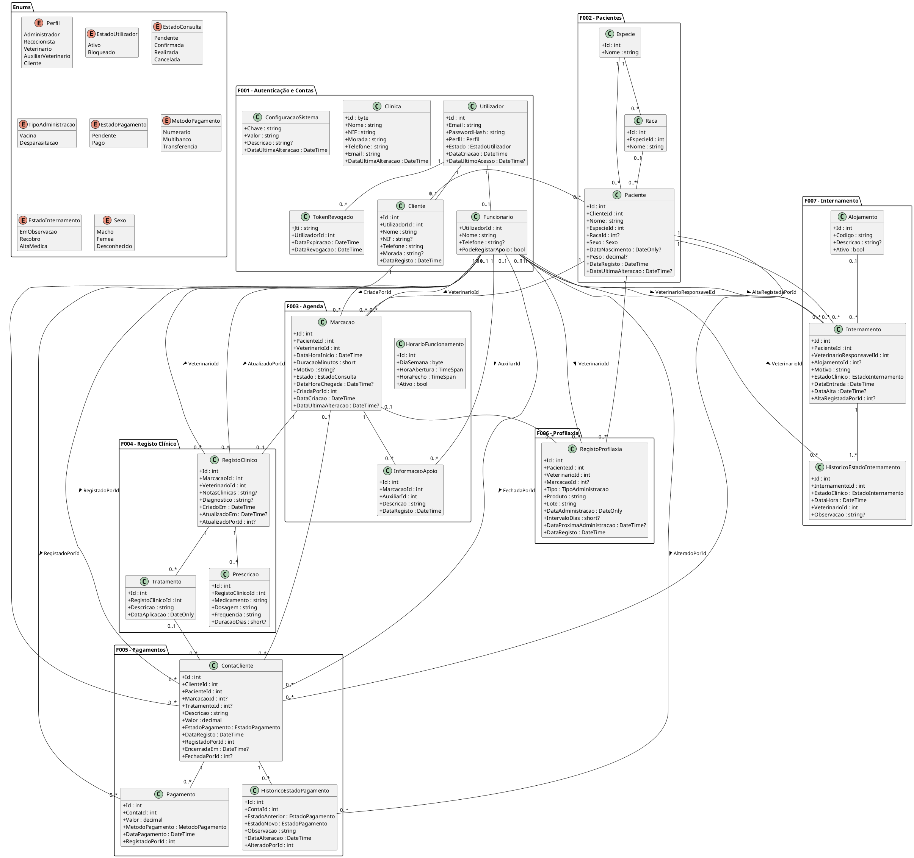
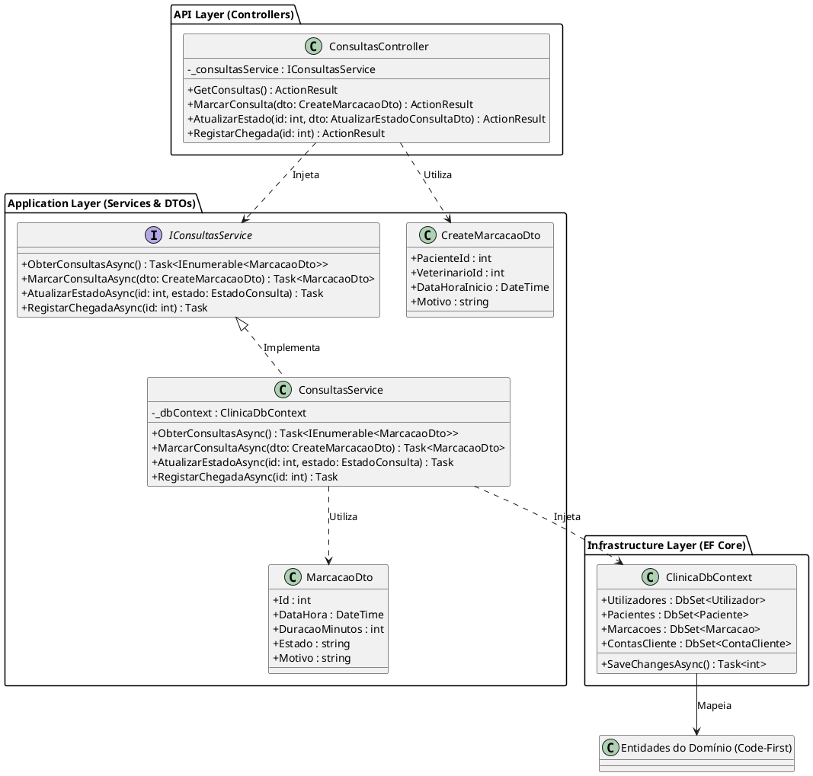

# Modelo de Classes - Backend

**Projeto:** Gestão de Clínica Veterinária
**Grupo:** G08
**Milestone:** m2
**Versão:** v01
**Issue:** I020 — Modelo de Classes (Backend)
**Executor:** André Filipe Moreira Mesquita
**Revisor:** Ivan Cristiano Silva Mendes
**Auditor:** Gonçalo Dinis Magalhães Teixeira

---

## 1. Objetivo

Este documento apresenta o modelo de classes previsto para o Backend do sistema (ARC-API). De acordo com a arquitetura estabelecida (`m2-documentacao-arquitetura-v01.md`), o modelo reflete a organização em camadas do ASP.NET Core e as entidades persistidas através de Entity Framework Core.

## 2. Modelo de Domínio (Entidades Code-First)

O diagrama seguinte ilustra as entidades principais do sistema, as suas enumerações e relacionamentos. Estas classes representam os dados que serão mapeados para a base de dados SQL Server.

## 3. Padrão Estrutural e Responsabilidades

Para demonstrar a organização em camadas definida na Arquitetura, apresenta-se o padrão estrutural transversal a todos os módulos, com foco nas classes essenciais e DTOs da API. O exemplo abaixo utiliza o fluxo F003 (Agendamento de Consultas).

### Tabela de Responsabilidades (Exemplo: Módulo F003)

| Classe / Interface | Tipo | Responsabilidade |
|---|---|---|
| `ConsultasController` | Controller | Recebe os pedidos HTTP já sujeitos à autenticação/autorização do backend, delega a lógica ao serviço e devolve as respostas JSON. |
| `IConsultasService` | Interface | Define o contrato das operações de negócio do módulo de Consultas. |
| `ConsultasService` | Service | Implementa a lógica de negócio, incluindo regras de transição de estado e verificação de disponibilidade do veterinário. |
| `ClinicaDbContext` | DbContext | Gere a ligação à base de dados SQL Server, mapeia as entidades de domínio utilizando a abordagem Code-First (DbSets) e assegura as migrações. |
| `CreateMarcacaoDto` | DTO | Representa a estrutura de dados de entrada para o registo de uma marcação. |
| `MarcacaoDto` | DTO | Representa a estrutura de dados de saída para os endpoints GET de consultas. |

### Diagrama Estrutural (Fluxo F003)

## 4. Integração do Backend

De forma a garantir a segurança da API e a gestão correta da autenticação e das sessões, o Backend inclui os seguintes serviços complementares:

- **`AuthController`** — recebe os pedidos de login, logout e consulta do utilizador autenticado (EP-001 a EP-003).
- **`AuthService`** — coordena a autenticação, verifica as credenciais e o estado da conta e trata a revogação no logout.
- **`JwtTokenService`** — gera e valida os JWT e respetivas *claims*. A autorização por perfil continua a ser aplicada pelos mecanismos do ASP.NET Core/ARC-SEC, não pelas Controllers isoladamente.
- **`ClinicaDbContext`** — disponibiliza a persistência necessária à autenticação e aos restantes módulos, incluindo `Utilizador` e `TokenRevogado`.

No logout, o `AuthService` regista o `jti` do token em `TokenRevogado` até à respetiva expiração. Este fluxo é o representado no artefacto I023 — Diagrama de sequência — autenticar utilizador e é coerente com a decisão arquitetural DA-ARQ-06.

## 5. Serviços previstos por módulo

O diagrama da secção 3 exemplifica o padrão com F003. Os restantes módulos seguem a mesma separação Controller → Service → `ClinicaDbContext`, sem implicar microserviços independentes.

| Módulo | Controller / serviço principal | Operações principais previstas |
|---|---|---|
| F001 — Autenticação, Contas e Configuração | `AuthController` / `AuthService`; `UtilizadoresController` / `UtilizadoresService`; `ClientesController` / `ClientesService`; `ClinicaController` / `ClinicaService` | autenticar, terminar sessão, consultar utilizador autenticado, gerir contas de funcionários e Clientes, consultar/atualizar configuração e horários |
| F002 — Pacientes | `AnimaisController` / `AnimaisService` | listar/pesquisar pacientes, consultar ficha, registar e atualizar dados administrativos, consultar animais do Cliente |
| F003 — Agenda e Marcações | `ConsultasController` / `ConsultasService` | listar consultas, consultar disponibilidade, criar/alterar marcação, atualizar estado, registar chegada e informação de apoio |
| F004 — Registo Clínico | `RegistosClinicosController` / `RegistosClinicosService` | criar/atualizar registo clínico, consultar registo e histórico clínico |
| F005 — Contas e Pagamentos | `ContasController` / `ContasService` | registar custos, consultar contas, registar pagamentos, corrigir estado e fechar conta |
| F006 — Vacinação e Desparasitação | `VacinacoesController` / `VacinacoesService` | consultar boletim e registar vacinação/desparasitação |
| F007 — Internamento | `InternamentosController` / `InternamentosService` | consultar alojamentos/internamentos, registar internamento, associar alojamento, atualizar estado e registar alta |

As assinaturas concretas dos endpoints e DTOs são as definidas em `m2-documentacao-api-v01.md`. Este modelo não duplica todos os DTOs da API para evitar duas fontes de verdade; representa as classes estruturais necessárias para orientar a implementação.

## 6. Regras de consistência do modelo

- `Funcionario.PodeRegistarApoio` só tem efeito para o perfil `AuxiliarVeterinario` e é verificado antes de criar `InformacaoApoio` (RF027).
- `HorarioFuncionamento` admite vários períodos no mesmo dia; o serviço rejeita períodos sobrepostos antes da persistência (RF019).
- a criação e atualização de pacientes utiliza apenas os dados administrativos definidos no contrato da API; o e-mail do Cliente pertence a `Utilizador.Email`.
- `EstadoPagamento` permanece coerente com o valor em dívida; uma correção administrativa fica registada em `HistoricoEstadoPagamento` e não altera os movimentos de `Pagamento` (RF040).
- apenas o Veterinário pode alterar o estado clínico do internamento ou registar a alta; o Auxiliar tem acesso de leitura (RF051, RF052).
- as regras de perfil, propriedade dos dados do Cliente e validação autoritativa são aplicadas no backend, mesmo quando as interfaces ocultam operações não permitidas.

## 7. Rastreabilidade

| Área | Requisitos | Casos de uso | Componente arquitetural |
|---|---|---|---|
| F001 | RF001–RF013 | UC01–UC05 | ARC-F001 / ARC-SEC |
| F002 | RF014–RF018 | UC06–UC08 | ARC-F002 |
| F003 | RF019–RF029 | UC09–UC11 | ARC-F003 |
| F004 | RF030–RF036 | UC12–UC13 | ARC-F004 |
| F005 | RF037–RF042 | UC14–UC15 | ARC-F005 |
| F006 | RF043–RF047 | UC16–UC17 | ARC-F006 |
| F007 | RF048–RF052 | UC18 | ARC-F007 |

Todas as operações persistentes passam por ARC-DATA/`ClinicaDbContext`; os frontends não acedem diretamente às entidades deste modelo.
