# Modelo de Classes — Frontend Mobile

**Projeto:** Gestão de Clínica Veterinária  
**Grupo:** G08  
**Milestone:** m2  
**Versão:** v01  
**Issue:** I022 — Modelo de Classes — Frontend Mobile  
**Executor:** Gonçalo Magalhães Ribeiro  
**Revisor:** Gonçalo Dinis Magalhães Teixeira  
**Auditor:** André Filipe Moreira Mesquita  
**Ficheiro:** `m2-modelo-classes-frontend-mobile-v01.md`  
**Pasta de destino:** `/projeto/04-artefactos-tecnicos/04.07-modelos-de-classes`  


---

## 1. Objetivo

O presente documento define o modelo de classes previsto para o **Frontend Mobile** do sistema de Gestão de Clínica Veterinária.

O modelo representa as classes e estruturas relevantes da aplicação Flutter/Dart, as respetivas responsabilidades, atributos, operações e relações, mantendo coerência com:

- a Especificação de Requisitos;
- as Especificações dos Casos de Uso;
- o Protótipo de Baixa Fidelidade (ecrãs M01–M06);
- a Documentação da Arquitetura;
- a Documentação da API;
- o Modelo de Classes do Frontend Web.

O Frontend Mobile corresponde ao componente arquitetural **ARC-MOB** e destina-se **exclusivamente** ao perfil **Cliente (Proprietário do animal)**. Todas as funcionalidades disponibilizadas são de consulta: a aplicação não cria, altera nem elimina dados de negócio.

---

## 2. Fontes e referências

| Referência | Utilização neste documento |
|---|---|
| `m1-proposta-sistema-v03.pdf` | Ator Cliente e funcionalidades F001–F007. |
| `m1-declaracao-ambito-v03.pdf` | Âmbito mobile por funcionalidade e exclusões (sem marcações, pagamentos, edição de animais nem internamentos). |
| `m1-regulamento-grupo-v01.pdf` | Flutter 3.19, Dart 3.2, Android SDK 34, Effective Dart, `flutter_lints`, `flutter_test`, `integration_test`, `mocktail`. |
| `m2-especificacao-requisitos-v01.md` | RF001–RF005, RF018, RF028, RF029, RF042, RF047 e RNF001–RNF006. |
| `m2-especificacoes-casos-uso-v01.md` | UC01, UC02, UC08, UC11, UC15 e UC17. |
| `m2-prototipo-baixa-fidelidade-v01.pdf` | Ecrãs M01–M06 e navegação da aplicação mobile. |
| `m2-documentacao-arquitetura-v01.md` | ARC-MOB, ARC-API, DA-ARQ-01, DA-ARQ-03 e DA-ARQ-06. |
| `m2-documentacao-api-v01.md` | Endpoints EP-001 a EP-003, EP-019, EP-020, EP-030, EP-041 e EP-044, formatos JSON e erros. |
| `m2-modelo-classes-frontend-web-v01.md` | Convenções partilhadas de cliente HTTP, sessão e tratamento de erros. |
| `m2-diagrama-sequencia-autenticar-utilizador-v01.md` | Fluxo de autenticação (UC01) e armazenamento do token no cliente. |
| `m2-20261007-backlog-projeto-v01.pdf` | Critérios de aceitação, evidências e resultado esperado da I022. |

Quando exista conflito, prevalecem os documentos homologados e normativos e, no que respeita ao contrato entre a aplicação e o backend, a Documentação da API prevista para a milestone m2.

---

## 3. Âmbito do modelo

O modelo cobre exclusivamente a aplicação **Flutter** destinada ao Cliente.

São representadas cinco categorias de estruturas:

1. **Core** — configuração, cliente HTTP, tratamento de erros e armazenamento seguro do token;
2. **Sessão e navegação** — autenticação, restauro e fim de sessão, controlo do perfil e navegação entre ecrãs;
3. **Ecrãs e controladores** — correspondentes aos ecrãs M01–M06 do protótipo;
4. **Serviços de acesso à API** — encapsulam os endpoints `/auth/*` e `/me/*`;
5. **Models Dart** — representam os dados recebidos da API.

Não são modelados:

- o Frontend Web e os perfis internos;
- entidades Entity Framework ou acesso direto à base de dados;
- operações de escrita sobre dados de negócio;
- endpoints que não sejam `/auth/*` ou `/me/*`;
- funcionalidades fora do âmbito aprovado.

---

## 4. Convenções de modelação

### 4.1. Flutter e UML

A aplicação utiliza **Flutter 3.19 + Dart 3.2**. Ao contrário do Frontend Web, em Flutter as estruturas são classes Dart, pelo que a notação UML de classe se aplica diretamente.

São utilizados os seguintes estereótipos:

- `<<screen>>` — ecrã (widget) correspondente a um ecrã do protótipo;
- `<<widget>>` — widget estrutural reutilizável;
- `<<controller>>` — controlador de estado do ecrã (`ChangeNotifier`);
- `<<service>>` — serviço de comunicação com a API;
- `<<model>>` — classe de dados imutável recebida da API;
- `<<enum>>` — enumeração Dart;
- `<<infrastructure>>` — infraestrutura transversal.

Os tipos são apresentados com a sintaxe Dart, incluindo nulabilidade (`String?`, `Future<void>`, `List<T>`).

### 4.2. Nomenclatura

De acordo com as **Effective Dart Guidelines** adotadas no Regulamento Interno do Grupo (secção 11.3):

- classes, enums e tipos em `UpperCamelCase`;
- atributos, métodos e valores de enum em `lowerCamelCase`;
- ficheiros e pastas em `snake_case`;
- os nomes dos campos JSON seguem a Documentação da API (camelCase em português) e são convertidos nos métodos `fromJson`.

### 4.3. Responsabilidade da aplicação mobile

A aplicação mobile:

- permite ao Cliente iniciar e terminar sessão;
- apresenta apenas informação devolvida pela API para a conta autenticada;
- não envia nunca o identificador do Cliente nos pedidos: este é obtido pelo servidor a partir do token (RNF002);
- não disponibiliza operações de criação, alteração ou eliminação;
- apresenta mensagens claras quando a API devolve erros ou não existe ligação à rede.

As decisões de autorização, isolamento de dados e regras de negócio continuam a pertencer ao Backend / API.

### 4.4. Decisões internas introduzidas por este modelo

As decisões seguintes são de **organização interna do Frontend Mobile** e não constituem novas funcionalidades de negócio:

| N.º | Decisão | Justificação |
|---|---|---|
| DM-01 | Gestão de estado com `ChangeNotifier` (incluído no Flutter SDK), um controlador por ecrã e um `SessaoController` global. | Evita dependências externas de gestão de estado e facilita os testes com `flutter_test` e `mocktail`. |
| DM-02 | Comunicação HTTP centralizada num único `ApiClient`, baseado no package `http`. | Um único ponto para URL base, cabeçalho JWT, *timeout* e conversão de erros. |
| DM-03 | Token guardado com `flutter_secure_storage` (Android Keystore). | O token dá acesso a dados pessoais do Cliente; não deve ficar em armazenamento em texto simples. |
| DM-04 | URL base da API definida em tempo de compilação com `--dart-define=API_BASE_URL=...`, através de `AppConfig`. | Permite utilizar diferentes ambientes de desenvolvimento e demonstração sem alterar código. No emulador Android, o backend local pode ser acedido por `http://10.0.2.2:<porta>` em ambiente controlado. |
| DM-05 | Serviços e controladores recebem as dependências pelo construtor. | Permite substituir serviços por *mocks* (`mocktail`) nos testes unitários e de widgets. |
| DM-06 | Cada ecrã expõe chaves (`Key`) estáveis nos elementos relevantes (ver secção 13). | Necessário para os testes de sistema automáticos com `integration_test` (QG-07 do Regulamento Interno). |

Os packages `http` e `flutter_secure_storage` devem ser registados nas dependências do projeto (`pubspec.yaml`) na implementação em m4.

---

## 5. Organização lógica prevista

```text
/src/frontend-mobile/lib
│
├── main.dart
├── app.dart
│
├── core/
│   ├── config/
│   │   └── app_config.dart
│   ├── api/
│   │   ├── api_client.dart
│   │   └── api_exception.dart
│   ├── storage/
│   │   └── token_storage.dart
│   └── formatacao/
│       └── formatadores.dart
│
├── sessao/
│   ├── auth_service.dart
│   ├── sessao_controller.dart
│   └── models/
│       ├── credenciais_login.dart
│       ├── sessao_autenticada.dart
│       └── utilizador_autenticado.dart
│
├── navegacao/
│   ├── app_router.dart
│   ├── auth_gate.dart
│   └── main_shell.dart
│
├── features/
│   ├── login/
│   │   └── login_screen.dart
│   ├── animais/
│   │   ├── animais_service.dart
│   │   ├── animais_controller.dart
│   │   ├── animal_detalhe_controller.dart
│   │   ├── animais_screen.dart
│   │   ├── animal_detalhe_screen.dart
│   │   └── models/
│   ├── consultas/
│   │   ├── consultas_service.dart
│   │   ├── consultas_controller.dart
│   │   ├── consultas_screen.dart
│   │   └── models/
│   ├── despesas/
│   │   ├── despesas_service.dart
│   │   ├── despesas_controller.dart
│   │   ├── despesas_screen.dart
│   │   └── models/
│   └── boletim/
│       ├── boletim_service.dart
│       ├── boletim_controller.dart
│       ├── boletim_screen.dart
│       └── models/
│
└── shared/
    ├── estado_carregamento.dart
    └── widgets/
        └── estado_vista.dart
```

A estrutura física pode sofrer pequenos ajustamentos durante a implementação, desde que sejam preservadas as responsabilidades, relações e contratos definidos neste modelo.

---

# 6. Modelo transversal — Core, sessão e navegação

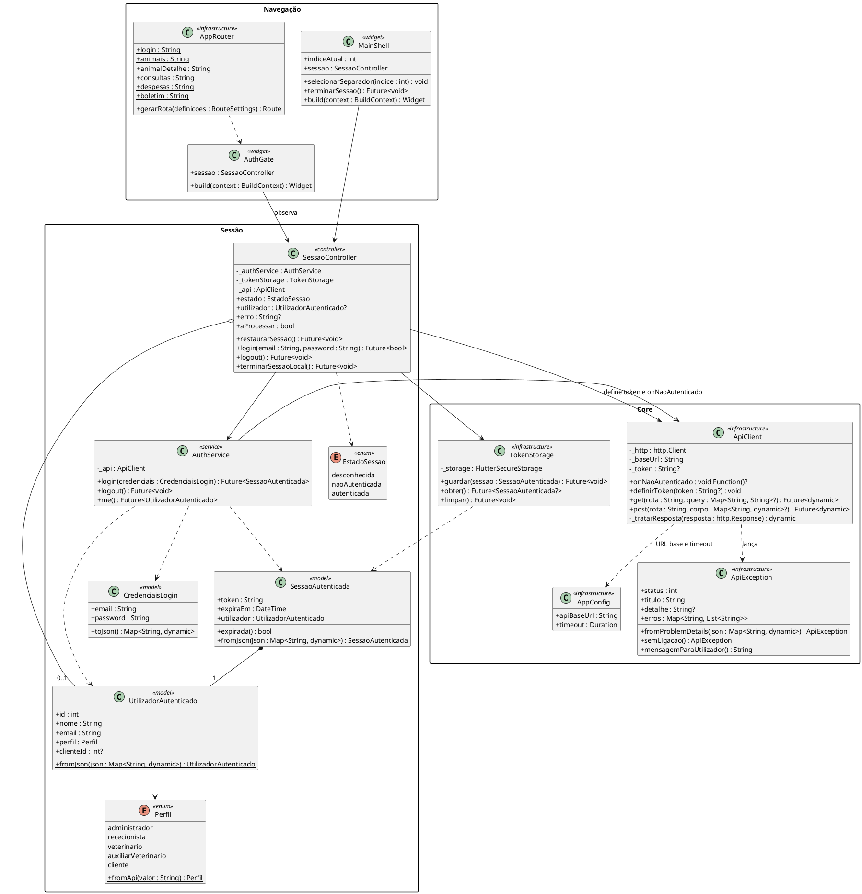

## 6.1. Responsabilidades

| Estrutura | Responsabilidade |
|---|---|
| `AppConfig` | Disponibilizar a URL base da API (via `--dart-define`) e o *timeout* dos pedidos. |
| `ApiClient` | Executar pedidos HTTP, acrescentar o cabeçalho `Authorization: Bearer`, converter JSON e transformar respostas de erro em `ApiException`. Invoca `onNaoAutenticado` quando recebe `401`. |
| `ApiException` | Representar erros no formato *Problem Details* da API e a ausência de ligação à rede, com uma mensagem adequada ao utilizador. |
| `TokenStorage` | Guardar, obter e limpar a sessão (token, expiração e utilizador) em armazenamento seguro. |
| `AuthService` | Consumir EP-001 (`POST /auth/login`), EP-002 (`POST /auth/logout`) e EP-003 (`GET /auth/me`). |
| `SessaoController` | Gerir o ciclo de vida da sessão: login, verificação do perfil, restauro, logout e fim local da sessão. |
| `AuthGate` | Mostrar M01 ou a área autenticada consoante o `EstadoSessao`. |
| `MainShell` | Conter a barra de navegação inferior (Animais, Consultas, Despesas) e a ação de terminar sessão. |
| `AppRouter` | Definir as rotas nomeadas dos ecrãs e os respetivos argumentos (por exemplo, `animalId`). |

## 6.2. Regras de sessão

1. **Login (UC01):** `SessaoController.login()` chama EP-001. Em caso de sucesso, define temporariamente o token recebido no `ApiClient` e verifica o perfil devolvido:
   - se o perfil for `cliente`, guarda a sessão com `TokenStorage` e passa a `autenticada`;
   - se o perfil **não** for `cliente`, chama EP-002 com o token recebido para o revogar, limpa o token local, não guarda a sessão e apresenta a mensagem "Esta aplicação destina-se apenas a clientes da clínica." (RNF003).
2. **Erros de login:** `401` → "Email ou palavra-passe incorretos."; `403` → "A conta encontra-se bloqueada."; sem ligação → mensagem de rede (RNF006).
3. **Restauro:** ao arrancar, `restaurarSessao()` lê a sessão guardada. Se não existir ou estiver expirada (`expiraEm`), limpa-a e mostra M01. Caso contrário, confirma a sessão com EP-003; se a API responder `401`, termina a sessão localmente.
4. **Sem refresh token:** o token tem validade de 8 horas (DA-ARQ-06). Expirado, o Cliente volta a autenticar-se.
5. **Resposta 401 em qualquer pedido:** o `ApiClient` invoca `onNaoAutenticado`, que executa `terminarSessaoLocal()` (limpa o armazenamento e volta a M01).
6. **Logout (UC02):** `logout()` chama EP-002 para revogar o token no servidor e **limpa sempre** a sessão local, mesmo que o pedido falhe (por exemplo, sem rede).

## 6.3. Diagrama de estados da sessão

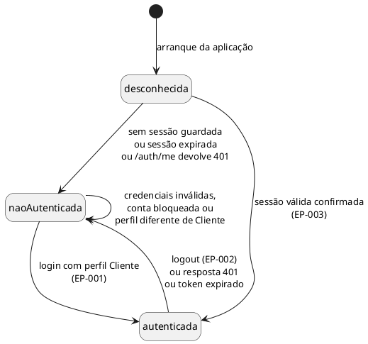

---

# 7. Ecrãs e controladores (M01–M06)

Os serviços e models aparecem neste diagrama apenas como referência; a sua definição completa encontra-se nas secções 8 e 9.

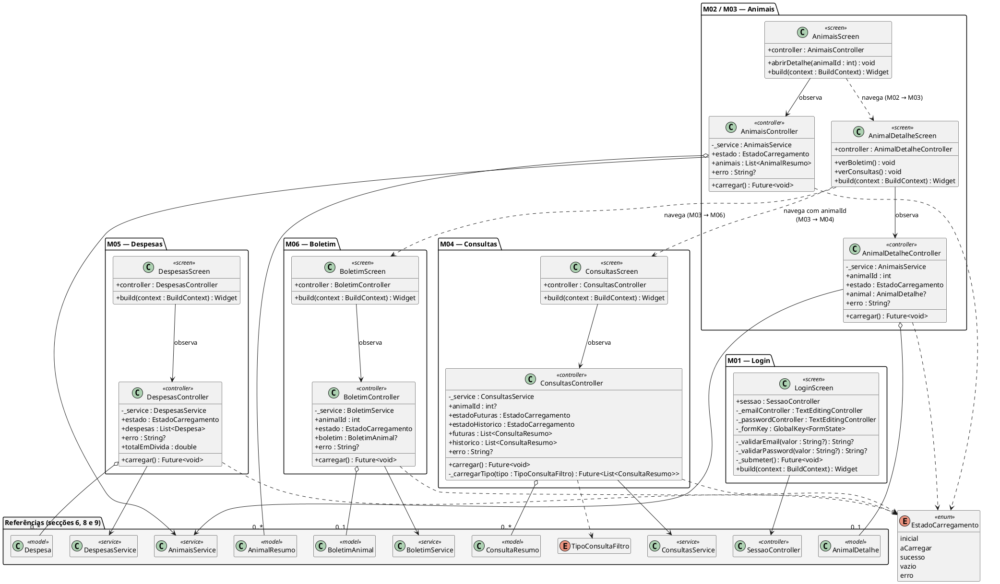

## 7.1. Responsabilidades dos controladores

Todos os controladores estendem `ChangeNotifier` e chamam `notifyListeners()` após cada mudança de estado.

| Controlador | Responsabilidade |
|---|---|
| `AnimaisController` | Obter os animais do Cliente (EP-019) e indicar `vazio` quando a lista é vazia (UC08, A1). |
| `AnimalDetalheController` | Obter os dados básicos de um animal (EP-020); tratar `403` como acesso recusado (UC08, E1). |
| `ConsultasController` | Obter marcações futuras e histórico (EP-030 com `tipo=futuras` e `tipo=historico`), opcionalmente filtradas por `animalId`. |
| `DespesasController` | Obter as despesas (EP-041) e calcular `totalEmDivida` como soma de `valorEmDivida`, apenas para apresentação. |
| `BoletimController` | Obter o boletim de um animal (EP-044): histórico e próximas administrações. |

## 7.2. Estado de carregamento

`EstadoCarregamento` uniformiza o comportamento visual de todos os ecrãs de consulta:

| Estado | Apresentação |
|---|---|
| `inicial` / `aCarregar` | Indicador de progresso. |
| `sucesso` | Dados devolvidos pela API. |
| `vazio` | Mensagem de ausência de dados (por exemplo, "Ainda não existem despesas registadas."). |
| `erro` | Mensagem de `ApiException.mensagemParaUtilizador()` e ação "Tentar novamente", que volta a chamar `carregar()`. |

---

# 8. Serviços de acesso à API

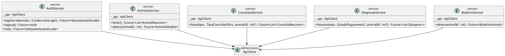

## 8.1. Endpoints consumidos por serviço

| Serviço | Operação | Endpoint | Requisitos |
|---|---|---|---|
| `AuthService` | `login` | EP-001 `POST /auth/login` | RF001, RF002, RF004, RF005 |
| `AuthService` | `logout` | EP-002 `POST /auth/logout` | RF003 |
| `AuthService` | `me` | EP-003 `GET /auth/me` | RF004, RF005 |
| `AnimaisService` | `listar` | EP-019 `GET /me/animais` | RF018 |
| `AnimaisService` | `obter` | EP-020 `GET /me/animais/{id}` | RF018 |
| `ConsultasService` | `listar` | EP-030 `GET /me/consultas?tipo=&animalId=` | RF028, RF029 |
| `DespesasService` | `listar` | EP-041 `GET /me/despesas?estado=&animalId=` | RF042 |
| `BoletimService` | `obter` | EP-044 `GET /me/animais/{id}/vacinacoes` | RF047 |

A aplicação mobile consome **exclusivamente** estes oito endpoints. Todos os restantes (EP-004 a EP-018, EP-021 a EP-029, EP-031 a EP-040, EP-042, EP-043 e EP-045 a EP-051) pertencem ao Frontend Web e não são consumidos pela aplicação mobile (RNF003).

Nenhum serviço envia `clienteId`: as rotas `/me/*` identificam o Cliente a partir do token (RNF002). O único método de escrita é `POST /auth/*`, que gere a sessão e não altera dados de negócio.

---

# 9. Models Dart

Todos os models são **imutáveis** (atributos `final`) e possuem uma fábrica `fromJson`, que converte os campos da API. As datas recebidas em ISO 8601 são convertidas para `DateTime` e apresentadas na hora local do dispositivo.

## 9.1. Enumerações

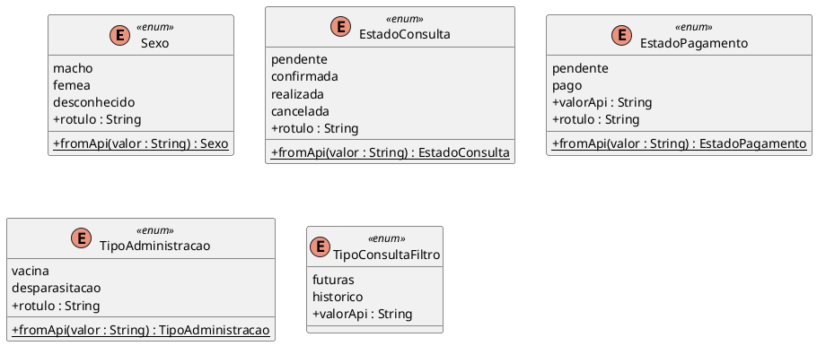

As enumerações correspondem aos valores da Documentação da API (secção 2.2), convertidos para `lowerCamelCase` conforme as Effective Dart Guidelines (por exemplo, `"Pendente"` ↔ `pendente`). O método `fromApi` faz a conversão a partir do texto recebido; `valorApi` faz a conversão inversa quando o valor é enviado como parâmetro.

O atributo `rotulo` define o texto apresentado ao utilizador:

| Enumeração | Valor | Rótulo apresentado |
|---|---|---|
| `Sexo` | `macho` / `femea` / `desconhecido` | Macho / Fêmea / Desconhecido |
| `EstadoConsulta` | `pendente` / `confirmada` / `realizada` / `cancelada` | Pendente / Confirmada / Realizada / Cancelada |
| `EstadoPagamento` | `pendente` / `pago` | Por pagar / Pago |
| `TipoAdministracao` | `vacina` / `desparasitacao` | Vacina / Desparasitação |

`Perfil` está definido na secção 6. `TipoConsultaFiltro` é uma restrição de tipagem da aplicação mobile que corresponde ao parâmetro `tipo` de EP-030.

## 9.2. Animais (F002)

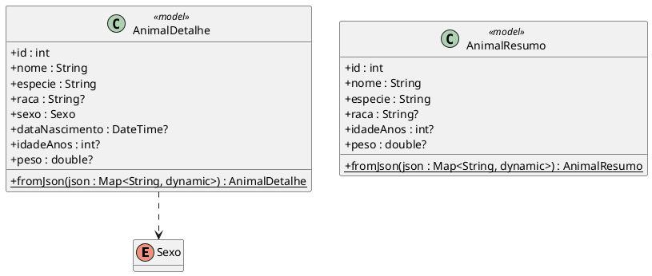

## 9.3. Consultas (F003)

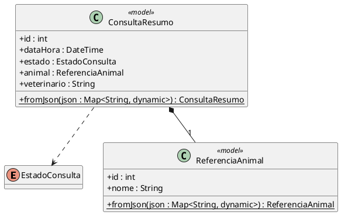

`ConsultaResumo` contém apenas informação administrativa (data, animal, Veterinário e estado), sem qualquer registo clínico (RF029).

## 9.4. Despesas (F005)

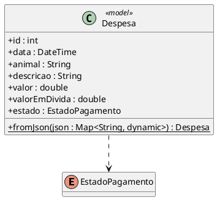

Os valores monetários são recebidos como número decimal em euros e apresentados com duas casas decimais e o símbolo €. A aplicação não altera valores nem registos de pagamento (RF042).

## 9.5. Boletim de vacinação e desparasitação (F006)

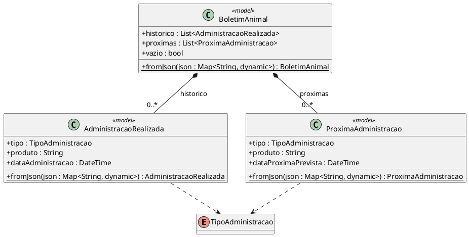

A data da próxima administração é calculada pelo servidor (RF045); a aplicação apenas a apresenta. `vazio` é verdadeiro quando ambas as listas estão vazias (UC17, A1).

---

# 10. Relação entre ecrãs, estruturas e protótipo

| Ecrã | Ecrã / controlador | Serviço(s) e endpoints | UC / RF |
|---|---|---|---|
| M01 — Login Mobile | `LoginScreen`, `SessaoController` | `AuthService` — EP-001, EP-002 (perfil não Cliente), EP-003 (restauro) | UC01; RF001, RF002, RF004, RF005 |
| M02 — Os Meus Animais | `AnimaisScreen`, `AnimaisController` | `AnimaisService` — EP-019 | UC08; RF018 |
| M03 — Detalhe do Animal | `AnimalDetalheScreen`, `AnimalDetalheController` | `AnimaisService` — EP-020 | UC08; RF018 |
| M04 — Consultas | `ConsultasScreen`, `ConsultasController` | `ConsultasService` — EP-030 | UC11; RF028, RF029 |
| M05 — Despesas e Pagamentos | `DespesasScreen`, `DespesasController` | `DespesasService` — EP-041 | UC15; RF042 |
| M06 — Boletim | `BoletimScreen`, `BoletimController` | `BoletimService` — EP-044 | UC17; RF047 |
| Barra de navegação e terminar sessão | `MainShell`, `SessaoController` | `AuthService` — EP-002 | UC02; RF003 |

## 10.1. Navegação

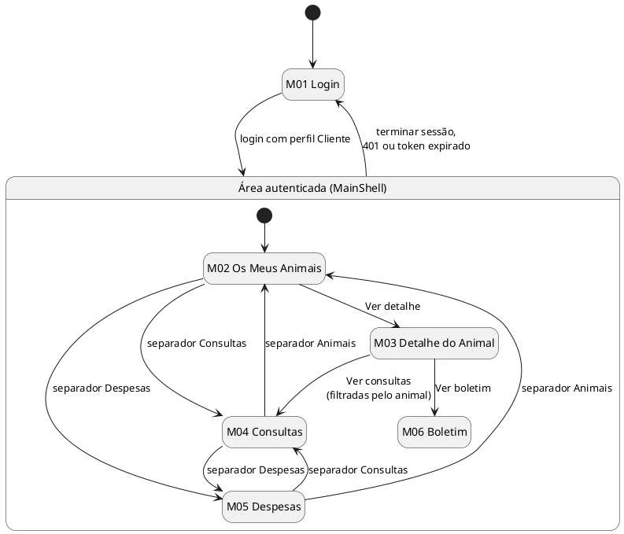

---

# 11. Regras de comportamento e restrições do Cliente

A aplicação mobile:

- apresenta apenas os animais, consultas, despesas e boletins devolvidos pelas rotas `/me/*` para a conta autenticada;
- não contém botões, formulários ou rotas para criar, alterar ou cancelar marcações (RF028, UC11);
- não contém formulários de edição de animais (RF018, UC08);
- não permite registar nem efetuar pagamentos (RF042, UC15);
- não apresenta registos clínicos, diagnósticos, tratamentos nem prescrições (RF029);
- não apresenta internamentos (Declaração de Âmbito, F007);
- não apresenta funcionalidades dos perfis internos.

Quando a API devolve `403` ao pedir um recurso (por exemplo, um animal de outro Cliente), o ecrã apresenta "Não tem acesso a esta informação." e não mostra quaisquer dados (UC08 E1, UC11 E1, UC15 E2, UC17 E1).

---

# 12. Validação e tratamento de erros

## 12.1. Validação local

Apenas o formulário de login (M01) recebe dados do utilizador. A validação local verifica:

- email preenchido e com formato válido;
- palavra-passe preenchida.

Esta validação não substitui a validação da API.

## 12.2. Conversão de erros

O `ApiClient` converte cada resposta de erro numa `ApiException`:

| Situação | Tratamento na aplicação |
|---|---|
| `400` | Mensagem de dados inválidos; erros por campo (`errors`) associados aos campos do formulário de login. |
| `401` | No login: credenciais incorretas. Nos restantes pedidos: fim local da sessão e regresso a M01. |
| `403` | No login: conta bloqueada. Nos restantes pedidos: "Não tem acesso a esta informação." |
| `404` | "A informação pedida já não existe." |
| `500` | "Ocorreu um erro no servidor. Tente novamente mais tarde." |
| Sem ligação / *timeout* | "Sem ligação ao servidor. Verifique a sua ligação à rede." e ação "Tentar novamente" (RNF006). |

A aplicação não guarda dados de negócio localmente nem funciona offline: apenas a sessão é guardada (RNF006).

---

# 13. Testabilidade

Para cumprir os quality gates QG-05 e QG-07 do Regulamento Interno do Grupo, o modelo prevê:

- **Injeção pelo construtor:** serviços recebem o `ApiClient`; controladores recebem o respetivo serviço; o `SessaoController` recebe `AuthService`, `TokenStorage` e `ApiClient`. Todos podem ser substituídos por *mocks* com `mocktail`.
- **Chaves estáveis nos widgets**, utilizadas pelos testes de sistema com `integration_test`:

| Ecrã | Chaves previstas |
|---|---|
| M01 | `m01-email`, `m01-password`, `m01-entrar`, `m01-erro` |
| M02 | `m02-lista-animais`, `m02-animal-{id}`, `m02-vazio` |
| M03 | `m03-nome`, `m03-ver-boletim`, `m03-ver-consultas` |
| M04 | `m04-lista-futuras`, `m04-lista-historico` |
| M05 | `m05-lista-despesas`, `m05-total-divida` |
| M06 | `m06-historico`, `m06-proximas`, `m06-vazio` |
| Barra de navegação | `nav-animais`, `nav-consultas`, `nav-despesas`, `nav-terminar-sessao` |
| Estados comuns | `estado-a-carregar`, `estado-erro`, `estado-tentar-novamente` |

- **Testes de sistema** apontam para o backend local ou de testes através de `--dart-define=API_BASE_URL`, sem alterar código.

---

# 14. Relações estruturais principais

```text
Ecrã (Screen)
    ↓ observa
Controlador (ChangeNotifier)
    ↓ utiliza
Service
    ↓ utiliza
ApiClient
    ↓ HTTP(S) / JSON / JWT
ARC-API (/auth/*, /me/*)

AuthGate
    ↓ observa
SessaoController
    ↓ utiliza
AuthService + TokenStorage + ApiClient
```

Não existe relação direta:

```text
Frontend Mobile → Base de Dados
Frontend Mobile → Entity Framework Core
Frontend Mobile → endpoints dos perfis internos
```

---

# 15. Rastreabilidade com ARC-MOB e requisitos não funcionais

| Requisito / componente | Tratamento no modelo |
|---|---|
| ARC-MOB | Ecrãs, controladores, serviços, models, sessão e infraestrutura definidos neste documento. |
| RNF001 — Controlo de acesso | `SessaoController` aceita apenas o perfil `cliente`; a aplicação não expõe operações de outros perfis; o backend continua autoritativo. |
| RNF002 — Isolamento dos dados de Clientes | Utilização exclusiva das rotas `/me/*`; nenhum serviço envia `clienteId`; `403` tratado como acesso recusado. |
| RNF003 — Separação dos canais | Apenas EP-001 a EP-003 e os cinco endpoints `/me/*` são consumidos; perfis internos são rejeitados no login. |
| RNF004 — Validação dos dados de entrada | Validação local do login; erros `400` da API apresentados por campo. |
| RNF005 — Persistência dos dados confirmados | A aplicação apenas consulta dados persistidos pelo backend; não mantém cópias locais. |
| RNF006 — Dependência de ligação à rede | `ApiException.semLigacao()`, mensagem de rede e "Tentar novamente"; sem modo offline. |

## 15.1. Cobertura dos requisitos funcionais do Cliente

| Requisito | Estruturas |
|---|---|
| RF001, RF002 | `LoginScreen`, `SessaoController.login()`, `AuthService.login()` |
| RF003 | `MainShell.terminarSessao()`, `SessaoController.logout()`, `AuthService.logout()` |
| RF004 | `TokenStorage`, `SessaoController.restaurarSessao()`, `SessaoAutenticada.expirada()` |
| RF005 | `SessaoController` (verificação do perfil), `AuthGate` |
| RF018 | `AnimaisScreen`, `AnimalDetalheScreen`, `AnimaisController`, `AnimalDetalheController`, `AnimaisService` |
| RF028, RF029 | `ConsultasScreen`, `ConsultasController`, `ConsultasService`, `ConsultaResumo` |
| RF042 | `DespesasScreen`, `DespesasController`, `DespesasService`, `Despesa` |
| RF047 | `BoletimScreen`, `BoletimController`, `BoletimService`, `BoletimAnimal` |

---

# 16. Elementos deliberadamente fora do modelo

Este modelo não introduz:

- registo autónomo de conta pelo Cliente ou recuperação de palavra-passe;
- criação, alteração ou cancelamento de marcações;
- criação ou edição de fichas de animais;
- pagamentos eletrónicos ou registo de pagamentos;
- consulta de registos clínicos, diagnósticos, tratamentos ou prescrições;
- acompanhamento de internamentos;
- notificações *push*, SMS ou e-mail;
- sincronização com calendários externos;
- autenticação Google/Facebook ou multifator;
- refresh token;
- leitura de QR, códigos de barras ou microchips;
- armazenamento local de dados de negócio ou modo offline;
- acesso direto à base de dados.

---

# 17. Critérios de implementação derivados do modelo

Para manter coerência com este artefacto durante a implementação (m4):

1. ecrãs não efetuam pedidos HTTP diretamente; utilizam o respetivo controlador e serviço;
2. serviços utilizam exclusivamente o `ApiClient`;
3. o token é guardado apenas através de `TokenStorage` (armazenamento seguro);
4. a URL base da API é definida por `--dart-define=API_BASE_URL`, nunca escrita no código;
5. nenhuma rota fora de `/auth/*` e `/me/*` é chamada;
6. os valores das enumerações permanecem compatíveis com a API através de `fromApi` / `valorApi`;
7. os models podem ser refinados apenas se o contrato da API for atualizado de forma controlada;
8. os ecrãs M01–M06 continuam identificáveis na implementação, ainda que a composição visual evolua;
9. as chaves da secção 13 são mantidas para os testes de sistema;
10. a ação "Terminar sessão" está sempre acessível na área autenticada.

---

# 18. Diagrama global simplificado

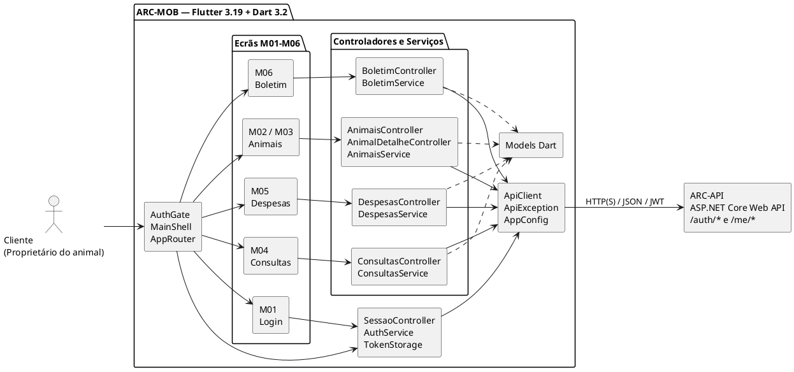


---

## 19. Histórico de versões

| Versão | Autor  |
|---|---|
| v01 | Gonçalo Magalhães Ribeiro | 
