# Modelo de Classes — Frontend Web

**Projeto:** Gestão de Clínica Veterinária  
**Grupo:** G08  
**Milestone:** m2  
**Versão:** v01  
**Issue:** I021 — Modelo de Classes — Frontend Web  


---

## 1. Objetivo

O presente documento define o modelo de classes e estruturas previsto para o **Frontend Web** do sistema de Gestão de Clínica Veterinária.

O modelo representa as estruturas relevantes da aplicação React/TypeScript, as respetivas responsabilidades, atributos, operações e relações, mantendo coerência com:

- a Especificação de Requisitos;
- as Especificações dos Casos de Uso;
- o Protótipo de Baixa Fidelidade;
- a Documentação da Arquitetura;
- a Documentação da API;
- o Modelo de Dados;
- o Modelo de Classes do Backend.

O Frontend Web corresponde ao componente arquitetural **ARC-WEB** e destina-se exclusivamente aos perfis internos:

- Administrador;
- Rececionista;
- Veterinário;
- Auxiliar Veterinário.

O perfil **Cliente** utiliza exclusivamente a aplicação móvel e não faz parte deste modelo.

---

## 2. Fontes e referências

| Referência | Utilização neste documento |
|---|---|
| `m1-proposta-sistema-v03.pdf` | Âmbito funcional homologado e atores. |
| `m1-declaracao-ambito-v03.pdf` | Limites dos canais Web/Mobile e exclusões. |
| `m1-regulamento-grupo-v01.pdf` | Tecnologias, convenções e ferramentas adotadas pelo grupo. |
| `m2-especificacao-requisitos-v01.md` | Requisitos RF001–RF052 e RNF001–RNF006. |
| `m2-especificacoes-casos-uso-v01.md` | UC01–UC18, atores, fluxos, alternativas e permissões. |
| `m2-prototipo-baixa-fidelidade-v01.pdf` | Ecrãs W01–W18 e organização prevista da interface Web. |
| `m2-documentacao-arquitetura-v01.md` | ARC-WEB, ARC-API, autenticação, autorização e separação de responsabilidades. |
| `m2-documentacao-api-v01.md` | Endpoints, contratos JSON, perfis autorizados, erros e enumerações. |
| `m2-modelo-de-dados-clinica-veterinaria-v01.md` | Entidades e conceitos persistentes relevantes para os DTOs. |
| `m2-modelo-classes-backend-v01.md` | Nomenclatura e estruturas previstas no backend. |
| `m2-diagrama-sequencia-autenticar-utilizador-v01.md` | Fluxo UC01 e armazenamento do token no cliente. |
| `m2-20261007-backlog-projeto-v01.pdf` | Critérios de aceitação, evidências e resultado esperado da I021. |

Quando exista conflito, prevalecem os documentos homologados e normativos e, no que respeita ao contrato entre frontend e backend, a Documentação da API prevista para a milestone m2.

---

## 3. Âmbito do modelo

O modelo cobre exclusivamente o **Frontend Web React/TypeScript**.

São representadas quatro categorias principais de estruturas:

1. **Core e segurança do frontend**
   - cliente HTTP;
   - contexto de autenticação;
   - proteção de rotas;
   - tratamento normalizado de erros;
   - layout e navegação condicionada pelo perfil.

2. **Páginas da aplicação**
   - correspondentes aos ecrãs W01–W18 definidos no protótipo.

3. **Serviços de acesso à API**
   - encapsulam as operações HTTP previstas na Documentação da API.

4. **Models / DTOs TypeScript**
   - representam os dados recebidos e enviados através da API;
   - não constituem entidades persistentes do frontend;
   - não substituem as entidades do backend nem o modelo de dados.

Não são modelados:

- o Frontend Mobile;
- entidades Entity Framework;
- acesso direto à base de dados;
- regras de negócio autoritativas;
- endpoints exclusivos do Cliente em `/me/*`;
- funcionalidades fora do âmbito aprovado.

---

## 4. Convenções de modelação

### 4.1. React e UML

A aplicação Web utiliza **React 18.2 + TypeScript 5.3**.

Em React, as páginas e componentes serão preferencialmente implementados como componentes funcionais e não como classes ES/TypeScript tradicionais. Por esse motivo, a notação UML de classe é utilizada neste documento como forma de representar **estruturas, responsabilidades, estado, propriedades e operações**, através dos seguintes estereótipos:

- `<<page>>` — página React;
- `<<component>>` — componente reutilizável;
- `<<context>>` — contexto/estado transversal;
- `<<guard>>` — proteção de acesso;
- `<<service>>` — serviço de comunicação com a API;
- `<<interface>>` — interface/DTO TypeScript;
- `<<enum>>` — enumeração utilizada pelo frontend;
- `<<infrastructure>>` — infraestrutura transversal.

### 4.2. Responsabilidade do frontend

O Frontend Web:

- apresenta apenas as opções compatíveis com o perfil autenticado;
- recolhe dados e efetua validações de interface;
- comunica com a API;
- apresenta respostas e erros;
- suporta os fluxos Web dos casos de uso.

As decisões finais de autorização, validação de regras de negócio e persistência continuam a pertencer ao Backend / API.

### 4.3. Decisões internas introduzidas por este modelo

As seguintes decisões são de **organização interna do Frontend Web** e não constituem novas funcionalidades de negócio:

- utilização de um `ApiClient` genérico para centralizar pedidos HTTP e o token JWT;
- utilização de um `AuthContext` para manter o utilizador autenticado durante a execução da aplicação;
- utilização de `ProtectedRoute` para restringir a apresentação das páginas por perfil;
- separação entre `pages`, `services`, `models` e elementos transversais;
- utilização de interfaces TypeScript específicas para os contratos da API.

Estas decisões concretizam ARC-WEB sem alterar o âmbito funcional definido nos documentos anteriores.

---

## 5. Organização lógica prevista

```text
/src/frontend/src
│
├── core/
│   ├── api/
│   │   └── ApiClient.ts
│   └── auth/
│       ├── AuthContext.tsx
│       ├── ProtectedRoute.tsx
│       └── TokenStorage.ts
│
├── layout/
│   └── AppLayout.tsx
│
├── pages/
│   ├── auth/
│   ├── funcionarios/
│   ├── clientes/
│   ├── pacientes/
│   ├── clinica/
│   ├── agenda/
│   ├── clinica-registos/
│   ├── contas/
│   ├── profilaxia/
│   └── internamentos/
│
├── services/
│   ├── AuthService.ts
│   ├── UtilizadoresService.ts
│   ├── ClinicaService.ts
│   ├── ClientesService.ts
│   ├── PacientesService.ts
│   ├── AgendaService.ts
│   ├── RegistosClinicosService.ts
│   ├── ContasService.ts
│   ├── ProfilaxiaService.ts
│   └── InternamentosService.ts
│
└── models/
    ├── common.ts
    ├── auth.ts
    ├── utilizadores.ts
    ├── clinica.ts
    ├── clientes.ts
    ├── pacientes.ts
    ├── agenda.ts
    ├── clinica-registos.ts
    ├── contas.ts
    ├── profilaxia.ts
    └── internamentos.ts
```

A estrutura física concreta pode sofrer pequenos ajustamentos durante a implementação desde que sejam preservadas as responsabilidades, relações e contratos definidos neste modelo.

---

# 6. Modelo transversal — Core, autenticação e navegação

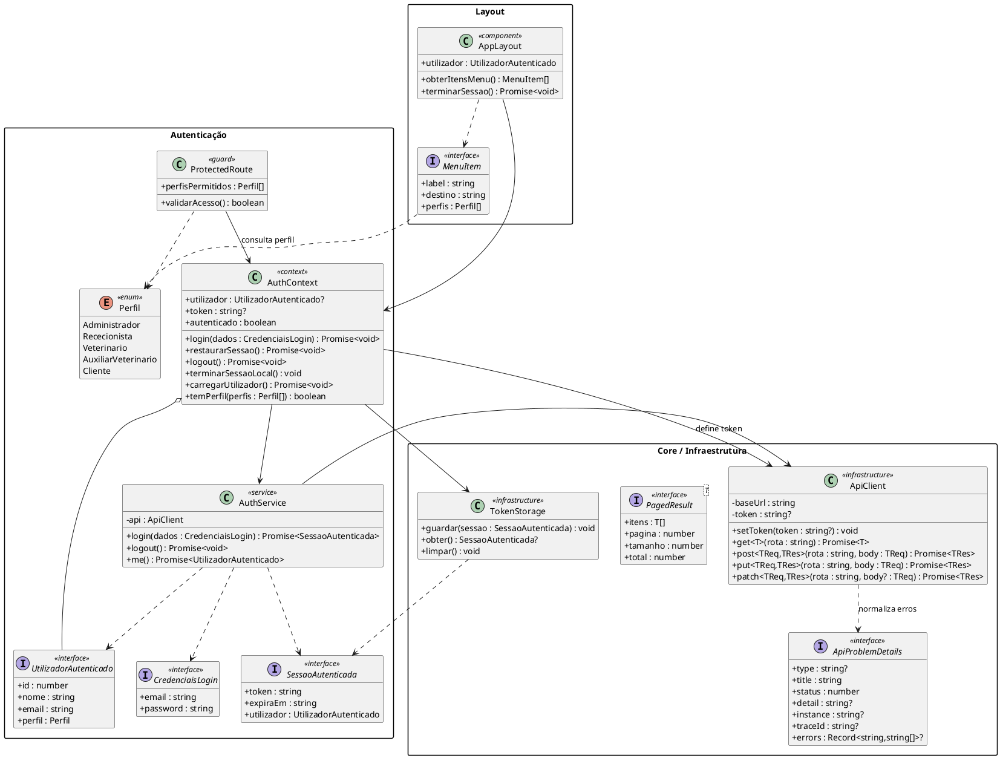

## 6.1. Responsabilidades

| Estrutura | Responsabilidade |
|---|---|
| `ApiClient` | Centralizar o acesso HTTP à API, aplicar a URL base, enviar JWT quando existente e normalizar erros. |
| `ApiProblemDetails` | Representar o formato de erro devolvido pela API, incluindo erros de validação por campo. |
| `PagedResult<T>` | Representar listas paginadas devolvidas pela API. |
| `AuthService` | Consumir EP-001, EP-002 e EP-003. |
| `TokenStorage` | Guardar e limpar a sessão Web em `sessionStorage`, para que não persista depois de fechado o separador. |
| `AuthContext` | Manter o estado de autenticação, restaurar a sessão válida e rejeitar perfis que não pertencem ao canal Web. |
| `ProtectedRoute` | Impedir a apresentação de páginas não permitidas ao perfil atual. |
| `AppLayout` | Apresentar navegação e ações adequadas ao perfil autenticado. |
| `MenuItem` | Representar uma opção de navegação e os perfis que a podem visualizar. |

### 6.2. Regras

- O JWT é obtido no login e utilizado nos pedidos protegidos. No Web, a sessão é guardada em `sessionStorage` através de `TokenStorage`; esta é a concretização do armazenamento do token previsto no I023 para este canal.
- Depois de EP-001, `AuthContext` aceita apenas os perfis `Administrador`, `Rececionista`, `Veterinario` e `AuxiliarVeterinario`. Se a API devolver um utilizador com perfil `Cliente`, o token recebido é definido apenas temporariamente para chamar EP-002, é revogado e limpo, e o acesso Web é recusado (RNF003).
- Ao arrancar, `restaurarSessao()` recupera uma sessão existente e confirma-a com EP-003. Uma sessão expirada ou uma resposta `401` é limpa e conduz a W01.
- O frontend não implementa refresh token; após a expiração do JWT, o utilizador volta a autenticar-se.
- A ocultação de uma opção no frontend não substitui a autorização obrigatória do backend.
- Embora a enumeração `Perfil` inclua `Cliente` por corresponder ao contrato da API, `ProtectedRoute` nunca permite páginas Web ao perfil `Cliente`.

---

# 7. Páginas Web — F001, F002 e F003

```plantuml {kroki=true}
@startuml
skinparam classAttributeIconSize 0
hide empty members

package "F001 - Autenticação, Contas e Configuração" {
  class LoginPage <<page>> {
    + email : string
    + password : string
    + erro : string?
    + submeter() : Promise<void>
  }

  class FuncionariosPage <<page>> {
    + pesquisa : string
    + perfil : Perfil?
    + estado : EstadoUtilizador?
    + carregar() : Promise<void>
    + selecionar(id : number) : void
    + bloquear(id : number) : Promise<void>
  }

  class FuncionarioFormPage <<page>> {
    + funcionarioId : number?
    + formulario : FuncionarioFormState
    + guardar() : Promise<void>
    + bloquear() : Promise<void>
  }

  class ClientesPage <<page>> {
    + pesquisa : string
    + carregar() : Promise<void>
    + selecionar(id : number) : void
  }

  class ClienteFormPage <<page>> {
    + clienteId : number?
    + formulario : ClienteFormState
    + carregar() : Promise<void>
    + guardar() : Promise<void>
  }

  class ClinicaConfiguracaoPage <<page>> {
    + formulario : ClinicaConfig
    + carregar() : Promise<void>
    + guardar() : Promise<void>
  }
}

package "F002 - Pacientes" {
  class PacientesPage <<page>> {
    + pesquisa : string
    + pesquisaProprietario : string
    + proprietarios : ClienteResumo[]
    + clienteId : number?
    + especie : string?
    + pesquisarProprietarios() : Promise<void>
    + selecionarProprietario(id : number) : void
    + carregar() : Promise<void>
    + selecionar(id : number) : void
    + novoPaciente() : void
  }

  class PacienteDetalhePage <<page>> {
    + pacienteId : number?
    + paciente : PacienteDetalhe?
    + formulario : PacienteForm
    + modoCriacao : boolean
    + modoLeitura : boolean
    + carregar() : Promise<void>
    + guardar() : Promise<void>
  }
}

package "F003 - Agenda e Apoio" {
  class AgendaPage <<page>> {
    + filtros : AgendaFiltros
    + carregar() : Promise<void>
    + novaMarcacao() : void
    + abrirMarcacao(id : number) : void
  }

  class MarcacaoFormPage <<page>> {
    + consultaId : number?
    + formulario : MarcacaoForm
    + disponibilidade : Disponibilidade?
    + consultarDisponibilidade() : Promise<void>
    + guardar() : Promise<void>
  }

  class MarcacaoDetalhePage <<page>> {
    + consultaId : number
    + marcacao : MarcacaoDetalhe?
    + carregar() : Promise<void>
    + alterarEstado(estado : EstadoConsulta) : Promise<void>
    + registarChegada() : Promise<void>
  }

  class PreparacaoConsultaPage <<page>> {
    + filtros : AgendaFiltros
    + consultas : MarcacaoResumo[]
    + consultaId : number?
    + marcacao : MarcacaoDetalhe?
    + paciente : PacienteDetalhe?
    + textoApoio : string
    + listarConsultas() : Promise<void>
    + selecionarConsulta(id : number) : Promise<void>
    + carregarDetalhe() : Promise<void>
    + guardarApoio() : Promise<void>
  }
}

LoginPage --> AuthService

FuncionariosPage --> UtilizadoresService
FuncionarioFormPage --> UtilizadoresService
ClientesPage --> ClientesService
ClienteFormPage --> ClientesService
ClinicaConfiguracaoPage --> ClinicaService

PacientesPage --> PacientesService
PacientesPage --> ClientesService : pesquisa proprietário
PacienteDetalhePage --> PacientesService

AgendaPage --> AgendaService
MarcacaoFormPage --> AgendaService
MarcacaoDetalhePage --> AgendaService
PreparacaoConsultaPage --> AgendaService
PreparacaoConsultaPage --> PacientesService

FuncionariosPage ..> Perfil
FuncionariosPage ..> EstadoUtilizador
FuncionarioFormPage ..> FuncionarioFormState
ClienteFormPage ..> ClienteFormState
ClinicaConfiguracaoPage ..> ClinicaConfig
PacienteDetalhePage ..> PacienteDetalhe
PacienteDetalhePage ..> PacienteForm
AgendaPage ..> AgendaFiltros
MarcacaoFormPage ..> MarcacaoForm
MarcacaoFormPage ..> Disponibilidade
MarcacaoDetalhePage ..> MarcacaoDetalhe
MarcacaoDetalhePage ..> EstadoConsulta
PreparacaoConsultaPage ..> AgendaFiltros
PreparacaoConsultaPage ..> MarcacaoResumo
PreparacaoConsultaPage ..> MarcacaoDetalhe
PreparacaoConsultaPage ..> PacienteDetalhe
@enduml
```

---

# 8. Páginas Web — F004, F005, F006 e F007

```plantuml {kroki=true}
@startuml
skinparam classAttributeIconSize 0
hide empty members

package "F004 - Registo Clínico" {
  class RegistoClinicoPage <<page>> {
    + animalId : number
    + consultaId : number?
    + registoId : number?
    + registo : RegistoClinico?
    + historico : HistoricoClinicoItem[]
    + modoLeitura : boolean
    + carregarHistorico() : Promise<void>
    + carregarRegisto(id : number) : Promise<void>
    + guardar() : Promise<void>
  }
}

package "F005 - Contas e Pagamentos" {
  class ContasPage <<page>> {
    + filtros : ContaFiltros
    + carregar() : Promise<void>
    + novaConta() : void
    + abrirConta(id : number) : void
  }

  class ContaDetalhePage <<page>> {
    + contaId : number
    + conta : ContaDetalhe?
    + carregar() : Promise<void>
    + registarPagamento(dados : PagamentoForm) : Promise<void>
    + alterarEstado(dados : EstadoPagamentoForm) : Promise<void>
    + fecharConta() : Promise<void>
  }
}

package "F006 - Vacinação e Desparasitação" {
  class ProfilaxiaPage <<page>> {
    + animalId : number
    + boletim : BoletimPaciente?
    + formulario : ProfilaxiaForm
    + carregar() : Promise<void>
    + registar() : Promise<void>
  }
}

package "F007 - Internamento" {
  class InternamentosPage <<page>> {
    + ativos : boolean
    + internamentos : InternamentoResumo[]
    + formularioNovo : InternamentoForm?
    + carregar() : Promise<void>
    + novoInternamento() : void
    + criar(dados : InternamentoForm) : Promise<void>
    + abrir(id : number) : void
  }

  class InternamentoDetalhePage <<page>> {
    + internamentoId : number
    + internamento : InternamentoDetalhe?
    + alojamentos : Alojamento[]
    + modoLeitura : boolean
    + carregar() : Promise<void>
    + associarAlojamento(id : number) : Promise<void>
    + atualizarEstado(dados : EstadoInternamentoForm) : Promise<void>
    + registarAlta(dados : AltaMedicaForm) : Promise<void>
  }
}

RegistoClinicoPage --> RegistosClinicosService
ContasPage --> ContasService
ContaDetalhePage --> ContasService
ProfilaxiaPage --> ProfilaxiaService
InternamentosPage --> InternamentosService
InternamentoDetalhePage --> InternamentosService

RegistoClinicoPage ..> RegistoClinico
RegistoClinicoPage ..> HistoricoClinicoItem
ContasPage ..> ContaFiltros
ContaDetalhePage ..> ContaDetalhe
ContaDetalhePage ..> PagamentoForm
ContaDetalhePage ..> EstadoPagamentoForm
ProfilaxiaPage ..> BoletimPaciente
ProfilaxiaPage ..> ProfilaxiaForm
InternamentosPage ..> InternamentoResumo
InternamentosPage ..> InternamentoForm
InternamentoDetalhePage ..> InternamentoDetalhe
InternamentoDetalhePage ..> Alojamento
InternamentoDetalhePage ..> EstadoInternamentoForm
InternamentoDetalhePage ..> AltaMedicaForm
@enduml
```

---

# 9. Serviços de acesso à API

```plantuml {kroki=true}
@startuml
skinparam classAttributeIconSize 0
hide empty members

class ApiClient <<infrastructure>>

class AuthService <<service>> {
  + login(dados : CredenciaisLogin) : Promise<SessaoAutenticada>
  + logout() : Promise<void>
  + me() : Promise<UtilizadorAutenticado>
}

class UtilizadoresService <<service>> {
  + listar(filtros : UtilizadorFiltros) : Promise<PagedResult<FuncionarioResumo>>
  + obter(id : number) : Promise<FuncionarioDetalhe>
  + criar(dados : CriarFuncionarioRequest) : Promise<FuncionarioDetalhe>
  + atualizar(id : number, dados : AtualizarFuncionarioRequest) : Promise<FuncionarioDetalhe>
  + bloquear(id : number) : Promise<void>
}

class ClinicaService <<service>> {
  + obter() : Promise<ClinicaConfig>
  + atualizar(dados : ClinicaConfig) : Promise<ClinicaConfig>
}

class ClientesService <<service>> {
  + listar(pesquisa : string?, pagina : number, tamanho : number) : Promise<PagedResult<ClienteResumo>>
  + obter(id : number) : Promise<ClienteDetalhe>
  + criar(dados : CriarClienteRequest) : Promise<ClienteDetalhe>
  + atualizar(id : number, dados : AtualizarClienteRequest) : Promise<ClienteDetalhe>
}

class PacientesService <<service>> {
  + listar(filtros : PacienteFiltros) : Promise<PagedResult<PacienteResumo>>
  + obter(id : number) : Promise<PacienteDetalhe>
  + criar(dados : PacienteForm) : Promise<PacienteDetalhe>
  + atualizar(id : number, dados : PacienteForm) : Promise<PacienteDetalhe>
}

class AgendaService <<service>> {
  + listarVeterinarios() : Promise<VeterinarioResumo[]>
  + obterDisponibilidade(id : number, inicio : string, fim? : string) : Promise<Disponibilidade>
  + listarConsultas(filtros : AgendaFiltros) : Promise<PagedResult<MarcacaoResumo>>
  + obterConsulta(id : number) : Promise<MarcacaoDetalhe>
  + criar(dados : MarcacaoForm) : Promise<MarcacaoDetalhe>
  + atualizar(id : number, dados : MarcacaoForm) : Promise<MarcacaoDetalhe>
  + alterarEstado(id : number, dados : EstadoMarcacaoForm) : Promise<void>
  + registarChegada(id : number) : Promise<ChegadaConsulta>
  + registarNotaPreparacao(id : number, texto : string) : Promise<NotaPreparacao>
}

class RegistosClinicosService <<service>> {
  + criar(dados : RegistoClinicoForm) : Promise<RegistoClinico>
  + atualizar(id : number, dados : RegistoClinicoForm) : Promise<RegistoClinico>
  + obter(id : number) : Promise<RegistoClinico>
  + historicoAnimal(animalId : number, inicio? : string, fim? : string) : Promise<HistoricoClinico>
}

class ContasService <<service>> {
  + listar(filtros : ContaFiltros) : Promise<ContasResultado>
  + criar(dados : ContaForm) : Promise<ContaDetalhe>
  + obter(id : number) : Promise<ContaDetalhe>
  + registarPagamento(id : number, dados : PagamentoForm) : Promise<ResumoPagamento>
  + alterarEstado(id : number, dados : EstadoPagamentoForm) : Promise<ContaEstado>
  + fechar(id : number) : Promise<ContaEstado>
}

class ProfilaxiaService <<service>> {
  + obterBoletim(animalId : number, tipo? : TipoAdministracao) : Promise<BoletimPaciente>
  + registar(animalId : number, dados : ProfilaxiaForm) : Promise<RegistoProfilaxia>
}

class InternamentosService <<service>> {
  + listarAlojamentos(disponivel? : boolean) : Promise<Alojamento[]>
  + listar(filtros : InternamentoFiltros) : Promise<PagedResult<InternamentoResumo>>
  + obter(id : number) : Promise<InternamentoDetalhe>
  + criar(dados : InternamentoForm) : Promise<InternamentoDetalhe>
  + associarAlojamento(id : number, alojamentoId : number) : Promise<InternamentoAlojamento>
  + atualizarEstado(id : number, dados : EstadoInternamentoForm) : Promise<void>
  + registarAlta(id : number, dados : AltaMedicaForm) : Promise<InternamentoAlta>
}

AuthService --> ApiClient
UtilizadoresService --> ApiClient
ClinicaService --> ApiClient
ClientesService --> ApiClient
PacientesService --> ApiClient
AgendaService --> ApiClient
RegistosClinicosService --> ApiClient
ContasService --> ApiClient
ProfilaxiaService --> ApiClient
InternamentosService --> ApiClient
@enduml
```

## 9.1. Endpoints consumidos por serviço

| Serviço | Endpoints previstos |
|---|---|
| `AuthService` | EP-001 `POST /auth/login`; EP-002 `POST /auth/logout`; EP-003 `GET /auth/me` |
| `UtilizadoresService` | EP-004 a EP-008 |
| `ClinicaService` | EP-009 e EP-010 |
| `ClientesService` | EP-011 a EP-014 |
| `PacientesService` | EP-015 a EP-018 |
| `AgendaService` | EP-021 a EP-029 |
| `RegistosClinicosService` | EP-031 a EP-034 |
| `ContasService` | EP-035 a EP-040 |
| `ProfilaxiaService` | EP-042 e EP-043 |
| `InternamentosService` | EP-045 a EP-051 |

Os endpoints EP-019, EP-020, EP-030, EP-041 e EP-044 são exclusivos da aplicação móvel do Cliente e não são consumidos pelo Frontend Web.

---

# 10. Models e DTOs TypeScript

## 10.1. Enumerações

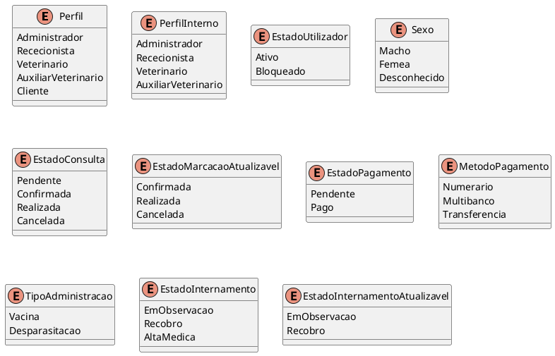

As enumerações `Perfil`, `EstadoUtilizador`, `Sexo`, `EstadoConsulta`, `EstadoPagamento`, `MetodoPagamento`, `TipoAdministracao` e `EstadoInternamento` seguem diretamente os valores definidos na Documentação da API.

`PerfilInterno`, `EstadoMarcacaoAtualizavel` e `EstadoInternamentoAtualizavel` são restrições de tipagem introduzidas apenas no Frontend Web para impedir, ainda na interface, valores que a própria API declara inválidos: o perfil `Cliente` não pode ser atribuído por EP-006/EP-007, `Pendente` não é um destino válido em EP-027 e `AltaMedica` é registada por EP-051, não por EP-050.

---

## 10.2. Autenticação, funcionários e configuração

```plantuml {kroki=true}
@startuml
skinparam classAttributeIconSize 0
hide empty methods

interface CredenciaisLogin {
  + email : string
  + password : string
}

interface UtilizadorAutenticado {
  + id : number
  + nome : string
  + email : string
  + perfil : Perfil
}

interface SessaoAutenticada {
  + token : string
  + expiraEm : string
  + utilizador : UtilizadorAutenticado
}

interface FuncionarioResumo {
  + id : number
  + nome : string
  + email : string
  + perfil : PerfilInterno
  + estado : EstadoUtilizador
  + podeRegistarApoio : boolean
}

interface FuncionarioDetalhe {
  + id : number
  + nome : string
  + email : string
  + telefone : string?
  + perfil : PerfilInterno
  + estado : EstadoUtilizador
  + podeRegistarApoio : boolean
  + criadoEm : string
}

interface FuncionarioFormState {
  + nome : string
  + email : string
  + telefone : string?
  + perfil : PerfilInterno
  + podeRegistarApoio : boolean
  + passwordInicial : string?
}

interface CriarFuncionarioRequest {
  + nome : string
  + email : string
  + telefone : string?
  + perfil : PerfilInterno
  + podeRegistarApoio : boolean
  + passwordInicial : string
}

interface AtualizarFuncionarioRequest {
  + nome : string
  + email : string
  + telefone : string?
  + perfil : PerfilInterno
  + podeRegistarApoio : boolean
}

interface UtilizadorFiltros {
  + perfil : PerfilInterno?
  + estado : EstadoUtilizador?
  + pesquisa : string?
  + pagina : number
  + tamanho : number
}

interface HorarioFuncionamento {
  + diaSemana : string
  + abertura : string
  + fecho : string
}

interface ClinicaConfig {
  + nome : string
  + nif : string
  + morada : string
  + telefone : string
  + email : string
  + duracaoConsultaMinutos : number
  + horarioFuncionamento : HorarioFuncionamento[]
}

SessaoAutenticada *-- UtilizadorAutenticado
FuncionarioResumo ..> PerfilInterno
FuncionarioResumo ..> EstadoUtilizador
FuncionarioDetalhe ..> PerfilInterno
FuncionarioDetalhe ..> EstadoUtilizador
FuncionarioFormState ..> PerfilInterno
CriarFuncionarioRequest ..> PerfilInterno
AtualizarFuncionarioRequest ..> PerfilInterno
ClinicaConfig *-- "1..*" HorarioFuncionamento
@enduml
```

`FuncionarioFormState` representa o estado visual partilhado do ecrã W03. Os pedidos HTTP mantêm contratos distintos: `CriarFuncionarioRequest` exige `passwordInicial`, enquanto `AtualizarFuncionarioRequest` não envia esse campo. `podeRegistarApoio` só é apresentado como autorização específica quando o perfil selecionado é `AuxiliarVeterinario`. O bloqueio da conta é uma ação separada em EP-008; não é disponibilizada uma ação de desbloqueio.

`ClinicaConfig.horarioFuncionamento` é uma lista de períodos. O mesmo `diaSemana` pode surgir mais do que uma vez, desde que os períodos não se sobreponham.

---

## 10.3. Clientes e pacientes

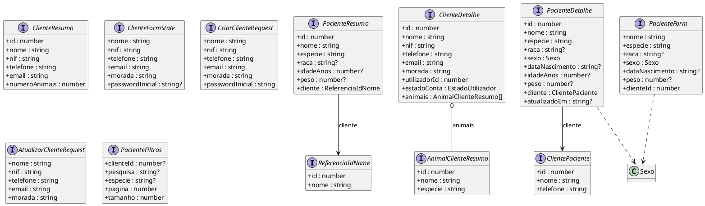

`ClienteFormState` representa o estado visual partilhado do ecrã W05. Na criação, o frontend converte-o para `CriarClienteRequest`, onde `passwordInicial` é obrigatório; na atualização utiliza `AtualizarClienteRequest`, sem palavra-passe.

---

## 10.4. Agenda e preparação de consulta

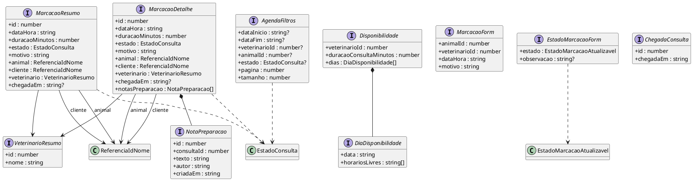

---

## 10.5. Registo clínico

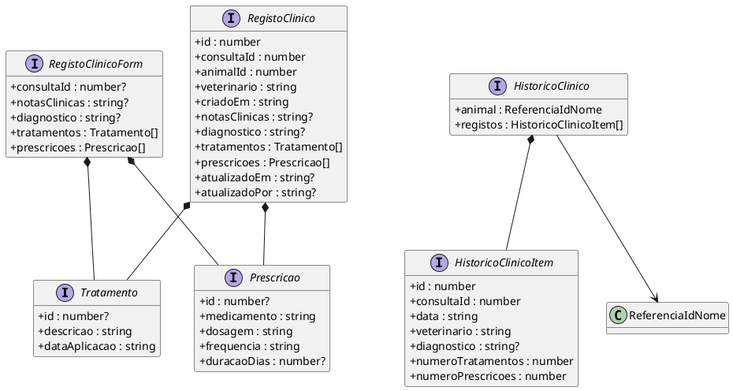

Para criação, `consultaId` é obrigatório. Na atualização de um registo existente, a API reutiliza o mesmo formato sem `consultaId`, motivo pelo qual o campo é representado como opcional no modelo partilhado do frontend.

---

## 10.6. Contas e pagamentos

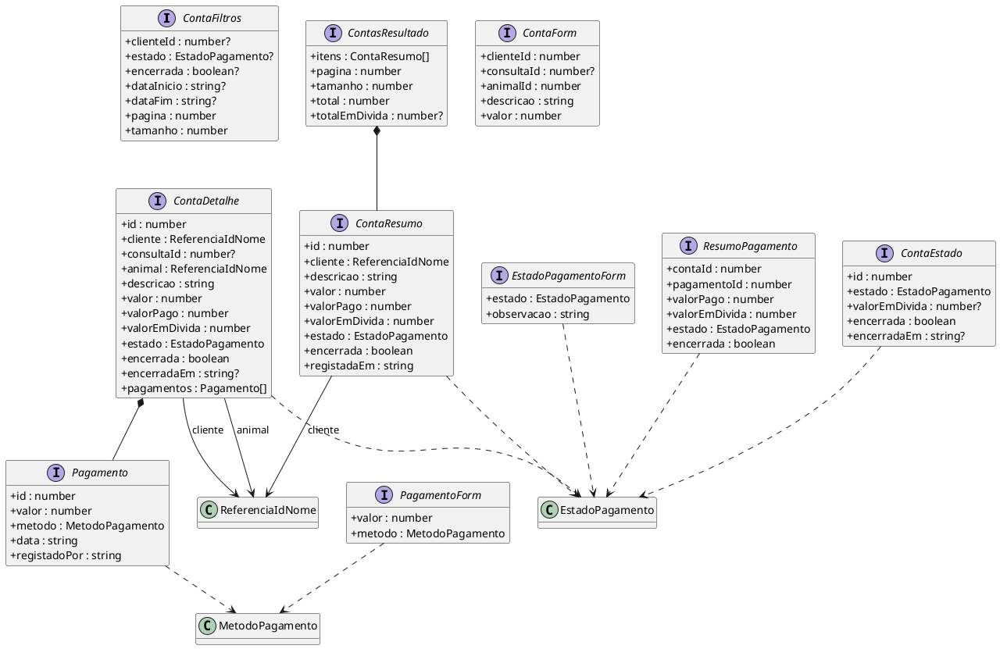

O Frontend Web apenas **regista administrativamente** pagamentos efetuados ao balcão. Não existe integração com TPA, MB Way, referências Multibanco ou outros meios de pagamento eletrónico.

---

## 10.7. Vacinação e desparasitação

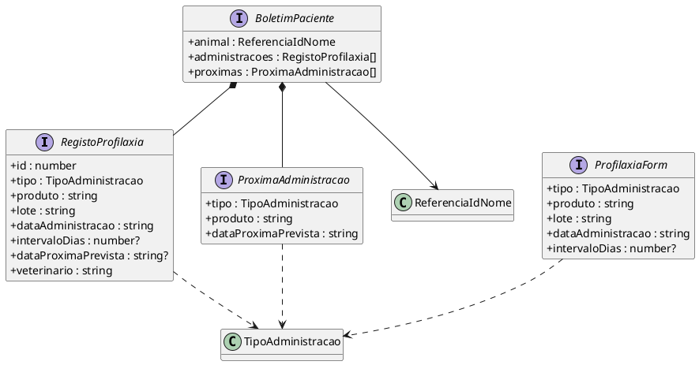

A data da próxima administração é calculada pelo servidor quando `intervaloDias` é fornecido; o frontend não é a fonte autoritativa desse cálculo.

---

## 10.8. Internamentos

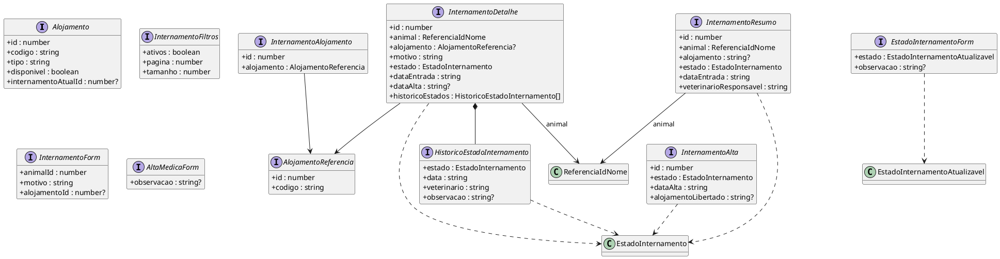

---

# 11. Relação entre páginas, serviços e protótipo

| Ecrã | Página / estrutura principal | Serviço(s) | UC / RF principais |
|---|---|---|---|
| W01 — Login Web | `LoginPage` | `AuthService` | UC01; RF001, RF002, RF004, RF005 |
| W02 — Funcionários | `FuncionariosPage` | `UtilizadoresService` | UC03; RF007–RF009 |
| W03 — Criar/Editar Funcionário | `FuncionarioFormPage` | `UtilizadoresService` | UC03; RF006–RF009 |
| W04 — Clientes | `ClientesPage` | `ClientesService` | UC04; RF010, RF011 |
| W05 — Detalhe/Criar/Editar Cliente | `ClienteFormPage` | `ClientesService` | UC04; RF010, RF011 |
| W06 — Clínica, Configurações e Horários | `ClinicaConfiguracaoPage` | `ClinicaService` | UC05/UC09; RF012, RF013, RF019 |
| W07 — Pacientes | `PacientesPage` | `PacientesService`, `ClientesService` (pesquisa de proprietário) | UC06/UC07; RF014, RF017 |
| W08 — Ficha do Paciente | `PacienteDetalhePage` | `PacientesService` | UC06/UC07/UC10; RF014–RF016, RF026 |
| W09 — Agenda | `AgendaPage` | `AgendaService` | UC09; RF020, RF024 |
| W10 — Criar/Editar Marcação | `MarcacaoFormPage` | `AgendaService` | UC09; RF020–RF023 |
| W11 — Detalhe da Marcação | `MarcacaoDetalhePage` | `AgendaService` | UC09; RF023–RF025 |
| W12 — Preparação e Apoio | `PreparacaoConsultaPage` | `AgendaService`, `PacientesService` | UC10; RF026, RF027; inclui listagem/seleção das consultas disponíveis |
| W13 — Registo e Histórico Clínico | `RegistoClinicoPage` | `RegistosClinicosService` | UC12/UC13; RF030–RF036 |
| W14 — Contas e Valores em Dívida | `ContasPage` | `ContasService` | UC14; RF037, RF038 |
| W15 — Detalhe da Conta e Pagamentos | `ContaDetalhePage` | `ContasService` | UC14; RF039–RF041 |
| W16 — Vacinação e Desparasitação | `ProfilaxiaPage` | `ProfilaxiaService` | UC16; RF043–RF046 |
| W17 — Painel de Internamentos | `InternamentosPage` | `InternamentosService` | UC18; RF048–RF050 |
| W18 — Detalhe do Internamento | `InternamentoDetalhePage` | `InternamentosService` | UC18; RF048–RF052 |

---

# 12. Matriz de acesso das páginas Web

| Página | Administrador | Rececionista | Veterinário | Auxiliar Veterinário |
|---|---:|---:|---:|---:|
| W01 Login | Sim | Sim | Sim | Sim |
| W02 Funcionários | Leitura/Escrita | — | — | — |
| W03 Criar/Editar Funcionário | Escrita | — | — | — |
| W04 Clientes | Leitura/Escrita | Leitura/Escrita | — | — |
| W05 Detalhe/Criar/Editar Cliente | Leitura/Escrita | Leitura/Escrita | — | — |
| W06 Clínica/Configuração/Horários | Leitura/Escrita | — | — | — |
| W07 Pacientes | — | Leitura/Escrita | Leitura/Escrita | — |
| W08 Ficha do Paciente | — | Leitura/Escrita | Leitura/Escrita | Leitura |
| W09 Agenda | — | Agenda da clínica | Consultas próprias | — |
| W10 Criar/Editar Marcação | — | Escrita | — | — |
| W11 Detalhe da Marcação | — | Leitura/Escrita administrativa | Leitura das próprias | — |
| W12 Preparação/Apoio | — | — | — | Leitura + apoio não clínico autorizado |
| W13 Registo Clínico | — | — | Leitura/Escrita | Leitura autorizada |
| W14 Contas/Dívidas | — | Leitura/Escrita | — | — |
| W15 Conta/Pagamentos | — | Leitura/Escrita | — | — |
| W16 Vacinação/Desparasitação | — | — | Leitura/Escrita | — |
| W17 Internamentos | — | — | Leitura/Escrita | Leitura |
| W18 Detalhe do Internamento | — | — | Leitura/Escrita | Leitura |

A matriz descreve o comportamento esperado da interface. A API continua a ser responsável por rejeitar operações não autorizadas.

**Clarificações de navegação:**

- o Veterinário não entra em W04. A pesquisa de proprietário necessária ao UC07 é efetuada dentro de W07 através de `ClientesService` em modo de consulta;
- o Auxiliar não necessita de entrar em W09. O W12 apresenta a própria lista de consultas disponíveis, permite selecionar uma consulta e só depois mostra a informação de preparação/apoio;
- W14 inclui a criação/registo de custos (RF037), além da consulta dos valores em dívida (RF038). W15 fica responsável pelo detalhe da conta, registo de pagamentos, atualização administrativa do estado e fecho.

---

# 13. Regras de comportamento por perfil

## 13.1. Administrador

A interface do Administrador disponibiliza:

- gestão de contas de funcionários;
- atribuição de perfis;
- bloqueio de contas;
- gestão de contas de Clientes;
- dados gerais e configurações da clínica;
- horários de funcionamento.

Não apresenta operações clínicas, vacinação, contas/pagamentos operacionais ou internamentos.

## 13.2. Rececionista

A interface do Rececionista disponibiliza:

- gestão administrativa de Clientes;
- registo, consulta e atualização administrativa de pacientes;
- consulta da agenda;
- consulta de disponibilidade;
- criação e alteração de marcações;
- atualização do estado da marcação;
- registo de chegada;
- gestão administrativa de contas e pagamentos.

Não apresenta operações de escrita clínica.

## 13.3. Veterinário

A interface do Veterinário disponibiliza:

- pesquisa e gestão administrativa de pacientes prevista nos requisitos;
- pesquisa/seleção de proprietário dentro de W07 para localizar pacientes, sem acesso à área W04 de gestão de Clientes;
- consulta apenas das consultas que lhe estão atribuídas;
- consulta de detalhe das próprias marcações;
- registo e atualização clínica;
- histórico clínico;
- vacinação e desparasitação;
- gestão clínica de internamentos.

Não apresenta administração de utilizadores, configurações da clínica ou gestão financeira.

## 13.4. Auxiliar Veterinário

A interface do Auxiliar disponibiliza:

- no próprio W12, listagem e seleção das consultas disponíveis abrangidas pelas suas permissões;
- consulta da ficha administrativa necessária à preparação;
- consulta da informação da consulta necessária às suas funções;
- registo de informação não clínica de apoio quando autorizado;
- consulta de informação clínica autorizada;
- consulta de internamentos.

Não disponibiliza:

- criação/alteração clínica;
- gestão de marcações;
- alteração do estado clínico do internamento;
- alta médica;
- operações financeiras.

---

# 14. Validação e tratamento de erros

O Frontend Web pode efetuar validações locais para melhorar a experiência de utilização, incluindo:

- campos obrigatórios;
- formatos básicos;
- datas;
- valores numéricos;
- seleção de opções válidas.

Estas validações não substituem a validação autoritativa da API.

O `ApiClient` deve permitir às páginas distinguir pelo menos:

- `400` — pedido inválido e erros de validação;
- `401` — autenticação ausente, inválida, expirada ou revogada;
- `403` — perfil sem permissão;
- `404` — recurso inexistente;
- `409` — conflito;
- `422` — regra de negócio violada;
- `500` — erro inesperado.

Quando a API devolver o campo `errors`, os erros devem poder ser associados aos respetivos campos do formulário.

---

# 15. Relações estruturais principais

O modelo segue as relações abaixo:

```text
Página React
    ↓ utiliza
Service
    ↓ utiliza
ApiClient
    ↓ HTTP/JSON
ARC-API

Página React
    ↓ apresenta / edita
DTOs / Models TypeScript

ProtectedRoute
    ↓ consulta
AuthContext
    ↓ utiliza
AuthService
    ↓ utiliza
ApiClient
```

Não existe relação direta:

```text
Frontend Web → Base de Dados
Frontend Web → Entity Framework Core
Frontend Web → entidades persistentes internas do backend
```

Os DTOs do frontend representam exclusivamente o contrato necessário à interface.

---

# 16. Rastreabilidade com ARC-WEB e requisitos não funcionais

| Requisito / componente | Tratamento no modelo |
|---|---|
| ARC-WEB | Páginas, serviços, models, autenticação e infraestrutura definidos neste documento. |
| RNF001 — Controlo de acesso | `AuthContext`, `ProtectedRoute`, menus por perfil e permissões de ações; backend continua autoritativo. |
| RNF003 — Separação dos canais | O modelo contém apenas perfis internos; Cliente não possui páginas Web. |
| RNF004 — Validação dos dados de entrada | Formulários podem validar localmente; `ApiProblemDetails.errors` apresenta validações devolvidas pelo backend. |
| RNF005 — Persistência dos dados confirmados | O frontend envia as operações para a API e atualiza o estado visual após confirmação do backend. |
| RNF006 — Dependência de ligação à rede | Todas as funcionalidades dependem do `ApiClient`; não existe modo offline. |

RNF002 — Isolamento dos dados de Clientes é principalmente relevante para a aplicação móvel e para as regras do backend. O Frontend Web continua sujeito às permissões e aos dados devolvidos pela API.

---

# 17. Elementos deliberadamente fora do modelo

Este modelo não introduz:

- registo autónomo de Cliente pelo próprio;
- funcionalidades mobile;
- criação, alteração ou cancelamento de marcações pelo Cliente;
- edição de animais pelo Cliente;
- pagamentos eletrónicos;
- faturação certificada;
- notificações SMS/e-mail;
- calendários externos;
- autenticação Google/Facebook;
- autenticação multifator;
- refresh token;
- geração automática de prescrições em PDF;
- integração com SIAC ou bases de saúde animal;
- leitura de QR/códigos de barras;
- integração com equipamentos clínicos;
- acompanhamento de internamentos pelo Cliente;
- modo offline;
- acesso direto à base de dados.

---

# 18. Correspondência com a API Web

A Documentação da API identifica explicitamente como utilizados pelo Frontend Web:

- EP-001 a EP-018;
- EP-021 a EP-029;
- EP-031 a EP-040;
- EP-042 e EP-043;
- EP-045 a EP-051.

O modelo de serviços desta I021 cobre exatamente estes grupos.

Não são modelados como operações do Frontend Web:

- EP-019;
- EP-020;
- EP-030;
- EP-041;
- EP-044;

por serem operações `/me/...` destinadas à aplicação móvel do Cliente.

---

# 19. Critérios de implementação derivados do modelo

Para manter coerência com este artefacto durante a implementação:

1. páginas não devem efetuar pedidos HTTP diretamente; devem utilizar o respetivo serviço;
2. serviços devem utilizar `ApiClient`;
3. páginas protegidas devem declarar os perfis permitidos através da camada de proteção/navegação;
4. ações de escrita devem ser ocultadas ou desativadas quando o perfil apenas possui leitura;
5. o frontend não deve reproduzir como definitivas regras de negócio pertencentes ao backend;
6. os nomes e valores das enumerações devem permanecer compatíveis com a API;
7. os DTOs podem ser refinados durante a implementação apenas se o contrato da API também for atualizado de forma controlada;
8. os ecrãs W01–W18 devem continuar identificáveis na estrutura implementada, ainda que a composição visual evolua;
9. a pesquisa de proprietários do Veterinário deve ocorrer no contexto de W07, sem conceder acesso funcional à gestão W04;
10. W12 deve disponibilizar ao Auxiliar um ponto de entrada autónomo para listar e selecionar consultas disponíveis antes de carregar o detalhe;
11. W14 deve disponibilizar a ação de registo de custo prevista em RF037;
12. W08 deve funcionar em modo de criação quando não recebe `pacienteId` e em modo de consulta/edição quando recebe um identificador, respeitando o perfil atual;
13. W17 deve permitir ao Veterinário iniciar o registo de um internamento através de `InternamentoForm`;
14. W03 deve permitir ao Administrador definir `podeRegistarApoio` para Auxiliares e apenas bloquear contas, conforme o contrato da API.

---

# 20. Diagrama global simplificado

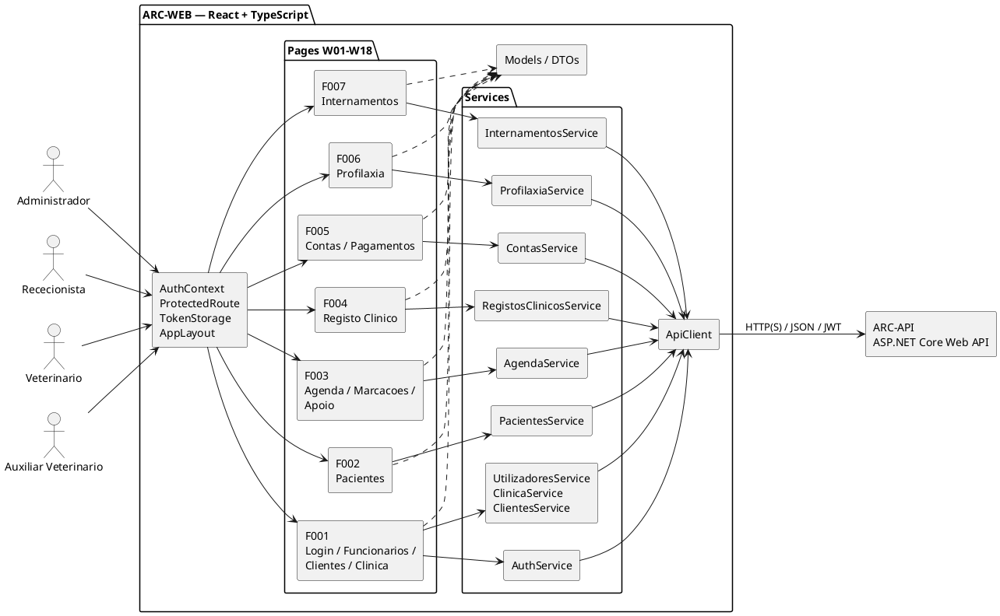


---

## 21. Histórico de versões

| Versão | Autores|
|---|---|
| v01 | Gonçalo Dinis Magalhães Teixeira | 
