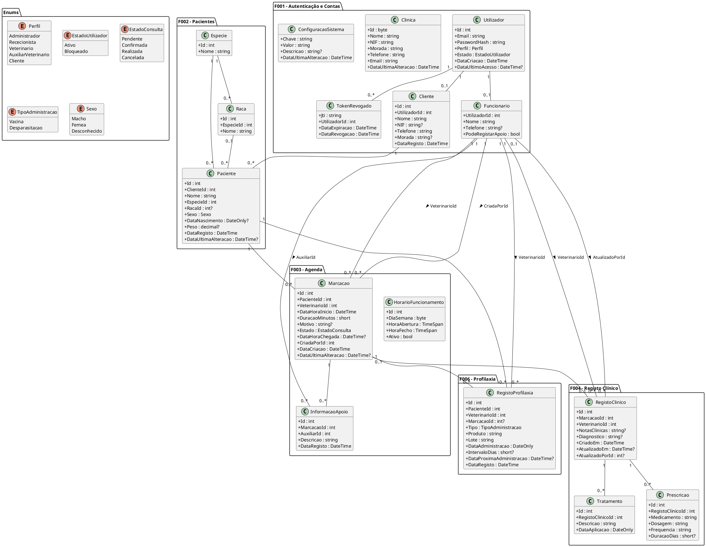
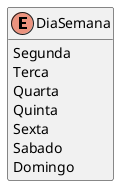
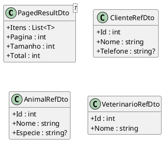
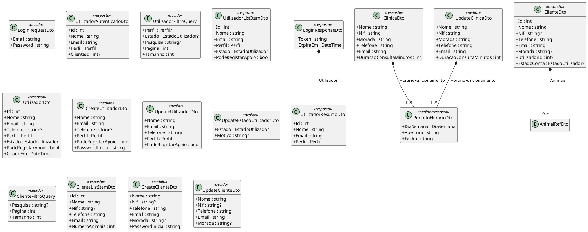
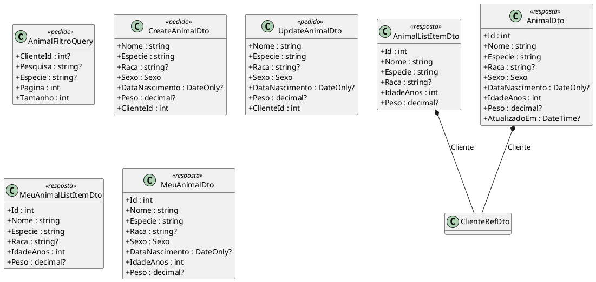
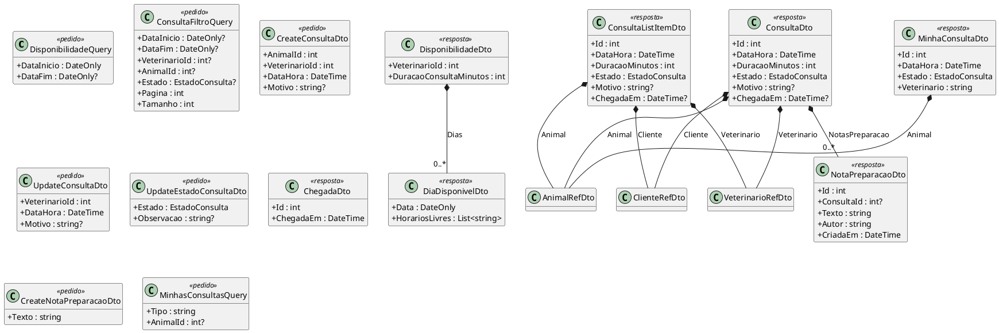
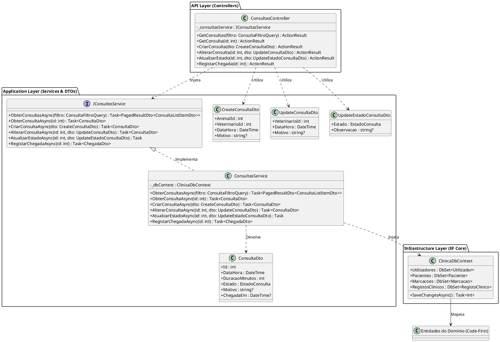

# Modelo de Classes - Backend

**Projeto:** Gestão de Clínica Veterinária
**Grupo:** G08
**Milestone:** m3
**Versão:** v02
**Issue:** I020 — Modelo de Classes (Backend)
**Estado:** Rascunho para revisão e auditoria
**Executor / Revisor / Auditor:** a confirmar segundo o Backlog de Projeto em vigor

---

## Histórico de versões

| Versão | Data | Descrição das alterações |
|---|---|---|
| v01 | m2 | Modelo de domínio das sete funcionalidades, padrão estrutural da F003 e serviços previstos. Mantém-se inalterado como histórico (`m2-modelo-classes-backend-v01.md`). |
| v02 | 22/10/2026 | Reflete a Declaração de Âmbito v05 (F005 e F007 fora do âmbito). Passa a incluir **todos os DTOs** dos 37 endpoints em âmbito, agrupados por funcionalidade, com a ligação entre entidades, DTOs e endpoints. Atualiza o padrão estrutural da F003 para os nomes de DTO da API. |

## 1. Objetivo

Este documento apresenta o modelo de classes previsto para o Backend do sistema (ARC-API). De acordo com a arquitetura estabelecida (`m2-documentacao-arquitetura-v01.md`), o modelo reflete a organização em camadas do ASP.NET Core e as entidades persistidas através de Entity Framework Core. A tecnologia de referência do backend é a registada no Regulamento Interno do Grupo G08 v02 (secção 11.2: C# 14, ASP.NET Core 10 e Entity Framework Core 10).

A versão v02 acrescenta duas coisas em relação à v01:

1. **O âmbito atualizado.** A Declaração de Âmbito v05 retirou as funcionalidades F005 (Gestão de contas e pagamentos) e F007 (Gestão de internamento). Estas funcionalidades, as respetivas entidades, enumerações e serviços deixam de fazer parte do modelo.
2. **Os DTOs.** Um DTO (*Data Transfer Object*) é uma classe simples, apenas com atributos, que transporta dados entre o backend e os frontends (web e mobile). Os DTOs correspondem ao pedido e à resposta de cada endpoint da `m2-documentacao-api-v01.md`. As entidades de domínio, que representam as tabelas da base de dados, **nunca** são expostas diretamente pela API. Esta separação evita, por exemplo, que o campo `PasswordHash` saia da API e permite alterar a base de dados sem alterar o contrato com os frontends.

### 1.1. Âmbito deste modelo

| Funcionalidade | Estado | Endpoints |
|---|---|---|
| F001 — Autenticação e Controlos de Acesso | Em âmbito | EP-001 a EP-014 |
| F002 — Gestão de pacientes | Em âmbito | EP-015 a EP-020 |
| F003 — Agendamento de consultas | Em âmbito | EP-021 a EP-030 |
| F004 — Registo clínico e tratamentos | Em âmbito | EP-031 a EP-034 |
| F005 — Gestão de contas e pagamentos | **Fora do âmbito** (DA v05) | EP-035 a EP-041 (não implementados) |
| F006 — Boletim de vacinas e desparasitações | Em âmbito | EP-042 a EP-044 |
| F007 — Gestão de internamento | **Fora do âmbito** (DA v05) | EP-045 a EP-051 (não implementados) |

Total em âmbito: 14 + 6 + 10 + 4 + 3 = **37 endpoints**.

## 2. Modelo de Domínio (Entidades Code-First)

O diagrama seguinte ilustra as entidades principais do sistema em âmbito, as suas enumerações e relacionamentos. Estas classes representam os dados que serão mapeados para a base de dados SQL Server. As entidades, atributos e relações são os da v01, sem as funcionalidades F005 e F007.

## 3. Modelo de DTOs

### 3.1. Convenção de nomes e tipos

| Tipo de DTO | Padrão | Exemplo |
|---|---|---|
| Pedido de criação (POST) | `Create<Coisa>Dto` | `CreateAnimalDto` |
| Pedido de alteração (PUT/PATCH) | `Update<Coisa>Dto` | `UpdateClienteDto` |
| Resposta de detalhe | `<Coisa>Dto` | `AnimalDto` |
| Item de uma lista | `<Coisa>ListItemDto` | `ClienteListItemDto` |
| Parâmetros de pesquisa (*query string*) | `<Coisa>FiltroQuery` | `UtilizadorFiltroQuery` |
| Lista paginada | `PagedResultDto<T>` | `PagedResultDto<ClienteListItemDto>` |
| Referência curta a outra entidade | `<Coisa>RefDto` | `AnimalRefDto` |

Os nomes dos DTOs seguem a terminologia do contrato da API (`Animal`, `Consulta`), enquanto as entidades de domínio mantêm os nomes do modelo de dados (`Paciente`, `Marcacao`). A correspondência entre ambos está na secção 3.8.

Tipos: `int` para identificadores; `string`; `decimal` para o peso; `DateTime` (UTC) para data e hora; `DateOnly` para datas simples; `?` indica valor opcional. Os nomes de campo na API são `camelCase` (por exemplo, `DataNascimento` é serializado como `dataNascimento`).

### 3.2. Enumerações da API

As enumerações da API são as mesmas do domínio (`Perfil`, `EstadoUtilizador`, `EstadoConsulta`, `TipoAdministracao`, `Sexo`), acrescidas de `DiaSemana`, usada nos horários da clínica. Saem as enumerações `EstadoPagamento`, `MetodoPagamento` e `EstadoInternamento`, por pertencerem às funcionalidades F005 e F007. Os valores `Segunda` e `Sabado` constam dos exemplos da API v01; os restantes dias seguem o mesmo padrão e devem ser confirmados na API v02.

### 3.3. DTOs comuns

| DTO | Utilização |
|---|---|
| `PagedResultDto<T>` | Envelope das listas paginadas (EP-004, EP-011, EP-015, EP-023). |
| `ClienteRefDto` | Referência ao proprietário em animais e consultas. O campo `Telefone` só é preenchido na ficha do animal (EP-016). |
| `AnimalRefDto` | Referência ao animal em consultas, histórico clínico e boletim. |
| `VeterinarioRefDto` | Referência ao Veterinário na lista de Veterinários e nas consultas. |

### 3.4. F001 — Autenticação e controlos de acesso (EP-001 a EP-014)

O `Email` do Cliente pertence a `Utilizador.Email`, mantendo uma única fonte do dado. `UpdateEstadoUtilizadorDto.Estado` só aceita o valor `Bloqueado` (EP-008). `PeriodoHorarioDto.Abertura` e `Fecho` são horas no formato `HH:mm`.

### 3.5. F002 — Gestão de pacientes (EP-015 a EP-020)

Os DTOs de pacientes contêm apenas dados administrativos. Os campos clínicos pertencem à F004. `Especie` e `Raca` são o nome (`Especie.Nome`, `Raca.Nome`) e não os identificadores internos da entidade. `MeuAnimal*Dto` são usados nas rotas `/me/...`, em que o identificador do Cliente vem sempre do token e nunca do pedido.

### 3.6. F003 — Agendamento de consultas (EP-021 a EP-030)

`MinhasConsultasQuery.Tipo` aceita `futuras` (valor por omissão) ou `historico`. `CreateNotaPreparacaoDto.Texto` tem o máximo de 1000 caracteres. `NotaPreparacaoDto.ConsultaId` só vem preenchido na resposta de criação (EP-029). Tudo o que o Cliente vê em `MinhaConsultaDto` é informação administrativa, sem dados clínicos.

### 3.7. F004 e F006 — Registo clínico e boletim de vacinas (EP-031 a EP-034 e EP-042 a EP-044)

```plantuml {kroki=true}
@startuml
skinparam classAttributeIconSize 0
hide empty methods

class CreateTratamentoDto <<pedido>> {
  + Id : int?
  + Descricao : string
  + DataAplicacao : DateOnly
}

class CreatePrescricaoDto <<pedido>> {
  + Id : int?
  + Medicamento : string
  + Dosagem : string
  + Frequencia : string
  + DuracaoDias : int?
}

class CreateRegistoClinicoDto <<pedido>> {
  + ConsultaId : int
  + NotasClinicas : string?
  + Diagnostico : string?
}

class UpdateRegistoClinicoDto <<pedido>> {
  + NotasClinicas : string?
  + Diagnostico : string?
}

class TratamentoDto <<resposta>> {
  + Id : int
  + Descricao : string
  + DataAplicacao : DateOnly
}

class PrescricaoDto <<resposta>> {
  + Id : int
  + Medicamento : string
  + Dosagem : string
  + Frequencia : string
  + DuracaoDias : int?
}

class RegistoClinicoDto <<resposta>> {
  + Id : int
  + ConsultaId : int
  + AnimalId : int
  + Veterinario : string
  + CriadoEm : DateTime
  + NotasClinicas : string?
  + Diagnostico : string?
  + AtualizadoEm : DateTime?
  + AtualizadoPor : string?
}

class HistoricoClinicoQuery <<pedido>> {
  + DataInicio : DateOnly?
  + DataFim : DateOnly?
}

class RegistoClinicoResumoDto <<resposta>> {
  + Id : int
  + ConsultaId : int
  + Data : DateOnly
  + Veterinario : string
  + Diagnostico : string?
  + NumeroTratamentos : int
  + NumeroPrescricoes : int
}

class HistoricoClinicoDto <<resposta>> {
}

class BoletimQuery <<pedido>> {
  + Tipo : TipoAdministracao?
}

class AdministracaoDto <<resposta>> {
  + Id : int
  + Tipo : TipoAdministracao
  + Produto : string
  + Lote : string
  + DataAdministracao : DateOnly
  + IntervaloDias : int?
  + DataProximaPrevista : DateOnly?
  + Veterinario : string
}

class CreateAdministracaoDto <<pedido>> {
  + Tipo : TipoAdministracao
  + Produto : string
  + Lote : string
  + DataAdministracao : DateOnly
  + IntervaloDias : int?
}

class ProximaAdministracaoDto <<resposta>> {
  + Tipo : TipoAdministracao
  + Produto : string
  + DataProximaPrevista : DateOnly
}

class BoletimDto <<resposta>> {
}

class HistoricoAdministracaoDto <<resposta>> {
  + Tipo : TipoAdministracao
  + Produto : string
  + DataAdministracao : DateOnly
}

class MeuBoletimDto <<resposta>> {
}

CreateRegistoClinicoDto *-- "0..*" CreateTratamentoDto : Tratamentos
CreateRegistoClinicoDto *-- "0..*" CreatePrescricaoDto : Prescricoes
UpdateRegistoClinicoDto *-- "0..*" CreateTratamentoDto : Tratamentos
UpdateRegistoClinicoDto *-- "0..*" CreatePrescricaoDto : Prescricoes
RegistoClinicoDto *-- "0..*" TratamentoDto : Tratamentos
RegistoClinicoDto *-- "0..*" PrescricaoDto : Prescricoes
HistoricoClinicoDto *-- AnimalRefDto : Animal
HistoricoClinicoDto *-- "0..*" RegistoClinicoResumoDto : Registos
BoletimDto *-- AnimalRefDto : Animal
BoletimDto *-- "0..*" AdministracaoDto : Administracoes
BoletimDto *-- "0..*" ProximaAdministracaoDto : Proximas
MeuBoletimDto *-- "0..*" HistoricoAdministracaoDto : Historico
MeuBoletimDto *-- "0..*" ProximaAdministracaoDto : Proximas
@enduml
```

Regras destes DTOs:

- Existe no máximo um registo clínico por consulta. `CreateRegistoClinicoDto` exige `ConsultaId`; `UpdateRegistoClinicoDto` não o inclui, porque o registo mantém-se associado à consulta e ao animal.
- Na alteração, as listas `Tratamentos` e `Prescricoes` substituem as anteriores; um elemento existente mantém-se indicando o respetivo `Id` (por isso os DTOs de entrada têm um `Id` opcional).
- `CreateAdministracaoDto.IntervaloDias`, quando indicado, serve para o servidor calcular `DataProximaPrevista = DataAdministracao + IntervaloDias`. Caso contrário, `DataProximaPrevista` fica vazia (RF044).
- O `Veterinario` aparece como texto em `RegistoClinicoDto`, `RegistoClinicoResumoDto` e `AdministracaoDto`, como no contrato da API v01. Ver secção 7.

### 3.8. Correspondência entre entidades de domínio e DTOs

| Entidade de domínio | DTOs principais | Notas de mapeamento |
|---|---|---|
| `Utilizador` + `Funcionario` | `UtilizadorDto`, `UtilizadorListItemDto`, `UtilizadorResumoDto`, `UtilizadorAutenticadoDto`, `CreateUtilizadorDto`, `UpdateUtilizadorDto` | `PasswordHash` nunca é exposto. `Nome`, `Telefone` e `PodeRegistarApoio` vêm de `Funcionario`. |
| `Utilizador` + `Cliente` | `ClienteDto`, `ClienteListItemDto`, `CreateClienteDto`, `UpdateClienteDto` | O `Email` vem de `Utilizador.Email`. `EstadoConta` vem de `Utilizador.Estado`. |
| `Clinica` + `HorarioFuncionamento` + `ConfiguracaoSistema` | `ClinicaDto`, `UpdateClinicaDto`, `PeriodoHorarioDto` | `DuracaoConsultaMinutos` vem de `ConfiguracaoSistema`. `DiaSemana` (byte na entidade) é convertido em nome. |
| `Paciente` + `Especie` + `Raca` | `AnimalDto`, `AnimalListItemDto`, `CreateAnimalDto`, `UpdateAnimalDto`, `MeuAnimalDto`, `MeuAnimalListItemDto` | `Especie` e `Raca` são os nomes. `IdadeAnos` é calculada a partir de `DataNascimento`. |
| `Marcacao` | `ConsultaDto`, `ConsultaListItemDto`, `CreateConsultaDto`, `UpdateConsultaDto`, `UpdateEstadoConsultaDto`, `ChegadaDto`, `MinhaConsultaDto` | `Paciente` ↔ `AnimalId`; `DataHoraInicio` ↔ `DataHora`; `DataHoraChegada` ↔ `ChegadaEm`. |
| `InformacaoApoio` | `NotaPreparacaoDto`, `CreateNotaPreparacaoDto` | `Descricao` ↔ `Texto`; `Autor` vem do nome do Auxiliar. |
| `RegistoClinico` + `Tratamento` + `Prescricao` | `RegistoClinicoDto`, `RegistoClinicoResumoDto`, `HistoricoClinicoDto`, `CreateRegistoClinicoDto`, `UpdateRegistoClinicoDto`, `TratamentoDto`, `PrescricaoDto` | `MarcacaoId` ↔ `ConsultaId`; `Marcacao.PacienteId` ↔ `AnimalId`. |
| `RegistoProfilaxia` | `AdministracaoDto`, `CreateAdministracaoDto`, `BoletimDto`, `MeuBoletimDto`, `ProximaAdministracaoDto` | `DataProximaAdministracao` ↔ `DataProximaPrevista`. `Veterinario` vem do nome do Funcionário. |

### 3.9. DTOs por endpoint

| EP | Método e rota | Pedido | Resposta |
|---|---|---|---|
| 001 | `POST /auth/login` | `LoginRequestDto` | `LoginResponseDto` |
| 002 | `POST /auth/logout` | — | — (204) |
| 003 | `GET /auth/me` | — | `UtilizadorAutenticadoDto` |
| 004 | `GET /utilizadores` | `UtilizadorFiltroQuery` | `PagedResultDto<UtilizadorListItemDto>` |
| 005 | `GET /utilizadores/{id}` | — | `UtilizadorDto` |
| 006 | `POST /utilizadores` | `CreateUtilizadorDto` | `UtilizadorListItemDto` (201) |
| 007 | `PUT /utilizadores/{id}` | `UpdateUtilizadorDto` | `UtilizadorDto` |
| 008 | `PATCH /utilizadores/{id}/estado` | `UpdateEstadoUtilizadorDto` | — (204) |
| 009 | `GET /clinica` | — | `ClinicaDto` |
| 010 | `PUT /clinica` | `UpdateClinicaDto` | `ClinicaDto` |
| 011 | `GET /clientes` | `ClienteFiltroQuery` | `PagedResultDto<ClienteListItemDto>` |
| 012 | `GET /clientes/{id}` | — | `ClienteDto` |
| 013 | `POST /clientes` | `CreateClienteDto` | `ClienteDto` (201) |
| 014 | `PUT /clientes/{id}` | `UpdateClienteDto` | `ClienteDto` |
| 015 | `GET /animais` | `AnimalFiltroQuery` | `PagedResultDto<AnimalListItemDto>` |
| 016 | `GET /animais/{id}` | — | `AnimalDto` |
| 017 | `POST /animais` | `CreateAnimalDto` | `AnimalDto` (201) |
| 018 | `PUT /animais/{id}` | `UpdateAnimalDto` | `AnimalDto` |
| 019 | `GET /me/animais` | — | `List<MeuAnimalListItemDto>` |
| 020 | `GET /me/animais/{id}` | — | `MeuAnimalDto` |
| 021 | `GET /veterinarios` | — | `List<VeterinarioRefDto>` |
| 022 | `GET /veterinarios/{id}/disponibilidade` | `DisponibilidadeQuery` | `DisponibilidadeDto` |
| 023 | `GET /consultas` | `ConsultaFiltroQuery` | `PagedResultDto<ConsultaListItemDto>` |
| 024 | `GET /consultas/{id}` | — | `ConsultaDto` |
| 025 | `POST /consultas` | `CreateConsultaDto` | `ConsultaDto` (201) |
| 026 | `PUT /consultas/{id}` | `UpdateConsultaDto` | `ConsultaDto` |
| 027 | `PATCH /consultas/{id}/estado` | `UpdateEstadoConsultaDto` | — (204) |
| 028 | `PATCH /consultas/{id}/chegada` | — | `ChegadaDto` |
| 029 | `POST /consultas/{id}/notas-preparacao` | `CreateNotaPreparacaoDto` | `NotaPreparacaoDto` (201) |
| 030 | `GET /me/consultas` | `MinhasConsultasQuery` | `List<MinhaConsultaDto>` |
| 031 | `POST /registos-clinicos` | `CreateRegistoClinicoDto` | `RegistoClinicoDto` (201) |
| 032 | `PUT /registos-clinicos/{id}` | `UpdateRegistoClinicoDto` | `RegistoClinicoDto` |
| 033 | `GET /registos-clinicos/{id}` | — | `RegistoClinicoDto` |
| 034 | `GET /animais/{id}/historico-clinico` | `HistoricoClinicoQuery` | `HistoricoClinicoDto` |
| 042 | `GET /animais/{id}/vacinacoes` | `BoletimQuery` | `BoletimDto` |
| 043 | `POST /animais/{id}/vacinacoes` | `CreateAdministracaoDto` | `AdministracaoDto` (201) |
| 044 | `GET /me/animais/{id}/vacinacoes` | — | `MeuBoletimDto` |

Utilização por frontend: o frontend mobile (apenas Cliente) usa `LoginRequestDto`, `LoginResponseDto`, `UtilizadorAutenticadoDto`, `MeuAnimal*Dto`, `MinhaConsultaDto` e `MeuBoletimDto`. O frontend web usa os restantes.

## 4. Padrão Estrutural e Responsabilidades

Para demonstrar a organização em camadas definida na Arquitetura, apresenta-se o padrão estrutural transversal a todos os módulos. O exemplo abaixo utiliza o fluxo F003 (Agendamento de Consultas), agora com os nomes de DTO da secção 3.

### Tabela de Responsabilidades (Exemplo: Módulo F003)

| Classe / Interface | Tipo | Responsabilidade |
|---|---|---|
| `ConsultasController` | Controller | Recebe os pedidos HTTP já sujeitos à autenticação/autorização do backend, delega a lógica ao serviço e devolve as respostas JSON. |
| `IConsultasService` | Interface | Define o contrato das operações de negócio do módulo de Consultas. |
| `ConsultasService` | Service | Implementa a lógica de negócio, incluindo regras de transição de estado e verificação de disponibilidade do veterinário. Converte a entidade `Marcacao` nos DTOs de resposta. |
| `ClinicaDbContext` | DbContext | Gere a ligação à base de dados SQL Server, mapeia as entidades de domínio utilizando a abordagem Code-First (DbSets) e assegura as migrações. |
| `CreateConsultaDto` | DTO de entrada | Estrutura de dados de entrada para o registo de uma consulta (EP-025). |
| `UpdateEstadoConsultaDto` | DTO de entrada | Estrutura de dados de entrada para a alteração do estado (EP-027). |
| `ConsultaDto` / `ConsultaListItemDto` | DTO de saída | Estruturas de dados de saída dos endpoints de consulta (EP-023 a EP-026). |

### Diagrama Estrutural (Fluxo F003)

## 5. Integração do Backend

De forma a garantir a segurança da API e a gestão correta da autenticação e das sessões, o Backend inclui os seguintes serviços complementares:

- **`AuthController`** — recebe os pedidos de login, logout e consulta do utilizador autenticado (EP-001 a EP-003), usando `LoginRequestDto`, `LoginResponseDto` e `UtilizadorAutenticadoDto`.
- **`AuthService`** — coordena a autenticação, verifica as credenciais e o estado da conta e trata a revogação no logout.
- **`JwtTokenService`** — gera e valida os JWT e respetivas *claims*. A autorização por perfil continua a ser aplicada pelos mecanismos do ASP.NET Core/ARC-SEC, não pelas Controllers isoladamente.
- **`ClinicaDbContext`** — disponibiliza a persistência necessária à autenticação e aos restantes módulos, incluindo `Utilizador` e `TokenRevogado`.

No logout, o `AuthService` regista o `jti` do token em `TokenRevogado` até à respetiva expiração. Este fluxo é o representado no artefacto I023 — Diagrama de sequência — autenticar utilizador e é coerente com a decisão arquitetural DA-ARQ-06.

## 6. Serviços previstos por módulo

O diagrama da secção 4 exemplifica o padrão com F003. Os restantes módulos seguem a mesma separação Controller → Service → `ClinicaDbContext`, sem implicar microserviços independentes.

| Módulo | Controller / serviço principal | Operações principais previstas |
|---|---|---|
| F001 — Autenticação, Contas e Configuração | `AuthController` / `AuthService`; `UtilizadoresController` / `UtilizadoresService`; `ClientesController` / `ClientesService`; `ClinicaController` / `ClinicaService` | autenticar, terminar sessão, consultar utilizador autenticado, gerir contas de funcionários e Clientes, consultar/atualizar configuração e horários |
| F002 — Pacientes | `AnimaisController` / `AnimaisService` | listar/pesquisar pacientes, consultar ficha, registar e atualizar dados administrativos, consultar animais do Cliente |
| F003 — Agenda e Marcações | `ConsultasController` / `ConsultasService`; `VeterinariosController` / `VeterinariosService` | listar Veterinários, consultar disponibilidade, listar consultas, criar/alterar consulta, atualizar estado, registar chegada e informação de apoio |
| F004 — Registo Clínico | `RegistosClinicosController` / `RegistosClinicosService` | criar/atualizar registo clínico, consultar registo e histórico clínico |
| F006 — Vacinação e Desparasitação | `VacinacoesController` / `VacinacoesService` | consultar boletim e registar vacinação/desparasitação |

As funcionalidades F005 (contas e pagamentos) e F007 (internamento) deixam de ter controllers, serviços, entidades e DTOs neste modelo, por estarem fora do âmbito (Declaração de Âmbito v05).

As assinaturas concretas dos endpoints são as definidas em `m2-documentacao-api-v01.md`, com os endpoints EP-035 a EP-041 e EP-045 a EP-051 excluídos. Os DTOs da secção 3 representam, um a um, os pedidos e as respostas desses endpoints, para que o modelo e a API tenham a mesma terminologia.

## 7. Pontos em aberto e decisões a tomar

| N.º | Ponto | Proposta |
|---|---|---|
| 1 | **Nomes `Marcacao`/`Paciente` (entidades) e `Consulta`/`Animal` (API e DTOs).** As entidades seguem o modelo de dados aprovado; a API usa os termos `consultas` e `animais`. | Manter as entidades como estão e usar a correspondência da secção 3.8. Decidir na próxima revisão se se renomeiam as entidades para `Consulta` e `Animal`. |
| 2 | **O Veterinário é um objeto em alguns DTOs (`VeterinarioRefDto`) e um texto noutros** (`MinhaConsultaDto`, `RegistoClinicoDto`, `AdministracaoDto`), como no contrato da API v01. | Uniformizar para `VeterinarioRefDto` na API v02, ou documentar a diferença. |
| 3 | **`DiaSemana`** é usada em EP-009 e EP-010 mas não está na tabela de enumerações da API v01. | Acrescentar à tabela de enumerações da API v02. |
| 4 | **Baseline v02 do backlog (RF053 a RF056).** O backlog em preparação refere requisitos que ainda não existem na Especificação de Requisitos da M2: Cliente sem conta de acesso (RF053, RF054), horários regulares de atendimento por Veterinário (RF055) e atualização de um registo de vacinação ou desparasitação (RF056). | Quando os Requisitos v02 e a API v02 estiverem aprovados, acrescentar a este modelo as entidades e DTOs correspondentes (por exemplo, `Utilizador` opcional em `Cliente`, um horário por Veterinário e `UpdateAdministracaoDto`). Este modelo cobre apenas os 37 endpoints atuais. |

## 8. Regras de consistência do modelo

- `Funcionario.PodeRegistarApoio` só tem efeito para o perfil `AuxiliarVeterinario` e é verificado antes de criar `InformacaoApoio` (RF027).
- `HorarioFuncionamento` admite vários períodos no mesmo dia; o serviço rejeita períodos sobrepostos antes da persistência (RF019).
- a criação e atualização de pacientes utiliza apenas os dados administrativos definidos no contrato da API; o e-mail do Cliente pertence a `Utilizador.Email`.
- as entidades de domínio não são devolvidas pela API; qualquer resposta passa por um DTO, que nunca inclui `PasswordHash`.
- nas rotas `/me/...`, o identificador do Cliente é obtido do token e nunca de um DTO de pedido (RNF002).
- as regras de perfil, propriedade dos dados do Cliente e validação autoritativa são aplicadas no backend, mesmo quando as interfaces ocultam operações não permitidas.

## 9. Rastreabilidade

| Área | Requisitos | Casos de uso | Componente arquitetural | Estado |
|---|---|---|---|---|
| F001 | RF001–RF013 | UC01–UC05 | ARC-F001 / ARC-SEC | Em âmbito |
| F002 | RF014–RF018 | UC06–UC08 | ARC-F002 | Em âmbito |
| F003 | RF019–RF029 | UC09–UC11 | ARC-F003 | Em âmbito |
| F004 | RF030–RF036 | UC12–UC13 | ARC-F004 | Em âmbito |
| F005 | RF037–RF042 | UC14–UC15 | ARC-F005 | Fora do âmbito (DA v05) |
| F006 | RF043–RF047 | UC16–UC17 | ARC-F006 | Em âmbito |
| F007 | RF048–RF052 | UC18 | ARC-F007 | Fora do âmbito (DA v05) |

Todas as operações persistentes passam por ARC-DATA/`ClinicaDbContext`; os frontends não acedem diretamente às entidades deste modelo.
