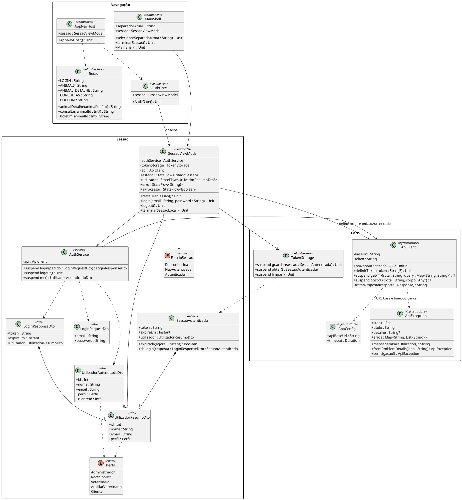
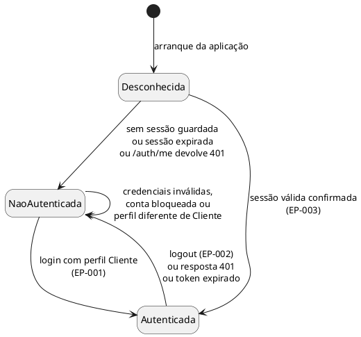
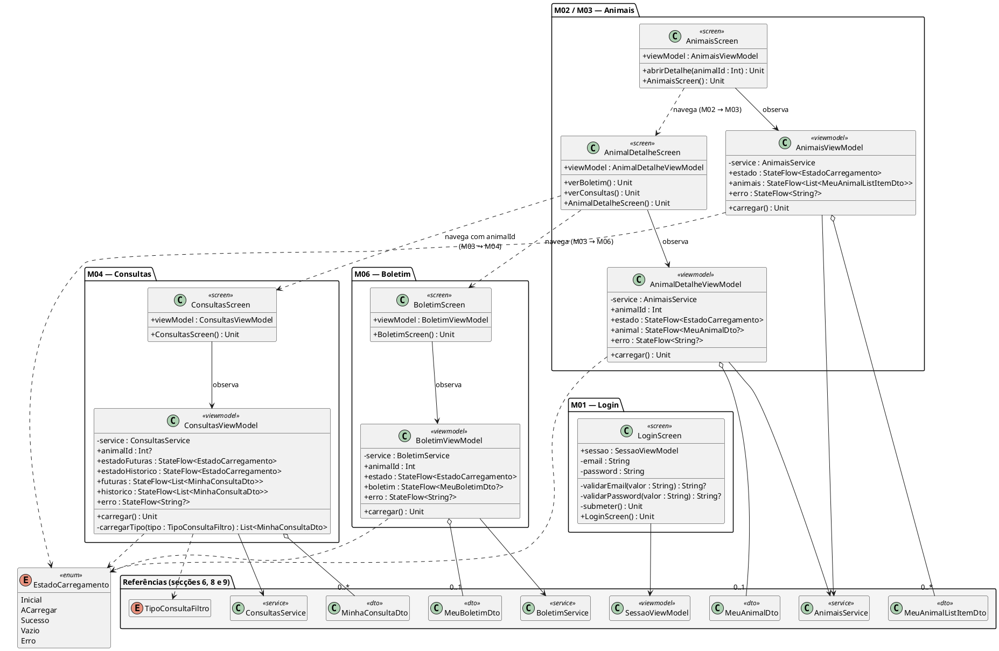
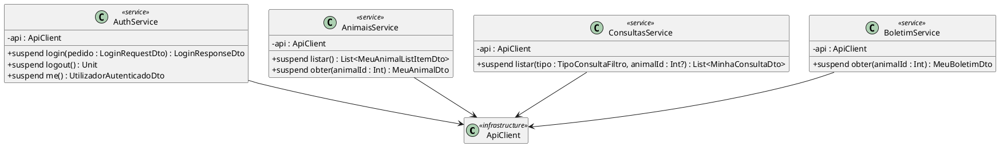
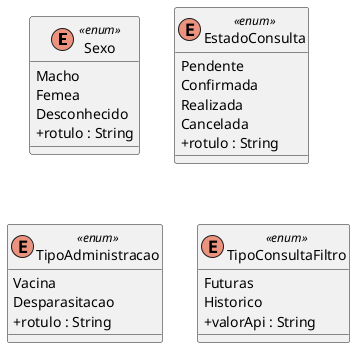
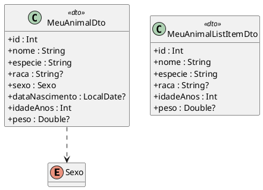
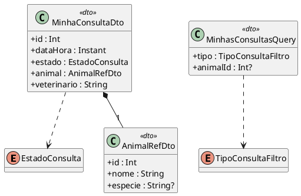
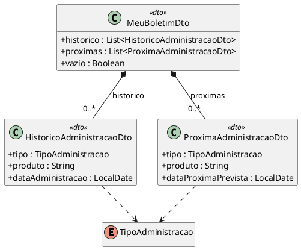
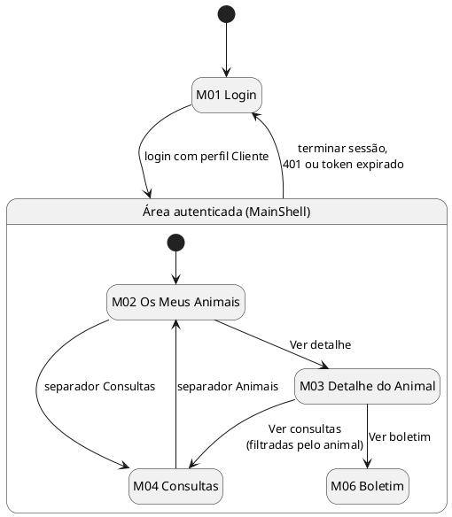
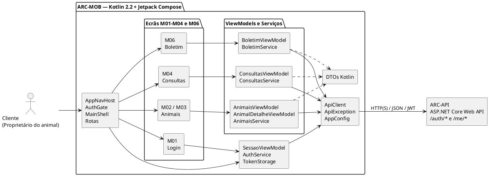

# Modelo de Classes — Frontend Mobile

**Projeto:** Gestão de Clínica Veterinária  
**Grupo:** G08  
**Milestone:** m3  
**Versão:** v02  
**Issue e papéis:** por atribuir. Esta versão ainda não tem Issue própria; será planeada no Backlog Refinement e no Sprint Planning, onde se atribuem Executor, Revisor e Auditor. A Issue I022 (v01, m2) está concluída e não é reaberta.  
**Estado:** Rascunho para revisão e auditoria  

## Histórico de versões

| Versão | Data | Descrição das alterações |
|---|---|---|
| v01 | m2 | Modelo de classes da aplicação móvel em Flutter e Dart (M01 a M06). Mantém-se inalterado como histórico (`m2-modelo-classes-frontend-mobile-v01.md`). |
| v02 | 23/10/2026 | Reflete a Declaração de Âmbito v05, que retira a F005 (contas e pagamentos), e o Regulamento Interno do Grupo v02, que passa o frontend mobile de Flutter e Dart para **Android nativo em Kotlin com Jetpack Compose**. O modelo é reescrito em Kotlin, sem o ecrã M05 (despesas), e as classes de dados passam a usar os nomes dos DTOs da API v02. |

### Alterações da v02 em relação à v01

| Tema | Alteração |
|---|---|
| Âmbito | O ecrã **M05 — Despesas** (UC15, RF042, EP-041) passa a **fora do âmbito**; ficam M01 a M04 e M06. A numeração mantém-se reservada. Saem `DespesasScreen`, `DespesasController`, `DespesasService`, `Despesa` e `EstadoPagamento`. A barra de navegação passa de três para dois separadores (Animais e Consultas). |
| Endpoints | A aplicação consome **7 endpoints** (EP-001, EP-002, EP-003, EP-019, EP-020, EP-030 e EP-044), em vez de 8. |
| Tecnologias | Flutter 3.19 e Dart 3.2 passam a Kotlin 2.2, Jetpack Compose com Material 3, Android SDK API 37 (minSdk 26) e JDK 21, com Gradle 9.6 e Android Gradle Plugin 9.4. Testes com JUnit, MockK, Compose UI Test e Robolectric; qualidade com ktlint e Android Lint (secção 4.1). |
| Estrutura | `ChangeNotifier` passa a `ViewModel` com `StateFlow`; os widgets passam a funções `@Composable`; as `Key` passam a `testTag`; `--dart-define` passa a `BuildConfig`; `flutter_secure_storage` passa a armazenamento cifrado com chave no Android Keystore. A tabela completa está na secção 4.5. |
| DTOs | As classes de dados passam a ter os nomes dos DTOs da API v02 (por exemplo, `MeuAnimalDto`, `MinhaConsultaDto`, `MeuBoletimDto`), como no Modelo de Classes do Backend v02. |
| Correções | `SessaoAutenticada` guarda o utilizador devolvido por EP-001 (`UtilizadorResumoDto`, sem `clienteId`); a v01 usava o tipo de EP-003. Em `MinhaConsultaDto` o animal é um `AnimalRefDto`. |

---

## 1. Objetivo

O presente documento define o modelo de classes previsto para o **Frontend Mobile** do sistema de Gestão de Clínica Veterinária.

O modelo representa as classes e estruturas relevantes da aplicação Android em Kotlin com Jetpack Compose, as respetivas responsabilidades, atributos, operações e relações, mantendo coerência com:

- a Especificação de Requisitos;
- as Especificações dos Casos de Uso v02;
- o Protótipo de Baixa Fidelidade v02 (ecrãs M01 a M04 e M06);
- a Documentação da Arquitetura;
- a Documentação da API v02;
- o Modelo de Classes do Frontend Web v02;
- o Modelo de Classes do Backend v02.

O Frontend Mobile corresponde ao componente arquitetural **ARC-MOB** e destina-se **exclusivamente** ao perfil **Cliente (Proprietário do animal)**. Todas as funcionalidades disponibilizadas são de consulta: a aplicação não cria, altera nem elimina dados de negócio.

A Declaração de Âmbito v05 retirou as funcionalidades F005 (Gestão de contas e pagamentos) e F007 (Gestão de internamento). Não fazem parte deste modelo.

---

## 2. Fontes e referências

| Referência | Utilização neste documento |
|---|---|
| `m1-proposta-sistema-v03.pdf` e `m3-proposta-sistema-v05.pdf` | Ator Cliente e funcionalidades. |
| `m3-declaracao-ambito-v05.pdf` | Âmbito mobile por funcionalidade; F005 e F007 fora do âmbito. |
| `m3-regulamento-grupo-v02.pdf` | Tecnologias, convenções, ferramentas e quality gates do frontend mobile (secções 11.2 a 11.6). |
| `m2-especificacao-requisitos-v01.md` | RF001–RF005, RF018, RF028, RF029, RF047 e RNF001–RNF006. |
| `m3-especificacoes-casos-uso-v02.md` | UC01, UC02, UC08, UC11 e UC17. |
| `m3-prototipo-baixa-fidelidade-v02.md` | Ecrãs M01–M04 e M06 e navegação da aplicação mobile; M05 fora do âmbito. |
| `m2-documentacao-arquitetura-v01.md` | ARC-MOB, ARC-API, DA-ARQ-01, DA-ARQ-03 e DA-ARQ-06. Ainda refere as tecnologias da v01 (Flutter): para as tecnologias prevalece o Regulamento Interno do Grupo v02. |
| `m3-documentacao-api-v02.md` | Endpoints EP-001 a EP-003, EP-019, EP-020, EP-030 e EP-044, DTOs, formatos JSON e erros. |
| `m3-modelo-classes-backend-v02.md` | Nomes e campos dos DTOs (secção 3). |
| `m3-modelo-classes-frontend-web-v02.md` | Convenções partilhadas de cliente HTTP, sessão e tratamento de erros. |
| `m2-diagrama-sequencia-autenticar-utilizador-v01.md` | Fluxo de autenticação (UC01) e armazenamento do token no cliente. |

Quando exista conflito, prevalecem os documentos homologados e normativos e, no que respeita ao contrato entre a aplicação e o backend, a Documentação da API v02.

---

## 3. Âmbito do modelo

O modelo cobre exclusivamente a aplicação **Android nativa (Kotlin e Jetpack Compose)** destinada ao Cliente.

São representadas cinco categorias de estruturas:

1. **Core** — configuração, cliente HTTP, tratamento de erros e armazenamento seguro do token;
2. **Sessão e navegação** — autenticação, restauro e fim de sessão, controlo do perfil e navegação entre ecrãs;
3. **Ecrãs e ViewModels** — correspondentes aos ecrãs M01–M04 e M06 do protótipo;
4. **Serviços de acesso à API** — encapsulam os endpoints `/auth/*` e `/me/*`;
5. **DTOs Kotlin** — representam os dados enviados e recebidos da API.

Não são modelados:

- o Frontend Web e os perfis internos;
- entidades Entity Framework ou acesso direto à base de dados;
- operações de escrita sobre dados de negócio;
- endpoints que não sejam `/auth/*` ou `/me/*`;
- funcionalidades fora do âmbito aprovado, em particular F005 e F007.

---

## 4. Convenções de modelação

### 4.1. Kotlin, Jetpack Compose e UML

A aplicação utiliza as tecnologias do Regulamento Interno do Grupo v02 (secções 11.2 a 11.4):

| Elemento | Tecnologia |
|---|---|
| Linguagem | Kotlin 2.2 |
| Interface | Jetpack Compose com Material 3 (Compose BOM 2026.02.01) |
| Plataforma | Android SDK API 37 (minSdk 26) e JDK 21 (Eclipse Temurin) |
| Compilação | Gradle 9.6 (Kotlin DSL) e Android Gradle Plugin 9.4 |
| Ambiente de desenvolvimento | Android Studio |
| Testes | JUnit 4.13, MockK 1.14, Compose UI Test e Robolectric 4.17 |
| Análise estática e formatação | ktlint 1.5 e Android Lint (`warningsAsErrors` ativo) |

Em Jetpack Compose, os ecrãs são funções `@Composable` e não classes. A notação UML de classe é usada neste documento para representar **estruturas, responsabilidades, estado, propriedades e operações**, como no modelo do frontend web. São utilizados os seguintes estereótipos:

- `<<screen>>` — ecrã (função `@Composable`) correspondente a um ecrã do protótipo;
- `<<component>>` — elemento estrutural reutilizável de interface;
- `<<viewmodel>>` — `ViewModel` do ecrã (`androidx.lifecycle.ViewModel`), que expõe o estado por `StateFlow`;
- `<<service>>` — serviço de comunicação com a API;
- `<<dto>>` — `data class` imutável enviada ou recebida da API;
- `<<model>>` — classe de dados local da aplicação (não vem da API);
- `<<enum>>` — enumeração Kotlin;
- `<<infrastructure>>` — infraestrutura transversal.

Os tipos são apresentados com a sintaxe Kotlin, incluindo nulabilidade (`String?`, `List<T>`, `StateFlow<T>`). As operações de rede são funções `suspend`.

### 4.2. Nomenclatura

De acordo com as **Kotlin Coding Conventions** e o **Android Kotlin Style Guide** adotados no Regulamento Interno do Grupo (secção 11.3), verificados por `ktlint`:

- classes, objetos, enumerações e funções `@Composable` em `PascalCase`;
- propriedades, parâmetros e funções em `camelCase`;
- ficheiros em `PascalCase.kt` (o nome da classe ou da função principal que contêm); pacotes em minúsculas, sem sublinhados;
- constantes (`const val`) em `MAIUSCULAS_COM_SUBLINHADO`;
- valores de enumeração em `PascalCase`, iguais aos valores da API (por exemplo, `Pendente`, `Femea`), o que dispensa tabelas de conversão;
- os nomes dos campos JSON seguem a Documentação da API (`camelCase` em português) e coincidem com as propriedades das `data class`.

### 4.3. Responsabilidade da aplicação mobile

A aplicação mobile:

- permite ao Cliente iniciar e terminar sessão;
- apresenta apenas informação devolvida pela API para a conta autenticada;
- não envia nunca o identificador do Cliente nos pedidos: este é obtido pelo servidor a partir do token (RNF002);
- não disponibiliza operações de criação, alteração ou eliminação;
- apresenta mensagens claras quando a API devolve erros ou não existe ligação à rede.

As decisões de autorização, isolamento de dados e regras de negócio continuam a pertencer ao Backend / API.

### 4.4. Decisões internas introduzidas por este modelo

As decisões seguintes são de **organização interna do Frontend Mobile** e não constituem novas funcionalidades de negócio. São propostas deste modelo, a ratificar na revisão:

| N.º | Decisão | Justificação |
|---|---|---|
| DM-01 | Arquitetura MVVM com fluxo de dados unidirecional: um `ViewModel` por ecrã e um `SessaoViewModel` partilhado. O estado é exposto por `StateFlow` e lido nos ecrãs com `collectAsStateWithLifecycle`. | Padrão recomendado para Jetpack Compose; separa a interface do estado e facilita os testes com JUnit e MockK. |
| DM-02 | Comunicação HTTP centralizada num único `ApiClient`. A biblioteca HTTP concreta (por exemplo, OkHttp) e a de JSON (por exemplo, kotlinx.serialization) escolhem-se na implementação (m4) e registam-se nas dependências Gradle. | Um único ponto para URL base, cabeçalho JWT, *timeout* e conversão de erros. |
| DM-03 | Token guardado em armazenamento cifrado, com a chave guardada no Android Keystore. A biblioteca concreta escolhe-se na implementação (m4). | O token dá acesso a dados pessoais do Cliente; não deve ficar em armazenamento em texto simples. |
| DM-04 | URL base da API definida em tempo de compilação por `BuildConfig.API_BASE_URL` (campo `buildConfigField` de cada tipo de compilação em `build.gradle.kts`), através de `AppConfig`. | Permite utilizar diferentes ambientes de desenvolvimento e demonstração sem alterar código. No emulador Android, o backend local pode ser acedido por `http://10.0.2.2:<porta>` em ambiente controlado. |
| DM-05 | Injeção de dependências manual pelo construtor, com um contentor simples (`AppContainer`) criado em `ClinicaApplication`; sem framework de injeção. | Serviços e `ViewModel` podem ser substituídos por *mocks* (MockK) nos testes; evita dependências adicionais. |
| DM-06 | Cada ecrã expõe `testTag` estáveis nos elementos relevantes (ver secção 13). | Necessário para os testes de sistema automáticos com Compose UI Test e Robolectric (QG-07 do Regulamento Interno). |
| DM-07 | Os DTOs usam os nomes da API v02 (`...Dto`) e as datas ISO 8601 são convertidas para `java.time` (`Instant` e `LocalDate`), disponível a partir do minSdk 26. | Mantém um único vocabulário entre a API, o backend e a aplicação. |

### 4.5. Correspondência com a v01 (Flutter e Dart)

| v01 (Flutter e Dart) | v02 (Kotlin e Jetpack Compose) |
|---|---|
| Widget `<<screen>>` | Função `@Composable` de ecrã (`LoginScreen`, `AnimaisScreen`, ...) |
| `ChangeNotifier` e `notifyListeners()` | `ViewModel` com `StateFlow` |
| `*Controller` | `*ViewModel` |
| `AppRouter` e `RouteSettings` | Navigation Compose: `Rotas` e `AppNavHost` |
| `AuthGate` e `MainShell` (widgets) | `AuthGate` e `MainShell` (composables) |
| `Key` estáveis | `Modifier.testTag` |
| `fromJson` / `toJson` em cada model | `data class` serializável; sem métodos de conversão escritos à mão |
| `Future<T>` | função `suspend` |
| `flutter_secure_storage` | Armazenamento cifrado com chave no Android Keystore |
| Package `http` | Cliente HTTP único em `ApiClient` (biblioteca a escolher na m4) |
| `--dart-define=API_BASE_URL` | `BuildConfig.API_BASE_URL` |
| `mocktail`, `flutter_test` e `integration_test` | MockK, JUnit, Compose UI Test e Robolectric |
| `flutter_lints` e Effective Dart | ktlint e Android Lint; Kotlin Coding Conventions |
| `pubspec.yaml` | `build.gradle.kts` e catálogo de versões Gradle |

---

## 5. Organização lógica prevista

```text
/src/frontend-mobile/app/src/main/kotlin/clinicaveterinaria/mobile
│
├── ClinicaApplication.kt
├── MainActivity.kt
├── AppContainer.kt
│
├── core/
│   ├── config/
│   │   └── AppConfig.kt
│   ├── api/
│   │   ├── ApiClient.kt
│   │   └── ApiException.kt
│   ├── storage/
│   │   └── TokenStorage.kt
│   └── formatacao/
│       └── Formatadores.kt
│
├── sessao/
│   ├── AuthService.kt
│   ├── SessaoViewModel.kt
│   ├── SessaoAutenticada.kt
│   └── dto/
│       ├── LoginRequestDto.kt
│       ├── LoginResponseDto.kt
│       ├── UtilizadorResumoDto.kt
│       └── UtilizadorAutenticadoDto.kt
│
├── navegacao/
│   ├── Rotas.kt
│   ├── AppNavHost.kt
│   ├── AuthGate.kt
│   └── MainShell.kt
│
├── features/
│   ├── login/
│   │   └── LoginScreen.kt
│   ├── animais/
│   │   ├── AnimaisService.kt
│   │   ├── AnimaisViewModel.kt
│   │   ├── AnimalDetalheViewModel.kt
│   │   ├── AnimaisScreen.kt
│   │   ├── AnimalDetalheScreen.kt
│   │   └── dto/
│   ├── consultas/
│   │   ├── ConsultasService.kt
│   │   ├── ConsultasViewModel.kt
│   │   ├── ConsultasScreen.kt
│   │   └── dto/
│   └── boletim/
│       ├── BoletimService.kt
│       ├── BoletimViewModel.kt
│       ├── BoletimScreen.kt
│       └── dto/
│
└── shared/
    ├── EstadoCarregamento.kt
    └── components/
        └── EstadoVista.kt
```

Os testes ficam em `app/src/test` (JUnit, MockK, Compose UI Test com Robolectric). O nome do pacote base (`clinicaveterinaria.mobile`) é proposto e confirma-se na criação do projeto (m4). A estrutura física pode sofrer pequenos ajustamentos durante a implementação, desde que sejam preservadas as responsabilidades, relações e contratos definidos neste modelo.

---

# 6. Modelo transversal — Core, sessão e navegação



## 6.1. Responsabilidades

| Estrutura | Responsabilidade |
|---|---|
| `AppConfig` | Disponibilizar a URL base da API (via `BuildConfig`) e o *timeout* dos pedidos. |
| `ApiClient` | Executar pedidos HTTP, acrescentar o cabeçalho `Authorization: Bearer`, converter JSON em DTOs e transformar respostas de erro em `ApiException`. Invoca `onNaoAutenticado` quando recebe `401`. |
| `ApiException` | Representar erros no formato *Problem Details* da API e a ausência de ligação à rede, com uma mensagem adequada ao utilizador. |
| `TokenStorage` | Guardar, obter e limpar a sessão (token, expiração e utilizador) em armazenamento cifrado. |
| `SessaoAutenticada` | Agrupar o token, a expiração e o utilizador devolvidos por EP-001 e indicar se a sessão expirou. |
| `AuthService` | Consumir EP-001 (`POST /auth/login`), EP-002 (`POST /auth/logout`) e EP-003 (`GET /auth/me`). |
| `SessaoViewModel` | Gerir o ciclo de vida da sessão: login, verificação do perfil, restauro, logout e fim local da sessão. |
| `AuthGate` | Mostrar M01 ou a área autenticada consoante o `EstadoSessao`. |
| `MainShell` | Conter a barra de navegação inferior (Animais e Consultas) e a ação de terminar sessão. |
| `Rotas` e `AppNavHost` | Definir as rotas dos ecrãs e os respetivos argumentos (por exemplo, `animalId`) com Navigation Compose. |

## 6.2. Regras de sessão

1. **Login (UC01):** `SessaoViewModel.login()` chama EP-001. Em caso de sucesso, define temporariamente o token recebido no `ApiClient` e verifica o perfil devolvido:
   - se o perfil for `Cliente`, guarda a sessão com `TokenStorage` e passa a `Autenticada`;
   - se o perfil **não** for `Cliente`, chama EP-002 com o token recebido para o revogar, limpa o token local, não guarda a sessão e apresenta a mensagem "Esta aplicação destina-se apenas a clientes da clínica." (RNF003).
2. **Erros de login:** `401` → "Email ou palavra-passe incorretos."; `403` → "A conta encontra-se bloqueada."; sem ligação → mensagem de rede (RNF006).
3. **Restauro:** ao arrancar, `restaurarSessao()` lê a sessão guardada. Se não existir ou estiver expirada (`expiraEm`), limpa-a e mostra M01. Caso contrário, confirma a sessão com EP-003; se a API responder `401`, termina a sessão localmente.
4. **Sem refresh token:** o token tem validade de 8 horas (DA-ARQ-06). Expirado, o Cliente volta a autenticar-se.
5. **Resposta 401 em qualquer pedido:** o `ApiClient` invoca `onNaoAutenticado`, que executa `terminarSessaoLocal()` (limpa o armazenamento e volta a M01).
6. **Logout (UC02):** `logout()` chama EP-002 para revogar o token no servidor e **limpa sempre** a sessão local, mesmo que o pedido falhe (por exemplo, sem rede).

## 6.3. Diagrama de estados da sessão



---

# 7. Ecrãs e ViewModels (M01–M04 e M06)

Os serviços e DTOs aparecem neste diagrama apenas como referência; a sua definição completa encontra-se nas secções 8 e 9. O ecrã M05 (despesas) está fora do âmbito e a sua numeração fica reservada.



## 7.1. Responsabilidades dos ViewModels

Todos os `ViewModel` expõem o estado por `StateFlow` e lançam as chamadas de rede em `viewModelScope`.

| ViewModel | Responsabilidade |
|---|---|
| `AnimaisViewModel` | Obter os animais do Cliente (EP-019) e indicar `Vazio` quando a lista é vazia (UC08, A1). |
| `AnimalDetalheViewModel` | Obter os dados básicos de um animal (EP-020); tratar `403` como acesso recusado (UC08, E1). |
| `ConsultasViewModel` | Obter marcações futuras e histórico (EP-030 com `tipo=futuras` e `tipo=historico`), opcionalmente filtradas por `animalId`. |
| `BoletimViewModel` | Obter o boletim de um animal (EP-044): histórico e próximas administrações. |

## 7.2. Estado de carregamento

`EstadoCarregamento` uniformiza o comportamento visual de todos os ecrãs de consulta:

| Estado | Apresentação |
|---|---|
| `Inicial` / `ACarregar` | Indicador de progresso. |
| `Sucesso` | Dados devolvidos pela API. |
| `Vazio` | Mensagem de ausência de dados (por exemplo, "Ainda não existem consultas registadas."). |
| `Erro` | Mensagem de `ApiException.mensagemParaUtilizador()` e ação "Tentar novamente", que volta a chamar `carregar()`. |

---

# 8. Serviços de acesso à API



## 8.1. Endpoints consumidos por serviço

| Serviço | Operação | Endpoint | Pedido → resposta (DTOs da API v02) | Requisitos |
|---|---|---|---|---|
| `AuthService` | `login` | EP-001 `POST /auth/login` | `LoginRequestDto` → `LoginResponseDto` | RF001, RF002, RF004, RF005 |
| `AuthService` | `logout` | EP-002 `POST /auth/logout` | — → — (204) | RF003 |
| `AuthService` | `me` | EP-003 `GET /auth/me` | — → `UtilizadorAutenticadoDto` | RF004, RF005 |
| `AnimaisService` | `listar` | EP-019 `GET /me/animais` | — → `List<MeuAnimalListItemDto>` | RF018 |
| `AnimaisService` | `obter` | EP-020 `GET /me/animais/{id}` | — → `MeuAnimalDto` | RF018 |
| `ConsultasService` | `listar` | EP-030 `GET /me/consultas?tipo=&animalId=` | `MinhasConsultasQuery` → `List<MinhaConsultaDto>` | RF028, RF029 |
| `BoletimService` | `obter` | EP-044 `GET /me/animais/{id}/vacinacoes` | — → `MeuBoletimDto` | RF047 |

A aplicação mobile consome **exclusivamente** estes sete endpoints. Todos os restantes (EP-004 a EP-018, EP-021 a EP-029, EP-031 a EP-034, EP-042 e EP-043) pertencem ao Frontend Web e não são consumidos pela aplicação mobile (RNF003). EP-001 a EP-003 são partilhados com o web; EP-019, EP-020, EP-030 e EP-044 são exclusivos do mobile. Os sete endpoints do mobile e os 30 só do web somam, com os três partilhados contados uma vez, os 37 endpoints em âmbito.

Nenhum serviço envia `clienteId`: as rotas `/me/*` identificam o Cliente a partir do token (RNF002). O único método de escrita é `POST /auth/*`, que gere a sessão e não altera dados de negócio.

---

# 9. DTOs Kotlin

Todos os DTOs são **imutáveis** (`data class` com propriedades `val`) e serializáveis: os campos coincidem com o JSON da API. As datas e horas recebidas em ISO 8601 são convertidas para `Instant` (data e hora, apresentada na hora local do dispositivo) e `LocalDate` (data simples). Os nomes e os campos são os da Documentação da API v02 e do Modelo de Classes do Backend v02 (secção 3), limitados aos DTOs que a aplicação usa.

## 9.1. Enumerações



Os valores das enumerações coincidem com os da Documentação da API v02 (secção 2.2): `Macho` ↔ `"Macho"`, `Femea` ↔ `"Femea"`, e assim sucessivamente; não é preciso conversão. `valorApi` devolve o texto do parâmetro `tipo` de EP-030 (`futuras` e `historico`).

O atributo `rotulo` define o texto apresentado ao utilizador:

| Enumeração | Valor | Rótulo apresentado |
|---|---|---|
| `Sexo` | `Macho` / `Femea` / `Desconhecido` | Macho / Fêmea / Desconhecido |
| `EstadoConsulta` | `Pendente` / `Confirmada` / `Realizada` / `Cancelada` | Pendente / Confirmada / Realizada / Cancelada |
| `TipoAdministracao` | `Vacina` / `Desparasitacao` | Vacina / Desparasitação |

`Perfil` está definido na secção 6. `TipoConsultaFiltro` é uma restrição de tipagem da aplicação mobile que corresponde ao parâmetro `tipo` de `MinhasConsultasQuery` (EP-030). A enumeração `EstadoPagamento`, da v01, saiu com a F005.

## 9.2. Sessão (F001)

Definidos na secção 6: `LoginRequestDto`, `LoginResponseDto`, `UtilizadorResumoDto` e `UtilizadorAutenticadoDto`. `UtilizadorAutenticadoDto.clienteId` só é preenchido para o perfil `Cliente` e a aplicação não o envia em nenhum pedido.

## 9.3. Animais (F002)



O peso é um número decimal em quilogramas (`decimal` na API). `MeuAnimalListItemDto` é a resposta de EP-019 e `MeuAnimalDto` a de EP-020. Nenhum dos dois inclui o proprietário nem dados clínicos.

## 9.4. Consultas (F003)



`MinhaConsultaDto` contém apenas informação administrativa (data, animal, Veterinário e estado), sem qualquer registo clínico (RF029). O Veterinário é um texto, como no contrato da API v02 (ponto em aberto da API sobre a uniformização). `MinhasConsultasQuery.tipo` assume por omissão `Futuras`.

## 9.5. Boletim de vacinação e desparasitação (F006)



A data da próxima administração é calculada pelo servidor (RF045); a aplicação apenas a apresenta. `vazio` é uma propriedade calculada na própria classe, verdadeira quando ambas as listas estão vazias (UC17, A1); não faz parte do JSON.

## 9.6. DTOs usados pela aplicação mobile

| DTO | Endpoint | Sentido |
|---|---|---|
| `LoginRequestDto` | EP-001 | Pedido |
| `LoginResponseDto`, `UtilizadorResumoDto` | EP-001 | Resposta |
| `UtilizadorAutenticadoDto` | EP-003 | Resposta |
| `MeuAnimalListItemDto` | EP-019 | Resposta |
| `MeuAnimalDto` | EP-020 | Resposta |
| `MinhasConsultasQuery` | EP-030 | Parâmetros no URL |
| `MinhaConsultaDto`, `AnimalRefDto` | EP-030 | Resposta |
| `MeuBoletimDto`, `HistoricoAdministracaoDto`, `ProximaAdministracaoDto` | EP-044 | Resposta |

Os DTOs `Meu*` e `Minha*` só existem para as rotas `/me/*` e não são usados pelo frontend web.

---

# 10. Relação entre ecrãs, estruturas e protótipo

| Ecrã | Ecrã / ViewModel | Serviço(s) e endpoints | UC / RF |
|---|---|---|---|
| M01 — Login Mobile | `LoginScreen`, `SessaoViewModel` | `AuthService` — EP-001, EP-002 (perfil não Cliente), EP-003 (restauro) | UC01; RF001, RF002, RF004, RF005 |
| M02 — Os Meus Animais | `AnimaisScreen`, `AnimaisViewModel` | `AnimaisService` — EP-019 | UC08; RF018 |
| M03 — Detalhe do Animal | `AnimalDetalheScreen`, `AnimalDetalheViewModel` | `AnimaisService` — EP-020 | UC08; RF018 |
| M04 — Consultas | `ConsultasScreen`, `ConsultasViewModel` | `ConsultasService` — EP-030 | UC11; RF028, RF029 |
| M06 — Boletim | `BoletimScreen`, `BoletimViewModel` | `BoletimService` — EP-044 | UC17; RF047 |
| Barra de navegação e terminar sessão | `MainShell`, `SessaoViewModel` | `AuthService` — EP-002 | UC02; RF003 |

O ecrã **M05 — Despesas e Pagamentos** (UC15, RF042) está **fora do âmbito** (Declaração de Âmbito v05) e a sua numeração fica reservada. Não tem ecrã, `ViewModel`, serviço nem DTO neste documento.

## 10.1. Navegação



---

# 11. Regras de comportamento e restrições do Cliente

A aplicação mobile:

- apresenta apenas os animais, consultas e boletins devolvidos pelas rotas `/me/*` para a conta autenticada;
- não contém botões, formulários ou rotas para criar, alterar ou cancelar marcações (RF028, UC11);
- não contém formulários de edição de animais (RF018, UC08);
- não apresenta despesas nem pagamentos (F005, fora do âmbito);
- não apresenta registos clínicos, diagnósticos, tratamentos nem prescrições (RF029);
- não apresenta internamentos (F007, fora do âmbito);
- não apresenta funcionalidades dos perfis internos.

Quando a API devolve `403` ao pedir um recurso (por exemplo, um animal de outro Cliente), o ecrã apresenta "Não tem acesso a esta informação." e não mostra quaisquer dados (UC08 E1, UC11 E1, UC17 E1).

---

# 12. Validação e tratamento de erros

## 12.1. Validação local

Apenas o formulário de login (M01) recebe dados do utilizador. A validação local verifica:

- email preenchido e com formato válido;
- palavra-passe preenchida.

Esta validação não substitui a validação da API.

## 12.2. Conversão de erros

O `ApiClient` converte cada resposta de erro numa `ApiException`:

| Situação | Tratamento na aplicação |
|---|---|
| `400` | Mensagem de dados inválidos; erros por campo (`errors`) associados aos campos do formulário de login. |
| `401` | No login: credenciais incorretas. Nos restantes pedidos: fim local da sessão e regresso a M01. |
| `403` | No login: conta bloqueada. Nos restantes pedidos: "Não tem acesso a esta informação." |
| `404` | "A informação pedida já não existe." |
| `500` | "Ocorreu um erro no servidor. Tente novamente mais tarde." |
| Sem ligação / *timeout* | "Sem ligação ao servidor. Verifique a sua ligação à rede." e ação "Tentar novamente" (RNF006). |

A aplicação não guarda dados de negócio localmente nem funciona offline: apenas a sessão é guardada (RNF006).

---

# 13. Testabilidade

Para cumprir os quality gates QG-05 e QG-07 do Regulamento Interno do Grupo (`./gradlew ktlintCheck lintDebug` e `./gradlew testDebugUnitTest`), o modelo prevê:

- **Injeção pelo construtor:** serviços recebem o `ApiClient`; `ViewModel` recebem o respetivo serviço; o `SessaoViewModel` recebe `AuthService`, `TokenStorage` e `ApiClient`. Todos podem ser substituídos por *mocks* com MockK.
- **`testTag` estáveis nos composables**, utilizados pelos testes de sistema com Compose UI Test e Robolectric:

| Ecrã | Etiquetas previstas |
|---|---|
| M01 | `m01-email`, `m01-password`, `m01-entrar`, `m01-erro` |
| M02 | `m02-lista-animais`, `m02-animal-{id}`, `m02-vazio` |
| M03 | `m03-nome`, `m03-ver-boletim`, `m03-ver-consultas` |
| M04 | `m04-lista-futuras`, `m04-lista-historico` |
| M06 | `m06-historico`, `m06-proximas`, `m06-vazio` |
| Barra de navegação | `nav-animais`, `nav-consultas`, `nav-terminar-sessao` |
| Estados comuns | `estado-a-carregar`, `estado-erro`, `estado-tentar-novamente` |

- **Testes de sistema** apontam para o backend local ou de testes através de `BuildConfig.API_BASE_URL`, sem alterar código.

---

# 14. Relações estruturais principais

```text
Ecrã (@Composable)
    ↓ observa
ViewModel (StateFlow)
    ↓ utiliza
Service
    ↓ utiliza
ApiClient
    ↓ HTTP(S) / JSON / JWT
ARC-API (/auth/*, /me/*)

AuthGate
    ↓ observa
SessaoViewModel
    ↓ utiliza
AuthService + TokenStorage + ApiClient
```

Não existe relação direta:

```text
Frontend Mobile → Base de Dados
Frontend Mobile → Entity Framework Core
Frontend Mobile → endpoints dos perfis internos
```

---

# 15. Rastreabilidade com ARC-MOB e requisitos não funcionais

| Requisito / componente | Tratamento no modelo |
|---|---|
| ARC-MOB | Ecrãs, `ViewModel`, serviços, DTOs, sessão e infraestrutura definidos neste documento. |
| RNF001 — Controlo de acesso | `SessaoViewModel` aceita apenas o perfil `Cliente`; a aplicação não expõe operações de outros perfis; o backend continua autoritativo. |
| RNF002 — Isolamento dos dados de Clientes | Utilização exclusiva das rotas `/me/*`; nenhum serviço envia `clienteId`; `403` tratado como acesso recusado. |
| RNF003 — Separação dos canais | Apenas EP-001 a EP-003 e os quatro endpoints `/me/*` são consumidos; perfis internos são rejeitados no login. |
| RNF004 — Validação dos dados de entrada | Validação local do login; erros `400` da API apresentados por campo. |
| RNF005 — Persistência dos dados confirmados | A aplicação apenas consulta dados persistidos pelo backend; não mantém cópias locais. |
| RNF006 — Dependência de ligação à rede | `ApiException.semLigacao()`, mensagem de rede e "Tentar novamente"; sem modo offline. |

## 15.1. Cobertura dos requisitos funcionais do Cliente

| Requisito | Estruturas |
|---|---|
| RF001, RF002 | `LoginScreen`, `SessaoViewModel.login()`, `AuthService.login()` |
| RF003 | `MainShell.terminarSessao()`, `SessaoViewModel.logout()`, `AuthService.logout()` |
| RF004 | `TokenStorage`, `SessaoViewModel.restaurarSessao()`, `SessaoAutenticada.expirada()` |
| RF005 | `SessaoViewModel` (verificação do perfil), `AuthGate` |
| RF018 | `AnimaisScreen`, `AnimalDetalheScreen`, `AnimaisViewModel`, `AnimalDetalheViewModel`, `AnimaisService`, `MeuAnimalListItemDto`, `MeuAnimalDto` |
| RF028, RF029 | `ConsultasScreen`, `ConsultasViewModel`, `ConsultasService`, `MinhaConsultaDto` |
| RF047 | `BoletimScreen`, `BoletimViewModel`, `BoletimService`, `MeuBoletimDto` |

O requisito RF042 (despesas e estados de pagamento no mobile) pertence à F005 e está fora do âmbito.

---

# 16. Elementos deliberadamente fora do modelo

Este modelo não introduz:

- registo autónomo de conta pelo Cliente ou recuperação de palavra-passe;
- criação, alteração ou cancelamento de marcações;
- criação ou edição de fichas de animais;
- despesas, pagamentos eletrónicos ou registo de pagamentos (F005, fora do âmbito);
- consulta de registos clínicos, diagnósticos, tratamentos ou prescrições;
- acompanhamento de internamentos (F007, fora do âmbito);
- notificações *push*, SMS ou e-mail;
- sincronização com calendários externos;
- autenticação Google/Facebook ou multifator;
- refresh token;
- leitura de QR, códigos de barras ou microchips;
- armazenamento local de dados de negócio ou modo offline;
- acesso direto à base de dados.

---

# 17. Critérios de implementação derivados do modelo

Para manter coerência com este artefacto durante a implementação (m4):

1. ecrãs não efetuam pedidos HTTP diretamente; utilizam o respetivo `ViewModel` e serviço;
2. serviços utilizam exclusivamente o `ApiClient`;
3. o token é guardado apenas através de `TokenStorage` (armazenamento cifrado);
4. a URL base da API é definida por `BuildConfig.API_BASE_URL`, nunca escrita no código;
5. nenhuma rota fora de `/auth/*` e `/me/*` é chamada;
6. os valores das enumerações permanecem iguais aos da API;
7. os DTOs podem ser refinados apenas se o contrato da API for atualizado de forma controlada;
8. os ecrãs M01–M04 e M06 continuam identificáveis na implementação, ainda que a composição visual evolua;
9. as etiquetas da secção 13 são mantidas para os testes de sistema;
10. a ação "Terminar sessão" está sempre acessível na área autenticada;
11. o código passa `./gradlew ktlintCheck lintDebug` e os testes passam `./gradlew testDebugUnitTest` antes do Merge Request (QG-05 e QG-07).

---

# 18. Diagrama global simplificado



---

## 19. Histórico de versões

| Versão | Autor |
|---|---|
| v01 | Gonçalo Magalhães Ribeiro |
| v02 | Por atribuir (ver «Issue e papéis» no cabeçalho). Rascunho preparado com apoio de IA, a rever pelo Executor. |
