# Protótipo de baixa fidelidade — Gestão de Clínica Veterinária

| Campo | Valor |
|---|---|
| Unidade curricular | Laboratório de Desenvolvimento de Software — LDS |
| Grupo | G08 |
| Milestone | m3 |
| Versão | v02 |
| Substitui (sem alterar) | `m2-prototipo-baixa-fidelidade-v01.pdf` |

## 1. Objetivo

Reunir num único ficheiro Markdown o código-fonte PlantUML dos ecrãs em âmbito do protótipo de baixa fidelidade, para que o protótipo seja textual, editável e versionável (Regulamento de Funcionamento da UC v19, secção sobre diagramas). O conteúdo de cada ecrã é o mesmo dos ficheiros `.puml` conservados em `fonte-prototipo-baixa-fidelidade/` na entrega m2.

## 2. Histórico de versões

| Versão | Milestone | Descrição |
|---|---|---|
| v01 | m2 | Protótipo em PDF, com os ficheiros `.puml` soltos em `fonte-prototipo-baixa-fidelidade/`. |
| v02 | m3 | Código PlantUML dos ecrãs em âmbito incorporado neste ficheiro Markdown. Os ecrãs W14, W15, W17, W18 e M05 (F005 e F007) ficam fora do âmbito, de acordo com a Declaração de Âmbito v05: aparecem no índice e na secção 4 apenas como «fora do âmbito», sem código, e foram retirados do mapa de navegação. Os ficheiros `.puml` e o PDF da m2 mantêm-se inalterados. |

## 3. Índice dos ecrãs

| Fonte | Ecrã | Atores | Caso(s) de uso | Requisitos |
|---|---|---|---|---|
| `00-mapa-navegacao.puml` | Mapa de Navegação - Gestão de Clínica Veterinária | - | - | - |
| `W01-login-web.puml` | W01 — Login Web | Administrador, Rececionista, Veterinário, Auxiliar Veterinário | UC01 | RF001, RF002, RF004, RF005 |
| `W02-funcionarios.puml` | W02 — Lista de Funcionários | - | UC03 | RF007, RF008, RF009 |
| `W03-editar-funcionario.puml` | W03 — Criar / Editar Funcionário | - | UC03 | RF006, RF007, RF008, RF009 |
| `W04-clientes.puml` | W04 — Lista e Pesquisa de Clientes | Administrador, Rececionista | UC04 | RF010, RF011 |
| `W05-detalhe-cliente.puml` | W05 — Detalhe / Criar / Editar Cliente | Administrador, Rececionista | UC04 | RF010, RF011 |
| `W06-clinica-config-horarios.puml` | W06 — Clínica, Configurações e Horários | - | UC05 / UC09 | RF012, RF013, RF019 |
| `W07-pacientes.puml` | W07 — Lista e Pesquisa de Pacientes | Rececionista, Veterinário | UC06 / UC07 | RF014, RF017 |
| `W08-ficha-paciente.puml` | W08 — Ficha do Paciente | Rececionista, Veterinário | UC06 / UC07 / UC10 | RF014, RF015, RF016, RF026 |
| `W09-agenda.puml` | W09 — Agenda da Clínica | Rececionista, Veterinário | UC09 | RF020, RF024 |
| `W10-marcacao-form.puml` | W10 — Criar / Editar Marcação | - | UC09 | RF020, RF021, RF022, RF023 |
| `W11-detalhe-marcacao.puml` | W11 — Detalhe da Marcação | Rececionista, Veterinário | UC09 | RF023, RF024, RF025 |
| `W12-preparacao-consulta.puml` | W12 — Preparação e Apoio à Consulta | - | UC10 | RF026, RF027 |
| `W13-registo-clinico.puml` | W13 — Registo e Histórico Clínico | - | UC12 / UC13 | RF030, RF031, RF032, RF033, RF034, RF035, RF036 |
| `W14-contas-dividas.puml` | W14 — Contas, Custos e Valores em Dívida — **fora do âmbito** | - | UC14 (fora do âmbito) | RF037, RF038 (fora do âmbito) |
| `W15-conta-pagamentos.puml` | W15 — Detalhe da Conta e Pagamentos — **fora do âmbito** | - | UC14 (fora do âmbito) | RF039, RF040, RF041 (fora do âmbito) |
| `W16-vacinacao.puml` | W16 — Vacinação e Desparasitação | - | UC16 | RF043, RF044, RF045, RF046 |
| `W17-internamentos.puml` | W17 — Painel de Internamentos — **fora do âmbito** | - | UC18 (fora do âmbito) | RF048, RF049, RF050 (fora do âmbito) |
| `W18-detalhe-internamento.puml` | W18 — Detalhe do Internamento — **fora do âmbito** | - | UC18 (fora do âmbito) | RF048, RF049, RF050, RF051, RF052 (fora do âmbito) |
| `M01-login-mobile.puml` | M01 — Login Mobile | - | UC01 | RF001, RF002, RF004, RF005 |
| `M02-meus-animais.puml` | M02 — Os Meus Animais | - | UC08 | RF018 |
| `M03-detalhe-animal.puml` | M03 — Detalhe do Animal | - | UC08 | RF018 |
| `M04-consultas.puml` | M04 — Consultas | - | UC11 | RF028, RF029 |
| `M05-despesas.puml` | M05 — Despesas e Pagamentos — **fora do âmbito** | - | UC15 (fora do âmbito) | RF042 (fora do âmbito) |
| `M06-boletim.puml` | M06 — Boletim de Vacinação e Desparasitação | - | UC17 | RF047 |

## 4. Ecrãs

### 4.1. Mapa de Navegação - Gestão de Clínica Veterinária

Fonte: `00-mapa-navegacao.puml`. Nesta versão foram retirados os ecrãs W14, W15, W17, W18 e M05 (F005 e F007, fora do âmbito).

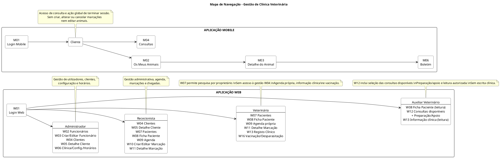

### 4.2. W01 — Login Web

Fonte: `W01-login-web.puml`

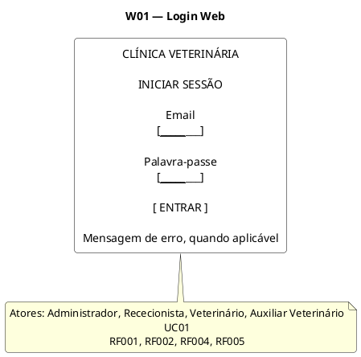

### 4.3. W02 — Lista de Funcionários

Fonte: `W02-funcionarios.puml`

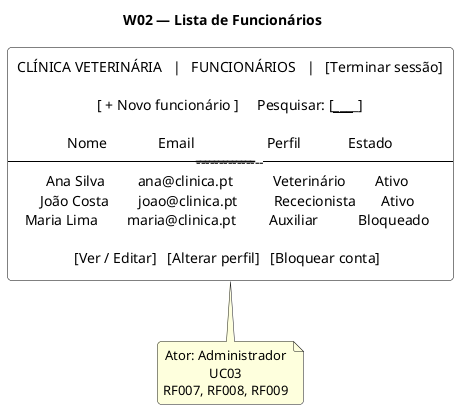

### 4.4. W03 — Criar / Editar Funcionário

Fonte: `W03-editar-funcionario.puml`

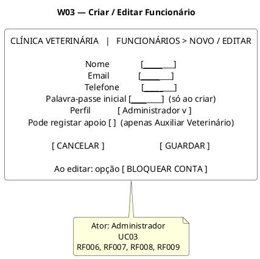

### 4.5. W04 — Lista e Pesquisa de Clientes

Fonte: `W04-clientes.puml`

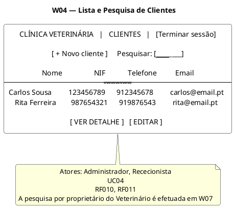

### 4.6. W05 — Detalhe / Criar / Editar Cliente

Fonte: `W05-detalhe-cliente.puml`

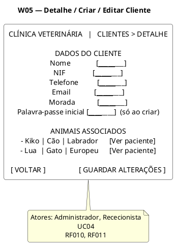

### 4.7. W06 — Clínica, Configurações e Horários

Fonte: `W06-clinica-config-horarios.puml`

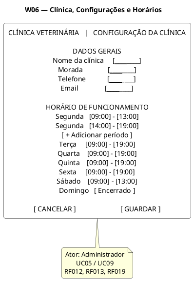

### 4.8. W07 — Lista e Pesquisa de Pacientes

Fonte: `W07-pacientes.puml`

```plantuml {kroki=true}
@startuml
skinparam shadowing false
skinparam roundcorner 8
skinparam defaultTextAlignment center
skinparam rectangle {
  BackgroundColor white
  BorderColor black
  FontColor black
}

title W07 — Lista e Pesquisa de Pacientes

rectangle "CLÍNICA VETERINÁRIA   |   PACIENTES

[ + Registar paciente ]     Pesquisar paciente: [____________________]

PESQUISA POR PROPRIETÁRIO
Proprietário: [________________________]   [ PESQUISAR ]
Resultados: Carlos Sousa | Rita Ferreira | ...
Selecionado: [ Carlos Sousa v ]

Nome        Espécie       Raça          Proprietário
------------------------------------------------------
Kiko        Cão           Labrador      Carlos Sousa
Lua         Gato          Europeu       Rita Ferreira

[ VER FICHA ]" as SCREEN

note bottom of SCREEN
Atores: Rececionista, Veterinário
UC06 / UC07
RF014, RF017
A pesquisa de proprietário ocorre aqui; o Veterinário não acede a W04
end note
@enduml
```

### 4.9. W08 — Ficha do Paciente

Fonte: `W08-ficha-paciente.puml`

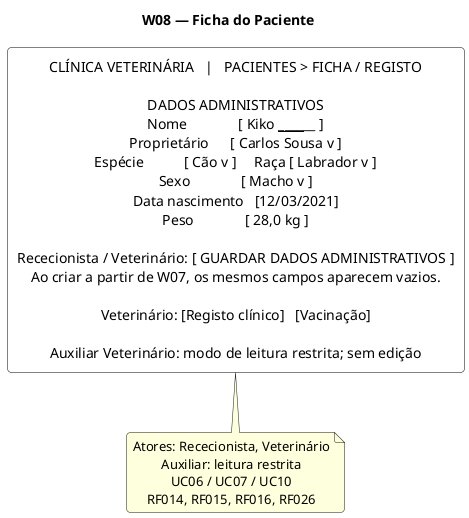

### 4.10. W09 — Agenda da Clínica

Fonte: `W09-agenda.puml`

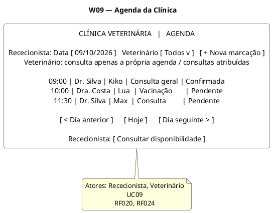

### 4.11. W10 — Criar / Editar Marcação

Fonte: `W10-marcacao-form.puml`

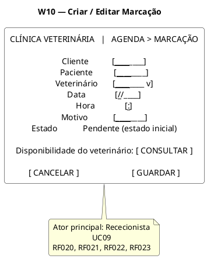

### 4.12. W11 — Detalhe da Marcação

Fonte: `W11-detalhe-marcacao.puml`

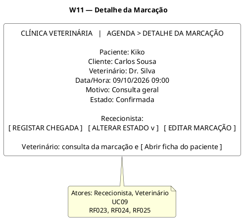

### 4.13. W12 — Preparação e Apoio à Consulta

Fonte: `W12-preparacao-consulta.puml`

```plantuml {kroki=true}
@startuml
skinparam shadowing false
skinparam roundcorner 8
skinparam defaultTextAlignment center
skinparam rectangle {
  BackgroundColor white
  BorderColor black
  FontColor black
}

title W12 — Preparação e Apoio à Consulta

rectangle "CLÍNICA VETERINÁRIA   |   APOIO À CONSULTA

CONSULTAS DISPONÍVEIS
Data: [ 09/10/2026 ]   Estado: [ Todos v ]   Pesquisar: [____________]

09:00 | Kiko | Dr. Silva | Consulta geral | Confirmada
10:00 | Lua  | Dra. Costa | Vacinação      | Confirmada

[ SELECIONAR CONSULTA ]

------------------------------------------------------------

CONSULTA SELECIONADA
Paciente: Kiko      Consulta: 09/10/2026 09:00
Veterinário: Dr. Silva

INFORMAÇÃO DE PREPARAÇÃO
- Motivo da consulta
- Dados administrativos relevantes
- Informação clínica autorizada para preparação

APOIO NÃO CLÍNICO
Notas de apoio: [____________________________________]
                [____________________________________]

[ GUARDAR INFORMAÇÃO DE APOIO ]" as SCREEN

note bottom of SCREEN
Ator: Auxiliar Veterinário
UC10
RF026, RF027
W12 é o ponto de entrada autónomo: listar -> selecionar -> preparar/apoiar
end note
@enduml
```

### 4.14. W13 — Registo e Histórico Clínico

Fonte: `W13-registo-clinico.puml`

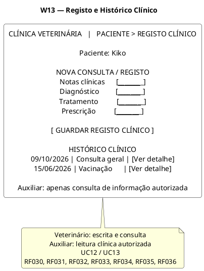

### 4.15. W14 — Contas, Custos e Valores em Dívida

**Fora do âmbito (Declaração de Âmbito v05).** O ecrã W14 pertencia a F005 — UC14 (RF037 e RF038), retirado do âmbito. O código PlantUML não é incorporado nesta versão. Mantém-se, como histórico, no ficheiro `W14-contas-dividas.puml` entregue na m2.

### 4.16. W15 — Detalhe da Conta e Pagamentos

**Fora do âmbito (Declaração de Âmbito v05).** O ecrã W15 pertencia a F005 — UC14 (RF039 a RF041), retirado do âmbito. O código PlantUML não é incorporado nesta versão. Mantém-se, como histórico, no ficheiro `W15-conta-pagamentos.puml` entregue na m2.

### 4.17. W16 — Vacinação e Desparasitação

Fonte: `W16-vacinacao.puml`

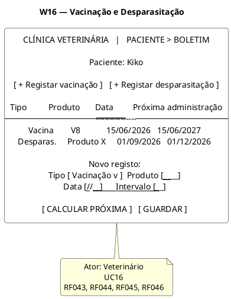

### 4.18. W17 — Painel de Internamentos

**Fora do âmbito (Declaração de Âmbito v05).** O ecrã W17 pertencia a F007 — UC18 (RF048 a RF050), retirado do âmbito. O código PlantUML não é incorporado nesta versão. Mantém-se, como histórico, no ficheiro `W17-internamentos.puml` entregue na m2.

### 4.19. W18 — Detalhe do Internamento

**Fora do âmbito (Declaração de Âmbito v05).** O ecrã W18 pertencia a F007 — UC18 (RF048 a RF052), retirado do âmbito. O código PlantUML não é incorporado nesta versão. Mantém-se, como histórico, no ficheiro `W18-detalhe-internamento.puml` entregue na m2.

### 4.20. M01 — Login Mobile

Fonte: `M01-login-mobile.puml`

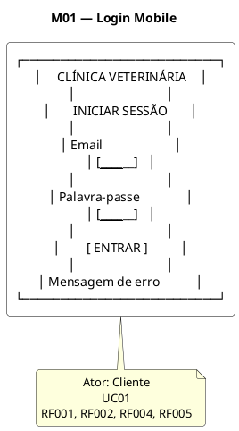

### 4.21. M02 — Os Meus Animais

Fonte: `M02-meus-animais.puml`

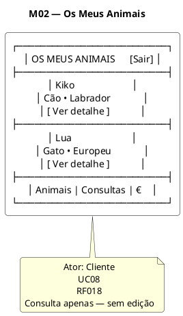

### 4.22. M03 — Detalhe do Animal

Fonte: `M03-detalhe-animal.puml`

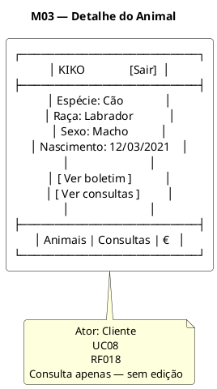

### 4.23. M04 — Consultas

Fonte: `M04-consultas.puml`

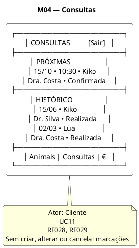

### 4.24. M05 — Despesas e Pagamentos

**Fora do âmbito (Declaração de Âmbito v05).** O ecrã M05 pertencia a F005 — UC15 (RF042), retirado do âmbito. O código PlantUML não é incorporado nesta versão. Mantém-se, como histórico, no ficheiro `M05-despesas.puml` entregue na m2.

### 4.25. M06 — Boletim de Vacinação e Desparasitação

Fonte: `M06-boletim.puml`

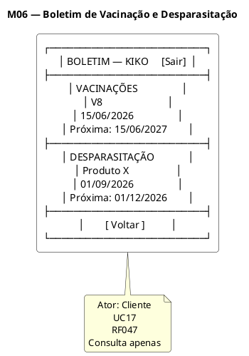
