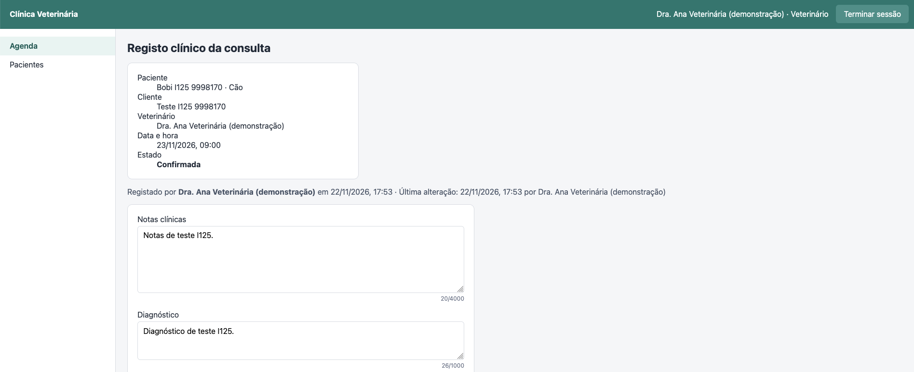
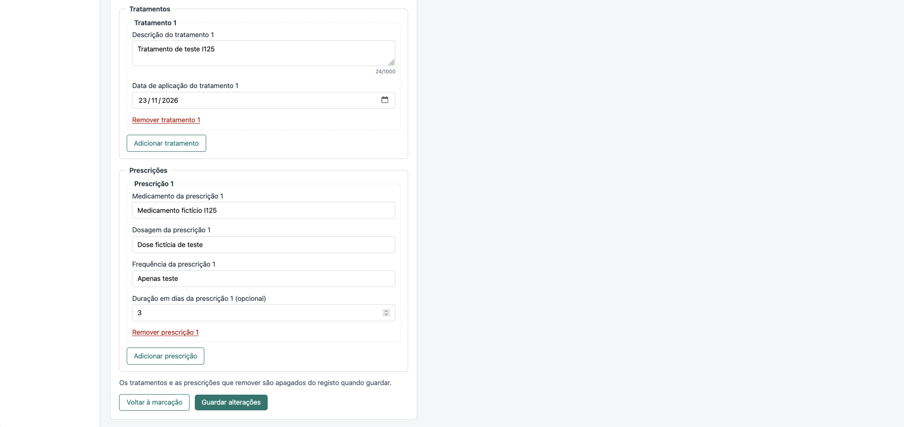
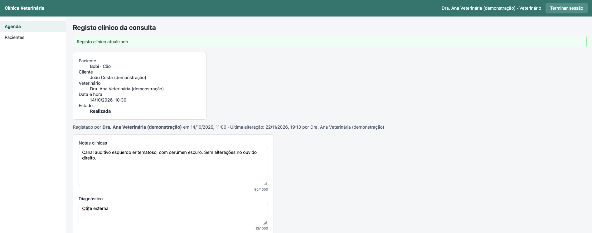
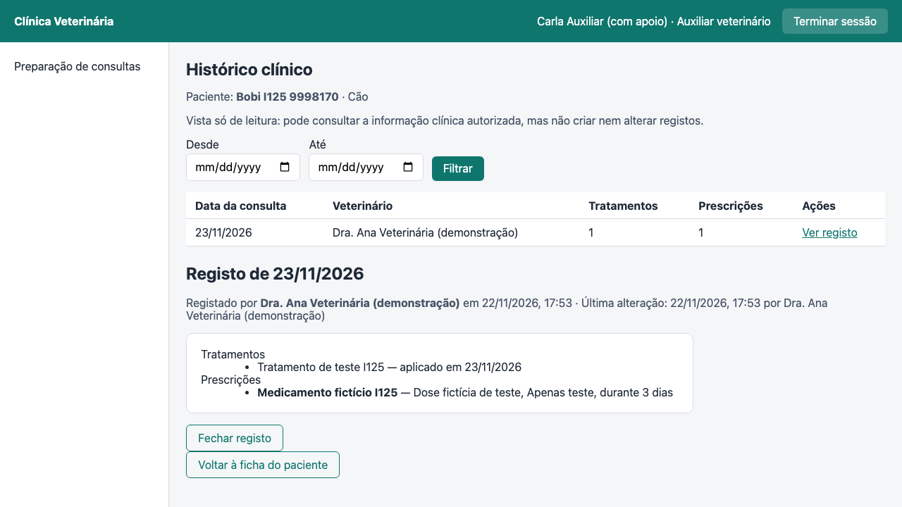
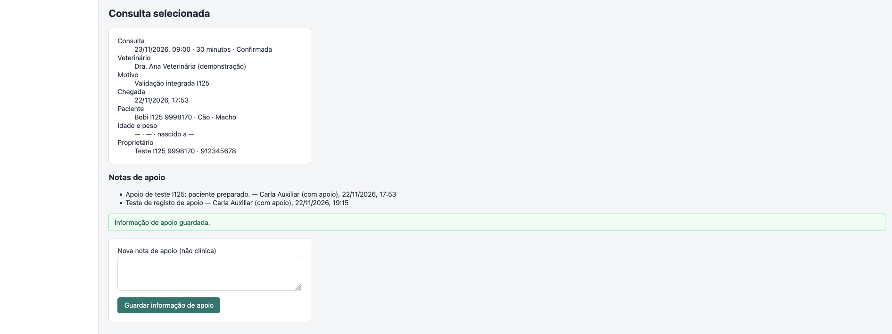
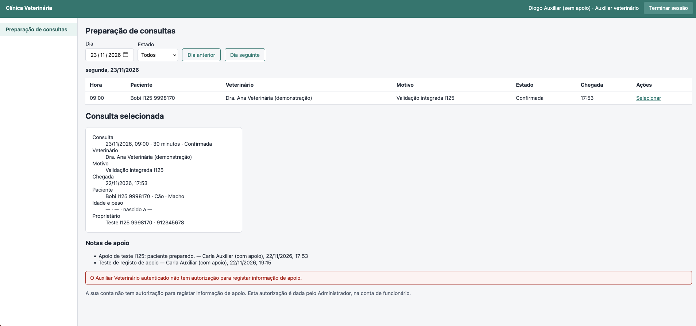
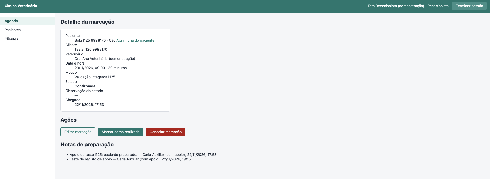
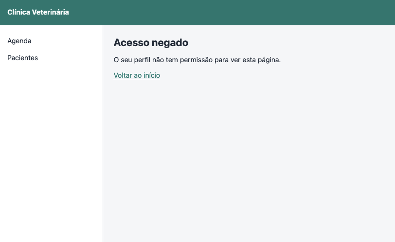
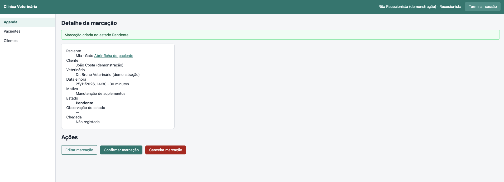
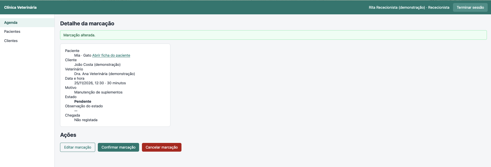

# I125 — REGISTO DOS TESTES MANUAIS DO EXECUTOR

Data dos testes: 22/11/2026. Consolidação documental: 23/11/2026, em resposta às observações do Revisor.

## ORIGEM DOS RESULTADOS

O Executor comunicou que executou com sucesso os cenários do roteiro manual apresentados abaixo. Este registo consolida os resultados comunicados; não corresponde a uma nova execução. Não foram registadas horas individuais para cada cenário. Não constitui revisão independente, auditoria ou autorização do contrato.

## AMBIENTE E DADOS DA EXECUÇÃO

Frontend local: http://localhost:5173. API: http://localhost:5159. Base SQL Server local em Docker. Palavras-passe fora do repositório. Paciente: Bobi I125 9998170, ID 2002. Consulta 2002: 23/11/2026 às 09:00. Registo clínico 1002. Os identificadores pertencem à base usada nos testes; para repetir noutra base, criar dados equivalentes e usar os novos IDs.

## 1. VETERINÁRIA ANA — REGISTO COMPLETO

Passos: iniciar sessão como vet.ana@clinica-g08.test; abrir /pacientes/2002/registo e selecionar Ver registo.

**Esperado:** notas clínicas, diagnóstico, tratamentos e prescrições visíveis; a ação de alteração continua disponível ao Veterinário.

**Resultado:** passou, conforme confirmação do Executor.

**Evidência:** capturas da Veterinária no PR #283; execução automatizada complementar em evidencias/i125-registo-clinico.png e evidencias/i125-edicao-clinica.png.

Ver capturas deste cenário

**Veterinária: notas clínicas e diagnóstico**

**Veterinária: tratamentos e prescrições**

**Atualização guardada num registo do Bobi dos dados de demonstração; consulta distinta do percurso principal**

## 2. AUXILIAR CARLA — LEITURA REDUZIDA E APOIO AUTORIZADO

Passos: terminar sessão; entrar como aux.carla@clinica-g08.test; abrir o mesmo histórico e registo. Em Preparação, selecionar o dia e a consulta e guardar uma nota não clínica identificada como teste.

**Esperado:** tratamentos/prescrições visíveis; sem diagnóstico, notas clínicas ou ação de alteração. Informação de apoio guardada com sucesso.

**Resultado:** passou, conforme confirmação do Executor.

**Evidência:** captura manual de apoio guardado no PR #283; evidência automatizada complementar em evidencias/i125-auxiliar-tratamentos-prescricoes.png.

Ver capturas deste cenário

**Evidência automatizada complementar: histórico e detalhe reduzidos do Auxiliar**

**Carla: informação de apoio guardada**

## 3. AUXILIAR DIOGO — APOIO RECUSADO

Passos: entrar como aux.diogo@clinica-g08.test e tentar guardar apoio na mesma consulta. Consultar também o histórico do paciente.

**Esperado:** recusa do registo de apoio por falta de autorização; leitura clínica reduzida disponível, sem diagnóstico nem notas clínicas.

**Resultado:** passou, conforme confirmação do Executor.

**Evidência:** captura manual de recusa no PR #283; verificação automatizada complementar em evidencias/i125-auxiliar-sem-apoio.png e evidencias/i125-verificacoes.json.

Ver capturas deste cenário

**Diogo: informação de apoio recusada**

## 4. RECECIONISTA — CONSULTA, ACESSO NEGADO E FIM DE SESSÃO

Passos: entrar como rececao@clinica-g08.test; abrir /agenda/2002; tentar /funcionarios; terminar sessão e tentar /agenda.

**Esperado:** consulta Confirmada, chegada registada e notas de preparação; acesso a Funcionários recusado; depois de terminar sessão, regressa ao login.

**Resultado:** passou, conforme confirmação do Executor.

**Evidência:** captura manual do detalhe da Rececionista no PR #283; verificação automatizada complementar em evidencias/i125-rota-sem-permissao.png, evidencias/i125-logout.png e evidencias/i125-verificacoes.json. A captura parcial “acesso_negado.png” do PR não identifica, isoladamente, o perfil nem o endereço; não é usada como prova exclusiva dessa combinação.

Ver capturas deste cenário

**Rececionista: consulta confirmada, chegada e preparação**

**Mensagem de acesso negado; captura parcial sem identificação do perfil ou endereço**

## 5. DISPONIBILIDADE — RESPOSTA ATRASADA

Passos: como Rececionista, consultar disponibilidade e mudar Veterinário/período antes de a resposta chegar. Não é necessário guardar uma marcação.

**Esperado:** não reaparecem horários da seleção anterior.

**Resultado:** passou, conforme confirmação global do Executor sobre o roteiro. Sem captura manual específica desse momento. Há dois testes de regressão em src/frontend/src/pages/agenda/agenda.test.tsx que cobrem as duas mudanças.

## LOCALIZAÇÃO DAS EVIDÊNCIAS

Os caminhos evidencias/... acima são internos ao ficheiro m4-i125-evidencias-v01.zip, nesta mesma pasta. As capturas manuais anexadas pelo Executor estão no PR: https://github.com/LEI-LDS-2026-2027-G08/LEI-Grupo-de-LDS-UTPORTO/pull/283 O roteiro dos restantes fluxos e resultados está em [m4-i125-roteiro-resultados-v01.md](m4-i125-roteiro-resultados-v01.md).

## ESTADO DA ENTREGA

O trabalho foi publicado pelo Executor nos commits 16c8513 e f54d2de e submetido no PR #283. O Executor comunicou que as verificações automáticas foram aprovadas; essa informação não substitui a consulta do estado do PR após futuras alterações.

## PENDÊNCIAS DE ACEITAÇÃO

CA 4: falta arquivar a referência formal da decisão/autorização aplicável à alteração do contrato. O acordo do grupo comunicado pelo Executor não é apresentado como essa autorização. Revisão e auditoria não são declaradas concluídas. A organização dos DTOs foi alinhada com o namespace `RegistosClinicos`, e os finais de linha dos ficheiros do backend foram repostos em LF, como na base de origem. A base do `develop`, incluindo I118 e I123, foi integrada no commit `4b22f3f`. Os ZIP antigos continuam pendentes de regeneração a partir do commit de código identificado para a entrega.

## TESTES ADICIONAIS DE MARCAÇÕES

As capturas seguintes correspondem à marcação da Mia e não à consulta do Bobi I125.

Ver criação e alteração da marcação

