# I127 — Roteiro e resultados do Executor — v01

Data dos testes manuais e das capturas: 23/11/2026. Consolidação e verificações automáticas: 23/11/2026.

Issue: [I127 — #115](https://github.com/LEI-LDS-2026-2027-G08/LEI-Grupo-de-LDS-UTPORTO/issues/115). Código de referência: `4b82347dcacaf9e8b082b6675911b42d51f9efae`.

Estado: preparado pelo Executor para revisão. Não constitui revisão independente, auditoria ou autorização de integração.

## 1. Âmbito e origem dos resultados

Foram validados os fluxos do Cliente: início de sessão, animais, detalhe, boletim, próximas consultas, histórico administrativo e mudança de conta, contra os backends local e público.

O Executor confirmou que executou os fluxos com João e Maria nos dois ambientes. Confirmou expressamente que as capturas das 00:18–00:20 são locais, que as das 00:37 são do Azure e que também testou a Maria no Android com Azure e o Histórico com os dois Clientes nos dois ambientes.

As capturas foram inspecionadas nesta consolidação. Não se apresenta essa inspeção como uma nova execução da interface. Não foram inventadas horas para os passos sem captura. As verificações automáticas são identificadas separadamente.

Canal: aplicação Android em emulador. Dispositivo Android físico: não comprovado nesta entrega; era uma possibilidade, não uma condição obrigatória. Despesas/I124, pagamentos e internamentos: fora do âmbito, conforme o [Plano de Testes Mobile v01](../../../03-artefactos-de-qualidade-de-produto/03.03-frontend-mobile/03.03.01-plano-de-testes/m4-plano-testes-frontend-mobile-v01.md).

## 2. Preparação reproduzível

1. Usar a aplicação do commit identificado, Android SDK 37 e o JDK previsto no projeto. Configurar o endereço conforme o [README](README.md).
2. No ambiente local, iniciar SQL Server e a API na porta 5159. Docker a correr, por si só, não inicia a API.
3. Usar as contas de Cliente João e Maria, com credenciais disponibilizadas por meio privado. João tem Bobi e Mia; Maria tem Kiko.
4. Para testar uma lista com próximas consultas, preparar pela Receção uma marcação futura para cada Cliente. As capturas locais mostram Bobi em 30/11/2026 às 09:00 e Kiko às 09:30, com a Veterinária Ana.
5. No Azure, confirmar a existência dos dados desse ambiente. Os dados locais não são transferidos automaticamente para o Azure.
6. Terminar sessão, instalar a configuração do ambiente pretendido e conferir a URL no ecrã técnico de debug. Não reutilizar tokens de outro ambiente.

## 3. Roteiro executado

Repetir os passos seguintes primeiro com João e depois com Maria, em cada ambiente. Os resultados abaixo foram confirmados pelo Executor; a coluna de capturas identifica apenas o que é visível nas imagens disponíveis.

| Passo | Ação e resultado esperado | Local | Público | Evidência visual disponível |
|---|---|---|---|---|
| 1 | Iniciar sessão com a conta de Cliente; abrir a área autenticada | Passou, João e Maria | Passou, João e Maria | Área autenticada nas capturas; não há captura do formulário de login |
| 2 | Abrir Animais; cada Cliente vê os seus animais | Passou: João/Bobi/Mia; Maria/Kiko | Passou, confirmado pelo Executor | Local: ambos; Azure: João na app e ambas as listas na API |
| 3 | Abrir o detalhe de um animal; conferir nome, espécie, raça, sexo, idade e peso | Passou, ambos | Passou, ambos | Local: Bobi e Kiko; Azure: Bobi |
| 4 | Abrir o boletim; conferir histórico e próximas administrações, incluindo lista vazia | Passou, ambos | Passou, ambos | Local: Bobi e Kiko; Azure: Bobi |
| 5 | Abrir Consultas pelo animal e pelo separador geral; conferir Próximas e o filtro | Passou, ambos | Passou, ambos | Local: próxima do Bobi e próxima do Kiko; Azure: Bobi sem próximas |
| 6 | Abrir Histórico; conferir apenas informação administrativa e animais do Cliente | Passou, ambos | Passou, ambos | Confirmado pelo Executor; sem captura deste separador |
| 7 | Terminar sessão e entrar com o outro Cliente; conferir a mudança dos dados apresentados | Passou | Passou | Sequência local João → Maria e confirmação do Executor nos dois ambientes |

O histórico aqui referido é o histórico administrativo das consultas do Cliente (RF029). Não é o registo clínico reservado aos perfis internos.

## 4. Isolamento entre Clientes

João apresenta Bobi e Mia; Maria apresenta Kiko. A mudança de conta foi confirmada nos dois ambientes. No Azure, as duas capturas do Swagger mostram respostas `200` diferentes para a mesma rota `/me/animais`, de acordo com o Cliente autenticado.

O formulário de autenticação, o token e as palavras-passe não constam das imagens selecionadas. A resposta a tentativas de acesso direto a animais de outro Cliente, quando verificada por pedidos à API, é documentada nas verificações automáticas; não se confunde com uma interação executada no Android.

Na verificação direta da API pública desta consolidação, os pedidos de detalhe, boletim e consultas de um animal da outra conta devolveram `403`, para ambos os Clientes. Esta evidência complementar confirma a restrição no servidor.

## 5. Capturas locais

João — animais, detalhe e boletim

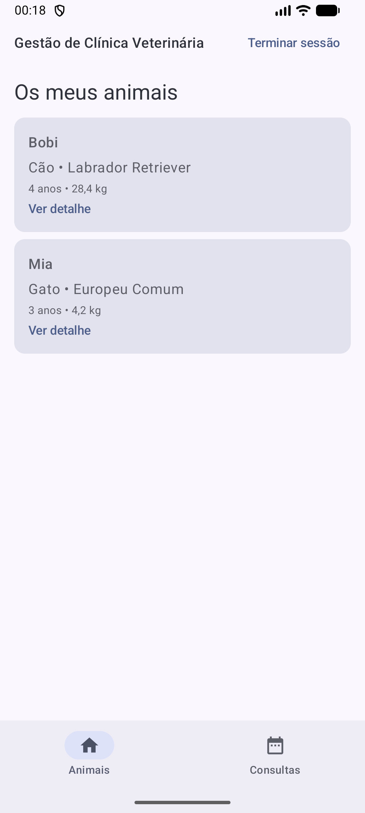
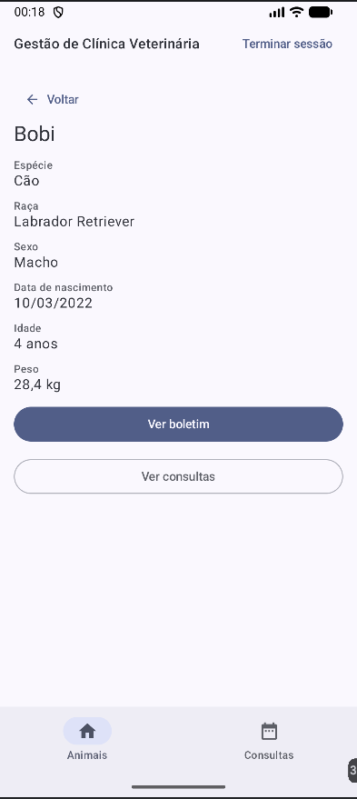
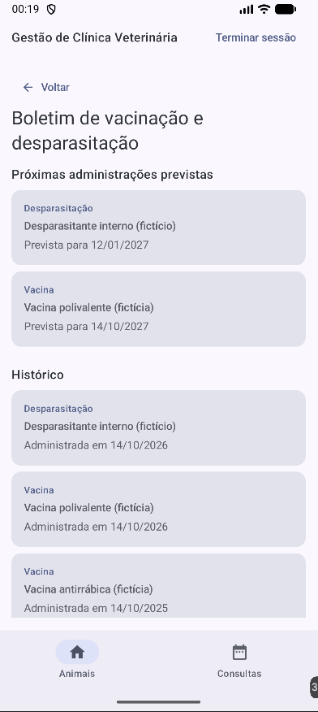

João — próxima consulta do Bobi

Marcação pendente de 30/11/2026 às 09:00, com a Veterinária Ana, filtrada pelo Bobi.

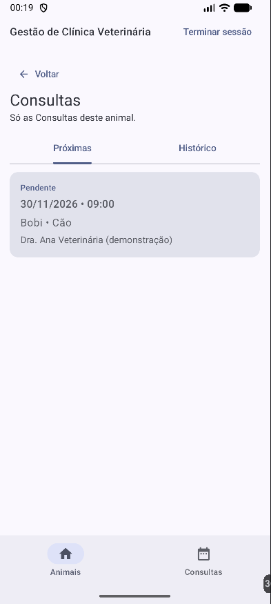

Maria — Kiko, detalhe e boletim

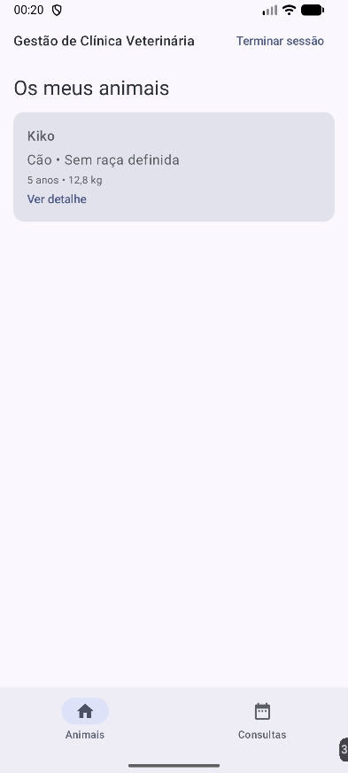
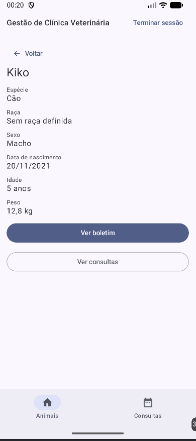
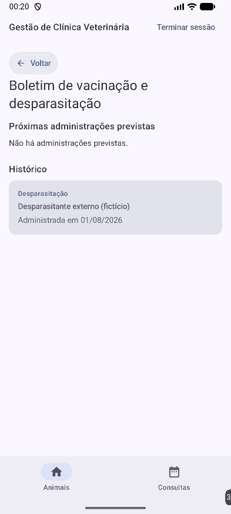

Maria — próxima consulta do Kiko

Marcação pendente de 30/11/2026 às 09:30, com a Veterinária Ana, no separador geral de Consultas.

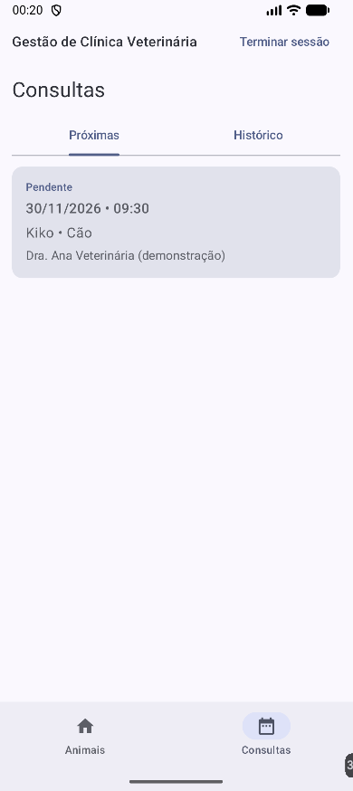

## 6. Capturas do ambiente público

API pública — animais de João e de Maria

As imagens identificam a URL pública e o resultado `200` de `/me/animais`. São evidência complementar da API, não da interface Android.

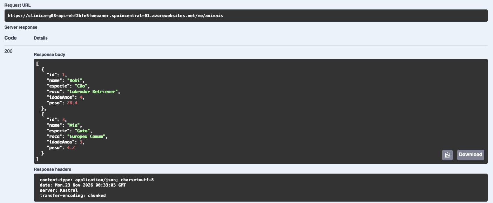
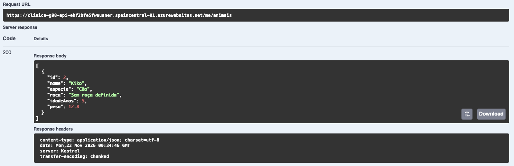

Android com Azure — João, detalhe e boletim do Bobi

A identificação deste ambiente foi confirmada pelo Executor; a URL não aparece nestes ecrãs.

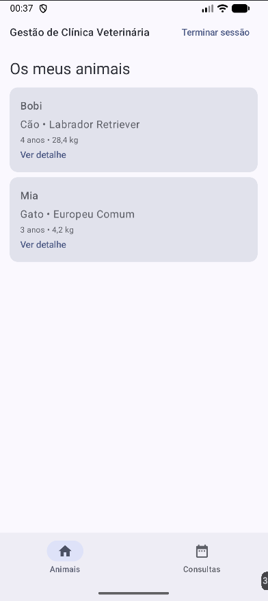

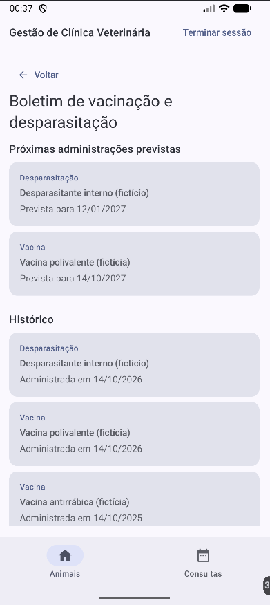

Android com Azure — próximas consultas vazias

A aplicação apresenta «Este animal não tem Consultas marcadas.». A lista vazia não prova uma falha de comunicação nem uma falha SQL. Nesta evidência não é demonstrada uma consulta futura existente no Azure.

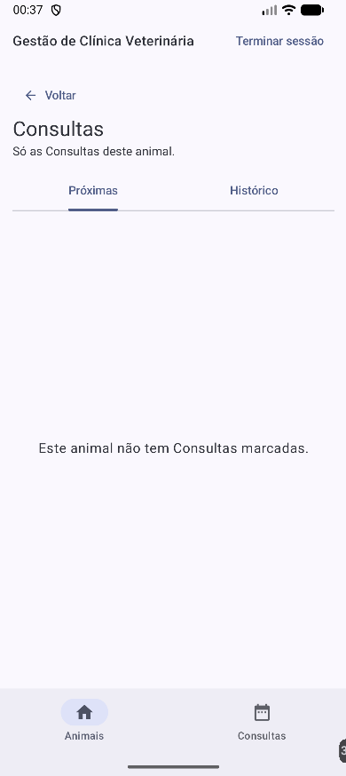

## 7. Critérios de aceitação e passagem à revisão

| Critério | Evidência e estado |
|---|---|
| CA1 — fluxos local e público | Confirmados pelo Executor na matriz; capturas ligadas aos fluxos. Limitações visuais identificadas, sem atribuir imagens inexistentes à Maria no Android público ou ao Histórico. |
| CA2 — ambientes por configuração | Propriedade Gradle `apiBaseUrl`; compilação nos dois ambientes e reposição da configuração local, documentadas nas verificações automáticas. |
| CA3 — dois Clientes e dados próprios | João e Maria nos dois ambientes, confirmação do Executor, capturas locais e listas públicas diferentes. |
| CA4 — defeitos com origem e decisão | Consultar o registo de ocorrências. Não é declarada uma Issue de defeito que não tenha sido criada. |

O Revisor deve repetir os fluxos com contas diferentes das do Executor e nos dois ambientes. A auditoria e a aceitação final seguem o processo do grupo. Os resultados aqui registados não substituem essas verificações.
