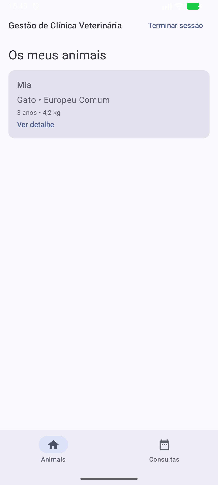

# I137 — Relatório do Executor — v01

Atualizado em 25/11/2026, após as correções da revisão. Issue: [I137 — GitHub #125](https://github.com/LEI-LDS-2026-2027-G08/LEI-Grupo-de-LDS-UTPORTO/issues/125).

Estado: implementação e verificação local preparadas para revisão. A pipeline, a revisão independente, a auditoria e a integração não são declaradas aprovadas.

## 1. Resultado produzido

Foram implementados os **18 cenários atribuídos à I137** na secção 13.1 da Especificação de Testes de Sistema Mobile v01 (I136): F001-01 a F001-04, F002-01 a F002-04, F003-01 a F003-06 e F006-01 a F006-04. Os outros 12 cenários são da I138. Despesas/I124 estão fora do âmbito documental do projeto.

- [Matriz cenário ↔ método ↔ requisitos](m4-i137-matriz-cenarios-testes-v01.md).
- [Guia de execução e preparação](../../../src/frontend-mobile/tests/sistema/README.md).
- [Classe de testes instrumentados](../../../src/frontend-mobile/app/src/androidTest/java/pt/ipp/estg/g08/clinica/sistema/FluxosClienteSistemaTest.kt).
- [Workflow da pipeline](../../../.github/workflows/mobile-sistema.yml).

Cada teste abre a interface Compose no emulador e faz pedidos à API real. O script cria uma API e um contentor SQL descartáveis. Antes de cada cenário, repõe a base e cria pela API os dados PD-01 a PD-04. As contas e as credenciais são geradas para a base de teste; não se usam as palavras-passe privadas do grupo ou o Azure.

O contentor da base habitual do utilizador não foi usado. Os serviços de teste foram terminados no fim e o emulador iniciado para esta verificação foi fechado.

## 2. Identificação do código verificado

Base Git das execuções mais recentes: `80e81da5a3293e10b09260d78442ad268be22c6e`.

Os cenários, o workflow e a primeira entrega já constam desse commit. As correções de portabilidade pedidas na revisão ainda eram alterações locais durante estas execuções. A versão verificada está identificada pelas somas SHA-256 de 117 ficheiros relevantes em [m4-i137-fontes-executadas-v01.json](m4-i137-fontes-executadas-v01.json).

A revisão comunicou quatro problemas no Windows: escolha de `gradlew` em vez de `gradlew.bat`; uso de `os.killpg` e `SIGKILL`; falta dos dados de `Europe/Lisbon`; guia sem instruções para Windows. Foram corrigidos no orquestrador e no guia. No Windows, a limpeza usa `taskkill /PID ... /T /F`; uma falha numa etapa não impede a tentativa das restantes e é registada em `erros_limpeza`. O fuso é verificado antes de criar recursos; o guia indica a instalação de `tzdata` com o mesmo Python dos testes. A descoberta do SDK inclui `%LOCALAPPDATA%\Android\Sdk` e os executáveis `.exe`.

Foram aprovados 11 testes de regressão do orquestrador e três da atualização segura do arquivo. Incluem a falta de `tzdata` antes de criar recursos, a chamada ao wrapper Windows, a terminação por PID e a continuação da limpeza quando a API falha. Estes testes foram executados no macOS com processos simulados para os ramos Windows; **não demonstram a execução completa em Windows**. Essa confirmação continua a cargo do Revisor, num clone limpo e sem o adaptador referido na revisão.

O problema anterior de localização do SDK no terminal do macOS foi corrigido e verificado em 23/11/2026. As duas execuções mais recentes, `37a6c5d4af4a`, repetiram a suite completa em 25/11/2026 depois das correções de portabilidade.

O Executor deve guardar a correção e estas evidências em commit e voltar a executar `arquivar.py`. As fontes de entrega existentes continuam a identificar o commit anterior até essa exportação; não foram substituídas por fontes sem commit. O script só atualiza uma cópia anterior se ainda corresponder ao manifesto de integridade, preservando edições manuais. Depois é necessário guardar a atualização das fontes e do manifesto em commit.

## 3. Duas execuções completas consecutivas

Ambiente observado: macOS, emulador Android 17/API 37 ARM64 sem janela, fuso `Europe/Lisbon`, animações desligadas, API .NET 10 e SQL Server 2025 em contentor exclusivo. As duas execuções de 25/11/2026 usaram o mesmo código da aplicação e do orquestrador, sem alteração entre elas. A limpeza terminou sem erros.

Comando executado na pasta `src/frontend-mobile`:

```sh
env -u ANDROID_HOME -u ANDROID_SDK_ROOT JAVA_HOME="/Applications/Android Studio.app/Contents/jbr/Contents/Home" python3 tests/sistema/executar.py
```

O próprio script iniciou o emulador sem janela e fechou-o no fim. A localização do SDK foi descoberta pela configuração predefinida do macOS e transmitida ao Gradle pelo script.

| Execução | Testes | Falhas | Erros | Ignorados | Resultado Gradle |
|---|---:|---:|---:|---:|---|
| 1 | 18 | 0 | 0 | 0 | Aprovada, 3m 43s |
| 2 | 18 | 0 | 0 | 0 | Aprovada, 2m 11s |

Evidências:

- [Resumo das duas execuções](m4-i137-resultados-execucoes-v01.json).
- [Registo da execução 1](evidencias-i137/execucao-1/registo-gradle.md).
- [Registo da execução 2](evidencias-i137/execucao-2/registo-gradle.md).
- Relatórios JUnit nas mesmas pastas, com os identificadores dos 18 métodos.

Não houve falhas intermitentes nestas duas execuções completas da versão final local. Os ensaios de desenvolvimento anteriores não são apresentados como execuções aprovadas.

## 4. Falha controlada e captura

Depois das duas execuções iniciais aprovadas, antes da correção da localização do SDK, foi alterado temporariamente o serviço de animais para omitir o Bobi da lista devolvida pela API. Foi executado apenas ST-MOB-F001-01: o teste falhou como esperado, por faltar o Bobi, e guardou a captura com o identificador do cenário.

O ficheiro original foi reposto byte a byte e a soma SHA-256 foi conferida. A alteração temporária não integra a entrega. Esta verificação do Executor não substitui a quebra de um fluxo e a execução independente exigidas ao Revisor.

[Registo da falha controlada e da reposição](m4-i137-falha-controlada-v01.json).

<details>
<summary>Falha induzida: Bobi omitido, apenas Mia visível</summary>

Esta imagem corresponde à falha deliberadamente introduzida, não a um resultado aprovado nem a um defeito deixado na aplicação.



</details>

## 5. Verificações complementares

Na verificação complementar de 23/11/2026, depois de repor o código, foram executados `testDebugUnitTest`, `ktlintCheck`, `lintDebug` e `assembleDebug`. Resultado: `BUILD SUCCESSFUL in 17s`; **166 testes unitários e de componentes aprovados, sem falhas, erros ou ignorados**. Nessa verificação, a compilação repôs a predefinição local `http://10.0.2.2:5159`; não foi instalada num dispositivo nesta etapa.

As dependências de teste foram atualizadas para AndroidX JUnit 1.3.0 e Espresso 3.7.0 devido à incompatibilidade reproduzida de Espresso 3.5.1 com a API 37 (`InputManager.getInstance`). [Notas oficiais do AndroidX Test](https://developer.android.com/jetpack/androidx/releases/test).

Em 25/11/2026, passaram os [14 testes de regressão do orquestrador e do arquivo](evidencias-i137/regressoes-orquestrador.md). A execução completa em Windows não foi observada nesta sessão.

O YAML do workflow foi analisado localmente. Os passos de interação usam espera por condições (`waitUntil`); não foram introduzidas pausas fixas. As capturas são guardadas fora do diretório privado do APK para sobreviverem à desinstalação automática do teste, e recolhidas pelo script.

## 6. Critérios de aceitação e pendências

| Critério | Estado desta entrega |
|---|---|
| CA1 — cenários automatizados e identificados | 18/18 dos atribuídos à I137 na I136; matriz arquivada. I138 mantém os outros 12. |
| CA2 — emulador sem interface, local e pipeline, backend isolado | Verificado em macOS. O Revisor comunicou pipeline verde na primeira entrega. **Nova execução da pipeline e repetição completa em Windows pendentes após estas correções.** |
| CA3 — independência, espera e captura de falhas | Base e sessão repostas por cenário, dados preparados pela API, espera por condições; captura comprovada no ensaio de falha controlada. |
| CA4 — duas execuções completas consecutivas | Cumprido localmente: 18/18 nas duas execuções. |

Para concluir a entrega: commit das fontes testadas e documentos; geração do arquivo das fontes a partir desse commit; submissão do PR; confirmação da pipeline; revisão em clone limpo duas vezes e falha provocada pelo Revisor; auditoria e aceitação conforme o processo do grupo.
