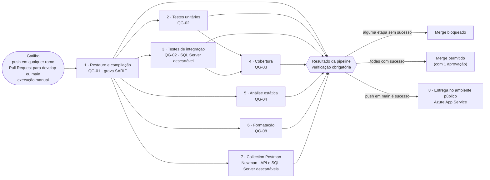

# Descrição da Pipeline de CI/CD do Backend — Gestão de Clínica Veterinária

| Campo | Valor |
|---|---|
| Grupo | G08 |
| Projeto | Gestão de Clínica Veterinária |
| Artefacto | Descrição da pipeline de CI/CD do backend |
| Ficheiro | `m3-descricao-pipeline-ci-cd-v01.md` |
| Versão | v01 |
| Milestone | m3 |
| Issue | I036 — Documentar a pipeline CI/CD do backend (GitHub #65) |
| Sprint | S05 |
| Executor | André Filipe Moreira Mesquita |
| Revisor | Ivan Cristiano Silva Mendes |
| Auditor | Gonçalo Dinis Magalhães Teixeira |
| Pipeline descrita | `.github/workflows/backend-ci.yml`, versão m3-v03 (último commit que a alterou: `c336e62`, I104), em `develop` no commit `df5b5f2` (2026-11-04) |
| Pasta | `/projeto/04-artefactos-tecnicos/04.16-ci-cd` |

## Histórico de versões

| Versão | Data | Autor | Descrição |
|---|---|---|---|
| v01 | 2026-11-04 | André Filipe Moreira Mesquita | Versão inicial: gatilhos, ambientes, etapas (finalidade, entradas, saídas e condição de falha), quality gates, artefactos, bloqueio do merge, tratamento de falhas, gestão de credenciais, diagrama em Mermaid, execução num ramo novo e replicação noutro repositório. |

---

## 1. Objetivo e âmbito

Este documento explica a pipeline do backend a qualquer elemento do grupo, para a compreender, manter e demonstrar na defesa: quando corre, o que faz cada etapa, que limites aplica, que artefactos produz, quando bloqueia o merge, o que fazer quando falha, onde estão as credenciais e como replicá-la noutro repositório.

A pipeline foi construída em três tarefas. Cada uma tem uma pasta própria em `04.16-ci-cd`, com a cópia dos ficheiros e o README dessa versão:

| Versão | Tarefa | O que acrescentou | Pasta |
|---|---|---|---|
| m3-v01 | I102 — pipeline de compilação e testes | Etapas 1 a 3, relatório de cobertura e a verificação «Resultado da pipeline» | `m3-v01` |
| m3-v02 | I103 — análise estática, cobertura e quality gates | Limiar de cobertura (QG-03), análise estática (QG-04), formatação (QG-08), Collection Postman (etapa 7) e o ficheiro `.github/quality-gates.json` | `m3-v02` |
| m3-v03 | I104 — ambiente público com entrega contínua | Etapa 8, entrega no Azure App Service | `m3-v03` |

Este documento descreve a versão **m3-v03**, a que está em `develop`. Se o workflow mudar, este documento passa a uma nova versão.

Há um segundo workflow no repositório, `integration-tests.yml`, da I062, que **não faz parte desta pipeline** nem bloqueia o merge (secção 11).

## 2. Visão geral e diagrama



Cada caixa é um *job* do GitHub Actions, com runner próprio e resultado visível no separador *Actions* e na lista de verificações do Pull Request. Depois da etapa 1, as etapas 2, 3, 5, 6 e 7 correm em paralelo. A etapa 4 espera pelos dois tipos de testes. O «Resultado da pipeline» espera pelas sete etapas.

Tempos de referência, na execução #184 (`develop`, commit `df5b5f2`, 2026-11-04, [ligação](https://github.com/LEI-LDS-2026-2027-G08/LEI-Grupo-de-LDS-UTPORTO/actions/runs/41748757482)):

| Etapa | Duração | Limite (`timeout-minutes`) |
|---|---|---|
| 1 · Restauro e compilação | 40 s | 10 min |
| 2 · Testes unitários | 46 s | 10 min |
| 3 · Testes de integração | 3 min 41 s | 15 min |
| 4 · Cobertura | 16 s | 10 min |
| 5 · Análise estática | 7 s | 5 min |
| 6 · Formatação | 50 s | 10 min |
| 7 · Collection Postman | 1 min 31 s | 20 min |
| Resultado da pipeline | 3 s | 5 min |
| 8 · Entrega | *skipped* (push em `develop`) | 20 min |
| **Total** (do início ao fim da execução) | **4 min 52 s** | — |

## 3. Gatilhos e concorrência

| Gatilho | Configuração no workflow | Finalidade |
|---|---|---|
| Push para qualquer ramo | `push: branches: ["**"]` | Verificar cada commit, incluindo os ramos de trabalho (critério 1 da I102) |
| Pull Request para `develop` ou `main` | `pull_request: branches: [develop, main]` | Produzir a verificação obrigatória que decide o merge |
| Manual | `workflow_dispatch` (*Actions → Backend CI → Run workflow*) | Repetir uma verificação ou recolher evidências |

- **Sem filtro de caminhos.** A pipeline corre em todos os Pull Requests, mesmo nos que só alteram documentos. Com um filtro, um Pull Request sem alterações no backend ficaria à espera de uma verificação obrigatória que nunca correria.
- **Duas execuções por push num Pull Request.** Um push num ramo com Pull Request aberto dispara o evento `push` e o evento `pull_request`. A proteção dos ramos usa o resultado do Pull Request.
- **Concorrência.** Uma nova execução no mesmo Pull Request ou ramo de trabalho cancela a anterior, que já está desatualizada (`cancel-in-progress`). Em `develop` e `main` nenhuma execução é cancelada, para ficar o resultado de cada integração. A etapa 8 tem um grupo próprio (`entrega-avaliacao`), com uma entrega de cada vez e sem cancelamentos.

## 4. Ambientes

| Ambiente | Onde | Para quê | Duração |
|---|---|---|---|
| Runner GitHub | `ubuntu-latest`, um por etapa | Todas as etapas | Destruído no fim de cada etapa |
| .NET | SDK `10.0.x` (última 10.0), instalado pela ação `preparar-dotnet`; o `src/backend/global.json` pede `10.0.100` com `rollForward: latestFeature` | Compilar, testar e publicar | Por etapa (os pacotes NuGet ficam em cache entre execuções) |
| SQL Server dos testes de integração | Um contentor SQL Server 2025 por classe de testes, criado pelo Testcontainers (infraestrutura da I091) | Etapa 3 | Destruído no fim de cada classe; a etapa confirma que não ficou nenhum |
| SQL Server da Collection Postman | Contentor `sql-newman-ci`, imagem `mcr.microsoft.com/mssql/server:2025-CU9-ubuntu-22.04`, base `ClinicaVeterinaria_CI` | Etapa 7 | Destruído no último passo da etapa, mesmo com falha |
| API da Collection Postman | API compilada na própria etapa, ambiente `Development`, em `http://localhost:5159` dentro do runner | Etapa 7 | Parada no último passo da etapa |
| Ambiente público de avaliação | Ambiente GitHub `avaliacao` → Azure App Service `clinica-g08-api` (Linux, Free F1) e Azure SQL `clinica-g08-avaliacao` | Etapa 8 | Permanente (`04.16-ci-cd/m3-v03/README.md`, secção 2) |

Nenhuma etapa usa uma base de dados de um elemento do grupo nem a base pública, exceto a etapa 8, que só publica a API (as migrações são aplicadas pela própria API ao arrancar).

## 5. Etapas

As secções seguintes descrevem cada etapa com a sua finalidade, entradas, saídas e condição de falha (critério 1). Todas começam por obter o código do commit (`actions/checkout`, sem guardar credenciais) e a maioria prepara o .NET com a ação local `.github/actions/preparar-dotnet` (SDK e cache NuGet). Cada etapa escreve uma tabela no separador *Summary* da execução.

### 5.1. Etapa 1 · Restauro e compilação (QG-01) — job `compilacao`

| Elemento | Descrição |
|---|---|
| Finalidade | Garantir que a solução restaura e compila em `Release` sem erros nem avisos, e produzir os relatórios da análise estática |
| Depende de | — (primeira etapa) |
| Entradas | Código do commit; `src/backend/ClinicaVeterinaria.sln`; `Directory.Build.props` e `.editorconfig` da I101 (análise `Recommended`, `TreatWarningsAsErrors`, `EnforceCodeStyleInBuild`) |
| Comandos | `dotnet restore`; `dotnet build --configuration Release --no-restore -p:ContinuousIntegrationBuild=true -p:PastaRelatoriosAnalise=…` |
| Saídas | Artefacto `relatorio-analise-estatica-sarif` (um ficheiro SARIF 2.1 por projeto), publicado mesmo com falha, para mostrar o que bloqueou |
| Condição de falha | Erro de restauro, erro de compilação ou **qualquer aviso** do compilador ou dos analisadores (os avisos são tratados como erros) |

### 5.2. Etapa 2 · Testes unitários (QG-02) — job `testes-unitarios`

| Elemento | Descrição |
|---|---|
| Finalidade | Executar os testes unitários e recolher a cobertura |
| Depende de | Etapa 1 |
| Entradas | `ClinicaVeterinaria.UnitTests` |
| Comandos | `dotnet build` do projeto de testes; `dotnet test --configuration Release --no-build --logger trx --collect:"XPlat Code Coverage" --blame-hang-timeout 5m` |
| Saídas | Artefacto `resultados-testes-unitarios` (`testes-unitarios.trx` e `coverage.cobertura.xml`); tabela no resumo com os testes executados, aprovados, falhados e não executados (script `resumo-testes.py`, só informativo) |
| Condição de falha | Um teste falha (código de saída do `dotnet test`) ou um teste fica bloqueado mais de 5 minutos |

### 5.3. Etapa 3 · Testes de integração (QG-02) — job `testes-integracao`

| Elemento | Descrição |
|---|---|
| Finalidade | Executar os testes de integração da API contra um SQL Server 2025 real e descartável |
| Depende de | Etapa 1 |
| Entradas | `ClinicaVeterinaria.IntegrationTests`; Docker do runner; migrações (I062) e dados de demonstração (I061), aplicados pela `IntegracaoFixture` (I091) |
| Comandos | Confirmar o Docker; `dotnet build`; `dotnet test` com TRX, cobertura e `--blame-hang-timeout 10m`; contar os contentores SQL Server do Testcontainers que ainda existem |
| Saídas | Artefacto `resultados-testes-integracao` (`testes-integracao.trx` e `coverage.cobertura.xml`); tabela de resultados e número de contentores por destruir no resumo |
| Condição de falha | Um teste falha, um teste fica bloqueado mais de 10 minutos, ou fica algum contentor SQL Server dos testes por destruir |

### 5.4. Etapa 4 · Cobertura (QG-03) — job `cobertura`

| Elemento | Descrição |
|---|---|
| Finalidade | Juntar a cobertura dos testes unitários e de integração, gerar os relatórios e aplicar o limiar de cobertura de linhas |
| Depende de | Etapas 2 e 3 (corre mesmo que falhem, exceto se a execução for cancelada) |
| Entradas | Artefactos `resultados-testes-*`; código (para o relatório HTML mostrar as linhas); `.github/quality-gates.json` (secção `QG-03`); ReportGenerator 5.5.11 |
| Comandos | Relatório completo (todas as camadas exceto os testes, informativo); `gate-cobertura.py filtros` (lê o âmbito); relatório do âmbito do QG-03; `gate-cobertura.py avaliar` (compara com o limiar) |
| Saídas | Artefacto `relatorio-cobertura` (HTML, `Cobertura.xml`, `Summary.txt` e `SummaryGithub.md`, completo e na subpasta `qg-03`); no resumo, a cobertura de linhas, a de ramos (informativa) e as 10 classes com menor cobertura |
| Condição de falha | Cobertura de linhas no âmbito do QG-03 **abaixo de 70%**; ou testes com sucesso mas sem nenhum `coverage.cobertura.xml`. Se os testes falharem, a cobertura não é avaliada e a etapa termina com sucesso, porque o merge já fica bloqueado pelas etapas 2 ou 3 |

### 5.5. Etapa 5 · Análise estática (QG-04) — job `analise-estatica`

| Elemento | Descrição |
|---|---|
| Finalidade | Contar as ocorrências da análise estática Roslyn e publicar um relatório legível |
| Depende de | Etapa 1 (corre também quando a etapa 1 falha, para mostrar o que bloqueou) |
| Entradas | Artefacto `relatorio-analise-estatica-sarif`; `.github/quality-gates.json` (secção `QG-04`) |
| Comandos | `gate-analise-estatica.py <config> <pasta SARIF> <relatório.md>` |
| Saídas | Artefacto `relatorio-analise-estatica` (SARIF e `relatorio-analise-estatica.md`, com regra, ficheiro e linha de cada ocorrência) |
| Condição de falha | Mais de **0** ocorrências não suprimidas de nível `error` ou `warning`, ou nenhum relatório SARIF encontrado |

### 5.6. Etapa 6 · Formatação (QG-08) — job `formatacao`

| Elemento | Descrição |
|---|---|
| Finalidade | Confirmar que o código respeita as regras de formatação do `.editorconfig` |
| Depende de | Etapa 1 |
| Entradas | Código; `.editorconfig` (`end_of_line = crlf`); `.github/quality-gates.json` (secção `QG-08`) |
| Comandos | Conversão da cópia de trabalho para CRLF (o repositório guarda LF e o Git converte para CRLF nos computadores Windows do grupo, por isso o runner verifica o mesmo que um computador do grupo); `dotnet format --verify-no-changes --report` |
| Saídas | Artefacto `relatorio-formatacao` (`format-report.json`); no resumo, os ficheiros por formatar e o primeiro problema de cada um |
| Condição de falha | Mais de **0** ficheiros por formatar, ou o `dotnet format` terminar com erro e sem relatório |

### 5.7. Etapa 7 · Collection Postman (Newman) — job `newman`

| Elemento | Descrição |
|---|---|
| Finalidade | Executar a Collection Postman completa contra a API compilada nesse commit, com uma base de dados nova e os dados de demonstração |
| Depende de | Etapa 1 |
| Entradas | API; `dotnet-ef` 10.0.13; imagem SQL Server 2025 CU9; dados da I061 (`04.13-scripts-de-base-de-dados/m3-v02/dados-demonstracao`); collection e ambiente de `03.01.05-postman`; Newman 6.2.1; tudo indicado na secção `Newman` de `.github/quality-gates.json` |
| Comandos | Gerar as credenciais da execução (secção 8); arrancar o SQL Server; aplicar as migrações (`dotnet ef database update`); carregar os dados (`executar-dados.sh`, com as 28 verificações); aplicar uma palavra-passe descartável às contas de demonstração (`preparar-newman.py`); arrancar a API e esperar que responda; `npx newman@6.2.1 run` com relatórios `cli` e `junit`; avaliar o JUnit; parar a API e destruir o contentor |
| Saídas | Artefacto `resultado-newman` (`resultado-newman.txt`, `newman-junit.xml`, `api.log` e o registo `dados-execucao-*.log`); no resumo, os pedidos, as verificações, as falhas e os pedidos falhados |
| Condição de falha | O SQL Server não arranca em 120 s; as migrações ou os dados falham; a API não responde; mais de **0** verificações falhadas; o Newman termina com erro sem verificações falhadas (pedido sem resposta ou collection inválida); ou um ficheiro de resultados contém a palavra-passe descartável (nesse caso os resultados não são publicados) |

### 5.8. Resultado da pipeline — job `resultado`

| Elemento | Descrição |
|---|---|
| Finalidade | Juntar o resultado das sete etapas numa única verificação, a que a proteção dos ramos exige |
| Depende de | Etapas 1 a 7 (corre sempre, `if: always()`) |
| Entradas | Resultado de cada etapa (`needs`) |
| Saídas | Tabela final no resumo, com o resultado de cada etapa |
| Condição de falha | Qualquer etapa com resultado diferente de `success` (`failure`, `cancelled` ou `skipped`) |

Por ser a única verificação obrigatória, acrescentar uma etapa à pipeline só exige juntá-la ao `needs` e à lista de nomes deste job; a regra de proteção não muda.

### 5.9. Etapa 8 · Entrega no ambiente público (I104) — job `entrega`

| Elemento | Descrição |
|---|---|
| Finalidade | Publicar no ambiente público de avaliação a versão de `main` que passou todos os quality gates |
| Quando corre | Só num **push para `main`** e só com o «Resultado da pipeline» com sucesso; nos outros casos fica *skipped* |
| Entradas | Ambiente GitHub `avaliacao`: secret `AZURE_WEBAPP_PUBLISH_PROFILE`, variáveis `AZURE_WEBAPP_NAME` e `AZURE_WEBAPP_URL` |
| Comandos | Confirmar a configuração do ambiente; `dotnet publish` (Release); `azure/webapps-deploy` v3.0.8; confirmar `GET /swagger/v1/swagger.json` → 200 e `GET /clinica` sem token → 401 (até 30 tentativas, 20 s entre elas, por causa do arranque da aplicação e da pausa da base serverless) |
| Saídas | Resumo com o commit entregue e o endereço; ligação «avaliacao» na página da execução e em *Environments* |
| Condição de falha | Falta de configuração do ambiente, falha da publicação ou a API não responder como esperado |

Esta etapa vem depois do «Resultado da pipeline», por isso uma falha na entrega não altera a verificação obrigatória. Fica visível como etapa vermelha na execução de `main`. A reposição da base pública e a reversão para a versão anterior estão no `04.16-ci-cd/m3-v03/README.md`, secções 6 e 7.

## 6. Quality gates e limites

Os limites das etapas 4 a 7 estão em `.github/quality-gates.json` (critério 1 da I103); nenhum está escrito no workflow. Os QG-01 e QG-02 resultam do `Directory.Build.props` e do código de saída do `dotnet test`. Os valores abaixo coincidem com os desses ficheiros no commit `df5b5f2` (critério 2).

| Gate | O que mede | Limite | Onde está configurado | Etapa |
|---|---|---|---|---|
| QG-01 | Erros de compilação | 0 erros; avisos tratados como erros | `Directory.Build.props` (`TreatWarningsAsErrors`, `AnalysisMode Recommended`, `EnforceCodeStyleInBuild`) | 1 |
| QG-02 | Testes unitários e de integração | 100% a passar | Código de saída do `dotnet test` | 2 e 3 |
| QG-03 | Cobertura de linhas | **≥ 70%** (`limiarMinimoPercentagem`) | `quality-gates.json` → `QG-03` | 4 |
| QG-03 (informativo) | Cobertura de ramos | Referência 60% (LT-02), **não bloqueia** | `quality-gates.json` → `QG-03.informativo` | 4 |
| QG-04 | Ocorrências Roslyn de nível `error` ou `warning` | **0** (`maximoOcorrencias`) | `quality-gates.json` → `QG-04` | 1 e 5 |
| QG-08 | Ficheiros por formatar | **0** (`maximoFicheirosPorFormatar`), com final de linha `crlf` | `quality-gates.json` → `QG-08` | 6 |
| Collection Postman | Verificações `pm.test` falhadas | **0** (`maximoFalhas`), Newman 6.2.1 | `quality-gates.json` → `Newman` | 7 |

**Âmbito do QG-03:** os projetos `ClinicaVeterinaria.Domain`, `ClinicaVeterinaria.Application` e `ClinicaVeterinaria.Infrastructure` (onde estão os serviços). Ficam excluídos:

- as classes `ClinicaVeterinaria.Application.DTOs.*`, `ClinicaVeterinaria.Infrastructure.Migrations.*`, `ClinicaVeterinaria.Infrastructure.ClinicaDbContext` e `ClinicaVeterinaria.*.DependencyInjection`;
- os ficheiros `**/obj/**`.

A API (`ClinicaVeterinaria.Api`) e os projetos de testes ficam fora do âmbito. A justificação de cada exclusão está no próprio `quality-gates.json`.

Os QG-05 a QG-07 do Regulamento Interno são dos frontends (análise estática Flutter e testes de sistema web e mobile) e não se aplicam a esta pipeline.

Alterar um limite é alterar o compromisso do grupo: exige uma nova versão do Regulamento Interno (secção 11.1). Nesse caso, muda-se o `quality-gates.json` e este documento passa a nova versão.

## 7. Artefactos e resumo da execução

Todos os artefactos ficam disponíveis durante **90 dias**, na página da execução (*Artifacts*). São publicados mesmo quando a etapa falha (exceto se a execução for cancelada), para se ver a causa.

| Artefacto | Etapa | Conteúdo |
|---|---|---|
| `relatorio-analise-estatica-sarif` | 1 | Relatórios SARIF 2.1, um por projeto |
| `resultados-testes-unitarios` | 2 | `testes-unitarios.trx` e `coverage.cobertura.xml` |
| `resultados-testes-integracao` | 3 | `testes-integracao.trx` e `coverage.cobertura.xml` |
| `relatorio-cobertura` | 4 | Relatório completo e relatório do âmbito do QG-03 (`qg-03/`), em HTML, Cobertura, texto e Markdown |
| `relatorio-analise-estatica` | 5 | SARIF e `relatorio-analise-estatica.md` |
| `relatorio-formatacao` | 6 | `format-report.json` |
| `resultado-newman` | 7 | `resultado-newman.txt`, `newman-junit.xml`, `api.log`, `dados-execucao-*.log` |

O separador *Summary* de cada execução junta as tabelas de todas as etapas: SDK usado, contagem de testes, cobertura, ocorrências da análise estática, ficheiros por formatar, resultado do Newman e a tabela final do «Resultado da pipeline».

## 8. Gestão de credenciais

**Regra:** nenhuma credencial está no repositório, nos ficheiros do workflow ou nos artefactos. A tabela mostra onde está cada uma e quanto tempo existe (critério 3).

| Credencial | Onde existe | Quem a cria | Duração |
|---|---|---|---|
| Palavra-passe do SQL Server dos testes de integração (etapa 3) | Só no contentor do Testcontainers, dentro do runner | Módulo MsSql do Testcontainers | Até o contentor ser destruído |
| Chave JWT dos testes de integração (etapa 3) | Memória do processo de testes | `IntegracaoFixture` (I091), em cada execução | Até ao fim dos testes |
| Palavra-passe `sa` do SQL Server da etapa 7 | Variável de ambiente do runner, escondida nos registos (`::add-mask::`) | `openssl rand`, em cada execução | Até ao fim da etapa |
| Chave JWT da etapa 7 (`Jwt__Key`) | Variável de ambiente do runner, escondida nos registos | `openssl rand -base64 48`, em cada execução | Até ao fim da etapa |
| Palavra-passe das contas de demonstração na etapa 7 | Hash na base `ClinicaVeterinaria_CI`; valor em claro só numa cópia do ambiente Postman em `RUNNER_TEMP`, fora do repositório | `preparar-newman.py`, em cada execução (escondida nos registos) | A cópia é apagada no último passo; a base é destruída com o contentor |
| Perfil de publicação do Azure (etapa 8) | Secret `AZURE_WEBAPP_PUBLISH_PROFILE` do ambiente GitHub `avaliacao`, limitado a `main` | Administrador do repositório (`m3-v03/README.md`, secção 3) | Até ser rodado (`m3-v03/README.md`, secção 5) |
| Cadeia de ligação e chave JWT do ambiente público | Só nas definições do App Service (`ClinicaDb`, `Jwt__Key`) | Administrador do Azure | Até serem rodadas |
| Palavras-passe reais das contas de demonstração | Ficheiro de credenciais da submissão (`m3-credenciais-avaliacao-v01.md`), fora do repositório | Grupo (I105) | — |
| Segredos de desenvolvimento (chave JWT e cadeia de ligação locais) | *User secrets* de cada elemento, no perfil do Windows | Cada elemento (Manual de Instalação, I038) | — |

Medidas de proteção no workflow:

- `permissions: contents: read`: o token da execução só lê o repositório.
- `persist-credentials: false` em todos os *checkouts*: o token não fica na cópia de trabalho.
- `::add-mask::` em todas as credenciais geradas: aparecem como `***` nos registos.
- Antes de publicar os resultados da etapa 7, a pipeline procura a palavra-passe descartável nos ficheiros. Se a encontrar, apaga os resultados e falha.
- Ações de terceiros fixadas pelo *commit* (por exemplo, `actions/checkout@3d3c42e…` = v7.0.1), para uma alteração numa ação não mudar a pipeline sem revisão (`m3-v01/README.md`, secção 5).
- Só a etapa 8 usa um secret. O ambiente `avaliacao` só aceita `main`, por isso um ramo de trabalho ou um *fork* não lhe chega.

Os secrets do GitHub configuram-se em *Settings → Environments → avaliacao* e só um administrador do repositório os vê ou altera. Nunca se colocam credenciais em `env:` do workflow, em `quality-gates.json` nem nas mensagens dos commits.

## 9. Bloqueio do merge — proteção dos ramos

O ruleset ativo **«G08 - Proteger main e develop»** aplica-se a `main` e `develop`, sem exceções (*bypass*). As regras foram confirmadas a 2026-11-04 pela API do GitHub:

| Regra | Configuração |
|---|---|
| Pull Request obrigatório | 1 aprovação; a aprovação cai se houver um push novo; o último push tem de ser aprovado por outra pessoa; todas as conversas resolvidas |
| Método de merge | Só *squash* |
| Verificação obrigatória | **`Resultado da pipeline`** |
| Ramo atualizado antes do merge | Não exigido (`strict_required_status_checks_policy: false`) |
| Apagar o ramo | Proibido |
| *Force push* | Proibido |

Consequência: um Pull Request só pode ser integrado com a aprovação do Revisor e com o «Resultado da pipeline» verde. Como não se exige que o ramo esteja atualizado, o botão *Update branch* pode não aparecer. Se `develop` tiver mudado a pipeline depois da última execução do Pull Request, fecha-se e reabre-se o Pull Request (ou faz-se um push), para a pipeline correr com o workflow atual antes do merge. Foi o que se fez na I099.

## 10. Tratamento de falhas

**Como diagnosticar:**

1. No Pull Request, em *Checks*, abrir a etapa vermelha. A primeira linha `::error` diz o motivo.
2. No *Summary* da execução, ver a tabela dessa etapa (testes falhados, cobertura, ficheiros, pedidos).
3. Descarregar o artefacto da etapa para ver o pormenor (TRX, SARIF, relatório HTML, `api.log`).
4. Reproduzir no computador com os comandos da secção «Quality gates — verificar antes de abrir um Pull Request» do `src/backend/README.md`.
5. Corrigir e fazer push. A execução nova cancela a anterior e o Pull Request fica com o resultado novo.

| Etapa | Causas habituais | O que fazer |
|---|---|---|
| 1 | Erro de compilação; aviso de um analisador (por exemplo, CA1822) | Corrigir o código; ver a regra e a linha no relatório da etapa 5 |
| 2 e 3 | Teste falhado; teste bloqueado | Ver o teste no resumo ou no TRX; correr esse teste localmente (`dotnet test --filter`) |
| 3 | Contentor por destruir; Docker indisponível no runner | Repetir a etapa (*Re-run failed jobs*); se repetir, ver a `IntegracaoFixture` |
| 4 | Cobertura abaixo de 70% | Acrescentar testes às classes indicadas no resumo |
| 5 | Ocorrência Roslyn | Corrigir; suprimir só com justificação, como na secção 10 do relatório da I101 |
| 6 | Ficheiro por formatar | `dotnet format src/backend/ClinicaVeterinaria.sln` e commit |
| 7 | Pedido falhado depois de uma alteração à API; datas da collection já ultrapassadas; dados da I061 alterados | Ver o pedido no resumo e no `resultado-newman.txt`; atualizar a API ou a collection (a pasta 08 usa a data da marcação M4 da I061 e os horários seguintes, por isso uma data no passado faz falhar a etapa) |
| 8 | Configuração do ambiente `avaliacao` em falta; App Service parado ou sem quota | Ver o `m3-v03/README.md`, secções 3 e 7 |

**Falhas transitórias.** Uma falha a descarregar pacotes, imagens ou o Newman resolve-se com *Re-run failed jobs*. Uma falha que se repete depois de duas tentativas não é transitória e trata-se como defeito.

**Execuções canceladas.** Uma execução cancelada por um push mais recente aparece como *cancelled*. Não é um defeito: conta o resultado da execução mais recente.

## 11. Workflow `integration-tests.yml` (I062)

| Elemento | Descrição |
|---|---|
| Finalidade | Verificar o script de reposição da base de dados da I062 (`scripts/reposicao-base-dados.ps1`) numa base nova e executar os testes de integração |
| Gatilhos | Pull Request e push para `develop` que alterem `src/backend/**` ou o próprio workflow; execução manual |
| Passos | SQL Server 2025 em Docker com palavra-passe gerada e escondida; reposição da base com o script da I062; `dotnet test` dos testes de integração em `Debug`; remoção do contentor |
| Relação com a pipeline | Não é verificação obrigatória e não bloqueia o merge; as ações não estão fixadas pelo commit (`@v7`, `@v6`). Fica como verificação complementar do script de reposição; a junção com a `backend-ci.yml` pode ser decidida em Backlog Refinement (`m3-v01/README.md`, secção 9) |

## 12. Executar a pipeline num ramo novo

Procedimento para confirmar que a pipeline corre num ramo novo (critério 5), sem alterar `develop`:

1. Atualizar o `develop` local e criar um ramo de teste:

   ```powershell
   git checkout develop
   git pull
   git checkout -b teste-pipeline-<nome>
   ```

2. Fazer uma alteração sem efeito no backend, por exemplo uma linha nova num ficheiro de texto do próprio ramo, e enviá-la:

   ```powershell
   Add-Content -Path teste-pipeline.txt -Value "Teste da pipeline $(Get-Date -Format s)"
   git add teste-pipeline.txt
   git commit -m "Teste da pipeline num ramo novo [I036]"
   git push -u origin teste-pipeline-<nome>
   ```

   Resultado esperado: em *Actions → Backend CI* aparece uma execução nova (evento `push`) para esse ramo.

3. Acompanhar a execução. Resultado esperado, em cerca de 5 minutos:
   - etapas 1 a 7 e «Resultado da pipeline» verdes;
   - etapa 8 *skipped*;
   - os 7 artefactos da secção 7.
4. Opcional, para ver o bloqueio: abrir um Pull Request *draft* do ramo para `develop`. Em *Checks* aparece «Resultado da pipeline» como verificação obrigatória. **Não fazer merge.** Fechar o Pull Request no fim.
5. Opcional, para ver uma falha: num segundo commit, acrescentar espaços no fim de uma linha de um ficheiro `.cs` e fazer push. Resultado esperado: a etapa 6 fica vermelha, com o ficheiro indicado no resumo, e o «Resultado da pipeline» fica vermelho.
6. Limpar: apagar o ramo remoto (`git push origin --delete teste-pipeline-<nome>`) e o local (`git checkout develop`, depois `git branch -D teste-pipeline-<nome>`).

Também se pode correr a pipeline sem commits: *Actions → Backend CI → Run workflow*, escolhendo o ramo.

## 13. Replicar a pipeline noutro repositório

1. **Pré-requisitos.** Um repositório GitHub com o GitHub Actions ativo e runners alojados pelo GitHub (`ubuntu-latest`, com Docker). Precisa também de uma solução .NET 10 com projetos de testes unitários e de integração.
2. **Copiar os ficheiros:**
   - `.github/workflows/backend-ci.yml`;
   - `.github/actions/preparar-dotnet/action.yml`;
   - `.github/scripts/` (os quatro scripts Python, só com a biblioteca padrão);
   - `.github/quality-gates.json`;
   - `Directory.Build.props` e `.editorconfig` da raiz.
3. **Adaptar os caminhos.** No bloco `env:` do workflow:
   - `SOLUCAO`, `TESTES_UNITARIOS` e `TESTES_INTEGRACAO`;
   - na etapa 7, `PROJETO_API` e `PROJETO_INFRA`.

   No `quality-gates.json`:
   - as assemblies e os filtros do QG-03;
   - os caminhos da collection, do ambiente e dos dados de demonstração;
   - o domínio das contas de demonstração.
4. **Sem Collection Postman:** retirar o job `newman` e retirá-lo também do `needs` e da lista de nomes do job `resultado`.
5. **Primeira execução.** Fazer push para um ramo. A pipeline corre sem secrets (as credenciais das etapas 1 a 7 são geradas em cada execução).
6. **Proteção dos ramos.** Depois de a pipeline ter corrido pelo menos uma vez, criar um ruleset para `main` e `develop`, como na secção 9, com a verificação obrigatória `Resultado da pipeline`. Se for criado antes, os Pull Requests ficam à espera de uma verificação que ainda não existe.
7. **Entrega (opcional).** Criar o App Service, a base de dados e o ambiente GitHub `avaliacao`, como no `m3-v03/README.md`, secções 2 e 3. Sem isso, retirar o job `entrega`: caso contrário, cada push para `main` termina com a etapa 8 vermelha.
8. **Confirmar.** Repetir o procedimento da secção 12 no repositório novo.

## 14. Correspondência com os critérios de aceitação da I036

| Critério | Onde é cumprido |
|---|---|
| 1. Cada etapa com finalidade, entradas, saídas e condição de falha | Secção 5 |
| 2. Quality gates e limites iguais aos da pipeline | Secção 6, conferida com `.github/quality-gates.json`, `Directory.Build.props` e o workflow no commit `df5b5f2` |
| 3. Onde estão os segredos e que nunca constam do repositório | Secção 8 |
| 4. Diagrama de etapas em Mermaid | Secção 2 (fonte textual neste ficheiro) |
| 5. Um terceiro elemento seguiu o documento e executou a pipeline num ramo novo | Secção 12; registo em `m3-s05-i036-AAAAMMDD-registo-verificacao-v01.md`, nesta pasta |
